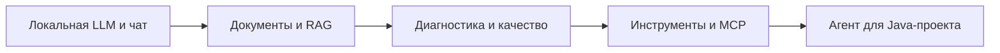

# Spring AI для Java-разработчиков: от локальной LLM до AI-агента

Практический курс на **Java 25 и Spring AI 2**. За 26 уроков вы создадите RepoPilot — помощника для работы с документацией и кодом Java-проекта: от первого ответа локальной модели до RAG, MCP, Skills и агентского цикла.

В каждом уроке есть полная лекция на русском, рабочий проект, самостоятельное домашнее задание и тесты. Все темы связаны одним приложением, которое растёт вместе с курсом.

**[Начать с первого урока](lessons/lesson-1.1/lecture/README.md)** · [Программа](#программа) · [Быстрый старт](#быстрый-старт) · [Как устроены материалы](#как-устроены-материалы)

## Что вы построите

RepoPilot начинает с обычного чата и постепенно получает новые возможности:



К концу курса помощник умеет искать ответы в документах, получать задачи через MCP, читать учебный репозиторий, применять Skills, вести план и предлагать точечные изменения. Применение правки и запуск проверки требуют отдельного решения человека. В финале вы пройдёте задачу Stock Room: воспроизведёте ошибку, исправите условие резервирования и подтвердите результат проверкой в Docker.

## Для кого курс

Для Java-разработчиков, которые хотят создавать приложения с LLM и понимать, как устроены RAG и агенты.

Достаточно знать Java, основы Spring Boot, REST, Maven, Git и SQL. Опыт обучения нейросетей не требуется: контекст, embeddings, вызовы инструментов и другие AI-понятия разбираются по мере разработки.

## Как проходить курс

1. Прочитайте лекцию и соберите пример по шагам либо откройте готовый `lecture` в IDE.
2. Запустите приложение, попробуйте сценарии урока и сравните ответы локальной модели.
3. Перейдите в `homework`: там уже работает основа лекции, а вам нужно добавить новую функцию.
4. Выполните проверки из задания и заполните `SUBMISSION.md`: что сделали, что проверили и какой результат получили.

Каждый проект самодостаточен. Следующий урок содержит нужную основу и не требует переносить решения предыдущих ДЗ.

Если изучаете тему впервые, двигайтесь по порядку. Для отдельной практики можно начать с нужного раздела:

| Интересует | С чего начать |
| --- | --- |
| Первое AI-приложение на Spring | [1.1. Локальная LLM](lessons/lesson-1.1/lecture/README.md) |
| Ответы по своим документам | [2.1. Контекст и подготовка к RAG](lessons/lesson-2.1/lecture/README.md) |
| Качество поиска и ответов | [3.1. Диагностика](lessons/lesson-3.1/lecture/README.md) |
| Инструменты и MCP | [4.1. Java tools](lessons/lesson-4.1/lecture/README.md) |
| Устройство AI-агента | [5.1. Собственный агентский цикл](lessons/lesson-5.1/lecture/README.md) |

## Программа

### 1. Spring AI и локальная модель

Первый работающий чат: подключение модели, интерфейс, потоковый ответ и история диалогов.

| Урок | Что добавляем в проект | Домашнее задание |
| --- | --- | --- |
| [1.1. От пустого проекта до локальной LLM](lessons/lesson-1.1/lecture/README.md) | Spring AI, первый HTTP-запрос к модели, проверка ответа | [ДЗ 1.1](lessons/lesson-1.1/homework/README.md) |
| [1.2. Web UI и состояния чата](lessons/lesson-1.2/lecture/README.md) | Страница чата, состояния запроса и обработка ошибок | [ДЗ 1.2](lessons/lesson-1.2/homework/README.md) |
| [1.3. Streaming, отмена и незавершённые ответы](lessons/lesson-1.3/lecture/README.md) | SSE, постепенный вывод, отмена и повтор запроса | [ДЗ 1.3](lessons/lesson-1.3/homework/README.md) |
| [1.4. Conversation, память и SQLite](lessons/lesson-1.4/lecture/README.md) | Несколько диалогов, сохранение истории и окно памяти | [ДЗ 1.4](lessons/lesson-1.4/homework/README.md) |

### 2. Документы, контекст и RAG

Помощник получает собственную базу знаний. Разбираемся, что передавать модели целиком, а что находить поиском.

| Урок | Что добавляем в проект | Домашнее задание |
| --- | --- | --- |
| [2.1. Управление контекстом и подготовка к RAG](lessons/lesson-2.1/lecture/README.md) | Режим FULL_CONTEXT, версия корпуса и бюджет контекста | [ДЗ 2.1](lessons/lesson-2.1/homework/README.md) |
| [2.2. Документы, чанки и embeddings](lessons/lesson-2.2/lecture/README.md) | Загрузка документов, разбиение и векторные представления | [ДЗ 2.2](lessons/lesson-2.2/homework/README.md) |
| [2.3. Первый RAG с pgvector](lessons/lesson-2.3/lecture/README.md) | Постоянный индекс, поиск фрагментов и ссылки на источники | [ДЗ 2.3](lessons/lesson-2.3/homework/README.md) |
| [2.4. CHAT, FULL_CONTEXT и RAG](lessons/lesson-2.4/lecture/README.md) | Сравнение стратегий на одном наборе вопросов | [ДЗ 2.4](lessons/lesson-2.4/homework/README.md) |

### 3. Диагностика и качество ответов

Учимся находить причину плохого ответа и проверять, помогло ли изменение запроса, поиска или ранжирования.

| Урок | Что добавляем в проект | Домашнее задание |
| --- | --- | --- |
| [3.1. Найти причину плохого ответа](lessons/lesson-3.1/lecture/README.md) | Диагностика запроса и разбор воспроизводимых ошибок | [ДЗ 3.1](lessons/lesson-3.1/homework/README.md) |
| [3.2. ChatClientRequest и собственный Advisor](lessons/lesson-3.2/lecture/README.md) | Свой Advisor, порядок обработки и RAG для call/stream | [ДЗ 3.2](lessons/lesson-3.2/homework/README.md) |
| [3.3. Контекстные запросы, MultiQuery и RRF](lessons/lesson-3.3/lecture/README.md) | Подготовка поисковых запросов и объединение результатов | [ДЗ 3.3](lessons/lesson-3.3/homework/README.md) |
| [3.4. Reranking найденных фрагментов](lessons/lesson-3.4/lecture/README.md) | Повторное ранжирование и сравнение качества RAG | [ДЗ 3.4](lessons/lesson-3.4/homework/README.md) |

### 4. Инструменты и MCP

От обычных Java-функций переходим к отдельному MCP-серверу и подключаем его к помощнику.

| Урок | Что добавляем в проект | Домашнее задание |
| --- | --- | --- |
| [4.1. Java tools и управляемый цикл](lessons/lesson-4.1/lecture/README.md) | Вызовы инструментов, их результаты и ограничения цикла | [ДЗ 4.1](lessons/lesson-4.1/homework/README.md) |
| [4.2. MCP Java SDK и STDIO](lessons/lesson-4.2/lecture/README.md) | Отдельный MCP-процесс, tools, resources, prompts и Inspector | [ДЗ 4.2](lessons/lesson-4.2/homework/README.md) |
| [4.3. Spring MCP Server и Streamable HTTP](lessons/lesson-4.3/lecture/README.md) | HTTP-сервер на Spring, регистрация инструментов и подключение клиента | [ДЗ 4.3](lessons/lesson-4.3/homework/README.md) |
| [4.4. MCP host: инструмент → RAG → ответ](lessons/lesson-4.4/lecture/README.md) | Общий сценарий получения задачи и поиска по документации | [ДЗ 4.4](lessons/lesson-4.4/homework/README.md) |

### 5. AI Harness: агент для Java-репозитория

Создаём приложение вокруг модели: цикл выполнения, инструменты, память, план, подтверждения и проверку результата.

| Урок | Что добавляем в проект | Домашнее задание |
| --- | --- | --- |
| [5.1. Собственный агентский цикл](lessons/lesson-5.1/lecture/README.md) | Agent, Conversation, журнал и события выполнения | [ДЗ 5.1](lessons/lesson-5.1/homework/README.md) |
| [5.2. Навигация по коду и Git-контекст](lessons/lesson-5.2/lecture/README.md) | Чтение репозитория, поиск файлов и фиксация прочитанного | [ДЗ 5.2](lessons/lesson-5.2/homework/README.md) |
| [5.3. Точечные изменения и Human-in-the-loop](lessons/lesson-5.3/lecture/README.md) | Предложение правки, просмотр и подтверждение человеком | [ДЗ 5.3](lessons/lesson-5.3/homework/README.md) |
| [5.4. Skills: каталог и активация](lessons/lesson-5.4/lecture/README.md) | Подключение процедур и дополнительных материалов под задачу | [ДЗ 5.4](lessons/lesson-5.4/homework/README.md) |
| [5.5. План и проверяемый прогресс](lessons/lesson-5.5/lecture/README.md) | Зависимости шагов и контроль выполнения обязательных задач | [ДЗ 5.5](lessons/lesson-5.5/homework/README.md) |
| [5.6. Бюджет контекста и compaction](lessons/lesson-5.6/lecture/README.md) | Сокращение рабочего контекста с сохранением полного журнала | [ДЗ 5.6](lessons/lesson-5.6/homework/README.md) |
| [5.7. Изолированные проверки результата](lessons/lesson-5.7/lecture/README.md) | Проверка учебного кода в Docker: ошибка → правка → успешный результат | [ДЗ 5.7](lessons/lesson-5.7/homework/README.md) |
| [5.8. Исследовательский субагент](lessons/lesson-5.8/lecture/README.md) | Отдельный контекст исследования и общий бюджет | [ДЗ 5.8](lessons/lesson-5.8/homework/README.md) |
| [5.9. Web и консольный REPL](lessons/lesson-5.9/lecture/README.md) | Два интерфейса, фоновые задачи, события и переподключение | [ДЗ 5.9](lessons/lesson-5.9/homework/README.md) |
| [5.10. Финальная задача: MCP → исправление → проверка](lessons/lesson-5.10/lecture/README.md) | Полный путь Stock Room и итоговый отчёт по выполненной задаче | [ДЗ 5.10](lessons/lesson-5.10/homework/README.md) |

## Технологии

| Инструмент | Для чего используется |
| --- | --- |
| **Java 25** | Код приложения и агентского runtime |
| **Spring Boot 4.1.2 / Spring AI 2.0.2** | HTTP API, подключение моделей, Advisors, tools и MCP |
| **Ollama** | Локальный запуск chat- и embedding-моделей |
| **SQLite** | Сохранение истории диалогов |
| **PostgreSQL + pgvector** | Векторный индекс и поиск по документам |
| **Docker** | База данных и изолированные проверки учебного кода |
| **Maven Wrapper** | Сборка и Java-тесты; отдельная установка Maven не нужна |
| **HTML / CSS / JavaScript** | Интерфейс чата и агента; Node.js используется для UI-тестов |

Для первого урока нужны JDK 25, Git и запущенный Ollama. Остальные инструменты подключаются по мере прохождения. Подробная подготовка среды — в [лекции 1.1](lessons/lesson-1.1/lecture/README.md#2-подготовка-среды).

## Быстрый старт

С установленным JDK 25 и работающим Ollama:

```bash
git clone https://github.com/myfrei/spring-ai.git
cd spring-ai/lessons/lesson-1.1/lecture
ollama pull qwen2.5:3b
./mvnw test
./mvnw spring-boot:run
```

В другом терминале отправьте первый вопрос:

```bash
curl http://localhost:8080/api/chat \
  -H 'Content-Type: application/json' \
  -d '{"message":"Для чего нужен Java record?"}'
```

Ответ приложения — JSON с полем `answer`. Дальше переходите к [пошаговой лекции](lessons/lesson-1.1/lecture/README.md) или [домашнему заданию 1.1](lessons/lesson-1.1/homework/README.md).

В Windows используйте `mvnw.cmd`; примеры команд приведены для Bash/zsh.

## Как устроены материалы

```text
lessons/
└── lesson-X.Y/
    ├── README.md          # Навигация по уроку
    ├── lecture/           # Полная лекция, рабочий код и тесты
    │   ├── README.md
    │   ├── pom.xml
    │   └── src/
    ├── homework/          # Готовая основа и новая задача для реализации
    │   ├── README.md
    │   ├── SUBMISSION.md
    │   ├── pom.xml
    │   └── src/
    └── VERIFICATION.md    # Результаты проверки примеров
```

Открывайте в IDE `lecture/pom.xml` или `homework/pom.xml` нужного урока. Сборка запускается из выбранного проекта.

Домашние задания развивают RepoPilot новой возможностью: например, в 5.9 вы добавляете очередь задач, требующих внимания, а в 5.10 — скачиваемый пакет аудита. Условия и команды проверки находятся в README каждого ДЗ.

Базовые тесты можно выполнять без локальной модели: они используют подмены и HTTP-фикстуры. Запросы к настоящей LLM и сравнение ответов входят в практику; для интеграционных проверок PostgreSQL и изолированного runner потребуется Docker. Ссылки на документацию и статьи собраны внутри лекций рядом с соответствующими темами.
