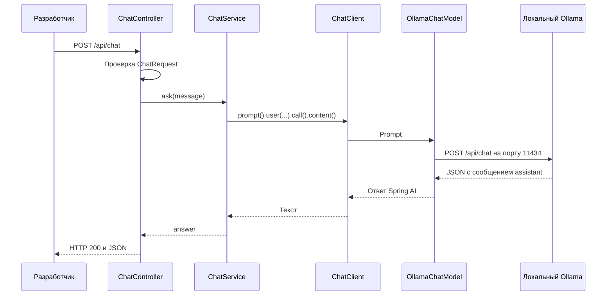

# Урок 1.1. От пустого Java-проекта до первого ответа локальной LLM

[Все материалы урока](../README.md) · [Домашнее задание](../homework/README.md) · [Проверка материалов](../VERIFICATION.md)

Дата: 2026-10-25. Учебная связка: **Java 25, Spring Boot 4.1.2, Spring AI 2.0.2, Maven 3.9.11**. Основной provider — Ollama. В этой папке находится полная реализация примера и его тесты.

## Результат занятия

К концу занятия у нас будет первая версия RepoPilot — помощника Java-разработчика. Пока он отвечает на один вопрос за запрос:

```http
POST /api/chat
Content-Type: application/json

{"message":"Кратко объясни, для чего нужен Java record."}
```

Ответ API имеет форму `{"answer":"..."}`. Модель работает локально в Ollama, а Java-приложение обращается к ней через Spring AI. Некорректный запрос получает HTTP 400; известная ошибка модели — HTTP 503. Текст ответа зависит от модели, параметры запуска и HTTP-контракт задаём мы.

Ориентировочно: 20 минут теории и подготовки, 70 минут разработки, 20 минут проверок, 10 минут на разбор ДЗ. Первоначальное скачивание модели и зависимостей лучше сделать до занятия.

После урока вы сможете объяснить роли `ChatClient`, `ChatModel` и Ollama, собрать приложение с BOM, выполнить реальный запрос и проверить логику без запущенной модели.

## 1. Как проходит запрос



Одинаковый путь `/api/chat` принадлежит двум разным серверам. Порт `8080` — наше приложение. Порт `11434` — Ollama. Spring AI берёт на себя преобразование Java-объектов в запрос provider и разбор ответа.

**LLM** — модель, генерирующая продолжение последовательности токенов. **Inference runtime** Ollama загружает веса и предоставляет API. **Spring AI** — Java-библиотека интеграции. Ни Ollama, ни `ChatClient` сами по себе не знают содержимое нашего будущего репозитория.

`ChatClient` предоставляет удобный fluent API для построения запроса. `ChatModel` — нижний уровень взаимодействия с конкретным provider. В приложении используем `ChatClient`, а в unit-тесте подменим `ChatModel`: это позволяет проверить настоящий путь сборки prompt. [ChatClient](https://docs.spring.io/spring-ai/reference/api/chatclient.html).

Модель получает сообщения с ролями: `user` — вопрос пользователя, `system` — инструкция приложения, `assistant` — ответ. В базовой реализации отправляем только user message; в ДЗ добавим отдельный endpoint с двумя форматами объяснения и системной инструкцией для каждого режима. Последующие HTTP-запросы пока независимы: истории разговора здесь нет.

Контекстное окно ограничивает вход и генерацию. `num-predict` ограничивает количество генерируемых токенов. Токен не равен символу или слову, поэтому проверка размера HTTP-сообщения и лимит токенов решают разные задачи.

## 2. Подготовка среды

Понадобятся JDK 25, Git, терминал и запущенный Ollama. В репозитории уже есть Maven Wrapper; отдельная установка Maven нужна только для ручного создания Wrapper с нуля. IDE можно выбрать привычную.

### Проверяем Java

```bash
java -version
javac -version
```

Обе команды должны указывать Java 25. Значение `<java.version>25</java.version>` в POM задаёт компиляцию, но не переключает JDK вашей IDE или терминала.

На macOS, если JDK 25 уже установлен:

```bash
export JAVA_HOME="$(/usr/libexec/java_home -v 25)"
export PATH="$JAVA_HOME/bin:$PATH"
java -version
```

На Linux укажите путь к установленному JDK 25 в `JAVA_HOME`, затем добавьте `$JAVA_HOME/bin` в `PATH`. В Windows PowerShell задайте `$env:JAVA_HOME` и добавьте `$env:JAVA_HOME\bin` в начало `$env:Path`; проверьте `java -version` ещё раз. В IDE отдельно выберите Project SDK и JDK Maven runner.

Для установки можно использовать [Eclipse Temurin](https://adoptium.net/installation/archives). Команды установки зависят от ОС; скачайте JDK именно для своей архитектуры. Во время подготовки материалов использовался Temurin 25.0.5, macOS aarch64.

### Запускаем Ollama

Установите Ollama с [официального сайта](https://ollama.com/download). Запустите приложение или сервер командой:

```bash
ollama serve
```

Оставьте сервер работать. Если порт уже занят действующим Ollama, второй сервер не нужен. В новом терминале выполните:

```bash
ollama --version
curl --fail-with-body http://localhost:11434/api/tags
```

Второй запрос должен вернуть JSON со списком локальных моделей. Пустой список — допустим, мы ещё не скачали веса.

### Выбираем небольшую модель для первого запроса

В примере используем `qwen2.5:3b` — конкретную небольшую модель из каталога Ollama, а не плавающий тег `latest`:

```bash
ollama pull qwen2.5:3b
ollama list
```

Скачивание происходит один раз. Фактическая память runtime выше размера файла модели, а скорость зависит от компьютера. Сведения о модели и её условиях использования смотрите в [карточке qwen2.5:3b](https://ollama.com/library/qwen2.5:3b). Тег также может обновляться: сохраните ID модели из `ollama list` в отчёте. Для полностью повторяемого курса позже закрепим manifest.

Если выбрали другую локальную chat-модель, используйте её одно и то же имя в `pull`, прямом запросе и конфигурации приложения. `qwen2.5:1.5b` можно рассмотреть для более ограниченной машины, но качество ответа потребуется проверить самостоятельно.

### Проверяем модель до Java

```bash
curl --max-time 90 --fail-with-body http://localhost:11434/api/chat \
  -H 'Content-Type: application/json' \
  -d '{"model":"qwen2.5:3b","messages":[{"role":"user","content":"Одним предложением: что такое Java record?"}],"stream":false}'
```

В ответе найдите `message.content`. Например, модель может объяснить, что record — компактный способ описать класс данных. Формулировка не обязана совпасть с примером. Если прямой запрос не работает, сначала исправьте запуск Ollama или имя модели: Spring-приложение этого не исправит.

`stream:false` просит обычный JSON вместо последовательности потоковых объектов. Формат запроса описан в [Ollama Chat API](https://docs.ollama.com/api/chat). Первый ответ может быть медленнее следующих из-за загрузки весов.

Примеры команд в лекции используют Bash/zsh. В Windows можно вызвать `curl.exe`; многострочные команды с `\` удобнее выполнить одной строкой. Для Maven используйте `./mvnw.cmd` в PowerShell.

## 3. Создаём Maven-проект

Есть два пути прохождения: открыть готовый `lecture/pom.xml` и разбирать пример или создать отдельную пустую папку `repopilot` и последовательно написать файлы ниже. В `homework` переходите после лекции: там готовая база этой лекции и отдельная незавершённая политика нового поведения.

### 3.1. Структура

```text
repopilot/
  pom.xml
  mvnw
  mvnw.cmd
  .mvn/wrapper/maven-wrapper.properties
  src/main/java/dev/myfrei/repopilot/
    RepoPilotApplication.java
    chat/
      ChatRequest.java
      ChatResponse.java
      ChatController.java
      ChatService.java
      LlmUnavailableException.java
      ApiExceptionHandler.java
  src/main/resources/application.yaml
  src/test/java/dev/myfrei/repopilot/chat/
```

Для нового проекта создайте каталоги:

```bash
mkdir -p repopilot/src/main/java/dev/myfrei/repopilot/chat
mkdir -p repopilot/src/main/resources
cd repopilot
```

Далее все пути относятся к корню этого Maven-проекта. Если используете готовый пример из репозитория, рабочий каталог — `lessons/lesson-1.1/lecture`.

### 3.2. POM и управление версиями

Создайте `pom.xml`:

```xml
<?xml version="1.0" encoding="UTF-8"?>
<project xmlns="http://maven.apache.org/POM/4.0.0"
         xmlns:xsi="http://www.w3.org/2001/XMLSchema-instance"
         xsi:schemaLocation="http://maven.apache.org/POM/4.0.0 https://maven.apache.org/xsd/maven-4.0.0.xsd">
    <modelVersion>4.0.0</modelVersion>

    <parent>
        <groupId>org.springframework.boot</groupId>
        <artifactId>spring-boot-starter-parent</artifactId>
        <version>4.1.2</version>
        <relativePath/>
    </parent>

    <groupId>dev.myfrei.course</groupId>
    <artifactId>repopilot-lesson-1-1-lecture</artifactId>
    <version>0.0.1-SNAPSHOT</version>
    <name>RepoPilot — lesson 1.1 lecture</name>

    <properties>
        <java.version>25</java.version>
        <spring-ai.version>2.0.2</spring-ai.version>
    </properties>

    <dependencyManagement>
        <dependencies>
            <dependency>
                <groupId>org.springframework.ai</groupId>
                <artifactId>spring-ai-bom</artifactId>
                <version>${spring-ai.version}</version>
                <type>pom</type>
                <scope>import</scope>
            </dependency>
        </dependencies>
    </dependencyManagement>

    <dependencies>
        <dependency>
            <groupId>org.springframework.boot</groupId>
            <artifactId>spring-boot-starter-webmvc</artifactId>
        </dependency>
        <dependency>
            <groupId>org.springframework.boot</groupId>
            <artifactId>spring-boot-starter-validation</artifactId>
        </dependency>
        <dependency>
            <groupId>org.springframework.ai</groupId>
            <artifactId>spring-ai-starter-model-ollama</artifactId>
        </dependency>
        <dependency>
            <groupId>org.springframework.boot</groupId>
            <artifactId>spring-boot-starter-test</artifactId>
            <scope>test</scope>
        </dependency>
    </dependencies>

    <build>
        <plugins>
            <plugin>
                <groupId>org.springframework.boot</groupId>
                <artifactId>spring-boot-maven-plugin</artifactId>
            </plugin>
        </plugins>
    </build>
</project>
```

Spring Boot parent задаёт согласованные версии компонентов Spring и плагинов. Spring AI BOM управляет версиями AI-модулей: у starter Ollama отдельно версия не указана. Сам BOM библиотек в runtime не добавляет — для этого нужны зависимости.

`spring-boot-starter-webmvc` даёт servlet REST-приложение, validation starter — проверку DTO, Ollama starter — конкретный provider и автонастройку. Test starter добавляет JUnit, AssertJ, Mockito и Spring Test. Boot 4 использует модульные starters, поэтому примеры из старых статей могут отличаться.

Spring AI 2.0.x поддерживает Boot 4.0.x/4.1.x. Урок фиксирует конкретные версии и использует Maven Central. Перед переносом на другие версии проверьте [Getting Started](https://docs.spring.io/spring-ai/reference/getting-started.html) и [Upgrade Notes](https://docs.spring.io/spring-ai/reference/upgrade-notes.html).

### 3.3. Maven Wrapper

В готовом примере Wrapper уже создан. Для своей пустой папки при установленном Maven выполните:

```bash
mvn org.apache.maven.plugins:maven-wrapper-plugin:3.3.4:wrapper \
  -Dmaven=3.9.11 -Dtype=only-script
./mvnw -version
```

Первый запуск скачает закреплённый Maven. В выводе должны быть Maven 3.9.11 и Java 25. Если Maven не установлен, скопируйте `mvnw`, `mvnw.cmd` и `.mvn/wrapper` из готового примера или создайте проект через [Spring Initializr](https://start.spring.io), затем сверяйте POM с указанным выше.

Wrapper фиксирует версию Maven, а не JDK. При `Permission denied` у скопированного файла на macOS/Linux выполните `chmod +x mvnw`.

Устройство и варианты установки описаны в [Apache Maven Wrapper](https://maven.apache.org/tools/wrapper/).

## 4. Добавляем запуск Spring Boot

Файл `src/main/java/dev/myfrei/repopilot/RepoPilotApplication.java`:

```java
package dev.myfrei.repopilot;

import org.springframework.boot.SpringApplication;
import org.springframework.boot.autoconfigure.SpringBootApplication;

@SpringBootApplication
public class RepoPilotApplication {

    public static void main(String[] args) {
        SpringApplication.run(RepoPilotApplication.class, args);
    }
}
```

Главный класс находится над пакетом `chat`, поэтому component scan найдёт будущие controller, service и advice. Пока endpoint ещё не написан.

## 5. Подключаем Ollama конфигурацией

Файл `src/main/resources/application.yaml`:

```yaml
spring:
  application:
    name: repopilot-lesson-1-1
  ai:
    model:
      chat: ollama
      embedding: none
    ollama:
      base-url: ${OLLAMA_BASE_URL:http://localhost:11434}
      init:
        pull-model-strategy: never
      chat:
        model: ${OLLAMA_CHAT_MODEL:qwen2.5:3b}
        temperature: 0.2
        num-predict: 256
    retry:
      max-attempts: 0
  http:
    clients:
      imperative:
        factory: jdk
      connect-timeout: 3s
      read-timeout: 60s

server:
  address: 127.0.0.1
  port: ${PORT:8080}
```

Разберём настройки:

| Параметр | Роль |
| --- | --- |
| `spring.ai.model.chat=ollama` | Выбирает provider чата |
| `spring.ai.model.embedding=none` | Для этого приложения не нужна embedding-модель |
| `spring.ai.ollama.base-url` | Адрес локального Ollama, без суффикса `/api/chat` |
| `spring.ai.ollama.chat.model` | Имя уже скачанной модели |
| `temperature` | Параметр выборки токенов; небольшое значение не гарантирует правильность |
| `num-predict` | Верхняя граница длины генерации в токенах |
| `pull-model-strategy=never` | Загрузка весов выполняется явно до запуска приложения |
| `spring.http.clients.imperative.factory=jdk` | Фиксирует синхронный HTTP-клиент для этого урока |
| `connect-timeout` / `read-timeout` | Ограничивают установление соединения и ожидание ответа |

У Spring AI 2.0 модель и параметры находятся непосредственно в `spring.ai.ollama.chat`, без `.options`. Не смешивайте конфигурацию 1.x и 2.x. [Ollama provider](https://docs.spring.io/spring-ai/reference/api/chat/ollama-chat.html).

Для выбранного релиза 2.0.2 настройка `spring.ai.retry.max-attempts` передаётся в `RetryPolicy.maxRetries`. Значение `0` отключает повторную попытку: на учебном запросе ожидаем один вызов provider и быструю видимую ошибку. Это проверяется HTTP-тестом. При обновлении зависимости семантику нужно перепроверить по реализации и тесту, а не угадывать по имени свойства. [Исходники релиза](https://github.com/spring-projects/spring-ai/tree/v2.0.2).

Таймаут чтения — не общий дедлайн всей бизнес-операции. При медленной первоначальной загрузке модели его может потребоваться увеличить. Позже отдельно изучим лимиты и повторы, а сейчас оставим поведение простым.

Адрес и модель можно изменить без правки Java:

```bash
OLLAMA_BASE_URL=http://localhost:11434 \
OLLAMA_CHAT_MODEL=qwen2.5:3b \
./mvnw spring-boot:run
```

В YAML используются значения по умолчанию, поэтому обычный `./mvnw spring-boot:run` тоже подходит. Для PowerShell задайте `$env:OLLAMA_CHAT_MODEL = "qwen2.5:3b"`, затем выполните `./mvnw.cmd spring-boot:run`.

## 6. Описываем запрос и ответ

Наш HTTP-контракт не зависит от JSON формата Ollama. На входе одно поле `message`, на выходе одно поле `answer`.

`src/main/java/dev/myfrei/repopilot/chat/ChatRequest.java`:

```java
package dev.myfrei.repopilot.chat;

import jakarta.validation.constraints.NotBlank;
import jakarta.validation.constraints.Size;

public record ChatRequest(
        @NotBlank @Size(max = 4_000) String message
) {
}
```

`@NotBlank` отвергает null, пустую строку и ввод только из пробелов. `@Size` проверяет длину, а не количество токенов. Для учебного API ограничиваем исходную строку 4000 Java `char`; это не универсальная мера длины Unicode-текста.

`src/main/java/dev/myfrei/repopilot/chat/ChatResponse.java`:

```java
package dev.myfrei.repopilot.chat;

public record ChatResponse(String answer) {
}
```

Records удобно использовать как DTO. Наш `ChatResponse` — DTO приложения. Не путайте его с одноимённым `org.springframework.ai.chat.model.ChatResponse`, который содержит поколения и метаданные provider.

## 7. Пишем ChatService

Сначала рассмотрим сам вызов:

```java
String answer = chatClient.prompt()
        .user(message)
        .call()
        .content();
```

`prompt()` начинает новый запрос, `user()` добавляет сообщение, `call()` выбирает обычный ответ вместо streaming, `content()` возвращает текст. Запрос не превращается в беседу с памятью только от того, что мы используем один и тот же `ChatClient`.

Spring Boot создаёт `ChatClient.Builder` на основе настроенного `ChatModel`. Сервис получает builder через конструктор и один раз строит клиент. Для каждого HTTP-вызова создаётся новый request spec через `prompt()`.

Полный файл `src/main/java/dev/myfrei/repopilot/chat/ChatService.java`:

```java
package dev.myfrei.repopilot.chat;

import org.springframework.ai.chat.client.ChatClient;
import org.springframework.ai.retry.NonTransientAiException;
import org.springframework.ai.retry.TransientAiException;
import org.springframework.stereotype.Service;
import org.springframework.util.StringUtils;
import org.springframework.web.client.RestClientException;

@Service
public class ChatService {

    private final ChatClient chatClient;

    public ChatService(ChatClient.Builder builder) {
        this.chatClient = builder.build();
    }

    public String ask(String message) {
        if (!StringUtils.hasText(message) || message.length() > 4_000) {
            throw new IllegalArgumentException("Сообщение должно содержать от 1 до 4000 символов.");
        }

        try {
            String answer = this.chatClient.prompt()
                    .user(message.strip())
                    .call()
                    .content();

            if (!StringUtils.hasText(answer)) {
                throw new LlmUnavailableException();
            }
            return answer;
        }
        catch (RestClientException | TransientAiException | NonTransientAiException ex) {
            throw new LlmUnavailableException(ex);
        }
    }
}
```

Валидация здесь дублирует входные ограничения намеренно: сервис может вызываться не только через HTTP-контроллер. Обрезаем пробелы после проверки исходной длины.

Пустой ответ не выдаём за успешное выполнение. Известные сетевые и AI-ошибки переводим в наше исключение. Не перехватываем все `RuntimeException`: ошибка программы должна остаться видимой при отладке.

Создайте `src/main/java/dev/myfrei/repopilot/chat/LlmUnavailableException.java`:

```java
package dev.myfrei.repopilot.chat;

public class LlmUnavailableException extends RuntimeException {

    public LlmUnavailableException() {
        super("Локальная LLM не вернула ответ. Проверьте Ollama, модель и время ожидания.");
    }

    public LlmUnavailableException(Throwable cause) {
        super("Локальная LLM не вернула ответ. Проверьте Ollama, модель и время ожидания.", cause);
    }
}
```

Причину сохраняем для диагностики, а наружу отдаём безопасное стабильное сообщение. Учебный контракт сводит недоступность сервера, неизвестную модель и ошибку provider к HTTP 503. Это упрощённая политика первой версии; отдельные коды и retryable/non-retryable поведение можно расширять позже.

## 8. Добавляем контроллер

Файл `src/main/java/dev/myfrei/repopilot/chat/ChatController.java`:

```java
package dev.myfrei.repopilot.chat;

import jakarta.validation.Valid;
import org.springframework.web.bind.annotation.PostMapping;
import org.springframework.web.bind.annotation.RequestBody;
import org.springframework.web.bind.annotation.RequestMapping;
import org.springframework.web.bind.annotation.RestController;

@RestController
@RequestMapping("/api/chat")
public class ChatController {

    private final ChatService chatService;

    public ChatController(ChatService chatService) {
        this.chatService = chatService;
    }

    @PostMapping
    public ChatResponse chat(@Valid @RequestBody ChatRequest request) {
        return new ChatResponse(this.chatService.ask(request.message()));
    }
}
```

`@Valid` включает проверку request DTO до вызова метода. Контроллер отвечает только за HTTP и преобразование DTO; модель вызывается в сервисе. POST подходит для запроса с телом и позволяет не размещать пользовательский prompt в URL.

## 9. Возвращаем ошибки через ProblemDetail

Файл `src/main/java/dev/myfrei/repopilot/chat/ApiExceptionHandler.java`:

```java
package dev.myfrei.repopilot.chat;

import org.springframework.http.HttpStatus;
import org.springframework.http.ProblemDetail;
import org.springframework.web.bind.MethodArgumentNotValidException;
import org.springframework.web.bind.annotation.ExceptionHandler;
import org.springframework.web.bind.annotation.RestControllerAdvice;

@RestControllerAdvice
public class ApiExceptionHandler {

    @ExceptionHandler(LlmUnavailableException.class)
    public ProblemDetail handleLlmUnavailable(LlmUnavailableException ex) {
        ProblemDetail problem = ProblemDetail.forStatusAndDetail(
                HttpStatus.SERVICE_UNAVAILABLE, ex.getMessage());
        problem.setTitle("LLM unavailable");
        return problem;
    }

    @ExceptionHandler({MethodArgumentNotValidException.class, IllegalArgumentException.class})
    public ProblemDetail handleInvalidRequest(Exception ex) {
        ProblemDetail problem = ProblemDetail.forStatusAndDetail(
                HttpStatus.BAD_REQUEST, "Поле message должно содержать от 1 до 4000 символов.");
        problem.setTitle("Invalid request");
        return problem;
    }
}
```

`ProblemDetail` возвращает структурированную HTTP-ошибку с `status`, `title` и `detail`. При ошибке модельного сервиса ответ не содержит поле `answer` и не выглядит как успешная генерация.

Не возвращайте `200 {"answer":"Ollama недоступна"}`: клиент не сможет надёжно отличить отказ системы от текста, который сгенерировала модель. Валидацию пользовательского входа и недоступность внешнего runtime разделяем разными статусами.

## 10. Запускаем и проверяем

### Компиляция и тесты готового примера

Из готового проекта `lecture`:

```bash
./mvnw test
./mvnw package
```

Для этих команд Ollama не нужен. Они проверяют код и связывание компонентов с подменённой моделью / локальным тестовым HTTP-сервером. Первое выполнение требует интернет для зависимостей.

Если вы создали проект вручную, основные классы уже готовы; тестовые классы ниже можно перенести из этой папки. Одной успешной компиляции недостаточно для проверки поведения.

### Реальный запуск

Убедитесь, что Ollama работает, затем:

```bash
./mvnw spring-boot:run
```

В другом терминале:

```bash
curl --max-time 90 --include http://127.0.0.1:8080/api/chat \
  -H 'Content-Type: application/json' \
  -d '{"message":"Кратко объясни, чем Java record отличается от обычного класса."}'
```

Ожидаем HTTP 200, JSON и непустой `answer`. Текст ниже — иллюстрация формы, а не записанный результат настоящей генерации:

```json
{"answer":"Record сокращает описание класса данных и автоматически создаёт конструктор, методы доступа, equals, hashCode и toString."}
```

Даже убедительный ответ небольшой модели нужно проверять по документации Java. Здесь оцениваем путь запроса и контракт API, а не доказанную экспертность помощника.

Упакованный проект можно запустить отдельно:

```bash
java -jar target/repopilot-lesson-1-1-lecture-0.0.1-SNAPSHOT.jar
```

### Проверка некорректного ввода

```bash
curl --include http://127.0.0.1:8080/api/chat \
  -H 'Content-Type: application/json' \
  -d '{"message":"   "}'
```

Ожидаем HTTP 400 и `title: Invalid request`. Модель вызываться не должна. Сочетание `@Valid`, ограничений DTO и контроллерного теста проверяет именно эту границу.

### Проверка недоступности provider

Остановите только учебное Spring Boot приложение через Ctrl+C и запустите с адресом, на котором нет Ollama:

```bash
OLLAMA_BASE_URL=http://localhost:1 ./mvnw spring-boot:run
```

Повторите корректный POST к нашему порту 8080. Ожидаем HTTP 503:

```json
{
  "type":"about:blank",
  "title":"LLM unavailable",
  "status":503,
  "detail":"Локальная LLM не вернула ответ. Проверьте Ollama, модель и время ожидания.",
  "instance":"/api/chat"
}
```

Порт 1 выбран для демонстрации; если в вашей среде он используется, укажите другой заведомо закрытый локальный порт. Приложение может успешно стартовать при выключенном Ollama: readiness backend и готовность модели — разные проверки. Не пытайтесь определять готовность модели только по сообщению `Started`.

Верните обычную конфигурацию перед следующим занятием. Состояние чата в этой версии не сохраняется.

## 11. Тестируем без весов модели

Сервисные тесты используют настоящий `ChatClient` и mock `ChatModel`. Это устойчивее, чем вручную подменять каждое звено fluent-цепочки: проверяем то, что действительно уйдёт в prompt.

Минимальный пример из [ChatServiceTest](src/test/java/dev/myfrei/repopilot/chat/ChatServiceTest.java):

```java
var model = mock(ChatModel.class);
when(model.getOptions()).thenReturn(
        ChatOptions.builder().model("unit-test-model").build());
when(model.call(any(Prompt.class))).thenReturn(
        new org.springframework.ai.chat.model.ChatResponse(
                List.of(new Generation(new AssistantMessage("Ответ модели")))));
var service = new ChatService(ChatClient.builder(model));

assertThat(service.ask("  Вопрос  ")).isEqualTo("Ответ модели");

var prompt = ArgumentCaptor.forClass(Prompt.class);
verify(model).call(prompt.capture());
assertThat(prompt.getValue().getUserMessage().getText()).isEqualTo("Вопрос");
```

В Spring AI 2.0 mock должен возвращать корректные `ChatOptions` через `getOptions()`: `ChatClient` использует их при сборке запроса. Пустой Mockito mock без этого поведения даст ошибку настройки теста вместо проверки бизнес-логики.

| Набор | Проверки |
| --- | --- |
| [ChatServiceTest](src/test/java/dev/myfrei/repopilot/chat/ChatServiceTest.java) | 14 случаев: prompt, ответ, пустой ввод/ответ, длина, ошибки provider и программные ошибки |
| [ChatControllerTest](src/test/java/dev/myfrei/repopilot/chat/ChatControllerTest.java) | 7 случаев: JSON, валидация до сервиса, HTTP 503 и отсутствие успешного `answer` при ошибке |
| [OllamaHttpIntegrationTest](src/test/java/dev/myfrei/repopilot/chat/OllamaHttpIntegrationTest.java) | 4 случая: полный Boot HTTP-путь, модель/опции, HTTP 404 provider и таймаут, отсутствие вызова provider при невалидном вводе |

Всего **25 проверок**, из них 21 — unit/MVC, 4 — HTTP-интеграционные. Последние поднимают два локальных порта: Boot и заглушку протокола Ollama. Настоящие веса не загружаются. Профиль `test` сокращает шум ожидаемых ошибок в логах; mock maker `mock-maker-subclass` не требует динамической загрузки Java agent.

```bash
./mvnw -Dtest=ChatServiceTest,ChatControllerTest test
./mvnw -Dtest=OllamaHttpIntegrationTest test
./mvnw test
```

MockMvc проверяет HTTP-контракт без настоящего сетевого сервера; интеграционный тест отдельно проверяет и автонастройку клиента. Тест с HTTP-заглушкой не проверяет качество ответов настоящей модели. Ручной запрос к Ollama остаётся отдельным шагом приёмки. Принципы тестирования Boot — в [официальной документации](https://docs.spring.io/spring-boot/reference/testing/spring-boot-applications.html).

## 12. Типичные проблемы

| Симптом | Что проверить | Действие |
| --- | --- | --- |
| `release version 25 not supported` | `./mvnw -version` и JDK Maven runner | Выбрать JDK 25 в терминале и IDE |
| `Connection refused` в прямом запросе | `/api/tags`, процесс Ollama, порт 11434 | Запустить Ollama и проверить адрес |
| `model not found` | `ollama list`, точный тег | Выполнить `ollama pull` и сверить `OLLAMA_CHAT_MODEL` |
| Зависимости не находятся | Версии POM и доступ к Maven Central | Использовать указанные релизы, проверить сеть/зеркало Maven |
| `ChatClient.Builder` не найден | Ollama starter, `spring.ai.model.chat`, package scan | Вернуть согласованный POM и конфигурацию |
| HTTP 503 при прямом рабочем Ollama | Адрес приложения, модель, исходная ошибка в логе | Сравнить настройки обоих запросов; проверить локальный proxy |
| Ответ не успевает за 60 секунд | Холодный запуск, размер модели, ресурсы | Прогреть модель, выбрать меньшую или увеличить `read-timeout` осознанно |
| Неожиданные повторы запроса | Версия retry-конфигурации и HTTP-клиент | Сверить настройку и счётчик в интеграционном тесте |
| Порт 8080 занят | Другое приложение | `PORT=8081 ./mvnw spring-boot:run` и изменить URL запроса |
| Unit-тест падает в `getOptions().mutate()` | Конфигурация mock `ChatModel` | Вернуть `ChatOptions` из `getOptions()` |

Не путайте Spring AI, Ollama и модель при поиске причины: сначала проверяется прямой provider-запрос, затем Java-интеграция. При локальном proxy убедитесь, что localhost обрабатывается как локальный адрес; системные настройки proxy ради урока менять не требуется.

## 13. Домашнее задание

В [homework](../homework/README.md) уже предоставлен полный работающий чат этой лекции: DTO, controller, ChatClient, обработка ошибок и regression-тесты. Новая задача — два формата объяснения Java-кода через отдельный `POST /api/explanations`. Повторно писать `/api/chat` не требуется.

Реализуйте только [ExplanationPolicy.messages](../homework/src/main/java/dev/myfrei/repopilot/explanation/ExplanationPolicy.java). BRIEF просит ответ в трёх предложениях, GUIDED — в пяти шагах. Системная инструкция и вопрос должны оставаться отдельными сообщениями; выбранный режим не определяется текстом вопроса. Проверяйте границы ввода, сохраняйте вопрос после strip и возвращайте неизменяемый список. DTO, новый endpoint и вызов модели уже готовы.

Новые [acceptance-тесты политики](../homework/src/test/java/dev/myfrei/repopilot/explanation/ExplanationAcceptanceTest.java) и [HTTP-контракта](../homework/src/test/java/dev/myfrei/repopilot/explanation/ExplanationHttpAcceptanceTest.java) проверяют поведение, которого нет в лекции. Согласно [VERIFICATION](../VERIFICATION.md), каркас компилируется, базовые **25 Java** зелёные. Из **8 новых** проверок четыре проходят на готовом wiring/DTO и четыре выявляют TODO. Во временном эталоне с заменой только policy все **33 Java** зелёные; тесты не менялись, решение в каркас не включено.

После реализации выполните `./mvnw test` из homework. С настоящим Ollama отправьте один вопрос в обоих режимах и заполните [SUBMISSION](../homework/SUBMISSION.md): какой формат оказался полезнее и где модель нарушила инструкцию. Проверки ролей доказывают состав запроса, но не гарантируют послушание модели. На работу ориентировочно 2–3 часа.

Усложнение: добавьте третий формат с собственным контрактом и тестом, сохранив независимость режима от текста вопроса.

## 14. Контрольные вопросы

1. Кто исполняет модель: JVM, Spring AI или Ollama?
2. Почему наличие BOM не заменяет зависимость provider starter?
3. Что произойдёт при втором запросе «А что я спрашивал до этого?» и почему?
4. Чем ограничение `message.length()` отличается от `num-predict`?
5. Почему unit-тест с ответом «Record хранит данные» ничего не говорит о качестве выбранной модели?
6. Почему модельная ошибка не должна выглядеть как HTTP 200?
7. Какие настройки нужно проверить, если curl к Ollama работает, а приложение возвращает 503?

## 15. Чтение и ссылки

- [Spring AI Getting Started](https://docs.spring.io/spring-ai/reference/getting-started.html) — совместимость и BOM.
- [Spring AI ChatClient](https://docs.spring.io/spring-ai/reference/api/chatclient.html) — построение запроса и типы результата.
- [Spring AI Ollama Chat](https://docs.spring.io/spring-ai/reference/api/chat/ollama-chat.html) — provider и настройки.
- [Ollama Chat API](https://docs.ollama.com/api/chat) — прямой HTTP-запрос.
- [Карточка qwen2.5:3b](https://ollama.com/library/qwen2.5:3b) — модель примера.
- [Spring Boot REST Clients](https://docs.spring.io/spring-boot/reference/io/rest-client.html) и [Application Properties](https://docs.spring.io/spring-boot/appendix/application-properties/index.html) — настройки HTTP-клиента и таймаутов.
- [Spring Boot Testing](https://docs.spring.io/spring-boot/reference/testing/spring-boot-applications.html) — границы unit и интеграционных проверок.
- [Spring AI Upgrade Notes](https://docs.spring.io/spring-ai/reference/upgrade-notes.html) — различия 1.x/2.x; полезно при чтении старых статей.
- [Spring AI 2.0 GA](https://spring.io/blog/2026/06/12/spring-ai-2-0-0-GA-available-now/) — обзор изменений поколения 2.0.

Следующее занятие добавит Web UI к тому же API. Состояние интерфейса и взаимодействие с моделью останутся в разных слоях.
