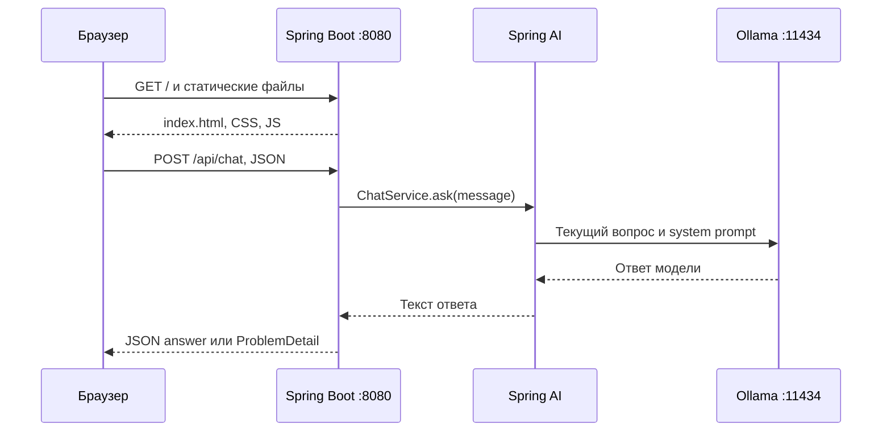

# Урок 1.2. Web UI для локального Java-помощника

[Материалы урока](../README.md) · [Домашнее задание](../homework/README.md) · [Тесты примера](src/test/java/dev/myfrei/repopilot/chat/) · [Все уроки](../../../README.md#программа) · [Проверки примера](../VERIFICATION.md) · [Предыдущая лекция](../../lesson-1.1/lecture/README.md)

Стек: **Java 25, Spring Boot 4.1.2, Spring AI 2.0.2, Maven 3.9.11**. HTML, CSS и JavaScript обслуживает то же Spring Boot приложение. Для тестов интерфейса нужны **Node.js 24** и **jsdom 27.4.0**.

## Результат занятия

У RepoPilot появляется страница: разработчик вводит вопрос, видит ожидание, получает текст и код, а при ошибке сохраняет возможность повторить попытку. Во время запроса форма блокируется, повторная отправка не создаёт второй вызов модели.

Из урока 1.1 мы сохраняем контракт `POST /api/chat` и разделение controller → service → Spring AI → Ollama. В стартовом backend этого занятия добавляем системную инструкцию из конфигурации. Это базовое развитие чата. Два режима объяснения из ДЗ 1.1 остаются самостоятельным расширением; переносить их для прохождения текущего урока не требуется.

В браузере отображается лента сообщений, но модель пока получает только текущий вопрос и system prompt. Предыдущие реплики не отправляются. Полноценная память будет в 1.4, потоковые ответы — в 1.3.

[Пример интерфейса с тестовым ответом](../Preview.jpg). Снимок сделан на локальном HTTP-стенде, без настоящей генерации LLM.

Ориентир на 120 минут: 15 минут — контракт и состояние UI, 70 — реализация, 25 — проверки, 10 — ДЗ. Домашняя работа — около 2–3 часов при знакомстве с базовым JavaScript.

## 1. Где живёт интерфейс



Страницу открываем по HTTP у нашего приложения, например `http://127.0.0.1:8080/`. Она обращается к относительному адресу `/api/chat`. Схема, host и порт совпадают, поэтому отдельная CORS-настройка здесь не нужна.

Браузер не обращается к Ollama напрямую: выбор модели, prompt и обработка ошибок остаются на Java-стороне. UI знает контракт нашего приложения, а не контракт provider.

Spring Boot автоматически обслуживает файлы из `src/main/resources/static` и использует `index.html` как welcome page. Ручной контроллер для `GET /` нам не требуется. [Spring Boot: Static Content](https://docs.spring.io/spring-boot/reference/web/servlet.html).

## 2. Подготовка и структура

Для настоящей генерации запустите Ollama и скачайте модель по [уроку 1.1](../../lesson-1.1/lecture/README.md). Проверки готового примера работают без Ollama.

Из корня готового проекта:

```bash
cd lessons/lesson-1.2/lecture
./mvnw -version
node --version
npm --version
```

Maven должен использовать Java 25; для тестов интерфейса выберите Node.js 24. Node нужен для тестов JavaScript; страница работает без Node-сервера и без frontend-сборки. Установка Node: [официальная страница](https://nodejs.org/en/download).

Все дальнейшие пути — относительно корня Maven-проекта. Готовый `lecture` содержит всю необходимую базу. Если продолжаете собственный проект, работайте в его копии и сопоставьте контракт с этим срезом; дополнительные маршруты предыдущих ДЗ переносите по желанию.

```text
lecture/
  pom.xml, mvnw, mvnw.cmd, .mvn/
  package.json, package-lock.json
  src/main/java/dev/myfrei/repopilot/chat/   # Java API из 1.1
  src/main/resources/
    application.yaml
    static/
      index.html
      css/styles.css
      js/
        chat-api.js          # HTTP-клиент нашего API
        chat-controller.js   # Состояния и действия UI
        chat-view.js         # Отображение состояния в DOM
        app.js               # Связь формы, клиента и состояния
        main.js              # Точка входа браузера
  src/test/java/             # Проверки Java и HTTP
  src/test/js/               # Проверки клиента, состояния и DOM
```

Это обычные ES modules, без React, TypeScript или bundler. Разделение похоже на Java-код: HTTP-адаптер, логика и представление имеют разные обязанности. Каждый файл можно тестировать отдельно.

[POM](pom.xml) сохраняет зависимости из 1.1. Artifact ID готового примера изменён на `repopilot-lesson-1-2-lecture`, чтобы имена jar разных уроков различались.

## 3. Закрепляем HTTP-контракт

| Ситуация | HTTP | Полезная часть тела |
| --- | --- | --- |
| Непустой ответ | 200 | `{"answer":"..."}` |
| Неверный message или некорректный JSON | 400 | `ProblemDetail`: title, status, detail |
| Известная ошибка локальной модели | 503 | `ProblemDetail`, поле answer отсутствует |

Запрос состоит из одного `message`. Предел — 4000 символов исходной строки; ввод только из пробелов запрещён. Пробелы по краям удаляются перед отправкой модели.

### System prompt в базовом backend

В [application.yaml](src/main/resources/application.yaml) сохранены настройки Ollama, лимиты и отключённые повторы выбранного релиза 2.0.2. Добавлен параметр:

```yaml
repopilot:
  system-prompt: >-
    Ты RepoPilot, помощник Java-разработчика. Отвечай по-русски, кратко и по делу.
    Если данных о проекте недостаточно, скажи об этом и попроси уточнение.
```

Полный [ChatService.java](src/main/java/dev/myfrei/repopilot/chat/ChatService.java):

```java
package dev.myfrei.repopilot.chat;

import org.springframework.ai.chat.client.ChatClient;
import org.springframework.ai.retry.NonTransientAiException;
import org.springframework.ai.retry.TransientAiException;
import org.springframework.stereotype.Service;
import org.springframework.beans.factory.annotation.Value;
import org.springframework.util.StringUtils;
import org.springframework.web.client.RestClientException;

@Service
public class ChatService {

    private final ChatClient chatClient;
    private final String systemPrompt;

    public ChatService(ChatClient.Builder builder, @Value("${repopilot.system-prompt}") String systemPrompt) {
        this.chatClient = builder.build();
        this.systemPrompt = systemPrompt;
    }

    public String ask(String message) {
        if (!StringUtils.hasText(message) || message.length() > 4_000) {
            throw new IllegalArgumentException("Сообщение должно содержать от 1 до 4000 символов.");
        }

        try {
            String answer = this.chatClient.prompt()
                    .system(this.systemPrompt)
                    .user(message.strip())
                    .call()
                    .content();

            if (!StringUtils.hasText(answer)) {
                throw new LlmUnavailableException();
            }
            return answer;
        }
        catch (RestClientException | TransientAiException | NonTransientAiException ex) {
            throw new LlmUnavailableException(ex);
        }
    }
}
```

System prompt и user message — разные роли. UI не формирует system prompt и не может переключать модель через поле сообщения. Фактическое следование инструкции оценивается отдельно от корректности её передачи. [ChatClient](https://docs.spring.io/spring-ai/reference/api/chatclient.html).

### Некорректный JSON тоже имеет понятную ошибку

Расширим обработчик из 1.1: `HttpMessageNotReadableException` возвращает тот же публичный HTTP 400. Это нужно для устойчивого API, даже если наш UI использует правильный `JSON.stringify`.

[ApiExceptionHandler.java](src/main/java/dev/myfrei/repopilot/chat/ApiExceptionHandler.java):

```java
package dev.myfrei.repopilot.chat;

import org.springframework.http.HttpStatus;
import org.springframework.http.ProblemDetail;
import org.springframework.http.converter.HttpMessageNotReadableException;
import org.springframework.web.bind.MethodArgumentNotValidException;
import org.springframework.web.bind.annotation.ExceptionHandler;
import org.springframework.web.bind.annotation.RestControllerAdvice;

@RestControllerAdvice
public class ApiExceptionHandler {

    @ExceptionHandler(LlmUnavailableException.class)
    public ProblemDetail handleLlmUnavailable(LlmUnavailableException ex) {
        ProblemDetail problem = ProblemDetail.forStatusAndDetail(
                HttpStatus.SERVICE_UNAVAILABLE, ex.getMessage());
        problem.setTitle("LLM unavailable");
        return problem;
    }

    @ExceptionHandler({MethodArgumentNotValidException.class, IllegalArgumentException.class,
            HttpMessageNotReadableException.class})
    public ProblemDetail handleInvalidRequest(Exception ex) {
        ProblemDetail problem = ProblemDetail.forStatusAndDetail(
                HttpStatus.BAD_REQUEST, "Поле message должно содержать от 1 до 4000 символов.");
        problem.setTitle("Invalid request");
        return problem;
    }
}
```

DTO и `ChatController` остаются такими же, как в 1.1. Ошибка LLM не становится успешным `answer`.

## 4. Создаём HTML-страницу

Создайте `src/main/resources/static/index.html`:

```html
<!doctype html>
<html lang="ru">
<head>
  <meta charset="utf-8">
  <meta name="viewport" content="width=device-width, initial-scale=1">
  <title>RepoPilot — помощник Java-разработчика</title>
  <link rel="stylesheet" href="/css/styles.css">
  <script type="module" src="/js/main.js"></script>
</head>
<body>
  <div class="shell">
    <header class="header">
      <a class="brand" href="/" aria-label="RepoPilot, главная">
        <span class="brand-icon" aria-hidden="true">R<span>↗</span></span>
        <span>RepoPilot</span>
      </a>
      <span class="badge"><span class="dot" aria-hidden="true"></span>Локальный помощник</span>
    </header>

    <main>
      <section class="intro" aria-labelledby="page-title">
        <p class="eyebrow">ВАШ НАПАРНИК ПО КОДУ</p>
        <h1 id="page-title">Разберёмся в Java.</h1>
        <p class="description">Объяснить сложную тему, сравнить подходы, разобрать пример — начните с вопроса.</p>
      </section>

      <section class="chat-card" aria-label="Чат с помощником">
        <div class="conversation-heading">
          <h2>Диалог</h2>
          <p id="status" role="status" aria-live="polite">Готов к вопросу</p>
        </div>
        <div id="empty-state" class="empty-state">
          <span class="empty-icon" aria-hidden="true">{ }</span>
          <h3>Что изучим сегодня?</h3>
          <p>Например: «Чем record отличается от обычного класса?»</p>
        </div>
        <ol id="messages" class="messages" aria-label="Сообщения"></ol>
        <div id="error-box" class="error-box" hidden>
          <p id="error-message" role="alert"></p>
        </div>

        <form id="chat-form" class="composer" novalidate>
          <label for="message">Ваш вопрос</label>
          <textarea id="message" name="message" rows="3" maxlength="4000"
                    aria-describedby="input-hint character-count"
                    placeholder="Спросите о Java, Spring или работе с кодом…"></textarea>
          <div class="composer-footer">
            <span id="input-hint">Ответ может потребовать времени</span>
            <div class="send-controls">
              <span id="character-count">0 / 4000</span>
              <button id="send-button" type="submit">Отправить <span aria-hidden="true">↗</span></button>
            </div>
          </div>
        </form>
      </section>
      <p class="footnote">Пока каждый вопрос рассматривается отдельно.</p>
    </main>
    <footer class="footer"><span>RepoPilot</span><span>Вопрос за вопросом — к ясному решению.</span></footer>
  </div>
</body>
</html>
```

У textarea есть label, подсказки и счётчик длины. Статус с `role="status"` сообщает о ходе работы, ошибка с `role="alert"` — о проблеме. Это базовые средства доступности; полный аудит доступности интерфейса не является результатом данного урока.

В форме стоит `novalidate`, потому что сообщения об ошибках будем показывать через один механизм UI. `maxlength` помогает при обычном вводе, но JavaScript и сервер всё равно проверяют ограничения: значение можно задать программно, а HTTP можно вызвать вне страницы.

`type="module"` позволяет импортировать соседние JS-файлы. Открывайте страницу через Spring Boot, а не двойным щелчком как `file://`: относительные API-адреса и загрузка модулей рассчитаны на HTTP.

## 5. Определяем состояния UI

Мы храним состояние явно:

| phase | Что видит человек | Что разрешено |
| --- | --- | --- |
| `idle` | Пустой чат и готовность к вопросу | Ввод и отправка |
| `submitting` | Свой вопрос и «Готовлю ответ…» | Форма заблокирована |
| `success` | Вопрос и ответ | Следующий вопрос |
| `error` | Понятная ошибка, прежний вопрос в поле | Исправить ввод или отправить снова |

`messages` — только отображаемая история страницы. `error` — текст текущей ошибки. При ожидании API мы не создаём пустую реплику assistant и не показываем её как ответ.

Одного disabled у кнопки мало: submit можно инициировать через другой обработчик или программно. Поэтому проверяем `submitting` и в логике контроллера.

Файл `src/main/resources/static/js/chat-controller.js`:

```javascript
export function validateMessage(message) {
  if (typeof message !== "string" || !message.trim()) {
    return "Введите вопрос перед отправкой.";
  }
  if (message.length > 4000) {
    return "Вопрос должен быть не длиннее 4000 символов.";
  }
  return "";
}

export function createChatController({ send, onStateChange = () => {} }) {
  let state = { phase: "idle", messages: [], error: "" };

  function getState() {
    return { ...state, messages: state.messages.map(message => ({ ...message })) };
  }

  function update(changes) {
    state = { ...state, ...changes };
    onStateChange(getState());
  }

  async function submit(rawMessage) {
    if (state.phase === "submitting") return false;
    const error = validateMessage(rawMessage);
    if (error) {
      update({ phase: "error", error });
      return false;
    }
    const message = rawMessage.trim();
    update({ phase: "submitting", error: "",
      messages: [...state.messages, { role: "user", content: message }] });
    let answer;
    try {
      answer = await send(message);
    } catch (failure) {
      update({ phase: "error", error: failure.message || "Не удалось получить ответ." });
      return false;
    }
    update({ phase: "success", error: "",
      messages: [...state.messages, { role: "assistant", content: answer }] });
    return true;
  }

  onStateChange(getState());
  return { getState, submit };
}
```

`send` передаётся зависимостью — так же, как Java-сервис получает зависимость через конструктор. В приложении это HTTP-клиент, в unit-тесте — функция с предсказуемым результатом.

`submit()` возвращает `true` только после успеха. При неверном вводе, дублирующем действии и ошибке возвращает `false`. По этому результату обработчик формы решит, можно ли очистить поле.

`getState()` отдаёт копии сообщений: внешний код не должен случайно менять внутреннюю ленту. `onStateChange` получает снимок и обновляет DOM. Контроллер не знает `document` и не рисует HTML.

`trim()` и Java `strip()` похожи по назначению, но обработка некоторых Unicode-пробелов отличается. На сервере остаётся окончательное решение о допустимости запроса; UI-проверка нужна для быстрой обратной связи.

## 6. Пишем HTTP-клиент

`fetch` возвращает Promise. `await` ждёт его завершения, не блокируя интерфейс на всё время работы модели. Важная особенность: HTTP 400 или 503 сами по себе не отклоняют Promise — нужно проверить `response.ok`. Ошибка сети и неуспешный HTTP-статус обрабатываются раздельно. [Using Fetch](https://developer.mozilla.org/en-US/docs/Web/API/Fetch_API/Using_Fetch).

Создайте `src/main/resources/static/js/chat-api.js`:

```javascript
export class ChatApiError extends Error {
  constructor(message, status = 0) {
    super(message);
    this.name = "ChatApiError";
    this.status = status;
  }
}

export async function sendMessage(message, fetchImpl = globalThis.fetch) {
  let response;
  try {
    response = await fetchImpl("/api/chat", {
      method: "POST",
      headers: {
        "Content-Type": "application/json",
        "Accept": "application/json, application/problem+json"
      },
      body: JSON.stringify({ message })
    });
  } catch {
    throw new ChatApiError("Нет связи с приложением. Проверьте соединение и повторите запрос.");
  }

  let payload;
  try {
    payload = await response.json();
  } catch {
    throw new ChatApiError("Сервер вернул неожиданный ответ. Попробуйте ещё раз.", response.status);
  }

  if (!response.ok) {
    const publicDetail = [400, 503].includes(response.status)
      && typeof payload?.detail === "string" && payload.detail.trim();
    throw new ChatApiError(publicDetail ? payload.detail
      : "Не удалось получить ответ. Попробуйте ещё раз.", response.status);
  }
  if (typeof payload?.answer !== "string" || !payload.answer.trim()) {
    throw new ChatApiError("Сервер вернул пустой или некорректный ответ.", response.status);
  }
  return payload.answer;
}
```

У API есть три слоя проверки: транспорт, HTTP-статус и форма успешного payload. Даже HTTP 200 не означает, что `{answer}` действительно существует и содержит строку.

Публичный detail читаем у знакомых 400/503. Для неожиданной серверной ошибки показываем общий текст; HTML-страницу proxy не принимаем за ответ модели. Детали ошибок выводятся только как текст — это не разрешение интерпретировать их как разметку.

`fetchImpl` тоже передаётся зависимостью. Unit-тест может вернуть настоящий объект `Response` с нужным статусом, не отправляя запрос в сеть.

## 7. Отображаем данные через DOM

Ответ модели — данные. Строка `` не должна становиться элементом страницы. Поэтому создаём элементы сами, а содержимое помещаем в `textContent`. Разницу с интерпретацией HTML объясняет [документация textContent](https://developer.mozilla.org/en-US/docs/Web/API/Node/textContent).

В этом уроке весь ответ выводится в `<pre>` с переносом строк. Java-код сохраняет отступы, Markdown-знаки остаются текстом. Подсветку синтаксиса и HTML/Markdown-renderer сейчас не добавляем.

`src/main/resources/static/js/chat-view.js`:

```javascript
export function createChatView(document) {
  const messages = document.getElementById("messages");
  const input = document.getElementById("message");
  const sendButton = document.getElementById("send-button");
  const status = document.getElementById("status");
  const labels = { idle: "Готов к вопросу", submitting: "Готовлю ответ…",
    success: "Ответ получен", error: "Не удалось отправить вопрос" };

  function render(state) {
    const busy = state.phase === "submitting";
    input.disabled = busy;
    sendButton.disabled = busy;
    document.getElementById("chat-form").setAttribute("aria-busy", String(busy));
    status.textContent = labels[state.phase];
    document.getElementById("empty-state").hidden = state.messages.length > 0;
    document.getElementById("error-box").hidden = !state.error;
    document.getElementById("error-message").textContent = state.error;

    messages.replaceChildren();
    for (const message of state.messages) {
      const item = document.createElement("li");
      item.className = `message message-${message.role}`;
      const role = document.createElement("span");
      role.className = "message-role";
      role.textContent = message.role === "user" ? "Вы" : "RepoPilot";
      const body = document.createElement("pre");
      body.textContent = message.content;
      item.append(role, body);
      messages.append(item);
    }
    messages.scrollTop = messages.scrollHeight;
  }
  return { render };
}
```

Форма и ошибка обновляются из одного состояния. При новом успешном запросе старый alert скрывается. Ленту целиком пересоздаём ради простоты небольшого учебного чата; при большом количестве сообщений понадобятся обновления отдельных элементов.

Строка роли создаётся нашим контроллером (`user` или `assistant`). Модель не присылает DOM, CSS-класс или действие кнопки.

## 8. Связываем форму и логику

`src/main/resources/static/js/app.js`:

```javascript
import { sendMessage } from "./chat-api.js";
import { createChatController } from "./chat-controller.js";
import { createChatView } from "./chat-view.js";

export function mountChat(document, send = sendMessage) {
  const view = createChatView(document);
  const controller = createChatController({ send, onStateChange: view.render });
  const input = document.getElementById("message");
  const count = document.getElementById("character-count");
  function updateCount() {
    count.textContent = `${input.value.length} / 4000`;
  }
  input.addEventListener("input", updateCount);
  document.getElementById("chat-form").addEventListener("submit", async event => {
    event.preventDefault();
    const success = await controller.submit(input.value);
    if (success) {
      input.value = "";
      updateCount();
    }
    if (!input.disabled) input.focus();
  });
  updateCount();
  return controller;
}
```

`preventDefault()` отменяет обычную отправку HTML-формы с перезагрузкой страницы. После успеха очищаем поле и счётчик; после ошибки сохраняем черновик. Фокус возвращается в доступное поле.

`src/main/resources/static/js/main.js`:

```javascript
import { mountChat } from "./app.js";

mountChat(document);
```

Небольшой entry point запускает приложение. Сам `app.js` не выполняет ничего при импорте — это важно для тестов, где мы передадим отдельный document.

## 9. Добавляем оформление

Создайте `src/main/resources/static/css/styles.css`:

```css
:root { color-scheme: light; font-family: -apple-system, BlinkMacSystemFont, "Segoe UI", sans-serif; color: #172c35; background: #f5f7f6; }
* { box-sizing: border-box; }
body { margin: 0; }
button, textarea { font: inherit; }
[hidden] { display: none !important; }
.shell { max-width: 1040px; margin: 0 auto; padding: 0 40px; }
.header { display: flex; justify-content: space-between; align-items: center; padding: 28px 0; border-bottom: 1px solid #dde5e2; }
.brand { display: flex; align-items: center; gap: 12px; font-size: 21px; font-weight: 750; text-decoration: none; color: inherit; letter-spacing: -.6px; }
.brand-icon { position: relative; background: #193e36; color: #fff; width: 37px; height: 37px; border-radius: 11px; padding: 7px 10px; font-size: 20px; }
.brand-icon span { position: absolute; right: 3px; top: 2px; font-size: 14px; color: #b9edb4; }
.badge { display: inline-flex; align-items: center; gap: 7px; background: #e9f1ec; color: #355c46; border-radius: 20px; padding: 8px 12px; font-size: 12px; font-weight: 600; }
.dot { width: 6px; height: 6px; background: #3a8058; border-radius: 50%; }
main { padding-top: 47px; }
.eyebrow { font-size: 10px; font-weight: 750; letter-spacing: 2px; color: #567264; margin: 0 0 15px; }
h1 { font-size: clamp(31px, 5vw, 45px); line-height: 1.15; letter-spacing: -1.8px; margin: 0 0 14px; }
.description { max-width: 560px; font-size: 14px; line-height: 1.65; color: #63736e; margin: 0; }
.chat-card { margin-top: 30px; background: white; border: 1px solid #dce5df; border-radius: 17px; box-shadow: 0 8px 28px #193c3005; overflow: hidden; }
.conversation-heading { display: flex; align-items: center; justify-content: space-between; gap: 15px; padding: 18px 24px; border-bottom: 1px solid #ecf0ed; }
.conversation-heading h2 { font-size: 13px; margin: 0; }
#status { font-size: 11px; color: #63736e; margin: 0; }
.empty-state { padding: 38px 24px 34px; text-align: center; }
.empty-icon { display: inline-block; background: #f0f5f1; color: #5d7b68; padding: 10px; border-radius: 12px; font: 20px monospace; }
.empty-state h3 { margin: 14px 0 7px; font-size: 15px; }
.empty-state p { font-size: 12px; color: #6c7c75; margin: 0; }
.messages { list-style: none; padding: 0; margin: 0; max-height: 460px; overflow-y: auto; }
.message { padding: 20px 24px; border-bottom: 1px solid #eff2ef; }
.message-user { background: #f7faf8; }
.message-role { display: block; margin-bottom: 8px; font-size: 10px; letter-spacing: .8px; text-transform: uppercase; font-weight: 700; color: #527365; }
.message pre { margin: 0; white-space: pre-wrap; overflow-wrap: anywhere; font: 13px/1.75 ui-monospace, SFMono-Regular, Consolas, monospace; }
.composer { padding: 21px 24px; }
.composer label { display: block; font-size: 12px; font-weight: 650; margin-bottom: 10px; }
textarea { width: 100%; padding: 12px 13px; resize: vertical; min-height: 86px; border: 1px solid #cdd9d1; border-radius: 8px; font-size: 13px; line-height: 1.5; color: #243a30; background: #fff; }
textarea::placeholder { color: #8b9890; }
textarea:focus-visible, button:focus-visible, a:focus-visible { outline: 3px solid #b2d8c2; outline-offset: 3px; }
textarea:disabled { background: #f6f8f6; }
.composer-footer { display: flex; justify-content: space-between; align-items: center; gap: 16px; margin-top: 12px; }
#input-hint, #character-count { font-size: 10px; color: #6f7e76; }
.send-controls { display: flex; align-items: center; gap: 16px; }
button { cursor: pointer; border: 0; border-radius: 8px; padding: 11px 17px; color: white; background: #214d3c; font-size: 12px; font-weight: 650; }
button:hover { background: #173c2d; }
button:disabled { cursor: wait; opacity: .55; }
button span { padding-left: 9px; }
.error-box { margin: 18px 24px 0; border: 1px solid #edd8d2; border-radius: 9px; padding: 13px; background: #fff8f6; }
#error-message { font-size: 12px; line-height: 1.5; color: #8d3f32; margin: 0; white-space: pre-wrap; }
.retry-button { margin-top: 10px; background: #7c4539; }
.footnote { text-align: center; font-size: 10px; color: #7a877f; margin: 15px 0 38px; }
.footer { display: flex; justify-content: space-between; padding: 19px 0 24px; border-top: 1px solid #dde5e2; font-size: 10px; color: #829087; }
@media (max-width: 600px) {
  .shell { padding: 0 17px; }
  .header { padding: 18px 0; }
  .brand { font-size: 18px; }
  .badge { font-size: 10px; padding: 7px 9px; }
  main { padding-top: 30px; }
  .conversation-heading, .message, .composer { padding: 17px; }
  .composer-footer { align-items: flex-end; }
  #input-hint { max-width: 95px; line-height: 1.5; }
  .send-controls { gap: 10px; }
  .footer { gap: 16px; font-size: 9px; }
}
```

Ключевые для поведения свойства: `[hidden]`, видимый focus outline, `white-space: pre-wrap`, перенос длинных строк и состояние disabled. Media query уменьшает отступы для узкого экрана. Не прячем ошибку только изменением цвета — у неё есть отдельный текст и alert.

## 10. Запускаем UI

При работающем Ollama:

```bash
./mvnw spring-boot:run
```

Откройте `http://127.0.0.1:8080/`. Для другого порта:

```bash
PORT=8081 ./mvnw spring-boot:run
```

Браузерный `/api/chat` автоматически использует порт открытой страницы. В JS не зашиты `8080`, адрес Ollama или имя модели.

На Windows используйте `./mvnw.cmd` в PowerShell. JDK и Ollama проверяются теми же командами, что в 1.1.

### Чек сценариев

1. Открыть страницу: поле доступно, в ленте нет выдуманных сообщений.
2. Отправить вопрос: собственная реплика видна, кнопка и textarea заблокированы.
3. Получить ответ: появляется отдельная реплика RepoPilot, поле очищается.
4. Отправить пробелы: видна ошибка, обращения к модели нет.
5. Получить 503: ошибка не становится ответом; вопрос остаётся в поле, форму можно использовать снова.
6. Проверить длинную строку и код с `<` / `>`: страница сохраняет текст, а не создаёт HTML-элементы.

Для 503 можно перезапустить только Spring-приложение с адресом, на котором нет Ollama:

```bash
OLLAMA_BASE_URL=http://localhost:1 ./mvnw spring-boot:run
```

Порт должен быть заведомо не занят в вашей среде. Для штатного запуска верните обычную конфигурацию.

На маленькой локальной модели первый запрос может потребовать загрузки весов. Состояние «Готовлю ответ…» означает ожидание, а не подтверждённый прогресс генерации. Стриминг добавим в следующем уроке.

## 11. Проверяем Java и JavaScript

### Backend

```bash
./mvnw package
```

Java-проверки не требуют настоящего Ollama:

| Набор | Количество | Обязанность |
| --- | --- | --- |
| `ChatServiceTest` | 14 | Вход, prompt, ответы, ошибки |
| `SystemPromptTest` | 2 | Отдельная system-роль и конфигурация |
| `ChatControllerTest` | 8 | HTTP 200/400/503, в том числе некорректный JSON |
| `OllamaHttpIntegrationTest` | 5 | Автонастройка клиента, HTTP-заглушка provider, таймаут и статические ресурсы |

Интеграционный тест загружает `/`, CSS и JS у реального Boot-сервера. Это доказывает, что файлы раздаются, но не заменяет выполнение JS в браузере.

### Frontend

Для тестов создайте `package.json` (в готовом проекте он уже есть):

```json
{
  "name": "repopilot-lesson-1-2-lecture-ui",
  "version": "0.0.1",
  "private": true,
  "type": "module",
  "engines": {
    "node": ">=24 <25"
  },
  "scripts": {
    "test": "node --test src/test/js/chat-api.test.mjs src/test/js/chat-controller.test.mjs src/test/js/ui.test.mjs"
  },
  "devDependencies": {
    "jsdom": "27.4.0"
  }
}
```

При создании проекта с нуля один раз выполните `npm install`, получите `package-lock.json` и сохраните его рядом с package.json. В готовом репозитории lock уже закреплён; используйте:

```bash
npm ci
npm test
```

Node test runner запускает проверки. jsdom предоставляет document для DOM-тестов, но не является полноценным браузером и не проверяет раскладку CSS. Это dev dependency: Spring Boot и браузер не загружают jsdom в runtime. [Node Test Runner](https://nodejs.org/docs/latest-v24.x/api/test.html), [jsdom](https://github.com/jsdom/jsdom).

| Набор | Количество | Что доказывает |
| --- | --- | --- |
| [chat-api.test.mjs](src/test/js/chat-api.test.mjs) | 11 | URL, JSON, статусы, ошибка сети, неверный payload |
| [chat-controller.test.mjs](src/test/js/chat-controller.test.mjs) | 7 | Состояния, валидация, блокировка дублей, сохранность данных |
| [ui.test.mjs](src/test/js/ui.test.mjs) | 6 | Реальные обработчики формы и DOM, текстовый вывод, восстановление после ошибки |

В этой лекции повтор после ошибки выполняется обычной формой с сохранённым вопросом. Отдельная кнопка Retry и семантика новой попытки появятся в уроке 1.3; текущее ДЗ добавляет сохраняемый черновик.

Пример проверки ошибок HTTP:

```javascript
const fetchImpl = async () => Response.json(
  { detail: "Модель временно недоступна." }, { status: 503 }
);
await assert.rejects(sendMessage("Вопрос", fetchImpl), {
  message: "Модель временно недоступна.", status: 503
});
```

Пример тестируемого UI-контроллера:

```javascript
const phases = [];
const controller = createChatController({
  send: async () => "Ответ",
  onStateChange: state => phases.push(state.phase)
});
await controller.submit("Вопрос");
assert.deepEqual(phases, ["idle", "submitting", "success"]);
```

DOM-тест отдельно проверяет, что HTML-подобный ответ оставляет ноль `img`/`script` внутри ленты. Недостаточно утверждать, что обработчик не вызвал alert: jsdom по умолчанию и так не исполняет вставленные скрипты. Мы проверяем отсутствие самих активных элементов.

Никаких `node_modules` или `target` в учебный Git не добавляем. На чистой машине сначала `npm ci`, затем `npm test`.

## 12. Типичные проблемы

| Симптом | Причина | Что сделать |
| --- | --- | --- |
| При открытии HTML нет работы API | Страница открыта через file:// | Открыть HTTP-адрес Spring Boot |
| GET / возвращает 404 | Неверное расположение index.html | Файл должен быть в src/main/resources/static |
| `Cannot use import...` или module не загрузился | Не указан type=module / неверный путь | Проверить index.html и вкладку Network |
| HTTP 503 показан как успех | Не проверен response.ok | Обработать HTTP-ошибку до answer |
| После ошибки поле очистилось | Очищаем в finally | Очищать только при успешном submit |
| Двойное нажатие даёт два POST | Блокируется только внешний вид кнопки | Проверять busy и в контроллере состояния |
| Ответ с кодом ломает HTML | Используется вставка разметки | Создавать элементы и назначать textContent |
| В ленте есть история, модель её не помнит | UI-история не включена в prompt | Это ожидаемо до урока 1.4 |
| npm test не находит jsdom | Зависимости не установлены | Выполнить npm ci в нужном проекте |
| Изменения страницы не видны | Запущен старый jar / браузерный кеш | Пересобрать/перезапустить приложение и обновить страницу |

## 13. Домашнее задание

В [homework](../homework/README.md) полностью готовы backend и основной Web UI этой лекции. Новая задача — восстановление черновика после перезагрузки на отдельной странице `/draft.html`. HTTP-клиент, state controller и отрисовку повторно писать не нужно.

Реализуйте три метода [draft-store.js](../homework/src/main/resources/static/js/draft-store.js): чтение JSON версии 1, сохранение строки до 4000 символов и `clearIfUnchanged`. Повреждённая запись или отказ storage не должны ломать чат. Удаляйте после успеха только отправленный черновик; более новый текст, уже видимый при сравнении, сохраняйте. Это best-effort compare-and-clear, а не атомарная синхронизация вкладок.

Готовый binding использует тот же чат на новой странице. [Приёмочные сценарии](../homework/src/test/js/draft-acceptance.test.mjs) проверяют формат хранения, границы, отказ storage, защиту нового черновика, восстановление и сохранение текста после ошибки отправки. Реализуйте store и выполните эти проверки вместе с тестами базового UI и API. Отдельная regression-проверка подтверждает безопасный доступ к getter localStorage. Состав проверок описан в [VERIFICATION](../VERIFICATION.md).

После реализации выполните `./mvnw test` и `npm test` из homework. Вручную проверьте reload, успешную отправку, ошибку и очистку на `/draft.html`; результаты внесите в [SUBMISSION](../homework/SUBMISSION.md). DOM-проверки используют transport-заглушку; настоящий inference отмечайте отдельным результатом.

Усложнение: добавьте срок жизни черновика и контролируемые часы в тестах. Сохранение вопроса в браузере не создаёт историю для модели.

## 14. Контрольные вопросы

1. Почему UI обращается к Spring Boot, а не к Ollama?
2. Почему fetch с HTTP 503 может успешно завершить Promise?
3. Почему disabled кнопки не заменяет проверку состояния в submit?
4. Кто решает, когда очищать поле: HTTP-клиент, контроллер состояния или binding формы?
5. Чем отображаемая лента отличается от памяти модели?
6. Как DOM-тест доказывает, что строка с HTML не стала элементом?
7. Почему успешный Maven build не доказывает работу JavaScript?

## 15. Материалы

- [Spring Boot Servlet Web / Static Content](https://docs.spring.io/spring-boot/reference/web/servlet.html).
- [Spring AI ChatClient](https://docs.spring.io/spring-ai/reference/api/chatclient.html).
- [MDN: Using Fetch](https://developer.mozilla.org/en-US/docs/Web/API/Fetch_API/Using_Fetch).
- [MDN: textContent](https://developer.mozilla.org/en-US/docs/Web/API/Node/textContent).
- [Node.js: Test Runner](https://nodejs.org/docs/latest-v24.x/api/test.html).
- [jsdom: документация](https://github.com/jsdom/jsdom) и [зафиксированная версия 27.4.0](https://github.com/jsdom/jsdom/releases/tag/27.4.0).

В уроке 1.3 сохраним тот же UI и переведём ответ из полного JSON в последовательность событий streaming.
