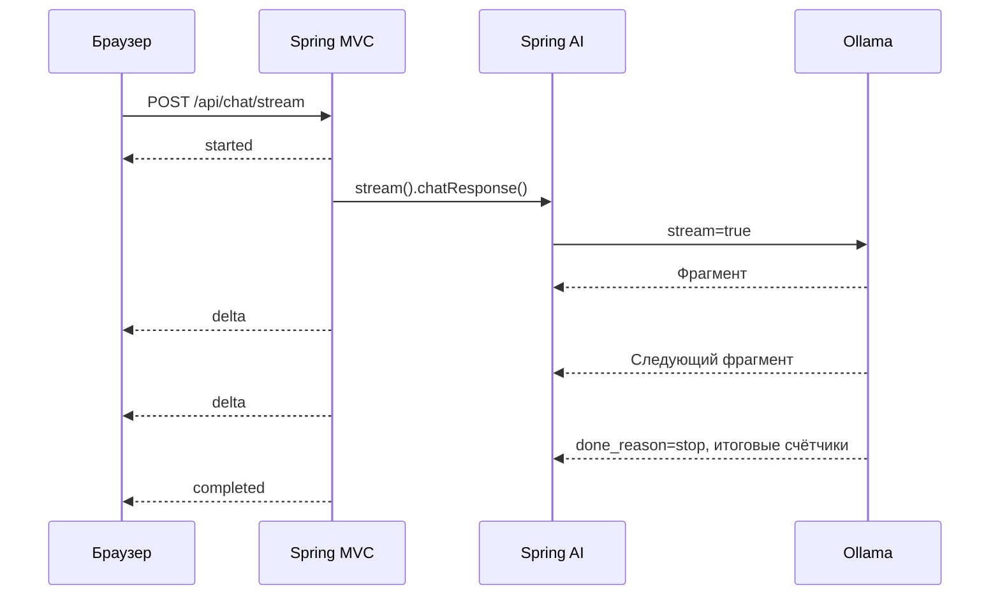

# Урок 1.3. Streaming: от Spring AI до постепенно появляющегося ответа

[Материалы урока](../README.md) · [Домашнее задание](../homework/README.md) · [Проверка](../VERIFICATION.md) · [Предыдущая лекция](../../lesson-1.2/lecture/README.md)

Дата: 2026-10-25. **Java 25, Spring Boot 4.1.2, Spring AI 2.0.2, Maven 3.9.11**. Для UI-тестов: Node.js 24 и jsdom 27.4.0.

## Результат занятия

RepoPilot показывает ответ постепенно. Разработчик видит первые фрагменты, может остановить генерацию и повторить попытку. Если поток оборвался, уже полученный текст остаётся в ленте с отметкой «Прерван»; он не становится успешным ответом только потому, что соединение закрылось.

Мы сохраним синхронный `POST /api/chat` из 1.2 и добавим `POST /api/chat/stream`. Web UI будет использовать новый endpoint. Памяти разговора пока нет: каждый запрос передаёт модели текущий вопрос и system prompt.

План занятия: 25 минут на модель потока и протокол, 35 — Java, 35 — браузер, 25 — проверки. Парсер и UI-каркас можно использовать готовыми, разбирая код по шагам. ДЗ — ориентировочно 2–4 часа: практика с асинхронным поведением требует больше времени, чем обычный HTTP-вызов.

## 1. Что меняется по сравнению с обычным запросом

До этого браузер ждал полный JSON `{answer}`. Теперь он получает последовательность событий, пока запрос ещё выполняется.



Фрагмент provider, токен модели, SSE-событие и сетевой chunk — разные единицы. Один сетевой read может содержать несколько событий или только часть строки. Кириллица и emoji могут оказаться разрезаны между байтовыми порциями.

Streaming уменьшает время до первого видимого фрагмента, если остальные части системы не буферизуют ответ. Он не обязан ускорять полную генерацию.

### Почему SSE и fetch

SSE — текстовый формат событий с `Content-Type: text/event-stream`. Наш запрос содержит JSON и отправляется методом POST. Браузерный `EventSource` рассчитан на другую модель подключения и не даёт нам обычного POST с JSON-телом, поэтому используем `fetch` и читаем `Response.body`. [SSE](https://developer.mozilla.org/en-US/docs/Web/API/Server-sent_events/Using_server-sent_events), [Fetch](https://developer.mozilla.org/en-US/docs/Web/API/Fetch_API/Using_Fetch).

SSE не означает обязательное использование `EventSource`. Здесь нет автоматического reconnect, воспроизведения event ID или продолжения с последнего токена. Повтор — новый POST с тем же вопросом.

## 2. Фиксируем протокол до кода

| Событие | Значение | Полезные поля |
| --- | --- | --- |
| `started` | Приложение приняло корректный запрос и открыло поток | type |
| `delta` | Следующая часть текста ответа | text |
| `completed` | Генерация штатно завершена и получен непустой ответ | type |
| `failed` | Ответ не завершён успешно | code, message |

Валидная последовательность: `started → delta* → completed` либо `started → delta* → failed`. Ровно одно терминальное событие. Для completed нужен непустой текст. Отмена клиентом закрывает поток: сервер не обязан успеть передать событие в уже закрытое соединение.

Пример wire-формата:

```text
event:started
data:{"type":"started","text":"","code":"","message":""}

event:delta
data:{"type":"delta","text":"Привет 👋","code":"","message":""}

event:completed
data:{"type":"completed","text":"","code":"","message":""}

```

Пустая строка завершает событие. JSON экранирует переносы строк внутри текста; протокольные переносы остаются снаружи JSON. Серверное имя event и поле type совпадают; клиент проверяет это.

`started` не подтверждает, что веса модели уже загружены. Успехом считается completed, а не started, HTTP 200 или сетевой EOF.

### Ошибки до и после начала потока

Некорректный request DTO по-прежнему получает HTTP 400 `ProblemDetail` до SSE. В Accept указываем оба допустимых формата: `text/event-stream, application/problem+json`.

После отправки заголовков статус HTTP поменять нельзя. Поэтому ошибка provider после started передаётся как failed внутри HTTP 200. Клиент должен проверять и HTTP-уровень, и события приложения.

| Момент | Представление ошибки |
| --- | --- |
| До открытия потока: неверный ввод | HTTP 400 + ProblemDetail |
| После started: provider недоступен | HTTP 200 + failed/MODEL_ERROR |
| Закрытие provider без признака завершения | failed/UPSTREAM_INCOMPLETE |
| Превышение времени или длины ответа | failed/TIMEOUT или failed/OUTPUT_LIMIT |
| Обрыв сети до completed на стороне браузера | Локальная ошибка, частичный ответ отмечен как прерванный |

## 3. Подготавливаем проект

Продолжайте свой результат 1.2 или откройте `lecture/pom.xml`. Готовый пример самостоятельный; package names одинаковы с предыдущими уроками, но Maven-проекты не объединяются.

```bash
cd lessons/lesson-1.3/lecture
./mvnw -version
node --version
npm ci
```

Maven должен использовать JDK 25, Node — ветку 24. Подготовка Ollama и модели `qwen2.5:3b` описана в 1.1. Для первых запросов полезно заранее проверить модель напрямую; холодная загрузка входит во время ожидания.

В [POM](pom.xml) сохраняем Spring MVC. Spring AI Ollama starter уже приносит Reactor/WebClient, поэтому полный переход серверного приложения на WebFlux не нужен. Spring MVC поддерживает возвращаемый `Flux<ServerSentEvent<...>>`; записи ответа выполняются через async-обработку servlet-контейнера. Это не превращает MVC в полностью неблокирующий WebFlux. [Spring MVC Async](https://docs.spring.io/spring-framework/reference/web/webmvc/mvc-ann-async.html).

Добавляем тестовую зависимость, версия управляется согласованной связкой:

```xml
<dependency>
    <groupId>io.projectreactor</groupId>
    <artifactId>reactor-test</artifactId>
    <scope>test</scope>
</dependency>
```

Новые файлы:

```text
src/main/java/dev/myfrei/repopilot/chat/
  ChatStreamEvent.java
  ChatStreamService.java
  ChatStreamController.java
src/main/resources/static/js/
  sse-parser.js
  stream-api.js
  chat-controller.js         # Состояния потока, cancel и retry
  chat-view.js               # Постепенный текст и статусы попыток
  app.js                     # Кнопки и обработчики
```

## 4. Коротко о Reactor

`Flux<T>` — publisher последовательности из 0..N значений, ошибок и сигнала завершения. `Mono<T>` — 0..1 значение. Объявление цепочки и подписка — разные действия.

Нужные операторы:

| Оператор | Роль в нашем коде |
| --- | --- |
| `defer` | Создаёт запрос и локальное состояние заново для каждой подписки |
| `handle` | Преобразует ответ provider в 0 или 1 текстовый delta |
| `concat` | Сохраняет порядок started, текста и терминального события |
| `timeout` | Останавливает молчащий provider |
| `takeUntilOther` | Ограничивает общую длительность активного ответа |
| `onErrorResume` | Заменяет ошибку после started безопасным failed |
| `takeUntil` | Завершает поток на терминальном событии и отменяет остальное |

В controller не вызываем `subscribe()` вручную. Подпиской владеет Spring MVC, который связывает её с HTTP-ответом. Ручной subscribe разорвал бы этот жизненный цикл. `block()`, `collectList()` или `join()` перед отправкой данных превратили бы постепенную доставку в ожидание полного ответа.

## 5. Описываем события

Создайте [ChatStreamEvent.java](src/main/java/dev/myfrei/repopilot/chat/ChatStreamEvent.java):

```java
package dev.myfrei.repopilot.chat;

public record ChatStreamEvent(String type, String text, String code, String message) {

    public static ChatStreamEvent started() {
        return new ChatStreamEvent("started", "", "", "");
    }

    public static ChatStreamEvent delta(String text) {
        return new ChatStreamEvent("delta", text, "", "");
    }

    public static ChatStreamEvent completed() {
        return new ChatStreamEvent("completed", "", "", "");
    }

    public static ChatStreamEvent failed(String code, String message) {
        return new ChatStreamEvent("failed", "", code, message);
    }

    public boolean terminal() {
        return this.type.equals("completed") || this.type.equals("failed");
    }
}
```

Это DTO нашего приложения. Оно не зависит от формата NDJSON Ollama и не выдаёт наружу внутренние исключения provider. Heartbeat не добавляем в список бизнес-событий: он будет SSE-комментарием без data.

## 6. Получаем поток от Spring AI

Минимальный переход выглядит так:

```java
Flux<String> chunks = chatClient.prompt()
        .user(message)
        .stream()
        .content();
```

Но одной строки недостаточно для подтверждения окончания генерации. В рабочем примере используем `.stream().chatResponse()`, чтобы видеть метаданные завершения. [Spring AI ChatClient](https://docs.spring.io/spring-ai/reference/api/chatclient.html).

### Почему проверяем finish reason

Ollama передаёт финальные поля done, done_reason и счётчики. В Spring AI 2.0.2 finish reason streaming-ответа переносится в metadata при наличии `prompt_eval_count` и `eval_count`. Мы проверяем конкретную связку: штатный `stop` означает окончание, `length` — достижение лимита, отсутствие подтверждения — незавершённый поток. [Код OllamaChatModel релиза 2.0.2](https://github.com/spring-projects/spring-ai/blob/v2.0.2/models/spring-ai-ollama/src/main/java/org/springframework/ai/ollama/OllamaChatModel.java), [Ollama Chat API](https://docs.ollama.com/api/chat).

Это provider-зависимая политика учебного адаптера. При смене runtime/provider её нужно проверить заново. Нельзя считать обычный конец Flux достаточным признаком, если провайдер просто перестал передавать данные без финального маркера.

[ChatStreamService.java](src/main/java/dev/myfrei/repopilot/chat/ChatStreamService.java):

```java
package dev.myfrei.repopilot.chat;

import java.time.Duration;
import java.util.concurrent.TimeoutException;
import java.util.concurrent.atomic.AtomicBoolean;
import java.util.concurrent.atomic.AtomicReference;

import org.slf4j.Logger;
import org.slf4j.LoggerFactory;
import org.springframework.ai.chat.client.ChatClient;
import org.springframework.ai.chat.model.ChatResponse;
import org.springframework.beans.factory.annotation.Value;
import org.springframework.stereotype.Service;
import org.springframework.util.StringUtils;
import reactor.core.publisher.Flux;
import reactor.core.publisher.Mono;

@Service
public class ChatStreamService {

    private static final Logger LOG = LoggerFactory.getLogger(ChatStreamService.class);

    private final ChatClient client;
    private final String systemPrompt;
    private final Duration idleTimeout;
    private final Duration maxDuration;

    public ChatStreamService(ChatClient.Builder builder,
            @Value("${repopilot.system-prompt}") String systemPrompt,
            @Value("${repopilot.stream.idle-timeout}") Duration idleTimeout,
            @Value("${repopilot.stream.max-duration}") Duration maxDuration) {
        this.client = builder.build();
        this.systemPrompt = systemPrompt;
        this.idleTimeout = idleTimeout;
        this.maxDuration = maxDuration;
    }

    public Flux<ChatStreamEvent> stream(String message) {
        if (!StringUtils.hasText(message) || message.length() > 4_000) {
            throw new IllegalArgumentException("Сообщение должно содержать от 1 до 4000 символов.");
        }
        return Flux.defer(() -> {
            var hasText = new AtomicBoolean();
            var finishReason = new AtomicReference<>("");

            Flux<ChatStreamEvent> deltas = Flux.defer(() -> this.client.prompt()
                            .system(this.systemPrompt).user(message.strip()).stream().chatResponse())
                    .timeout(this.idleTimeout)
                    .takeUntilOther(Mono.delay(this.maxDuration).flatMap(ignored ->
                            Mono.error(new TimeoutException("Stream deadline exceeded"))))
                    .takeUntil(response -> StringUtils.hasText(reason(response)))
                    .<ChatStreamEvent>handle((response, sink) -> {
                        if (StringUtils.hasText(reason(response))) {
                            finishReason.set(reason(response));
                        }
                        String text = response.getResult() == null ? null
                                : response.getResult().getOutput().getText();
                        if (text != null && !text.isEmpty()) {
                            if (StringUtils.hasText(text)) hasText.set(true);
                            sink.next(ChatStreamEvent.delta(text));
                        }
                    });

            return Flux.concat(Flux.just(ChatStreamEvent.started()), deltas,
                            Mono.fromSupplier(() -> terminal(finishReason.get(), hasText.get())))
                    .onErrorResume(error -> {
                        LOG.warn("Streaming failed: {}", error.getClass().getSimpleName());
                        return Mono.just(error instanceof TimeoutException
                                ? ChatStreamEvent.failed("TIMEOUT", "Модель не успела завершить ответ. Попробуйте ещё раз.")
                                : ChatStreamEvent.failed("MODEL_ERROR", "Поток модели прерван. Проверьте Ollama и повторите запрос."));
                    });
        });
    }

    private static String reason(ChatResponse response) {
        return response.getResult() == null ? "" : response.getResult().getMetadata().getFinishReason();
    }

    private static ChatStreamEvent terminal(String reason, boolean hasText) {
        if ("length".equalsIgnoreCase(reason)) {
            return ChatStreamEvent.failed("OUTPUT_LIMIT", "Ответ достиг лимита длины и остался незавершённым.");
        }
        if (!"stop".equalsIgnoreCase(reason)) {
            return ChatStreamEvent.failed("UPSTREAM_INCOMPLETE", "Модель не подтвердила завершение ответа.");
        }
        return hasText ? ChatStreamEvent.completed()
                : ChatStreamEvent.failed("EMPTY_RESPONSE", "Модель вернула пустой ответ.");
    }
}
```

Проверка входа выполняется до возврата publisher. Сама модель вызывается лениво. `hasText` и `finishReason` создаются внутри defer: параллельные запросы и повторные подписки не делят состояние.

Сохраняем пробельные фрагменты: они могут быть отступами кода. Проверка hasText нужна только для итогового статуса, она не фильтрует смысловые пробелы.

Ошибка после started превращается в failed, включая внутреннюю ошибку потока: отправить новый HTTP 500 уже нельзя. В лог записывается тип ошибки, в wire-ответе остаётся стабильное публичное сообщение. Для старого синхронного endpoint сохраняется его прежний контракт.

## 7. Связываем Flux с HTTP и heartbeat

[ChatStreamController.java](src/main/java/dev/myfrei/repopilot/chat/ChatStreamController.java):

```java
package dev.myfrei.repopilot.chat;

import java.time.Duration;

import jakarta.validation.Valid;
import org.springframework.beans.factory.annotation.Value;
import org.springframework.http.CacheControl;
import org.springframework.http.MediaType;
import org.springframework.http.ResponseEntity;
import org.springframework.http.codec.ServerSentEvent;
import org.springframework.web.bind.annotation.PostMapping;
import org.springframework.web.bind.annotation.RequestBody;
import org.springframework.web.bind.annotation.RestController;
import reactor.core.publisher.Flux;

@RestController
public class ChatStreamController {

    private final ChatStreamService service;
    private final Duration heartbeat;

    public ChatStreamController(ChatStreamService service,
            @Value("${repopilot.stream.heartbeat}") Duration heartbeat) {
        this.service = service;
        this.heartbeat = heartbeat;
    }

    @PostMapping(value = "/api/chat/stream", produces = MediaType.TEXT_EVENT_STREAM_VALUE)
    public ResponseEntity<Flux<ServerSentEvent<ChatStreamEvent>>> stream(@Valid @RequestBody ChatRequest request) {
        Flux<ServerSentEvent<ChatStreamEvent>> events = this.service.stream(request.message())
                .map(event -> ServerSentEvent.builder(event).event(event.type()).build());
        Flux<ServerSentEvent<ChatStreamEvent>> keepAlive = Flux.interval(this.heartbeat)
                .map(ignored -> ServerSentEvent.<ChatStreamEvent>builder().comment("keepalive").build());
        return ResponseEntity.ok().contentType(MediaType.TEXT_EVENT_STREAM).cacheControl(CacheControl.noStore())
                .header("X-Accel-Buffering", "no")
                .body(events.mergeWith(keepAlive)
                        .takeUntil(frame -> frame.data() != null && frame.data().terminal()));
    }
}
```

`ServerSentEvent` задаёт event, data или comment. Spring сериализует data в JSON и оформляет SSE. `no-store` отключает кеширование ответа, `X-Accel-Buffering: no` полезен для соответствующего reverse proxy, но не гарантирует отсутствие любой промежуточной буферизации.

Периодический `:keepalive` помогает поддерживать соединение и обнаруживать, что клиент ушёл. Он не должен попадать в текст ответа или сбрасывать таймаут молчания модели. После completed/failed оператор takeUntil останавливает и основную подписку, и таймер heartbeat.

### Что означает отмена

Браузер закрывает запрос через AbortController. MVC обнаруживает потерю клиента при записи, отменяет downstream-подписку, а реактивный HTTP-клиент освобождает upstream-соединение. При молчащем соединении обнаружение может произойти на следующем heartbeat, а не в момент нажатия кнопки. Это свойство Servlet API. [Spring MVC: Disconnects](https://docs.spring.io/spring-framework/reference/web/webmvc/mvc-ann-async.html).

Проверки подтверждают отмену publisher и освобождение HTTP-соединения на тестовом стенде. Они не доказывают, что произвольный inference runtime мгновенно прекратил вычисления на GPU: поведение настоящего Ollama проверяется отдельно.

## 8. Настраиваем лимиты

Полный [application.yaml](src/main/resources/application.yaml):

```yaml
spring:
  application:
    name: repopilot-lesson-1-3
  threads:
    virtual:
      enabled: true
  mvc:
    async:
      request-timeout: 100s
  ai:
    model:
      chat: ollama
      embedding: none
    ollama:
      base-url: ${OLLAMA_BASE_URL:http://localhost:11434}
      init:
        pull-model-strategy: never
      chat:
        model: ${OLLAMA_CHAT_MODEL:qwen2.5:3b}
        temperature: 0.2
        num-predict: 256
    retry:
      max-attempts: 0
  http:
    clients:
      imperative:
        factory: jdk
      connect-timeout: 3s
      read-timeout: 120s
      reactive:
        connector: reactor

server:
  address: 127.0.0.1
  port: ${PORT:8080}

repopilot:
  system-prompt: >-
    Ты RepoPilot, помощник Java-разработчика. Отвечай по-русски, кратко и по делу.
    Если данных о проекте недостаточно, скажи об этом и попроси уточнение.

  stream:
    idle-timeout: 30s
    max-duration: 90s
    heartbeat: 10s
```

Важны разные уровни:

- 30 секунд без ответа provider → application idle timeout. Heartbeat браузеру его не сбрасывает.
- 90 секунд общей генерации → deadline, даже если модель непрерывно присылает данные.
- 100 секунд → MVC async timeout как внешний запас.
- 120 секунд → настройки HTTP-клиентов; более короткий application timeout срабатывает раньше.

Для streaming зафиксирован Reactor connector WebClient, для старого синхронного запроса — JDK HTTP factory. На выбранном Reactor connector проверено закрытие upstream после отмены клиента. Перенос на другой connector требует тех же контрактных проверок.

Включённые virtual threads уменьшают стоимость ожидающих операций MVC в этой конфигурации Java 25. Они не ускоряют inference и не отменяют необходимость лимитов. В Spring AI 2.0.2 сохранено `retry.max-attempts: 0`: автоматический повтор посреди ответа мог бы смешать два результата.

## 9. Разбираем SSE в браузере

### Сначала байты, потом строки, потом события

Правильный путь:

```text
Response.body → reader.read() → TextDecoder(stream:true)
              → SSE parser → JSON.parse(data) → проверка события → состояние UI
```

Нельзя отдельно декодировать каждый Uint8Array без сохранения состояния UTF-8 или считать каждый read одним событием. Нельзя объявлять успех при `done: true` от reader: это только конец HTTP-body.

В уроке есть ограниченный парсер нашего протокола: event/data, комментарии, LF/CRLF/CR и несколько data-строк. Поля id/retry не используются; автоматического reconnect нет. Ограничение кадра 65 536 JS-символов относится к одному событию, а не ко всему ответу.

[sse-parser.js](src/main/resources/static/js/sse-parser.js):

```javascript
export class SseProtocolError extends Error {}

// A bounded parser for our SSE protocol: event/data, comments and CR/LF/CRLF.
export function createSseParser(maxFrameSize = 65_536) {
  let buffer = "";
  let event = "message";
  let data = [];
  let dataSize = 0;

  function line(value, frames) {
    if (value.length > maxFrameSize) throw new SseProtocolError("Слишком большое SSE-событие.");
    if (value === "") {
      if (data.length) frames.push({ event, data: data.join("\n") });
      event = "message"; data = []; dataSize = 0;
      return;
    }
    if (value.startsWith(":")) return;
    const separator = value.indexOf(":");
    const field = separator < 0 ? value : value.slice(0, separator);
    let content = separator < 0 ? "" : value.slice(separator + 1);
    if (content.startsWith(" ")) content = content.slice(1);
    if (field === "event") event = content || "message";
    if (field === "data") {
      dataSize += content.length + 1;
      if (dataSize > maxFrameSize) throw new SseProtocolError("Слишком большое SSE-событие.");
      data.push(content);
    }
  }

  function push(text) {
    buffer += text;
    const frames = [];
    while (true) {
      const position = buffer.search(/[\r\n]/);
      if (position < 0 || (buffer[position] === "\r" && position === buffer.length - 1)) break;
      const size = buffer[position] === "\r" && buffer[position + 1] === "\n" ? 2 : 1;
      line(buffer.slice(0, position), frames);
      buffer = buffer.slice(position + size);
    }
    if (buffer.length > maxFrameSize) throw new SseProtocolError("Слишком большое SSE-событие.");
    return frames;
  }

  function finish() {
    const frames = [];
    if (buffer.endsWith("\r")) {
      line(buffer.slice(0, -1), frames); buffer = "";
    }
    if (buffer || data.length || event !== "message") {
      throw new SseProtocolError("SSE-событие оборвалось до разделителя.");
    }
    return frames;
  }
  return { push, finish };
}
```

Этот файл предоставлен готовым и в ДЗ: задача занятия — интеграция streaming, а не написание универсальной реализации EventSource. В тестах отдельно проверяются границы событий и кадр, оборванный до пустой строки.

## 10. Пишем stream-api.js

Вместо старого клиента, возвращавшего строку, функция принимает onEvent и AbortSignal. Её Promise завершается успешно только после completed; failed и незавершённый EOF отклоняют Promise. [AbortController](https://developer.mozilla.org/en-US/docs/Web/API/AbortController/abort).

[stream-api.js](src/main/resources/static/js/stream-api.js):

```javascript
import { createSseParser } from "./sse-parser.js";

export class ChatStreamError extends Error {
  constructor(message, status = 0, code = "STREAM_ERROR") {
    super(message); this.name = "ChatStreamError"; this.status = status; this.code = code;
  }
}

export async function streamMessage(message, { signal, onEvent = () => {} } = {}, fetchImpl = globalThis.fetch) {
  const aborted = () => new DOMException("Запрос остановлен.", "AbortError");
  if (signal?.aborted) throw aborted();
  let response;
  try {
    response = await fetchImpl("/api/chat/stream", {
      method: "POST", signal,
      headers: { "Content-Type": "application/json", "Accept": "text/event-stream, application/problem+json" },
      body: JSON.stringify({ message })
    });
  } catch {
    if (signal?.aborted) throw aborted();
    throw new ChatStreamError("Нет связи с приложением. Повторите запрос.", 0, "NETWORK");
  }
  if (!response.ok) {
    let payload;
    try { payload = await response.json(); } catch { /* Use the stable fallback. */ }
    if (signal?.aborted) throw aborted();
    const detail = [400, 503].includes(response.status) && typeof payload?.detail === "string" && payload.detail.trim();
    throw new ChatStreamError(detail ? payload.detail : "Не удалось начать поток ответа.", response.status, "HTTP_ERROR");
  }
  if (!response.headers.get("Content-Type")?.toLowerCase().startsWith("text/event-stream") || !response.body) {
    await response.body?.cancel();
    throw new ChatStreamError("Сервер вернул неожиданный формат потока.", response.status, "PROTOCOL_ERROR");
  }

  const parser = createSseParser();
  const decoder = new TextDecoder("utf-8", { fatal: true });
  const reader = response.body.getReader();
  let started = false;
  let hasText = false;

  function consume(frame) {
    const event = JSON.parse(frame.data);
    if (!event || event.type !== frame.event || !["started", "delta", "completed", "failed"].includes(event.type)) {
      throw new Error("Invalid event");
    }
    if (event.type === "started") {
      if (started) throw new Error("Duplicate started");
      started = true;
    } else if (!started) throw new Error("Missing started");
    if (event.type === "delta") {
      if (typeof event.text !== "string") throw new Error("Invalid delta");
      hasText ||= Boolean(event.text.trim());
    }
    if (event.type === "completed" && !hasText) throw new Error("Empty answer");
    if (event.type === "failed" && (typeof event.message !== "string" || !event.message || typeof event.code !== "string")) {
      throw new Error("Invalid failure");
    }
    onEvent(event);
    if (event.type === "failed") throw new ChatStreamError(event.message, response.status, event.code);
    return event.type === "completed";
  }

  try {
    while (true) {
      let chunk;
      try { chunk = await reader.read(); }
      catch {
        if (signal?.aborted) throw aborted();
        throw new ChatStreamError("Соединение оборвалось. Полученный ответ не завершён.", 0, "CONNECTION_LOST");
      }
      if (signal?.aborted) throw aborted();
      if (chunk.done) break;
      for (const frame of parser.push(decoder.decode(chunk.value, { stream: true }))) {
        if (consume(frame)) return;
      }
    }
    for (const frame of [...parser.push(decoder.decode()), ...parser.finish()]) {
      if (consume(frame)) return;
    }
    throw new ChatStreamError("Поток закрылся без подтверждения завершения ответа.", 200, "INCOMPLETE_STREAM");
  } catch (error) {
    if (error instanceof ChatStreamError || error.name === "AbortError") throw error;
    throw new ChatStreamError("Получен некорректный или незавершённый поток ответа.", 200, "PROTOCOL_ERROR");
  } finally {
    try { await reader.cancel(); } catch { /* Connection may already be closed. */ }
    reader.releaseLock();
  }
}
```

Обратите внимание:

1. HTTP-ошибка проверяется до чтения SSE и может содержать ProblemDetail.
2. UTF-8 decoder сохраняет состояние между порциями; fatal запрещает незаметную замену повреждённого текста.
3. Имя event и payload.type сверяются, started не может повторяться.
4. После completed чтение прекращается — ждать закрытия keep-alive соединения не нужно.
5. В finally освобождаем reader, в том числе при отмене и ошибке протокола.

Транспорт не перезапускает запрос автоматически. В UI может остаться уже полученный текст, но это не основание вернуть успешный Promise.

## 11. Состояния ответа, отмена и повтор

Вместо одного submitting вводим connecting и streaming. Connecting означает ожидание первых фрагментов; started ещё не является текстом модели.

| phase | UI |
| --- | --- |
| idle | Можно задать вопрос |
| connecting | Ожидаем начало ответа, доступна остановка |
| streaming | Текст дополняется, доступна остановка |
| success | Получено явное завершение |
| error | Частичный ответ помечен как прерванный |
| cancelled | Пользователь остановил запрос, частичный ответ сохранён |

У assistant-сообщения отдельный status: pending, streaming, complete, interrupted или cancelled. Это позволяет сохранить неудачную попытку в истории без подмены её успешным ответом.

[chat-controller.js](src/main/resources/static/js/chat-controller.js):

```javascript
export function validateMessage(message) {
  if (typeof message !== "string" || !message.trim()) {
    return "Введите вопрос перед отправкой.";
  }
  if (message.length > 4000) {
    return "Вопрос должен быть не длиннее 4000 символов.";
  }
  return "";
}

export function isBusy(phase) { return phase === "connecting" || phase === "streaming"; }

export function createChatController({ send, onStateChange = () => {} }) {
  let state = { phase: "idle", messages: [], error: "", retryMessage: null };
  let active = null;
  let serial = 0;

  function getState() { return { ...state, messages: state.messages.map(message => ({ ...message })) }; }
  function update(changes) { state = { ...state, ...changes }; onStateChange(getState()); }
  function changeMessage(index, changes) {
    return state.messages.map((message, i) => i === index ? { ...message, ...changes } : message);
  }

  async function run(message, appendUser) {
    const messages = appendUser ? [...state.messages, { role: "user", content: message }] : [...state.messages];
    const attempt = { id: ++serial, message, index: messages.length, abort: new AbortController() };
    active = attempt;
    const current = () => active?.id === attempt.id && !attempt.abort.signal.aborted;
    messages.push({ role: "assistant", content: "", status: "pending" });
    update({ phase: "connecting", messages, error: "", retryMessage: null });
    try {
      await send(message, { signal: attempt.abort.signal, onEvent(event) {
        if (!current()) return;
        if (event.type === "delta") {
          update({ phase: "streaming", messages: changeMessage(attempt.index,
            { content: state.messages[attempt.index].content + event.text, status: "streaming" }) });
        }
      } });
      if (!current()) return false;
      if (!state.messages[attempt.index].content.trim()) throw new Error("Модель вернула пустой ответ.");
      update({ phase: "success", error: "", retryMessage: null,
        messages: changeMessage(attempt.index, { status: "complete" }) });
      return true;
    } catch (error) {
      if (!current()) return false;
      update({ phase: "error", error: error.message || "Ответ не завершён.", retryMessage: message,
        messages: changeMessage(attempt.index, { status: "interrupted" }) });
      return false;
    } finally {
      if (active?.id === attempt.id) active = null;
    }
  }

  async function submit(rawMessage) {
    if (isBusy(state.phase)) return false;
    const error = validateMessage(rawMessage);
    if (error) { update({ phase: "error", error, retryMessage: null }); return false; }
    return run(rawMessage.trim(), true);
  }

  function cancel() {
    if (!active || !isBusy(state.phase)) return false;
    const attempt = active;
    active = null;
    attempt.abort.abort();
    update({ phase: "cancelled", error: "", retryMessage: attempt.message,
      messages: changeMessage(attempt.index, { status: "cancelled" }) });
    return true;
  }

  async function retry() {
    if (!["error", "cancelled"].includes(state.phase) || !state.retryMessage) return false;
    return run(state.retryMessage, false);
  }

  onStateChange(getState());
  return { getState, submit, cancel, retry };
}
```

`active.id` защищает текущий UI от поздних callback старой попытки. Cancel немедленно снимает active, вызывает abort и разблокирует интерфейс. Даже если некорректный transport продолжил присылать данные, они больше не изменят историю.

Retry после ошибки или отмены отправляет тот же сохранённый вопрос. Это новая генерация, которая начинается с пустого текста нового assistant-сообщения. Старый частичный ответ остаётся с отметкой; user-сообщение не дублируется. Мы не склеиваем новое начало ответа с остатком старого.

## 12. Отображаем поток и подключаем кнопки

В index.html из 1.2 добавьте кнопку retry в блок ошибки и cancel в send-controls:

```html
<button id="retry-button" class="retry-button" type="button" hidden>Повторить запрос</button>
<button id="cancel-button" class="cancel-button" type="button" hidden>Остановить</button>
```

Полный [index.html](src/main/resources/static/index.html) и [styles.css](src/main/resources/static/css/styles.css) включены в проект. Идентификаторы используются binding и тестами.

[chat-view.js](src/main/resources/static/js/chat-view.js):

```javascript
import { isBusy } from "./chat-controller.js";

export function createChatView(document) {
  const messages = document.getElementById("messages");
  const input = document.getElementById("message");
  const sendButton = document.getElementById("send-button");
  const status = document.getElementById("status");
  const labels = { idle: "Готов к вопросу", connecting: "Ожидаю начало ответа…", streaming: "Пишу ответ…",
    success: "Ответ завершён", error: "Ответ не завершён", cancelled: "Остановлено" };
  const messageLabels = { pending: "Ожидание", streaming: "Пишет…", complete: "Завершён",
    interrupted: "Прерван", cancelled: "Остановлен" };

  function render(state) {
    const busy = isBusy(state.phase);
    input.disabled = busy;
    sendButton.disabled = busy;
    document.getElementById("chat-form").setAttribute("aria-busy", String(busy));
    status.textContent = labels[state.phase];
    document.getElementById("empty-state").hidden = state.messages.length > 0;
    const canRetry = ["error", "cancelled"].includes(state.phase) && Boolean(state.retryMessage);
    document.getElementById("cancel-button").hidden = !busy;
    document.getElementById("retry-button").hidden = !canRetry;
    document.getElementById("retry-button").disabled = busy;
    document.getElementById("error-box").hidden = !(state.error || canRetry);
    document.getElementById("error-message").textContent = state.error
      || (state.phase === "cancelled" ? "Генерация остановлена. Вы можете повторить запрос." : "");

    messages.replaceChildren();
    for (const message of state.messages) {
      const item = document.createElement("li");
      item.className = `message message-${message.role}`;
      if (message.status) item.classList.add(`message-${message.status}`);
      const role = document.createElement("span");
      role.className = "message-role";
      role.textContent = message.role === "user" ? "Вы" : "RepoPilot";
      if (message.status) {
        const badge = document.createElement("span");
        badge.className = "message-status";
        badge.textContent = messageLabels[message.status];
        role.append(badge);
      }
      const body = document.createElement("pre");
      body.textContent = message.content;
      item.append(role, body);
      messages.append(item);
    }
    messages.scrollTop = messages.scrollHeight;
  }
  return { render };
}
```

Как в 1.2, используем textContent. Фрагмент вида `` остаётся текстом; переносы и отступы сохраняются в pre. Статус попытки виден рядом с именем помощника. При отмене показывается возможность повтора без выдуманной ошибки модели.

[app.js](src/main/resources/static/js/app.js):

```javascript
import { streamMessage } from "./stream-api.js";
import { createChatController } from "./chat-controller.js";
import { createChatView } from "./chat-view.js";

export function mountChat(document, send = streamMessage) {
  const view = createChatView(document);
  const controller = createChatController({ send, onStateChange: view.render });
  const input = document.getElementById("message");
  const count = document.getElementById("character-count");
  function updateCount() {
    count.textContent = `${input.value.length} / 4000`;
  }
  input.addEventListener("input", updateCount);
  document.getElementById("chat-form").addEventListener("submit", async event => {
    event.preventDefault();
    const success = await controller.submit(input.value);
    if (success) {
      input.value = "";
      updateCount();
    }
    if (!input.disabled) input.focus();
  });
  document.getElementById("cancel-button").addEventListener("click", () => {
    controller.cancel();
    if (!input.disabled) input.focus();
  });
  document.getElementById("retry-button").addEventListener("click", async () => {
    const repeated = controller.getState().retryMessage;
    const success = await controller.retry();
    if (success && input.value.trim() === repeated) {
      input.value = "";
      updateCount();
    }
    if (!input.disabled) input.focus();
  });
  updateCount();
  return controller;
}
```

При успехе обычной отправки поле очищается. При cancel/error оно сохраняется. Retry не стирает другой черновик, который пользователь набрал после неудачи. `main.js` по-прежнему вызывает `mountChat(document)`.

Для небольшого учебного чата лента перерисовывается целиком. При больших ответах можно обновлять одну DOM-ноду и группировать частые изменения по animation frame; это дополнительная оптимизация, а не условие текущего ДЗ.

## 13. Проверяем сначала curl, затем браузер

Запустите настоящий Ollama и приложение:

```bash
./mvnw spring-boot:run
```

В другом терминале:

```bash
curl --no-buffer --max-time 100 http://127.0.0.1:8080/api/chat/stream \
  -H 'Content-Type: application/json' \
  -H 'Accept: text/event-stream, application/problem+json' \
  -d '{"message":"Объясни Java record и приведи короткий пример."}'
```

`--no-buffer` отключает выводную буферизацию curl. Ожидайте started, несколько delta и completed. Если модель достигла num-predict, сервер вернёт OUTPUT_LIMIT: для более длинного ответа осознанно увеличьте лимит или сократите вопрос.

Проверьте ошибочный запрос:

```bash
curl --include http://127.0.0.1:8080/api/chat/stream \
  -H 'Content-Type: application/json' \
  -H 'Accept: text/event-stream, application/problem+json' \
  -d '{"message":" "}'
```

Ожидается HTTP 400 + ProblemDetail без started. В браузере `http://127.0.0.1:8080/` проверьте:

1. Первые фрагменты появились до конца ответа.
2. «Остановить» доступна во время ожидания/генерации.
3. После остановки текст остаётся с отметкой, форма снова доступна.
4. После обрыва нет статуса «Завершён».
5. Повтор создаёт отдельный ответ, не дублируя вопрос.
6. Старые фрагменты не попадают в новый запрос после отмены.

Проверка через HTTP-заглушку подтверждает протокол. Реальная модель может иметь другую задержку и поведение остановки — их отмечают в ручном отчёте.

## 14. Автоматические проверки

```bash
./mvnw package
npm ci
npm test
```

### Java: 53 проверки

29 проверок из предыдущего урока сохранены. Добавлены:

| Набор | Количество | Что проверяет |
| --- | --- | --- |
| ChatStreamServiceTest | 15 | Ленивый запрос, prompt, порядок, пробелы, финальный metadata, ошибки, таймауты и cancel |
| ChatStreamControllerTest | 2 | SSE-заголовки, heartbeat и остановка таймера/подписки |
| StreamingHttpIntegrationTest | 7 | Настоящий Boot → WebClient → NDJSON stub → SSE, ранняя доставка и закрытие upstream |

StepVerifier проверяет последовательность и cancellation. Virtual time позволяет проверять таймауты без ожидания десятков секунд. [Reactor Testing](https://projectreactor.io/docs/core/release/reference/testing.html).

Интеграционный тест удерживает завершение provider через latch и убеждается, что клиент уже получил delta. Это сильнее, чем проверить итоговую строку после закрытия ответа.

### JavaScript: 45 проверок

| Набор | Количество | Что проверяет |
| --- | --- | --- |
| sse-parser.test.mjs | 8 | Разделители, границы кадров, CRLF и ограничение буфера |
| stream-api.test.mjs | 19 | POST, UTF-8 по одному байту, HTTP/failed/EOF, неверный протокол, reader и abort |
| chat-controller.test.mjs | 11 | Состояния, частичный ответ, cancel, retry и поздние события |
| ui.test.mjs | 7 | Постепенный DOM, кнопки, статусы, черновик и буквальный HTML |

Тестовый transport не исполняет настоящую модель. DOM-тесты не измеряют CSS, а HTTP-стенд не доказывает качество ответа LLM. [Отчёт проверки](../VERIFICATION.md) отделяет выполненные проверки от ручного прогона модели.

## 15. Типичные ошибки

| Симптом | Возможная причина | Проверка |
| --- | --- | --- |
| Текст появляется только в конце | collectList/block, response.text или proxy buffering | Сравнить curl --no-buffer и первый delta на HTTP-стенде |
| Слова/emoji повреждаются | Каждый byte chunk декодируется отдельно | Один TextDecoder и stream:true |
| JSON.parse падает на случайных фрагментах | Read ошибочно считается полным SSE-событием | Парсить строки и пустые разделители |
| Обрыв выглядит как успех | Успех привязан к EOF | Требовать completed и finish reason provider |
| После Stop меняется новый ответ | Нет защиты от callback старой попытки | Сравнивать active.id |
| При retry текст начинается дважды | Повторная генерация дописывается к старой | Новое assistant-сообщение с пустым content |
| UI остановился, сервер ещё работает | Закрытие не обнаружено / не отменена подписка | Heartbeat, cancel-тест, общий deadline |
| Сразу TIMEOUT на холодной модели | Весам нужно больше idle-времени | Прогреть модель или изменить ограничение осознанно |
| Успех заменился OUTPUT_LIMIT | Модель дошла до num-predict | Проверить длину вопроса/ответа и лимит |

## 16. Домашнее задание

В [homework](../homework/README.md) полностью готовы streaming-сервис, SSE parser, browser transport, Stop, Retry и UI этой лекции. Новое приращение — ограничение длины выдаваемого ответа через отдельный `POST /api/chat/limited-stream`.

Реализуйте только [OutputQuota.apply](../homework/src/main/java/dev/myfrei/repopilot/chat/OutputQuota.java). Считайте Unicode code points отдельно для каждой подписки. При переполнении передайте помещающийся непустой префикс delta, затем ровно один `failed` с кодом `OUTPUT_BUDGET` и отмените upstream. Не разрывайте surrogate pair emoji, не создавайте пустой delta и не подменяйте переполнение событием completed. Точная граница с нормальным финалом provider должна оставаться completed; исходный failed нужно сохранить.

[Семь новых acceptance-проверок](../homework/src/test/java/dev/myfrei/repopilot/chat/OutputQuotaAcceptanceTest.java) покрывают границы, emoji, независимые подписки, отмену источника и использование policy предоставленным controller. Согласно [VERIFICATION](../VERIFICATION.md), каркас собирается, базовые **53 Java + 45 JS** зелёные, **7 новых Java** сначала красные. Во временном эталоне, где заменена только quota policy, проходят **60 Java + 45 JS** без изменения тестов.

Выполните `./mvnw test` и `npm test` из homework, затем проверьте новый endpoint через curl с маленькой квотой. В [SUBMISSION](../homework/SUBMISSION.md) сохраните последовательность событий и объясните, почему остановка выдачи отличается от подтверждённой остановки вычислений модели. HTTP после начала SSE остаётся 200; исход читается из terminal event.

Усложнение: добавьте отдельную квоту времени с контролируемыми часами и определённым приоритетом при одновременном terminal/timeout.

## 17. Вопросы для самопроверки

1. Почему HTTP 200 не равен успешному ответу streaming-приложения?
2. Чем отличается штатный completed от сетевого EOF?
3. Почему один read не равен одному событию?
4. Когда MVC узнаёт, что клиент закрыл соединение?
5. Почему heartbeat не должен сбрасывать idle timeout модели?
6. Что отменяет AbortController и что он не доказывает о GPU runtime?
7. Почему retry после частичного ответа начинает новую попытку?

## 18. Источники

- [Spring AI ChatClient](https://docs.spring.io/spring-ai/reference/api/chatclient.html).
- [OllamaChatModel v2.0.2](https://github.com/spring-projects/spring-ai/blob/v2.0.2/models/spring-ai-ollama/src/main/java/org/springframework/ai/ollama/OllamaChatModel.java).
- [Ollama Chat API](https://docs.ollama.com/api/chat).
- [Spring MVC Async / Reactive Types / Disconnects](https://docs.spring.io/spring-framework/reference/web/webmvc/mvc-ann-async.html).
- [Reactor Testing](https://projectreactor.io/docs/core/release/reference/testing.html).
- [MDN: Server-sent events](https://developer.mozilla.org/en-US/docs/Web/API/Server-sent_events/Using_server-sent_events).
- [MDN: Fetch](https://developer.mozilla.org/en-US/docs/Web/API/Fetch_API/Using_Fetch).
- [MDN: AbortController](https://developer.mozilla.org/en-US/docs/Web/API/AbortController/abort).

Следующий урок 1.4 добавит Conversation, окно памяти и сохранение истории в SQLite.
