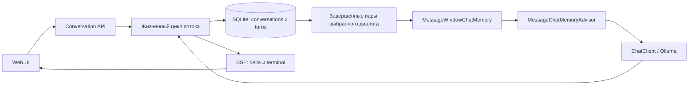

# Урок 1.4. Conversation, память модели и история в SQLite

[Материалы урока](../README.md) · [ДЗ](../homework/README.md) · [Проверка](../VERIFICATION.md) · [Предыдущая лекция](../../lesson-1.3/lecture/README.md)

Дата сверки: 2026-10-25. Java 25, Spring Boot 4.1.2, Spring AI 2.0.2, SQLite JDBC 3.53.4.0. Для UI-тестов — Node.js 24 и jsdom 27.4.0.

## Результат занятия

В RepoPilot появляются отдельные диалоги. После фразы «Меня зовут Анна» следующий вопрос «Как меня зовут?» в том же диалоге получает прежний контекст. В другом диалоге этого контекста нет. После перезапуска приложения список и история восстанавливаются из SQLite.

Streaming из 1.3 сохраняется. Успешные, прерванные и остановленные ответы видны после обновления страницы. При этом модель получает только ограниченное число завершённых обменов. История приложения и память модели развиваются независимо.

Занятие завершает модуль 1. План на 120 минут: 20 минут — модель данных, 30 — JDBC, 30 — память и поток, 25 — UI и проверки, 15 — перезапуск и ДЗ. Готовые HTTP- и SQL-каркасы позволяют сосредоточиться на новых механизмах. Для самостоятельного прохождения закладывайте дополнительное время на разбор жизненного цикла отмены.

## 1. Почему чат пока ничего не помнит

В 1.3 каждый вызов содержал system prompt и один текущий вопрос. Отрисованная лента оставалась в браузере, но не отправлялась модели. LLM не хранит прошлый HTTP-запрос автоматически: приложение само собирает очередной контекст.

Различаем четыре вещи:

| Понятие | В нашем проекте | Срок жизни |
| --- | --- | --- |
| Conversation | ID, название, даты | В SQLite до удаления данных вручную |
| Полная история | Вопросы, ответы и состояния всех попыток | Между запусками приложения |
| Память модели | Несколько завершённых user/assistant пар | Создаётся заново перед каждой генерацией |
| Контекстный запрос | System + окно истории + текущий user | Один вызов Ollama |

`ChatMemory` предназначена для управления контекстом; это не универсальный журнал всех событий чата. Официальная документация отдельно различает memory и history. [Spring AI Chat Memory](https://docs.spring.io/spring-ai/reference/api/chat-memory.html).

Окно из семи сообщений не равно семи токенам или семи диалогам. Один большой ответ может занять значительную часть контекста. В этом уроке ограничиваем число сообщений; оценку токенов оставим усложнением и следующему модулю.

## 2. Выбираем модель данных и границы



Один `Turn` — одна попытка: вопрос пользователя и соответствующий ответ модели. Это упрощает атомарное создание вопроса, хранение частичного ответа и выбор целых завершённых пар для памяти. Порядок задаёт числовой ID, а не время с недостаточной точностью.

Одна генерация на диалог может быть активна одновременно. Второй запрос отклоняем; скрытой очереди здесь нет. Разные диалоги имеют независимые разрешения. SQLite всё равно допускает одного writer за раз, поэтому операции записи короткие.

Приложение рассчитано на один локальный процесс и одного пользователя. `conversationId` обеспечивает разделение контекста, но не заменяет авторизацию в многопользовательской системе.

## 3. Подготавливаем проект

Продолжайте свой результат 1.3 или откройте готовый `lecture/pom.xml`. Не объединяйте проекты разных уроков в один Maven-модуль: у каждого собственные исходники, wrapper и зависимости.

Из корня курса:

```bash
cd lessons/lesson-1.4/lecture
./mvnw -version
node --version
npm ci
```

Maven должен использовать JDK 25; Node — ветку 24. Ollama и `qwen2.5:3b` готовим по 1.1. Docker и отдельный SQL-сервер в этом уроке не нужны.

В [pom.xml](pom.xml) сохраняем прежний BOM Spring AI и добавляем SQLite JDBC с явной версией:

```xml
<dependency>
    <groupId>org.xerial</groupId>
    <artifactId>sqlite-jdbc</artifactId>
    <version>3.53.4.0</version>
</dependency>
```

Версия закреплена по [релизу Xerial](https://github.com/xerial/sqlite-jdbc/releases/tag/3.53.4.0). Используем JDBC напрямую: не предполагаем наличие SQLite-диалекта в Spring AI JDBC memory auto-configuration. Нативная библиотека поставляется драйвером; отдельно установленная утилита sqlite3 для работы приложения не обязательна.

Создаём пакет `dev.myfrei.repopilot.conversation`. Старые `/api/chat` и `/api/chat/stream` остаются примерами без памяти; новый UI обращается к API диалогов. Для демонстрации памяти нужно использовать именно новый маршрут.

## 4. Добавляем настройки хранения

Относительный путь БД отсчитывается от рабочей директории процесса. Для команды Maven ниже это папка lecture. При запуске JAR из другой папки используйте явный путь через REPOPILOT_DATABASE.

Полная конфигурация:

[application.yaml](src/main/resources/application.yaml):

```yaml
spring:
  application:
    name: repopilot-lesson-1-4
  threads:
    virtual:
      enabled: true
  mvc:
    async:
      request-timeout: 100s
  ai:
    model:
      chat: ollama
      embedding: none
    ollama:
      base-url: ${OLLAMA_BASE_URL:http://localhost:11434}
      init:
        pull-model-strategy: never
      chat:
        model: ${OLLAMA_CHAT_MODEL:qwen2.5:3b}
        temperature: 0.2
        num-predict: 256
    retry:
      max-attempts: 0
  http:
    clients:
      imperative:
        factory: jdk
      connect-timeout: 3s
      read-timeout: 120s
      reactive:
        connector: reactor

server:
  address: 127.0.0.1
  port: ${PORT:8080}

repopilot:
  system-prompt: >-
    Ты RepoPilot, помощник Java-разработчика. Отвечай по-русски, кратко и по делу.
    Если данных о проекте недостаточно, скажи об этом и попроси уточнение.

  stream:
    idle-timeout: 30s
    max-duration: 90s
    heartbeat: 10s

  history:
    database: ${REPOPILOT_DATABASE:./data/repopilot.db}
    max-messages: 7
```

`max-messages: 7` задаёт учебное окно: до трёх завершённых пар плюс текущий вопрос; system prompt добавляется отдельно. Выбираем нечётное число 3–101 и проверяем его в конструкторе фабрики. Это политика приложения, а не общее требование Spring AI.

`data/`, файлы `*.db`, `*.db-wal`, `*.db-shm` исключены из Git. База содержит тексты вопросов и ответов; для демонстраций используйте учебные данные. Не копируйте активный WAL-файл как способ резервного копирования — сначала остановите приложение или используйте SQLite backup API.

## 5. Описываем Conversation и Turn

[Conversation.java](src/main/java/dev/myfrei/repopilot/conversation/Conversation.java):

```java
package dev.myfrei.repopilot.conversation;

public record Conversation(String id, String title, String createdAt, String updatedAt) { }
```

[Turn.java](src/main/java/dev/myfrei/repopilot/conversation/Turn.java):

```java
package dev.myfrei.repopilot.conversation;

public record Turn(long id, String conversationId, String question, String answer, String status, String errorCode) { }
```

Статусы относятся ко всей попытке, а не только к последнему сетевому фрагменту:

| Статус | Когда записывается | Допускается в память |
| --- | --- | --- |
| pending | Вопрос принят, terminal ещё не сохранён | Нет |
| completed | Provider подтвердил завершение и ответ непустой | Да, вопрос и ответ вместе |
| failed | Модель/протокол/хранилище сообщили ошибку | Нет |
| cancelled | Сервер обнаружил отмену подписки | Нет |
| interrupted | После запуска найден pending предыдущего процесса | Нет |

В UI значение completed преобразуется в complete, а failed/interrupted отображается как «Прерван». Пустой или частичный ответ при неудаче остаётся в истории с явным статусом.

## 6. Создаём схему SQLite

[history-schema.sql](src/main/resources/history-schema.sql):

```sql
CREATE TABLE IF NOT EXISTS conversations (
    id TEXT PRIMARY KEY,
    title TEXT NOT NULL,
    created_at TEXT NOT NULL,
    updated_at TEXT NOT NULL
);
CREATE TABLE IF NOT EXISTS turns (
    id INTEGER PRIMARY KEY AUTOINCREMENT,
    conversation_id TEXT NOT NULL REFERENCES conversations(id),
    question TEXT NOT NULL,
    answer TEXT NOT NULL DEFAULT '',
    status TEXT NOT NULL CHECK (status IN ('pending','completed','failed','cancelled','interrupted')),
    error_code TEXT NOT NULL DEFAULT ''
);
CREATE INDEX IF NOT EXISTS turns_by_conversation ON turns(conversation_id, id);
CREATE UNIQUE INDEX IF NOT EXISTS one_pending_turn ON turns(conversation_id) WHERE status = 'pending';
```

Внешний ключ защищает связь попытки с существующим диалогом. Partial unique index не позволяет создать две pending-попытки одного диалога даже при ошибке прикладной проверки. Условие `status IN (...)` не пускает неизвестные значения в таблицу.

`CREATE TABLE IF NOT EXISTS` подходит для первой учебной схемы. Это не система миграций: изменение Java record не меняет уже созданную БД. Следующие изменения схемы потребуют явной миграции.

SQLite требует включать foreign_keys для каждого соединения. WAL улучшает совместную работу чтений и записи, но не создаёт нескольких одновременных writers. Busy timeout ограничивает ожидание блокировки. [Foreign Keys](https://www.sqlite.org/foreignkeys.html), [WAL](https://www.sqlite.org/wal.html), [PRAGMA](https://www.sqlite.org/pragma.html).

## 7. Пишем JDBC-хранилище

Хранилище использует параметризованные SQL-запросы и закрывает Connection/Statement/ResultSet через try-with-resources. SQL-строки из пользовательского ввода не конкатенируются с командами.

Основные операции:

- create/list/get — работа с диалогами;
- begin — транзакционно сохраняет вопрос и обновляет дату диалога;
- append — добавляет текст только в pending-попытку;
- finish — меняет только pending на один из terminal-статусов;
- turns — полная история в порядке ID;
- completedWindow — последние N завершённых попыток в прямом порядке.

В конструкторе после создания схемы восстанавливаем зависшие pending как interrupted/RESTART. Это допустимо, пока один процесс владеет файлом. Запускать две копии приложения на одной БД нельзя: второй запуск не отличит живую попытку первого процесса от оборванной.

Полная реализация:

[SqliteHistory.java](src/main/java/dev/myfrei/repopilot/conversation/SqliteHistory.java):

```java
package dev.myfrei.repopilot.conversation;

import java.io.IOException;
import java.nio.charset.StandardCharsets;
import java.nio.file.Files;
import java.nio.file.Path;
import java.sql.Connection;
import java.sql.DriverManager;
import java.sql.ResultSet;
import java.sql.SQLException;
import java.time.Instant;
import java.util.ArrayList;
import java.util.List;
import java.util.UUID;
import org.springframework.beans.factory.annotation.Value;
import org.springframework.stereotype.Repository;

@Repository
public class SqliteHistory {
    private final String url;

    public SqliteHistory(@Value("${repopilot.history.database}") String database) {
        Path file = Path.of(database).toAbsolutePath();
        this.url = "jdbc:sqlite:" + file;
        try {
            Files.createDirectories(file.getParent());
            try (var input = getClass().getResourceAsStream("/history-schema.sql")) {
                if (input == null) throw new IOException("Schema resource missing");
                String schema = new String(input.readAllBytes(), StandardCharsets.UTF_8);
                withConnection(connection -> {
                    try (var statement = connection.createStatement()) {
                        statement.execute("PRAGMA journal_mode=WAL");
                        for (String sql : schema.split(";")) {
                            if (!sql.isBlank()) statement.execute(sql);
                        }
                        // Один процесс владеет файлом: незавершённые запросы предыдущего запуска не продолжаются.
                        statement.executeUpdate("UPDATE turns SET status='interrupted', error_code='RESTART' WHERE status='pending'");
                    }
                    return null;
                });
            }
        } catch (IOException ex) {
            throw new IllegalStateException("Cannot initialize history directory/schema", ex);
        }
    }

    public synchronized Conversation create(String title) {
        if (title == null || title.isBlank() || title.length() > 80) {
            throw new IllegalArgumentException("Title must contain 1..80 characters");
        }
        var conversation = new Conversation(UUID.randomUUID().toString(), title.strip(),
                Instant.now().toString(), Instant.now().toString());
        return withConnection(connection -> {
            try (var statement = connection.prepareStatement(
                    "INSERT INTO conversations(id,title,created_at,updated_at) VALUES (?,?,?,?)")) {
                statement.setString(1, conversation.id()); statement.setString(2, conversation.title());
                statement.setString(3, conversation.createdAt()); statement.setString(4, conversation.updatedAt());
                statement.executeUpdate();
            }
            return conversation;
        });
    }

    public synchronized List<Conversation> list() {
        return withConnection(connection -> {
            var result = new ArrayList<Conversation>();
            try (var statement = connection.prepareStatement("SELECT * FROM conversations ORDER BY updated_at DESC, id" );
                    var rows = statement.executeQuery()) {
                while (rows.next()) result.add(conversation(rows));
            }
            return List.copyOf(result);
        });
    }

    public synchronized Conversation get(String id) {
        return withConnection(connection -> {
            try (var statement = connection.prepareStatement("SELECT * FROM conversations WHERE id=?")) {
                statement.setString(1, id);
                try (var rows = statement.executeQuery()) {
                    if (!rows.next()) throw new ConversationProblem("NOT_FOUND", "Диалог не найден.");
                    return conversation(rows);
                }
            }
        });
    }

    public synchronized long begin(String id, String question) {
        get(id);
        if (question == null || question.isBlank() || question.length() > 4000) {
            throw new IllegalArgumentException("Question must contain 1..4000 characters");
        }
        return withConnection(connection -> {
            connection.setAutoCommit(false);
            try {
                try (var insert = connection.prepareStatement(
                        "INSERT INTO turns(conversation_id,question,status) VALUES (?,?,'pending')")) {
                    insert.setString(1, id); insert.setString(2, question.strip()); insert.executeUpdate();
                }
                long turn;
                try (var statement = connection.createStatement(); var row = statement.executeQuery("SELECT last_insert_rowid()")) {
                    row.next(); turn = row.getLong(1);
                }
                touch(connection, id);
                connection.commit();
                return turn;
            } catch (SQLException | RuntimeException ex) {
                connection.rollback(); throw ex;
            }
        });
    }

    public synchronized void append(long turn, String delta) {
        withConnection(connection -> {
            try (var statement = connection.prepareStatement("UPDATE turns SET answer=answer || ? WHERE id=? AND status='pending'")) {
                statement.setString(1, delta); statement.setLong(2, turn); statement.executeUpdate();
            }
            return null;
        });
    }

    public synchronized void finish(long turn, String status, String code) {
        if (!List.of("completed", "failed", "cancelled", "interrupted").contains(status)) {
            throw new IllegalArgumentException("Not a terminal status");
        }
        withConnection(connection -> {
            try (var statement = connection.prepareStatement("UPDATE turns SET status=?,error_code=? WHERE id=? AND status='pending'")) {
                statement.setString(1, status); statement.setString(2, code); statement.setLong(3, turn);
                statement.executeUpdate();
            }
            return null;
        });
    }

    public synchronized List<Turn> turns(String id) {
        get(id);
        return queryTurns("SELECT * FROM turns WHERE conversation_id=? ORDER BY id", id, 0);
    }

    public synchronized List<Turn> completedWindow(String id, int limit) {
        if (limit < 1) throw new IllegalArgumentException("Positive window required");
        return queryTurns("SELECT * FROM (SELECT * FROM turns WHERE conversation_id=? AND status='completed' ORDER BY id DESC LIMIT ?) ORDER BY id", id, limit);
    }

    private List<Turn> queryTurns(String sql, String id, int limit) {
        return withConnection(connection -> {
            var result = new ArrayList<Turn>();
            try (var statement = connection.prepareStatement(sql)) {
                statement.setString(1, id);
                if (limit > 0) statement.setInt(2, limit);
                try (var rows = statement.executeQuery()) {
                    while (rows.next()) result.add(new Turn(rows.getLong("id"), rows.getString("conversation_id"),
                            rows.getString("question"), rows.getString("answer"), rows.getString("status"), rows.getString("error_code")));
                }
            }
            return List.copyOf(result);
        });
    }

    private static Conversation conversation(ResultSet row) throws SQLException {
        return new Conversation(row.getString("id"), row.getString("title"), row.getString("created_at"), row.getString("updated_at"));
    }

    private static void touch(Connection connection, String id) throws SQLException {
        try (var statement = connection.prepareStatement("UPDATE conversations SET updated_at=? WHERE id=?")) {
            statement.setString(1, Instant.now().toString()); statement.setString(2, id); statement.executeUpdate();
        }
    }

    private <T> T withConnection(SqlFunction<T> action) {
        try (var connection = DriverManager.getConnection(this.url); var statement = connection.createStatement()) {
            statement.execute("PRAGMA foreign_keys=ON");
            statement.execute("PRAGMA busy_timeout=5000");
            return action.apply(connection);
        } catch (SQLException ex) {
            throw new IllegalStateException("History storage unavailable", ex);
        }
    }

    @FunctionalInterface
    private interface SqlFunction<T> { T apply(Connection connection) throws SQLException; }
}
```

`begin` выполняет INSERT и touch в одной короткой транзакции; при сбое делает rollback. Не держим SQL-транзакцию открытой на всё время генерации.

Сохранение terminal использует условие `WHERE status='pending'`. Поэтому завершившийся ответ нельзя затем перезаписать статусом cancelled из cleanup. Поздний delta тоже не дописывается к закрытой попытке.

Методы synchronized упрощают доступ к одному экземпляру repository и последовательность коротких JDBC-операций. Это не распределённая блокировка. Генерация LLM вне этих методов; один медленный ответ не удерживает монитор repository на 90 секунд.

### Контрольная точка

```bash
./mvnw -Dtest=SqliteHistoryTest test
```

Тесты используют настоящие временные файлы SQLite. Проверьте порядок, SQL как обычный текст, сохранение пробелов, rollback второй pending-попытки, перезапуск и защиту завершённой записи от поздних изменений.

## 8. Загружаем рабочее окно памяти

Для каждого запроса строим новый MessageWindowChatMemory из завершённых пар SQLite. Фабрика не сохраняет всю историю в singleton memory. Текущий pending-вопрос уже находится в БД, но не выбирается completedWindow; в prompt он попадёт ровно один раз через user.

Каждый запрос получает свой объект памяти. Внутренние записи memory advisor остаются временными; канонический статус результата определяет жизненный цикл нашего приложения.

[ConversationMemoryFactory.java](src/main/java/dev/myfrei/repopilot/conversation/ConversationMemoryFactory.java):

```java
package dev.myfrei.repopilot.conversation;

import org.springframework.ai.chat.memory.ChatMemory;
import org.springframework.ai.chat.memory.MessageWindowChatMemory;
import org.springframework.ai.chat.messages.AssistantMessage;
import org.springframework.ai.chat.messages.UserMessage;
import org.springframework.beans.factory.annotation.Value;
import org.springframework.stereotype.Component;

@Component
public class ConversationMemoryFactory {
    private final SqliteHistory history;
    private final int maxMessages;

    public ConversationMemoryFactory(SqliteHistory history,
            @Value("${repopilot.history.max-messages}") int maxMessages) {
        if (maxMessages < 3 || maxMessages > 101 || maxMessages % 2 == 0) {
            throw new IllegalArgumentException("Use an odd message window between 3 and 101");
        }
        this.history = history;
        this.maxMessages = maxMessages;
    }

    public ChatMemory create(String id) {
        ChatMemory memory = MessageWindowChatMemory.builder().maxMessages(this.maxMessages).build();
        for (Turn turn : this.history.completedWindow(id, (this.maxMessages - 1) / 2)) {
            memory.add(id, new UserMessage(turn.question()));
            memory.add(id, new AssistantMessage(turn.answer()));
        }
        return memory;
    }
}
```

Ограничиваем выборку уже в SQL. Не загружаем тысячи сообщений ради окна из трёх пар. После перезапуска фабрика работает по той же схеме: ей не нужно восстанавливать отдельный постоянный кеш памяти.

Например, полная история содержит Q1/A1, Q2/partial failed, Q3/A3 и Q4/A4. При окне из семи сообщений модель получит Q1/A1, Q3/A3, Q4/A4 и новый вопрос; неудачный Q2 целиком остаётся за пределами памяти.

Это осознанная политика. Иногда полезно передавать и неудачный вопрос, но тогда его статус и значение нужно моделировать отдельно; нельзя выдавать partial за подтверждённый assistant answer.

## 9. Подключаем MessageChatMemoryAdvisor

В ChatStreamService сохраняем прежний метод stream(message) и добавляем перегрузку с памятью и ID. При отсутствии memory старый маршрут работает как раньше. При наличии регистрируем advisor и передаём conversationId явно:

```java
prompt.advisors(MessageChatMemoryAdvisor.builder(memory).build())
        .advisors(advisors -> advisors.param(ChatMemory.CONVERSATION_ID, conversationId));
```

Полная версия сервиса с прежними таймаутами и проверкой finish reason:

[ChatStreamService.java](src/main/java/dev/myfrei/repopilot/chat/ChatStreamService.java):

```java
package dev.myfrei.repopilot.chat;

import java.time.Duration;
import java.util.concurrent.TimeoutException;
import java.util.concurrent.atomic.AtomicBoolean;
import java.util.concurrent.atomic.AtomicReference;

import org.slf4j.Logger;
import org.slf4j.LoggerFactory;
import org.springframework.ai.chat.client.ChatClient;
import org.springframework.ai.chat.client.advisor.MessageChatMemoryAdvisor;
import org.springframework.ai.chat.memory.ChatMemory;
import org.springframework.ai.chat.model.ChatResponse;
import org.springframework.beans.factory.annotation.Value;
import org.springframework.stereotype.Service;
import org.springframework.util.StringUtils;
import reactor.core.publisher.Flux;
import reactor.core.publisher.Mono;

@Service
public class ChatStreamService {

    private static final Logger LOG = LoggerFactory.getLogger(ChatStreamService.class);

    private final ChatClient client;
    private final String systemPrompt;
    private final Duration idleTimeout;
    private final Duration maxDuration;

    public ChatStreamService(ChatClient.Builder builder,
            @Value("${repopilot.system-prompt}") String systemPrompt,
            @Value("${repopilot.stream.idle-timeout}") Duration idleTimeout,
            @Value("${repopilot.stream.max-duration}") Duration maxDuration) {
        this.client = builder.build();
        this.systemPrompt = systemPrompt;
        this.idleTimeout = idleTimeout;
        this.maxDuration = maxDuration;
    }

    public Flux<ChatStreamEvent> stream(String message) {
        return stream(message, null, null);
    }

    public Flux<ChatStreamEvent> stream(String message, ChatMemory memory, String conversationId) {
        if (!StringUtils.hasText(message) || message.length() > 4_000) {
            throw new IllegalArgumentException("Сообщение должно содержать от 1 до 4000 символов.");
        }
        return Flux.defer(() -> {
            var hasText = new AtomicBoolean();
            var finishReason = new AtomicReference<>("");

            Flux<ChatStreamEvent> deltas = Flux.defer(() -> {
                        var prompt = this.client.prompt().system(this.systemPrompt).user(message.strip());
                        if (memory != null) {
                            prompt.advisors(MessageChatMemoryAdvisor.builder(memory).build())
                                    .advisors(advisors -> advisors.param(ChatMemory.CONVERSATION_ID, conversationId));
                        }
                        return prompt.stream().chatResponse();
                    })
                    .timeout(this.idleTimeout)
                    .takeUntilOther(Mono.delay(this.maxDuration).flatMap(ignored ->
                            Mono.error(new TimeoutException("Stream deadline exceeded"))))
                    .takeUntil(response -> StringUtils.hasText(reason(response)))
                    .<ChatStreamEvent>handle((response, sink) -> {
                        if (StringUtils.hasText(reason(response))) {
                            finishReason.set(reason(response));
                        }
                        String text = response.getResult() == null ? null
                                : response.getResult().getOutput().getText();
                        if (text != null && !text.isEmpty()) {
                            if (StringUtils.hasText(text)) hasText.set(true);
                            sink.next(ChatStreamEvent.delta(text));
                        }
                    });

            return Flux.concat(Flux.just(ChatStreamEvent.started()), deltas,
                            Mono.fromSupplier(() -> terminal(finishReason.get(), hasText.get())))
                    .onErrorResume(error -> {
                        LOG.warn("Streaming failed: {}", error.getClass().getSimpleName());
                        return Mono.just(error instanceof TimeoutException
                                ? ChatStreamEvent.failed("TIMEOUT", "Модель не успела завершить ответ. Попробуйте ещё раз.")
                                : ChatStreamEvent.failed("MODEL_ERROR", "Поток модели прерван. Проверьте Ollama и повторите запрос."));
                    });
        });
    }

    private static String reason(ChatResponse response) {
        return response.getResult() == null ? "" : response.getResult().getMetadata().getFinishReason();
    }

    private static ChatStreamEvent terminal(String reason, boolean hasText) {
        if ("length".equalsIgnoreCase(reason)) {
            return ChatStreamEvent.failed("OUTPUT_LIMIT", "Ответ достиг лимита длины и остался незавершённым.");
        }
        if (!"stop".equalsIgnoreCase(reason)) {
            return ChatStreamEvent.failed("UPSTREAM_INCOMPLETE", "Модель не подтвердила завершение ответа.");
        }
        return hasText ? ChatStreamEvent.completed()
                : ChatStreamEvent.failed("EMPTY_RESPONSE", "Модель вернула пустой ответ.");
    }
}
```

Advisor добавляет сохранённые сообщения в prompt и использует ID при обращении к memory. Внутренняя логика advisor не становится нашей таблицей истории. Мы сохраняем только результат, который прошёл условия completed из 1.3. [Исходник MessageChatMemoryAdvisor 2.0.2](https://github.com/spring-projects/spring-ai/blob/v2.0.2/spring-ai-client-chat/src/main/java/org/springframework/ai/chat/client/advisor/MessageChatMemoryAdvisor.java).

Наличие conversationId не заставляет модель помнить бесконечно и не гарантирует верный ответ на вопрос об имени. Тесты проверяют состав запроса, а поведение конкретной LLM проверяем вручную.

## 10. Запрещаем параллельные запросы одного диалога

Сценарий гонки: две вкладки одновременно читают старую историю, генерируют ответы и записывают их в неожиданном порядке. Защищаем весь цикл «прочитать → вызвать модель → сохранить результат» одной lease на диалог.

Lease не удерживает Java lock на потоке во время генерации; это запись в concurrent set. Повторное close безопасно и не снимает более новую lease.

[ConversationGate.java](src/main/java/dev/myfrei/repopilot/conversation/ConversationGate.java):

```java
package dev.myfrei.repopilot.conversation;

import java.util.Set;
import java.util.concurrent.ConcurrentHashMap;
import java.util.concurrent.atomic.AtomicBoolean;
import org.springframework.stereotype.Component;

@Component
public class ConversationGate {
    private final Set<String> active = ConcurrentHashMap.newKeySet();

    public Lease acquire(String id) {
        if (!this.active.add(id)) {
            throw new ConversationProblem("CONVERSATION_BUSY", "В этом диалоге уже выполняется запрос. Дождитесь его окончания.");
        }
        return new Lease(id);
    }

    public final class Lease implements AutoCloseable {
        private final String id;
        private final AtomicBoolean closed = new AtomicBoolean();
        private Lease(String id) { this.id = id; }
        @Override
        public void close() {
            if (this.closed.compareAndSet(false, true)) active.remove(this.id);
        }
    }
}
```

Сама ошибка описана классом [ConversationProblem.java](src/main/java/dev/myfrei/repopilot/conversation/ConversationProblem.java), который хранит публичный code и message.

Второй запрос возвращает started → failed/CONVERSATION_BUSY и не создаёт новую попытку. Другая conversationId проходит независимо. Политика очереди, лимиты на пользователя и несколько процессов потребуют отдельного дизайна.

## 11. Связываем запись и жизненный цикл потока

Недостаточно сохранить ответ в doOnComplete: отменённый поток не вызовет обычное завершение, а partial потеряется. Поэтому записываем фрагменты по мере получения, terminal — перед передачей клиенту, cleanup — при любом исходе.

JDBC блокирует вызывающий поток. Переносим открытие ресурса, сохранение и отмену на boundedElastic. В publishOn используем prefetch=1: между моделью и хранилищем не накапливается большая очередь ожидающих записи событий.

Flux.using создаёт session при подписке и освобождает её при завершении, ошибке или cancel. Session содержит lease, ID попытки и подготовленное окно памяти.

[ConversationChatService.java](src/main/java/dev/myfrei/repopilot/conversation/ConversationChatService.java):

```java
package dev.myfrei.repopilot.conversation;

import dev.myfrei.repopilot.chat.ChatStreamEvent;
import dev.myfrei.repopilot.chat.ChatStreamService;
import org.slf4j.Logger;
import org.slf4j.LoggerFactory;
import org.springframework.ai.chat.memory.ChatMemory;
import org.springframework.stereotype.Service;
import org.springframework.util.StringUtils;
import reactor.core.publisher.Flux;
import reactor.core.scheduler.Schedulers;

@Service
public class ConversationChatService {
    private static final Logger LOG = LoggerFactory.getLogger(ConversationChatService.class);
    private final SqliteHistory history;
    private final ConversationGate gate;
    private final ConversationMemoryFactory memories;
    private final ChatStreamService model;

    public ConversationChatService(SqliteHistory history, ConversationGate gate,
            ConversationMemoryFactory memories, ChatStreamService model) {
        this.history = history; this.gate = gate; this.memories = memories; this.model = model;
    }

    public Flux<ChatStreamEvent> stream(String id, String question) {
        if (!StringUtils.hasText(question) || question.length() > 4000) {
            throw new IllegalArgumentException("Question must contain 1..4000 characters");
        }
        Flux<ChatStreamEvent> work = Flux.using(() -> open(id, question), session ->
                this.model.stream(question, session.memory(), id)
                        .filter(event -> !event.type().equals("started"))
                        .publishOn(Schedulers.boundedElastic(), 1)
                        .map(event -> persist(session.turn(), event))
                        .doOnError(error -> this.history.finish(session.turn(), "failed", "HISTORY_ERROR")), this::close)
                .subscribeOn(Schedulers.boundedElastic())
                .cancelOn(Schedulers.boundedElastic());
        return Flux.concat(Flux.just(ChatStreamEvent.started()), work)
                .onErrorResume(error -> {
                    LOG.warn("Conversation stream failed: {}", error.getClass().getSimpleName());
                    return Flux.just(error instanceof ConversationProblem problem
                            ? ChatStreamEvent.failed(problem.code(), problem.getMessage())
                            : ChatStreamEvent.failed("HISTORY_ERROR", "Не удалось сохранить историю. Проверьте доступность SQLite."));
                });
    }

    private Session open(String id, String question) {
        var lease = this.gate.acquire(id);
        Long turn = null;
        try {
            turn = this.history.begin(id, question);
            return new Session(lease, turn, this.memories.create(id));
        } catch (RuntimeException ex) {
            try { if (turn != null) this.history.finish(turn, "failed", "HISTORY_ERROR"); }
            finally { lease.close(); }
            throw ex;
        }
    }

    private ChatStreamEvent persist(long turn, ChatStreamEvent event) {
        if (event.type().equals("delta")) this.history.append(turn, event.text());
        if (event.type().equals("completed")) this.history.finish(turn, "completed", "");
        if (event.type().equals("failed")) this.history.finish(turn, "failed", event.code());
        return event;
    }

    private void close(Session session) {
        try {
            // UPDATE ... WHERE pending не меняет уже сохранённый completed/failed.
            this.history.finish(session.turn(), "cancelled", "CLIENT_CANCELLED");
        } finally {
            session.lease().close();
        }
    }

    private record Session(ConversationGate.Lease lease, long turn, ChatMemory memory) { }
}
```

Порядок для успешного ответа:

1. Отдать started.
2. На boundedElastic получить lease, создать pending и загрузить окно.
3. Вызвать прежний потоковый сервис; его внутренний started отфильтровать.
4. Сохранить каждый delta и только затем передать его клиенту.
5. Записать completed/failed и только затем отдать terminal.
6. В cleanup завершить ещё pending как cancelled и освободить lease.

При нормальном terminal последний UPDATE ничего не меняет, потому что запись уже закрыта. Ошибка слоя хранения приводит к безопасному HISTORY_ERROR. Если сама БД недоступна и cleanup не может записать статус, pending будет восстановлен при следующем успешном старте.

Есть неизбежная граница: completed может быть записан в БД, а сеть оборваться до его доставки браузеру. Клиент отметит локальную попытку как незавершённую; после «Обновить» увидит каноническое состояние сервера. Доставку события и SQL commit нельзя сделать одной транзакцией.

При отмене браузером сервер узнаёт о закрытии на очередной записи/heartbeat. Поэтому status cancelled и освобождение lease могут появиться с задержкой. Немедленный повтор в это окно может получить CONVERSATION_BUSY; дождитесь обнаружения отмены и повторите запрос. Урок 1.3 объясняет отличие закрытия HTTP от прекращения inference.

## 12. Добавляем HTTP API

| Метод и путь | Ответ |
| --- | --- |
| POST /api/conversations, JSON title | 201, Conversation, Location |
| GET /api/conversations | Диалоги по обновлению, затем ID |
| GET /api/conversations/{id} | Conversation и turns в порядке ID |
| POST /api/conversations/{id}/messages/stream, JSON message | SSE из урока 1.3 |

UUID диалога создаёт сервер. Несуществующий ID получает 404 до открытия SSE. Неверный title/message получает 400. Конфликт lease проверяется лениво уже внутри потока и передаётся failed/CONVERSATION_BUSY при HTTP 200.

[ConversationController.java](src/main/java/dev/myfrei/repopilot/conversation/ConversationController.java):

```java
package dev.myfrei.repopilot.conversation;

import java.net.URI;
import java.time.Duration;
import java.util.List;
import java.util.UUID;
import dev.myfrei.repopilot.chat.ChatRequest;
import dev.myfrei.repopilot.chat.ChatStreamEvent;
import jakarta.validation.Valid;
import jakarta.validation.constraints.NotBlank;
import jakarta.validation.constraints.Size;
import org.springframework.beans.factory.annotation.Value;
import org.springframework.http.CacheControl;
import org.springframework.http.MediaType;
import org.springframework.http.ResponseEntity;
import org.springframework.http.codec.ServerSentEvent;
import org.springframework.web.bind.annotation.GetMapping;
import org.springframework.web.bind.annotation.PathVariable;
import org.springframework.web.bind.annotation.PostMapping;
import org.springframework.web.bind.annotation.RequestBody;
import org.springframework.web.bind.annotation.RequestMapping;
import org.springframework.web.bind.annotation.RestController;
import reactor.core.publisher.Flux;

@RestController
@RequestMapping("/api/conversations")
public class ConversationController {
    private final SqliteHistory history;
    private final ConversationChatService chat;
    private final Duration heartbeat;

    public ConversationController(SqliteHistory history, ConversationChatService chat,
            @Value("${repopilot.stream.heartbeat}") Duration heartbeat) {
        this.history = history; this.chat = chat; this.heartbeat = heartbeat;
    }

    @PostMapping
    public ResponseEntity<Conversation> create(@Valid @RequestBody CreateConversation request) {
        Conversation result = this.history.create(request.title());
        return ResponseEntity.created(URI.create("/api/conversations/" + result.id())).body(result);
    }

    @GetMapping
    public List<Conversation> list() { return this.history.list(); }

    @GetMapping("/{id}")
    public Detail detail(@PathVariable UUID id) {
        return new Detail(this.history.get(id.toString()), this.history.turns(id.toString()));
    }

    @PostMapping(value = "/{id}/messages/stream", produces = MediaType.TEXT_EVENT_STREAM_VALUE)
    public ResponseEntity<Flux<ServerSentEvent<ChatStreamEvent>>> stream(@PathVariable UUID id,
            @Valid @RequestBody ChatRequest request) {
        this.history.get(id.toString()); // 404 до отправки SSE-заголовков.
        var events = this.chat.stream(id.toString(), request.message())
                .map(event -> ServerSentEvent.builder(event).event(event.type()).build());
        var keepAlive = Flux.interval(this.heartbeat)
                .map(ignored -> ServerSentEvent.<ChatStreamEvent>builder().comment("keepalive").build());
        return ResponseEntity.ok().contentType(MediaType.TEXT_EVENT_STREAM).cacheControl(CacheControl.noStore())
                .header("X-Accel-Buffering", "no").body(events.mergeWith(keepAlive)
                        .takeUntil(frame -> frame.data() != null && frame.data().terminal()));
    }

    public record CreateConversation(@NotBlank @Size(max = 80) String title) { }
    public record Detail(Conversation conversation, List<Turn> turns) { }
}
```

Обработчик [ConversationExceptionHandler.java](src/main/java/dev/myfrei/repopilot/conversation/ConversationExceptionHandler.java) превращает NOT_FOUND в ProblemDetail 404. Общий [ApiExceptionHandler.java](src/main/java/dev/myfrei/repopilot/chat/ApiExceptionHandler.java) сохраняет 400 для невалидных полей.

Готовый controller не принимает от браузера историю сообщений: клиент передаёт ID и текущий вопрос, а источник контекста выбирает сервер.

## 13. Подключаем UI к диалогам

Transport из 1.3 получает необязательный параметр url с прежним значением по умолчанию. Parser, UTF-8, AbortSignal и проверки terminal остаются прежними. [stream-api.js](src/main/resources/static/js/stream-api.js).

API диалогов создаёт маршруты с ID, отправляет JSON и читает безопасные ошибки:

[conversation-api.js](src/main/resources/static/js/conversation-api.js):

```javascript
import { streamMessage } from "./stream-api.js";

export function createConversationApi(fetchImpl = globalThis.fetch) {
  async function json(path, options = {}) {
    const response = await fetchImpl(path, { ...options,
      headers: { "Accept": "application/json, application/problem+json", ...options.headers } });
    if (!response.ok) {
      let problem;
      try { problem = await response.json(); } catch { /* Use a public fallback. */ }
      throw new Error([400, 404, 409].includes(response.status) && problem?.detail
        ? problem.detail : "Не удалось загрузить диалоги. Проверьте приложение.");
    }
    return response.json();
  }
  const path = id => `/api/conversations/${encodeURIComponent(id)}`;
  return {
    list: () => json("/api/conversations"),
    create: title => json("/api/conversations", { method: "POST",
      headers: { "Content-Type": "application/json" }, body: JSON.stringify({ title }) }),
    detail: id => json(path(id)),
    send: (id, message, options) => streamMessage(message,
      { ...options, url: `${path(id)}/messages/stream` }, fetchImpl)
  };
}
```

В [index.html](src/main/resources/static/index.html) добавлены список, «Новый диалог», «Обновить», заголовок выбранного диалога и сообщение о загрузке. Оформление находится в [styles.css](src/main/resources/static/css/styles.css).

Создаём модуль, который соединяет сохранённые диалоги с прежним чатом:

[conversations.js](src/main/resources/static/js/conversations.js):

```javascript
import { mountChat } from "./app.js";
import { isBusy } from "./chat-controller.js";
import { createConversationApi } from "./conversation-api.js";

export function historyMessages(turns) {
  const statuses = { completed: "complete", pending: "pending", failed: "interrupted",
    interrupted: "interrupted", cancelled: "cancelled" };
  return turns.flatMap(turn => [
    { role: "user", content: turn.question },
    { role: "assistant", content: turn.answer, status: statuses[turn.status] || "interrupted" }
  ]);
}

export function mountConversations(document, { api = createConversationApi(), storage = globalThis.localStorage } = {}) {
  let selected = null;
  let loading = false;
  let conversations = [];
  const list = document.getElementById("conversation-list");
  const notice = document.getElementById("conversation-notice");
  const chat = mountChat(document, (message, options) => {
    if (!selected) throw new Error("Сначала создайте диалог.");
    return api.send(selected, message, options);
  }, syncControls);
  const busy = () => loading || isBusy(chat.getState().phase);
  function savedId() { try { return storage?.getItem("repopilot.conversationId"); } catch { return null; } }
  function syncControls(state) {
    const disabled = loading || isBusy(state.phase);
    document.getElementById("new-conversation").disabled = disabled;
    document.getElementById("refresh-conversations").disabled = disabled;
    for (const button of list.querySelectorAll("button")) button.disabled = disabled;
    document.getElementById("message").disabled = disabled || !selected;
    document.getElementById("send-button").disabled = disabled || !selected;
  }
  function lock(value) { loading = value; syncControls(chat.getState()); }
  function renderList() {
    list.replaceChildren();
    for (const conversation of conversations) {
      const item = document.createElement("li");
      const button = document.createElement("button");
      button.type = "button"; button.textContent = conversation.title;
      button.setAttribute("aria-current", String(conversation.id === selected));
      button.addEventListener("click", () => select(conversation.id));
      item.append(button); list.append(item);
    }
  }
  async function show(id) {
    const detail = await api.detail(id);
    chat.load(historyMessages(detail.turns));
    selected = id;
    document.getElementById("conversation-title").textContent = detail.conversation.title;
    try { storage?.setItem("repopilot.conversationId", id); } catch { /* History lives on the server. */ }
    document.getElementById("message").value = "";
    document.getElementById("character-count").textContent = "0 / 4000";
    renderList();
    notice.textContent = "История загружена. Прерванные ответы не входят в память модели.";
  }
  async function select(id) {
    if (busy()) return false;
    lock(true);
    try { await show(id); return true; }
    catch (error) { notice.textContent = error.message; return false; }
    finally { lock(false); }
  }
  async function refresh() {
    if (busy()) return false;
    lock(true);
    try {
      conversations = await api.list();
      renderList();
      const preferred = selected || savedId();
      const id = conversations.find(item => item.id === preferred)?.id || conversations[0]?.id;
      if (id) await show(id);
      else {
        selected = null;
        chat.load([]);
        document.getElementById("conversation-title").textContent = "Выберите диалог";
        notice.textContent = "Создайте первый диалог, чтобы начать разговор.";
      }
      return true;
    } catch (error) { notice.textContent = error.message; return false; }
    finally { lock(false); }
  }
  async function create() {
    if (busy()) return false;
    lock(true);
    try {
      const created = await api.create(`Диалог ${conversations.length + 1}`);
      conversations = [created, ...conversations];
      await show(created.id);
      return true;
    } catch (error) { notice.textContent = error.message; return false; }
    finally { lock(false); }
  }
  document.getElementById("new-conversation").addEventListener("click", create);
  document.getElementById("refresh-conversations").addEventListener("click", refresh);
  const ready = refresh();
  return { ready, select, create, refresh, chat, selectedId: () => selected };
}
```

Важные детали:

- localStorage хранит только выбранный ID; тексты находятся в SQLite;
- при отсутствии сохранённых диалогов поле отключено до явного создания;
- при переключении история заменяется, а черновик очищается;
- во время загрузки/генерации переключение и создание заблокированы;
- ошибка загрузки другого диалога сохраняет текущий;
- обновление списка восстанавливает серверные состояния partial;
- названия и сообщения вставляются через textContent.

В [chat-controller.js](src/main/resources/static/js/chat-controller.js) добавлен load(messages), который заменяет ленту только вне активной генерации. В [app.js](src/main/resources/static/js/app.js) добавлен callback состояния для блокировки переключателей. [main.js](src/main/resources/static/js/main.js) теперь вызывает mountConversations(document).

### Почему изменился повтор запроса

Каждый новый POST создаёт новый Turn. Поэтому retry в 1.4 показывает новую пару user/assistant, сохраняя предыдущую неудачную попытку. После перезагрузки лента выглядит так же, как во время работы. В 1.3 попытки жили только в UI и вопрос отображался один раз.

Повтор здесь не является идемпотентным воспроизведением того же HTTP-запроса. Автоматических retries после partial нет. Для прозрачной группировки попыток одного вопроса понадобятся messageId/attemptId и отдельный контракт — это дальнейшее развитие модели данных.

## 14. Запускаем и проверяем контекст

```bash
./mvnw spring-boot:run
```

Откройте http://127.0.0.1:8080/, нажмите «Новый диалог». Отправьте «Меня зовут Анна», дождитесь completed, затем «Как меня зовут?». Создайте второй диалог и повторите только второй вопрос. Вернитесь к первому — его история должна восстановиться.

Для проверки без UI сначала создайте диалог:

```bash
curl --include http://127.0.0.1:8080/api/conversations \
  -H 'Content-Type: application/json' \
  -d '{"title":"Проверка памяти"}'
```

Скопируйте возвращённый id:

```bash
CONVERSATION_ID='вставьте-id-из-ответа'
curl --no-buffer --max-time 100 \
  "http://127.0.0.1:8080/api/conversations/$CONVERSATION_ID/messages/stream" \
  -H 'Content-Type: application/json' \
  -H 'Accept: text/event-stream, application/problem+json' \
  -d '{"message":"Меня зовут Анна. Ответь одним предложением."}'
```

После completed отправьте второй запрос с тем же ID:

```bash
curl --no-buffer --max-time 100 \
  "http://127.0.0.1:8080/api/conversations/$CONVERSATION_ID/messages/stream" \
  -H 'Content-Type: application/json' \
  -H 'Accept: text/event-stream, application/problem+json' \
  -d '{"message":"Как меня зовут?"}'
curl "http://127.0.0.1:8080/api/conversations/$CONVERSATION_ID"
```

Для PowerShell используйте curl.exe и задайте `$env:REPOPILOT_DATABASE` при необходимости явного пути БД. Maven Wrapper запускается как `./mvnw.cmd`. Bash-переменная CONVERSATION_ID из примера не переносится в PowerShell дословно.

## 15. Проверяем перезапуск, обрыв и конкуренцию

1. Завершите два обмена и запомните путь БД.
2. Остановите приложение, запустите его снова с тем же путём, обновите страницу.
3. Убедитесь, что список, порядок и ответы восстановились.
4. Задайте уточняющий вопрос: в HTTP-запросе модели должны быть восстановленные пары.
5. Начните длинный ответ и нажмите «Остановить». Дождитесь обнаружения отмены сервером, затем «Обновить»: partial сохранён, статус не completed.
6. Для обрыва provider используйте тестовый HTTP-сценарий; не выдавайте его за реальную генерацию.
7. Откройте тот же диалог во второй вкладке. Пока первый запрос активен, второй должен получить CONVERSATION_BUSY без новой записи turns.
8. Проверьте другой ID: lease первого диалога ему не мешает. Реальная скорость параллельной генерации зависит от Ollama и оборудования.

Нормальная остановка приложения может успеть завершить запрос или отметить отмену. Восстановление pending после аварийного завершения проверяется отдельно тестом restartKeepsCompleteAndMarksPendingInterruptedWithPartial. В браузерном стенде также выполнен перезапуск отдельного тестового Java-процесса с тем же файлом.

## 16. Фиксируем первые контрольные вопросы

В [evaluation/Baseline.md](evaluation/Baseline.md) подготовлены десять вопросов и поля для ответов. Пока нет документов конкретного репозитория, часть вопросов намеренно проверяет признание нехватки контекста.

Заполняйте ответы только после запуска настоящей модели. Зафиксируйте model ID, настройки, холодный/тёплый запуск и ID диалога. Для независимых вопросов создавайте разные диалоги; для проверки памяти явно отмечайте связанные шаги. Автоматический HTTP-stub проверяет контракт и не даёт baseline качества модели.

## 17. Автоматические проверки

```bash
./mvnw package
npm ci
npm test
```

Рабочий пример: **79 Java- и 60 JavaScript-проверок**. 53 Java-сценария streaming/обычного чата сохранены из 1.3. Новые проверки:

| Набор | Количество | Что подтверждает |
| --- | --- | --- |
| SqliteHistoryTest | 9 | Настоящая SQLite, порядок, rollback, partial, terminal и перезапуск |
| ConversationMemoryFactoryTest | 4 | Изоляция, ограничение окна, исключение неудач и независимость memory/history |
| ConversationGateTest | 2 | Конфликт одного ID и безопасное повторное close |
| ConversationChatServiceTest | 5 | Ленивая запись, terminal до доставки, partial, cancel и освобождение lease |
| ConversationHttpIntegrationTest | 6 | Boot → SQLite → advisor → Ollama stub → SSE, фактический состав prompt и отключение |
| conversations.test.mjs | 15 | Список/создание/выбор, загрузка, статусы, маршруты, ошибки, storage и безопасный DOM |

В прежних UI-тестах осознанно обновлён контракт retry: новая попытка представляет новую пару user/assistant. Проверки parser и transport сохранены.

Отдельные команды:

```bash
./mvnw -Dtest=SqliteHistoryTest,ConversationMemoryFactoryTest,ConversationGateTest test
./mvnw -Dtest=ConversationChatServiceTest,ConversationHttpIntegrationTest test
node --test src/test/js/conversations.test.mjs
```

HTTP-тест проверяет реальный исходящий JSON, а не только вызов mock-advisor. Он подтверждает передачу истории A в A, отсутствие A в B, вытеснение старой пары из prompt без удаления истории и пропуск failed-попытки.

Проверки не требуют скачанных весов. Реальная LLM в среде автора не запускалась. Выполненные проверки и пределы — в [VERIFICATION.md](../VERIFICATION.md).

## 18. Типичные ошибки и ограничения

| Симптом | Причина и действие |
| --- | --- |
| После перезапуска пусто | Проверьте рабочую директорию и REPOPILOT_DATABASE: могли открыть другой файл |
| История есть, модель не помнит | Проверьте новый маршрут, регистрацию advisor, ID и completed-статусы |
| Вопрос попал дважды | Не загружайте pending в окно и не добавляйте текущий вопрос вручную в memory |
| Partial стал «знанием» модели | Выборка памяти должна фильтровать completed целыми парами |
| Повторный запрос отклонён сразу после Stop | Сервер ещё не обнаружил отключение; дождитесь heartbeat/cleanup |
| SQLITE_BUSY | Проверьте владельца файла; busy timeout не исправляет длинные транзакции |
| В другом диалоге чужое имя | Проверьте ID в запросе и параметре advisor, отсутствие общего singleton memory |
| Выдаётся неверный ответ об имени | Посмотрите фактический prompt; доставка контекста не гарантирует правильность генерации |
| После правки SQL старая схема | IF NOT EXISTS не выполняет миграции; нужна явная миграция |

Учебные ограничения: один процесс и локальный файл, полная история читается без пагинации, запись каждого delta создаёт отдельную короткую SQL-операцию. Для большого продукта понадобятся пагинация, пакетирование checkpoints и более продуманное управление соединениями. В этом уроке простота делает границы сохранения видимыми и проверяемыми.

## 19. Домашнее задание

В [homework](../homework/README.md) предоставлены полностью готовые диалоги, SQLite, окно памяти и streaming UI этой лекции. Новая задача — найти текст в сохранённом журнале выбранного диалога, не меняя контекст модели.

Реализуйте только [HistorySearch.find](../homework/src/main/java/dev/myfrei/repopilot/conversation/HistorySearch.java). Готовый `GET /api/conversations/{id}/search?q=...&limit=10` передаёт snapshot в вашу policy. Нужны буквальный поиск по question/answer после Unicode NFC и lower-case с Locale.ROOT, изоляция conversationId, только terminal-статусы и порядок от большего turn ID к меньшему. Сначала фильтруйте, затем применяйте limit; верните неизменяемый результат и не меняйте исходный snapshot.

Новые [policy acceptance](../homework/src/test/java/dev/myfrei/repopilot/conversation/HistorySearchAcceptanceTest.java) и [HTTP acceptance](../homework/src/test/java/dev/myfrei/repopilot/conversation/HistorySearchHttpAcceptanceTest.java) проверяют Unicode, буквальные спецсимволы, изоляцию, limit, настоящий временный SQLite и неизменность memory window. По [VERIFICATION](../VERIFICATION.md), каркас собирается, базовые **79 Java + 60 JS** зелёные, **8 новых Java** сначала красные. Во временном эталоне с заменой только search policy проходят **87 Java + 60 JS**, тесты не менялись.

После `./mvnw test` и `npm test` из homework создайте два диалога, найдите старую реплику и проверьте отсутствие чужих результатов. Заполните [SUBMISSION](../homework/SUBMISSION.md), отдельно показав журнал, поисковую выдачу и окно памяти. Поиск snapshot рассчитан на небольшой локальный журнал.

Усложнение: спроектируйте пагинацию с устойчивым курсором и проверьте добавление новой реплики между страницами.

## 20. Самопроверка

1. Почему полная история не должна ограничиваться окном ChatMemory?
2. Почему cancelled/failed-попытку исключаем целиком, включая вопрос?
3. Зачем нужен явный conversationId при наличии объекта memory?
4. Почему одной синхронизации коротких JDBC-методов недостаточно для генерации одного диалога?
5. Почему не держим SQL-транзакцию во время работы модели?
6. Что произойдёт при отключении клиента сразу после SQL completed, но до получения terminal?
7. Почему localStorage с выбранным ID не является хранилищем истории?
8. Какие условия нарушатся при запуске второго процесса на том же файле?

## 21. Читать дальше

- [Spring AI Chat Memory](https://docs.spring.io/spring-ai/reference/api/chat-memory.html) — memory/history и передача ID.
- [MessageWindowChatMemory v2.0.2](https://github.com/spring-projects/spring-ai/blob/v2.0.2/spring-ai-model/src/main/java/org/springframework/ai/chat/memory/MessageWindowChatMemory.java) — обработка окна в зафиксированном релизе.
- [MessageChatMemoryAdvisor v2.0.2](https://github.com/spring-projects/spring-ai/blob/v2.0.2/spring-ai-client-chat/src/main/java/org/springframework/ai/chat/client/advisor/MessageChatMemoryAdvisor.java) — добавление сообщений в prompt.
- [SQLite Foreign Keys](https://www.sqlite.org/foreignkeys.html), [WAL](https://www.sqlite.org/wal.html), [PRAGMA](https://www.sqlite.org/pragma.html) — настройки соединений и ограничения записи.
- [Xerial SQLite JDBC 3.53.4.0](https://github.com/xerial/sqlite-jdbc/releases/tag/3.53.4.0) — закреплённый драйвер.
- [Когда подходит SQLite](https://www.sqlite.org/whentouse.html) — границы применения локальной БД.
- [Reactor: Using Resources and the Finally Block](https://projectreactor.io/docs/core/release/reference/coreFeatures/error-handling.html) — жизненный цикл ресурсов в реактивной цепочке.

В уроке 2.1 будем управлять контекстом и сравнивать полный контекст с поиском по документам. Сохранённая история и набор контрольных вопросов дадут основу для измерений.

