# Урок 2.2. Документы → чанки → embeddings

[Материалы урока](../README.md) · [ДЗ](../homework/README.md) · [Проверка](../VERIFICATION.md) · [Предыдущая лекция](../../lesson-2.1/lecture/README.md)

Дата сверки: 2026-10-25. Java 25, Spring Boot 4.1.2, Spring AI 2.0.2, SQLite JDBC 3.53.4.0. Для UI-проверок — Node.js 24 и jsdom 27.4.0.

## Результат занятия

В RepoPilot появляется панель подготовки индекса. Пользователь выбирает стратегию разбиения, видит чанки с источником, разделом и диапазоном строк, затем получает embeddings отдельной локальной моделью. Готовый снимок сохраняется на диск и восстанавливается после перезапуска.

Повторный запуск на тех же данных не пересчитывает векторы. Изменение корпуса, параметров разбиения или идентичности encoder требует нового снимка. Ошибка модели, размерности или записи не публикует частичный результат вместо предыдущего.

Чат и FULL_CONTEXT из 2.1 продолжают работать. Поиск по векторам подключим в 2.3: сейчас строим и проверяем ingestion, отдельно от генерации ответов.

План на 120 минут: 20 — модель данных и embeddings, 30 — chunker, 25 — интеграция с Ollama, 25 — снимок и идемпотентность, 20 — UI и эксперименты. Реализация целиком включает инфраструктуру и тесты; для самостоятельного прохождения закладывайте дополнительное время. ДЗ — ориентировочно 3–5 часов.

## 1. Зачем отделять ingestion от вопроса

В 2.1 мы прикладывали весь маленький корпус к каждому запросу. Для RAG нужно заранее подготовить единицы поиска. Не следует заново разбивать и эмбеддить весь корпус на каждый вопрос.

```mermaid
flowchart LR
    Manifest[Разрешённый corpus manifest] --> Snapshot[Нормализованные документы и версия]
    Snapshot --> Split[Разбиение на чанки]
    Split --> Batches[Пакеты текстов]
    Batches --> Embed[Spring AI EmbeddingModel / Ollama]
    Embed --> Validate[Число, размерность, finite, nonzero]
    Validate --> Publish[Атомарная публикация снимка]
    Publish --> Disk[(JSON-артефакт)]
    Disk -. следующий урок .-> Search[VectorStore и retrieval]
```



Термины:

| Понятие | Роль |
| --- | --- |
| Документ | Разрешённый исходный Markdown с ID, путём и content hash |
| Чанк | Фрагмент документа с границами и provenance |
| Embedding | Числовой вектор текста от выбранного encoder |
| Профиль embedding | Model tag, digest, размерность и формат входа |
| Fingerprint индекса | Идентичность всего подготовленного результата |

Spring AI описывает ETL как чтение Document, преобразование и запись. Здесь используем собственный компактный Chunk, чтобы явно изучить ID, границы и обновления; в следующем уроке его метаданные перейдут в Spring AI Document/VectorStore. [ETL Pipeline](https://docs.spring.io/spring-ai/reference/api/etl-pipeline.html).

## 2. Что представляет собой embedding

Для N текстов модель возвращает N векторов размерности d. Векторы разных моделей нельзя считать одним пространством только потому, что их длина совпадает. Размерность проверяет форму, а digest и формат входа определяют происхождение.

Близость векторов полезна для поиска похожих смыслов, но не является вероятностью правильного ответа. В следующем уроке будем применять similarity отдельно от генерации и проверять найденные источники. Для понимания косинусной близости достаточно формулы:

```text
cosine(a, b) = sum(a[i] * b[i]) / (norm(a) * norm(b))
```

Нулевой вектор не подходит для такого сравнения. NaN/Infinity и неодинаковые размерности тоже нельзя тихо записывать в индекс.

Автотесты этого урока используют синтетические векторы, например [1, 0, 0]. Они подтверждают контракты и хранение, но не семантическое качество encoder.

## 3. Подготавливаем проект и отдельную модель

Продолжайте результат 2.1 или откройте готовый lecture/pom.xml. Новые внешние зависимости не добавляем: Ollama starter уже содержит embedding API, Jackson 3 и HTTP-клиент.

Из корня курса:

```bash
cd lessons/lesson-2.2/lecture
./mvnw -version
node --version
npm ci
```

Maven использует JDK 25; UI-тесты — Node.js 24. Docker и pgvector появятся в 2.3.

Для настоящей индексации подготовьте Ollama и отдельный encoder:

```bash
ollama --version
ollama pull embeddinggemma:300m
ollama list
```

В уроке выбрана исходная EmbeddingGemma 300M, а не другая модель с похожим названием. Для неё карточка описывает вход 2K и размерность 768 по умолчанию. Версия runtime должна поддерживать эту модель и используемые API/options. [Ollama model page](https://ollama.com/library/embeddinggemma), [карточка Google](https://ai.google.dev/gemma/docs/embeddinggemma/model_card).

Chat-модель qwen2.5:3b остаётся для ответов. Embedding-модель преобразует текст в вектор; её не нужно заставлять отвечать на вопрос в чате.

## 4. Настройки: модель, размерность, запрет усечения

Включаем embedding bean, фиксируем model tag и запрещаем молчаливое усечение входа. Подготовка модели не выполняется автоматически при старте: pull-model-strategy остаётся never.

Полная конфигурация:

[application.yaml](src/main/resources/application.yaml):

```yaml
spring:
  application:
    name: repopilot-lesson-2-2
  threads:
    virtual:
      enabled: true
  mvc:
    async:
      request-timeout: 100s
  ai:
    model:
      chat: ollama
      embedding: ollama
    ollama:
      base-url: ${OLLAMA_BASE_URL:http://localhost:11434}
      init:
        pull-model-strategy: never
      chat:
        model: ${OLLAMA_CHAT_MODEL:qwen2.5:3b}
        temperature: 0.2
        num-predict: ${LLM_MAX_OUTPUT:256}
        num-ctx: ${LLM_CONTEXT_WINDOW:4096}
      embedding:
        model: ${OLLAMA_EMBEDDING_MODEL:embeddinggemma:300m}
        truncate: false
        num-ctx: 2048
    retry:
      max-attempts: 0
  http:
    clients:
      imperative:
        factory: jdk
      connect-timeout: 3s
      read-timeout: 120s
      reactive:
        connector: reactor

server:
  address: 127.0.0.1
  port: ${PORT:8080}

repopilot:
  system-prompt: >-
    Ты RepoPilot, помощник Java-разработчика. Отвечай по-русски, кратко и по делу.
    Если данных о проекте недостаточно, скажи об этом и попроси уточнение.

  stream:
    idle-timeout: 30s
    max-duration: 90s
    heartbeat: 10s

  history:
    database: ${REPOPILOT_DATABASE:./data/repopilot.db}
    max-messages: 7

  context:
    window-tokens: ${LLM_CONTEXT_WINDOW:4096}
    output-reserve: ${LLM_MAX_OUTPUT:256}
    safety-margin: 256

  ingestion:
    index-file: ${REPOPILOT_INDEX_FILE:./data/ingestion/index.json}
    dimensions: ${OLLAMA_EMBEDDING_DIMENSIONS:768}
    batch-size: 8
```

OLLAMA_EMBEDDING_DIMENSIONS — запрошенная и ожидаемая размерность; каждый фактический вектор всё равно проверяется. Другая модель может не поддерживать произвольное число dimensions: тогда нужно выбрать её документированный профиль, а не обрезать массив ради прохождения теста.

REPOPILOT_INDEX_FILE задаёт файл снимка. Относительный путь считается от рабочей директории процесса, по умолчанию из lecture это ./data/ingestion/index.json. SQLite продолжает хранить диалоги в отдельном файле. Для запуска JAR из другой директории используйте явные пути.

batch-size=8 означает восемь текстов в одном запросе /api/embed. Это число входов, а не токенов или GPU batch-параметр модели. [Spring AI Ollama Embeddings](https://docs.spring.io/spring-ai/reference/api/embeddings/ollama-embeddings.html), [Ollama Embed API](https://docs.ollama.com/api/embed).

## 5. Подготавливаем корпус для сравнения стратегий

Используем разрешённый manifest из 2.1. В документах добавлены разделы H2, чтобы различия chunking были видны:

- [README TaskShelf](src/main/resources/corpus/README.md): назначение, запуск, ответственность.
- [Runbook](src/main/resources/corpus/RUNBOOK.md): запуск, диагностика, JSON-пример.
- [ADR](src/main/resources/corpus/adr/0001-local-runtime.md): контекст, решение, обоснование.

Факты остались учебными: TaskShelf слушает 8091, локально использует SQLite, владельцем модуля является Atlas. RepoPilot работает на 8080. Изменение структуры Markdown меняет corpusVersion; это ожидаемо.

Готовый CorpusCatalog нормализует CRLF/CR в LF, читает строгий UTF-8 и только перечисленные classpath-ресурсы. Не заменяем его обходом личных папок. Корпус остаётся данными; команды из Runbook не исполняются ingestion-процессом.

## 6. Описываем параметры разбиения

Для первого эксперимента выберем maxCodePoints=600 и overlapCodePoints=80. Размер считается в Unicode code points: это понятная воспроизводимая единица разбиения, но не токены модели и не визуальные символы/grapheme clusters.

Предоставим две стратегии:

- FIXED_WINDOW — последовательные окна по всему документу.
- MARKDOWN_SECTIONS — разделы ATX Markdown, затем такие же окна внутри длинного раздела.

Это разбиение по структуре текста, а не отдельная ML-модель «семантического chunking».

[ChunkingOptions.java](src/main/java/dev/myfrei/repopilot/ingestion/ChunkingOptions.java):

```java
package dev.myfrei.repopilot.ingestion;

public record ChunkingOptions(Strategy strategy, int maxCodePoints, int overlapCodePoints) {
    public static final String VERSION = "atx-codepoints-v1";
    public enum Strategy { FIXED_WINDOW, MARKDOWN_SECTIONS }
    public ChunkingOptions {
        if (strategy == null || maxCodePoints < 64 || maxCodePoints > 2000
                || overlapCodePoints < 0 || overlapCodePoints >= maxCodePoints) {
            throw new IllegalArgumentException("Use size 64..2000 and overlap 0..size-1");
        }
    }
    public String identity() { return VERSION + ":" + this.strategy + ":" + this.maxCodePoints + ":" + this.overlapCodePoints; }
}
```

Перекрытие строго меньше размера, иначе цикл не продвигается. Лимиты 64–2000 и максимум 512 чанков защищают учебный процесс от случайного взрыва числа фрагментов. При overlap=size-1 почти весь вход повторяется — это дорого и редко полезно.

Версия алгоритма входит в identity. При изменении правил разбиения её нужно обновить; одинаковые параметры другого алгоритма не означают одинаковый индекс.

## 7. Добавляем provenance чанка

Нужно не только text и vector. Источник должен оставаться открываемым после поиска:

[Chunk.java](src/main/java/dev/myfrei/repopilot/ingestion/Chunk.java):

```java
package dev.myfrei.repopilot.ingestion;

public record Chunk(String id, String documentId, String path, String title, String section, int ordinal,
        int startLine, int endLine, String documentHash, String textHash, String corpusVersion,
        String splitterVersion, String text) { }
```

startLine/endLine — включительные номера строк исходного нормализованного документа, начиная с 1. ordinal — порядок чанка внутри документа, начиная с 0. textHash описывает конкретный фрагмент, documentHash — весь исходный документ.

chunkId учитывает documentId, путь, заголовок/раздел, hash документа, версию и параметры splitter, ordinal и границы фрагмента. Корпусная версия хранится отдельно: изменение соседнего документа не переименовывает чанки неизменённого документа.

При изменении одного документа его documentHash меняется, поэтому его чанки получают новые ID. Это простая грубая инвалидизация; сохранение ID для неизменённых фрагментов внутри изменённого файла — отдельное усложнение.

Для устойчивой идентичности используем SHA-256 и кодируем длины полей перед конкатенацией:

[Hashes.java](src/main/java/dev/myfrei/repopilot/ingestion/Hashes.java):

```java
package dev.myfrei.repopilot.ingestion;

import java.nio.charset.StandardCharsets;
import java.security.MessageDigest;
import java.security.NoSuchAlgorithmException;
import java.util.HexFormat;

public final class Hashes {
    private Hashes() { }
    public static String sha256(String text) {
        try {
            return HexFormat.of().formatHex(MessageDigest.getInstance("SHA-256").digest(text.getBytes(StandardCharsets.UTF_8)));
        } catch (NoSuchAlgorithmException ex) { throw new IllegalStateException(ex); }
    }
    public static String identity(String... fields) {
        var text = new StringBuilder();
        for (String field : fields) text.append(field.getBytes(StandardCharsets.UTF_8).length).append(':').append(field);
        return sha256(text.toString());
    }
}
```

## 8. Реализуем chunker

Сначала находим диапазоны разделов. Заголовки #–###### распознаём вне fenced code blocks. Поддерживаем ограждения из backticks и тильд; закрывающее ограждение должно быть того же вида и не короче открывающего.

Затем каждый диапазон разбиваем по code points, сохраняя текст и отступы. Преобразование offsetByCodePoints не режет surrogate pair emoji пополам. Диапазоны строк считаем по исходному документу, а не по повторно собранному тексту.

[MarkdownChunker.java](src/main/java/dev/myfrei/repopilot/ingestion/MarkdownChunker.java):

```java
package dev.myfrei.repopilot.ingestion;

import java.util.ArrayList;
import java.util.Comparator;
import java.util.List;
import java.util.regex.Pattern;
import dev.myfrei.repopilot.context.CorpusDocument;
import dev.myfrei.repopilot.context.CorpusSnapshot;
import org.springframework.stereotype.Component;

@Component
public class MarkdownChunker {
    private static final Pattern HEADING = Pattern.compile("^ {0,3}(#{1,6})[ \\t]+(.+?)[ \\t]*#*[ \\t]*$");

    public List<Chunk> split(CorpusSnapshot corpus, ChunkingOptions options) {
        var result = new ArrayList<Chunk>();
        for (var document : corpus.documents().stream().sorted(Comparator.comparing(CorpusDocument::id)).toList()) {
            int ordinal = 0;
            var ranges = options.strategy() == ChunkingOptions.Strategy.FIXED_WINDOW
                    ? List.of(new Section(0, document.text().length(), document.title())) : sections(document);
            for (Section section : ranges) {
                int start = section.start();
                while (start < section.end()) {
                    int remaining = document.text().codePointCount(start, section.end());
                    int end = document.text().offsetByCodePoints(start, Math.min(options.maxCodePoints(), remaining));
                    String text = document.text().substring(start, end);
                    if (!text.isBlank()) {
                        String hash = Hashes.sha256(text);
                        String id = Hashes.identity(document.id(), document.path(), document.title(), section.title(), document.sha256(), options.identity(),
                                Integer.toString(ordinal), Integer.toString(start), Integer.toString(end), hash);
                        result.add(new Chunk(id, document.id(), document.path(), document.title(), section.title(), ordinal++,
                                lineAt(document.text(), start), lineAt(document.text(), end - 1), document.sha256(), hash,
                                corpus.version(), options.identity(), text));
                        if (result.size() > 512) throw new IllegalArgumentException("Too many chunks; increase size or reduce overlap");
                    }
                    if (end == section.end()) break;
                    start = document.text().offsetByCodePoints(end, -options.overlapCodePoints());
                }
            }
        }
        return List.copyOf(result);
    }

    private static List<Section> sections(CorpusDocument document) {
        var result = new ArrayList<Section>();
        var headings = new ArrayList<Heading>();
        int offset = 0;
        int start = 0;
        String title = document.title();
        char fence = 0;
        int fenceLength = 0;
        for (String line : document.text().split("(?<=\n)", -1)) {
            String stripped = line.strip();
            int indent = line.length() - line.stripLeading().length();
            char marker = stripped.isEmpty() ? 0 : stripped.charAt(0);
            int run = 0;
            while (run < stripped.length() && stripped.charAt(run) == marker) run++;
            if (indent <= 3 && (marker == '`' || marker == '~') && run >= 3) {
                if (fence == 0) { fence = marker; fenceLength = run; }
                else if (marker == fence && run >= fenceLength && stripped.substring(run).isBlank()) fence = 0;
            } else if (fence == 0) {
                var heading = HEADING.matcher(line.stripTrailing());
                if (heading.matches()) {
                    if (offset > start) result.add(new Section(start, offset, title));
                    int level = heading.group(1).length();
                    headings.removeIf(previous -> previous.level() >= level);
                    headings.add(new Heading(level, heading.group(2)));
                    title = String.join(" > ", headings.stream().map(Heading::title).toList());
                    start = offset;
                }
            }
            offset += line.length();
        }
        if (offset > start) result.add(new Section(start, offset, title));
        return result;
    }

    private static int lineAt(String text, int offset) {
        return 1 + (int) text.substring(0, offset).chars().filter(value -> value == '\n').count();
    }
    private record Section(int start, int end, String title) { }
    private record Heading(int level, String title) { }
}
```

Это учебный ATX-парсер, а не полная реализация CommonMark. Он не распознаёт Setext-заголовки, сложные вложенные контейнеры и все варианты Markdown. Длинный code block может быть разрезан окном, если превышает предел. Эти ограничения нужно оценить на документах перед выбором стратегии.

Overlap применяется внутри одного диапазона; он не подтягивает текст чужого раздела. При overlap=0 и отсутствии пустых фрагментов конкатенация окон восстанавливает исходный текст. Пробелы и переносы сохраняются; целиком пробельное окно не становится отдельным чанком.

Проверьте:

```bash
./mvnw -Dtest=MarkdownChunkerTest test
```

Особенно важны Unicode, заголовки внутри кода, границы строк и изменение ID при смене содержимого/метаданных/политики.

## 9. От model tag к идентичности encoder

Один model tag может со временем указывать на другие веса. Поэтому имя модели недостаточно для повторного использования индекса. Получим digest из локального GET /api/tags и сохраним его вместе с размерностью и версией формата входа. [Ollama List Models](https://docs.ollama.com/api/tags).

Профиль:

[EmbeddingIdentity.java](src/main/java/dev/myfrei/repopilot/ingestion/EmbeddingIdentity.java):

```java
package dev.myfrei.repopilot.ingestion;

public record EmbeddingIdentity(String model, String digest, int dimensions, String inputFormat) { }
```

Для документов исходной EmbeddingGemma используем форму title: ... | text: .... В title включаем название документа и раздел, чтобы оторванный фрагмент получил дополнительный контекст. Для будущего поискового вопроса потребуется query-prefix этой же модели; это не означает использование другого encoder. [Prompt Instructions в карточке модели](https://ai.google.dev/gemma/docs/embeddinggemma/model_card).

INPUT_FORMAT входит в fingerprint. Если меняете шаблон входа, обновите его версию: тот же raw text с другим prefix может иметь другой embedding.

## 10. Явный EmbeddingRequest и контроль HTTP-параметров

В проверенной связке Spring AI 2.0.2 короткий embed(List) не передал настроенный truncate=false. Поэтому используем явный EmbeddingRequest с OllamaEmbeddingOptions. HTTP-тест проверяет не только вызов интерфейса, но и реальные JSON-поля truncate, dimensions и options.num_ctx.

Отсутствие truncate в запросе существенно: API Ollama описывает усечение как поведение по умолчанию. Нельзя хранить embedding укороченного текста с метаданными полного чанка и не замечать этого. [Ollama Embed API](https://docs.ollama.com/api/embed), [OllamaEmbeddingModel v2.0.2](https://github.com/spring-projects/spring-ai/blob/v2.0.2/models/spring-ai-ollama/src/main/java/org/springframework/ai/ollama/OllamaEmbeddingModel.java).

Полный adapter:

[OllamaEmbeddingGateway.java](src/main/java/dev/myfrei/repopilot/ingestion/OllamaEmbeddingGateway.java):

```java
package dev.myfrei.repopilot.ingestion;

import java.util.List;
import com.fasterxml.jackson.annotation.JsonIgnoreProperties;
import org.springframework.ai.embedding.EmbeddingModel;
import org.springframework.ai.embedding.EmbeddingRequest;
import org.springframework.ai.ollama.api.OllamaEmbeddingOptions;
import org.springframework.beans.factory.annotation.Value;
import org.springframework.stereotype.Component;
import org.springframework.web.client.RestClient;

@Component
public class OllamaEmbeddingGateway {
    public static final String INPUT_FORMAT = "embeddinggemma-title-text-v1";
    private final EmbeddingModel embeddings;
    private final RestClient client;
    private final String model;
    private final int dimensions;
    private final int contextWindow;

    public OllamaEmbeddingGateway(EmbeddingModel embeddings, RestClient.Builder builder,
            @Value("${spring.ai.ollama.base-url}") String baseUrl,
            @Value("${spring.ai.ollama.embedding.model}") String model,
            @Value("${repopilot.ingestion.dimensions}") int dimensions,
            @Value("${spring.ai.ollama.embedding.num-ctx}") int contextWindow) {
        if (dimensions < 1 || dimensions > 4096 || contextWindow < 1) throw new IllegalArgumentException("Invalid embedding dimensions/context");
        this.embeddings = embeddings; this.client = builder.baseUrl(baseUrl).build();
        this.model = model; this.dimensions = dimensions;
        this.contextWindow = contextWindow;
    }

    public EmbeddingIdentity identity() {
        try {
            Tags tags = this.client.get().uri("/api/tags").retrieve().body(Tags.class);
            if (tags != null && tags.models() != null) {
                for (Tag tag : tags.models()) {
                    if (this.model.equals(tag.name()) || this.model.equals(tag.model())) {
                        if (tag.digest() == null || !tag.digest().matches("[0-9a-f]{64}")) break;
                        return new EmbeddingIdentity(this.model, tag.digest(), this.dimensions, INPUT_FORMAT);
                    }
                }
            }
        } catch (RuntimeException ex) {
            throw new IngestionProblem("EMBEDDING_UNAVAILABLE", "Не удалось проверить embedding-модель. Проверьте Ollama и локальный model tag.");
        }
        throw new IngestionProblem("MODEL_NOT_FOUND", "Embedding-модель с корректным digest не найдена. Сначала загрузите указанный tag в Ollama.");
    }

    public List<float[]> embed(List<Chunk> chunks) {
        List<String> texts = chunks.stream().map(this::input).toList();
        try {
            var options = OllamaEmbeddingOptions.builder().model(this.model).truncate(false)
                    .dimensions(this.dimensions).numCtx(this.contextWindow).build();
            var response = this.embeddings.call(new EmbeddingRequest(texts, options));
            if (!this.model.equals(response.getMetadata().getModel())) {
                throw new IngestionProblem("MODEL_CHANGED", "Embedding-ответ относится к другой модели. Новый снимок не опубликован.");
            }
            return response.getResults().stream().map(embedding -> embedding.getOutput()).toList();
        }
        catch (IngestionProblem ex) { throw ex; }
        catch (RuntimeException ex) {
            throw new IngestionProblem("EMBEDDING_UNAVAILABLE", "Не удалось получить embeddings. Проверьте модель и размер чанков; старый индекс сохранён.");
        }
    }

    public String input(Chunk chunk) { return "title: " + chunk.title() + " / " + chunk.section() + " | text: " + chunk.text(); }
    public String configuredModel() { return this.model; }
    public int configuredDimensions() { return this.dimensions; }

    @JsonIgnoreProperties(ignoreUnknown = true)
    public record Tags(List<Tag> models) { }
    @JsonIgnoreProperties(ignoreUnknown = true)
    public record Tag(String name, String model, String digest) { }
}
```

Model tag должен совпадать с локальным name/model из /api/tags; пример использует явный embeddinggemma:300m, а не подразумеваемый alias. Отсутствующая модель не скачивается автоматически.

Запрошенная модель проверяется также в metadata embedding-ответа. При смене encoder нужны подходящий input format и новая identity; простая подмена имени не является проверкой качества новой модели.

maxCodePoints ограничивает raw chunk, но к embedding-входу ещё добавляются title/section и prefix. Длинный заголовок или необычная токенизация всё равно могут превысить окно encoder. При truncate=false это явная ошибка: уменьшайте чанки или выбирайте проверенное окно модели, не скрывайте усечение.

## 11. Проверяем матрицу embeddings

Даже успешного HTTP 200 недостаточно. Нужно получить ровно по одному вектору на вход, сохранить порядок и проверить размерность каждого ряда. Нельзя смешать результаты разных пространств или принять NaN/нулевые векторы.

[VectorValidator.java](src/main/java/dev/myfrei/repopilot/ingestion/VectorValidator.java):

```java
package dev.myfrei.repopilot.ingestion;

import java.util.ArrayList;
import java.util.List;
import org.springframework.stereotype.Component;

@Component
public class VectorValidator {
    public List<List<Float>> validate(List<float[]> vectors, int expectedCount, int dimensions) {
        if (vectors == null || vectors.size() != expectedCount || expectedCount < 1 || dimensions < 1) fail();
        var result = new ArrayList<List<Float>>();
        for (float[] vector : vectors) {
            if (vector == null || vector.length != dimensions) fail();
            var copy = new ArrayList<Float>();
            double norm = 0;
            for (float value : vector) {
                if (!Float.isFinite(value)) fail();
                copy.add(value); norm += (double) value * value;
            }
            if (norm == 0) fail();
            result.add(List.copyOf(copy));
        }
        return List.copyOf(result);
    }
    private static void fail() {
        throw new IngestionProblem("INVALID_VECTOR", "Embedding-модель вернула некорректные векторы. Предыдущий индекс сохранён.");
    }
}
```

Копирование защищает сохранённый снимок от случайного изменения исходного float[]. Не нормализуем/обрезаем ответы ради совпадения с ожидаемым d. Внешний API может возвращать нормализованные векторы; наш контракт проверяет пригодность формы, а не семантику или качество поиска.

```bash
./mvnw -Dtest=VectorValidatorTest test
```

## 12. Описываем снимок индекса

На этом этапе сохраняем диагностический JSON-артефакт. Это ещё не VectorStore с эффективным поиском. В 2.3 будут PostgreSQL/pgvector и отдельный retrieval-путь.

Связываем каждый вектор с полным Chunk:

[EmbeddedChunk.java](src/main/java/dev/myfrei/repopilot/ingestion/EmbeddedChunk.java):

```java
package dev.myfrei.repopilot.ingestion;

import java.util.List;

public record EmbeddedChunk(Chunk chunk, List<Float> vector) {
    public EmbeddedChunk { vector = List.copyOf(vector); }
}
```

Fingerprint всего снимка включает corpusVersion, параметры/версию splitter, model tag, digest, dimensions и INPUT_FORMAT. Одного совпадения chunkId недостаточно для выбора vector space.

[IndexArtifact.java](src/main/java/dev/myfrei/repopilot/ingestion/IndexArtifact.java):

```java
package dev.myfrei.repopilot.ingestion;

import java.util.List;

public record IndexArtifact(int formatVersion, String fingerprint, String corpusVersion, ChunkingOptions options,
        EmbeddingIdentity embedding, List<EmbeddedChunk> chunks) {
    public IndexArtifact { chunks = List.copyOf(chunks); }
    public static String fingerprint(String corpusVersion, ChunkingOptions options, EmbeddingIdentity identity) {
        return Hashes.identity("index-artifact-v1", corpusVersion, options.identity(), identity.model(), identity.digest(),
                Integer.toString(identity.dimensions()), identity.inputFormat());
    }
}
```

batch-size не включён в fingerprint: он регулирует транспортную группировку, а не выбранные документы или encoder-профиль. Это не обещание побитово одинакового inference на любом оборудовании. Идемпотентность здесь означает повторное использование уже проверенного результата при совпавшей идентичности.

## 13. Сохраняем только целый проверенный результат

Публикация:

1. Получить и проверить все embeddings в памяти.
2. Сериализовать целый артефакт во временный файл рядом с целевым.
3. Атомарно переместить временный файл на место текущего.
4. Удалить только собственный оставшийся временный файл.

Если provider упал на третьем пакете, запись до этого шага не начинается. Потребитель видит предыдущий снимок. При успешной публикации старые чанки отсутствуют в новом активном файле; отдельного накопления строк с дубликатами нет.

[IndexArtifactStore.java](src/main/java/dev/myfrei/repopilot/ingestion/IndexArtifactStore.java):

```java
package dev.myfrei.repopilot.ingestion;

import java.io.IOException;
import java.nio.file.Files;
import java.nio.file.Path;
import java.nio.file.StandardCopyOption;
import java.util.HashSet;
import java.util.Optional;
import org.springframework.beans.factory.annotation.Value;
import org.springframework.stereotype.Repository;
import tools.jackson.databind.json.JsonMapper;

@Repository
public class IndexArtifactStore {
    private final Path file;
    private final JsonMapper mapper = JsonMapper.builder().build();

    public IndexArtifactStore(@Value("${repopilot.ingestion.index-file}") String file) {
        this.file = Path.of(file).toAbsolutePath();
    }

    public Optional<IndexArtifact> load() {
        if (!Files.exists(this.file)) return Optional.empty();
        try {
            if (Files.size(this.file) > 16_777_216) throw new IOException("Artifact too large");
            IndexArtifact artifact = this.mapper.readValue(Files.readAllBytes(this.file), IndexArtifact.class);
            validate(artifact);
            return Optional.of(artifact);
        } catch (IOException | RuntimeException ex) {
            throw new IngestionProblem("INDEX_CORRUPT", "Сохранённый индекс не удалось прочитать или проверить. Исходный файл не изменён.");
        }
    }

    public void save(IndexArtifact artifact) {
        validate(artifact);
        Path temporary = null;
        try {
            Files.createDirectories(this.file.getParent());
            byte[] bytes = this.mapper.writeValueAsBytes(artifact);
            if (bytes.length > 16_777_216) throw new IOException("Artifact too large");
            temporary = Files.createTempFile(this.file.getParent(), "index-", ".tmp");
            Files.write(temporary, bytes);
            Files.move(temporary, this.file, StandardCopyOption.ATOMIC_MOVE, StandardCopyOption.REPLACE_EXISTING);
        } catch (IOException | RuntimeException ex) {
            throw new IngestionProblem("INDEX_WRITE_FAILED", "Не удалось атомарно сохранить индекс. Проверьте каталог и файловую систему.");
        } finally {
            if (temporary != null) {
                try { Files.deleteIfExists(temporary); } catch (IOException ignored) { /* Owned temporary file only. */ }
            }
        }
    }

    private static void validate(IndexArtifact artifact) {
        if (artifact == null || artifact.formatVersion() != 1 || artifact.chunks().isEmpty() || artifact.chunks().size() > 512
                || !artifact.fingerprint().equals(IndexArtifact.fingerprint(artifact.corpusVersion(), artifact.options(), artifact.embedding()))) {
            throw new IllegalArgumentException("Invalid index manifest");
        }
        var ids = new HashSet<String>();
        for (var entry : artifact.chunks()) {
            if (!ids.add(entry.chunk().id()) || !entry.chunk().corpusVersion().equals(artifact.corpusVersion())
                    || entry.vector().size() != artifact.embedding().dimensions()
                    || entry.vector().stream().anyMatch(value -> !Float.isFinite(value))
                    || entry.vector().stream().allMatch(value -> value == 0)) {
                throw new IllegalArgumentException("Invalid saved vector/chunk");
            }
        }
    }
}
```

Используется ATOMIC_MOVE в том же каталоге. Если файловая система не поддерживает такую операцию, сохранение завершается ошибкой; скрытого fallback с частично видимым файлом нет. Проверено на macOS aarch64. Это атомарная видимость замены, а не гарантия fsync/power-loss durability или защита от ручного редактирования артефакта. [Files.move, Java 25](https://docs.oracle.com/en/java/javase/25/docs/api/java.base/java/nio/file/Files.html).

При чтении проверяем формат manifest, число/уникальность ID, corpusVersion, размерности и допустимость значений. Это проверка структуры, не криптографическая подпись содержимого. Не принимайте произвольный загруженный JSON как доверенный индекс.

Один процесс приложения владеет одним файлом. Лимит артефакта — 16 MiB, максимум 512 чанков. Каталог data и временные файлы исключены из Git; не сдавайте туда личные документы.

```bash
./mvnw -Dtest=IndexArtifactStoreTest test
```

## 14. Собираем процесс индексации

Индексация выполняется по явному POST, не при старте приложения и не при вопросе в чате. Для учебного локального продукта достаточно синхронной операции на MVC virtual thread и ограниченных пакетов.

Логика:

1. Получить process-wide busy guard.
2. Собрать чанки immutable corpus snapshot.
3. Запросить текущую identity encoder у Ollama.
4. При совпадении fingerprint вернуть reused=true без /api/embed и без перезаписи файла.
5. Иначе получить batches, проверить их и сопоставить по порядку.
6. Повторно проверить identity; смена digest запрещает публикацию.
7. Сохранить целый результат и вернуть summary.
8. Освободить busy guard в finally, включая ошибки.

[IngestionService.java](src/main/java/dev/myfrei/repopilot/ingestion/IngestionService.java):

```java
package dev.myfrei.repopilot.ingestion;

import java.util.ArrayList;
import java.util.List;
import java.util.concurrent.atomic.AtomicBoolean;
import dev.myfrei.repopilot.context.CorpusCatalog;
import dev.myfrei.repopilot.context.CorpusSnapshot;
import org.springframework.beans.factory.annotation.Value;
import org.springframework.stereotype.Service;

@Service
public class IngestionService {
    private final CorpusCatalog corpus;
    private final MarkdownChunker chunker;
    private final OllamaEmbeddingGateway embeddings;
    private final VectorValidator validator;
    private final IndexArtifactStore store;
    private final int batchSize;
    private final AtomicBoolean running = new AtomicBoolean();

    public IngestionService(CorpusCatalog corpus, MarkdownChunker chunker, OllamaEmbeddingGateway embeddings,
            VectorValidator validator, IndexArtifactStore store, @Value("${repopilot.ingestion.batch-size}") int batchSize) {
        if (batchSize < 1 || batchSize > 64) throw new IllegalArgumentException("Invalid batch size");
        this.corpus = corpus; this.chunker = chunker; this.embeddings = embeddings;
        this.validator = validator; this.store = store; this.batchSize = batchSize;
    }

    public Preview preview(ChunkingOptions options) {
        CorpusSnapshot snapshot = this.corpus.snapshot();
        return new Preview(snapshot.version(), options, this.chunker.split(snapshot, options));
    }

    public Result index(ChunkingOptions options) {
        if (!this.running.compareAndSet(false, true)) {
            throw new IngestionProblem("INDEX_BUSY", "Индексация уже выполняется. Дождитесь её завершения.");
        }
        try {
            Preview preview = preview(options);
            if (preview.chunks().isEmpty()) throw new IllegalArgumentException("No chunks to index");
            EmbeddingIdentity identity = this.embeddings.identity();
            String fingerprint = IndexArtifact.fingerprint(preview.corpusVersion(), options, identity);
            var previous = this.store.load();
            if (previous.isPresent() && previous.get().fingerprint().equals(fingerprint)) {
                return result(previous.get(), true);
            }
            var entries = new ArrayList<EmbeddedChunk>();
            for (int start = 0; start < preview.chunks().size(); start += this.batchSize) {
                List<Chunk> batch = preview.chunks().subList(start, Math.min(start + this.batchSize, preview.chunks().size()));
                var vectors = this.validator.validate(this.embeddings.embed(batch), batch.size(), identity.dimensions());
                for (int i = 0; i < batch.size(); i++) entries.add(new EmbeddedChunk(batch.get(i), vectors.get(i)));
            }
            if (!identity.equals(this.embeddings.identity())) {
                throw new IngestionProblem("MODEL_CHANGED", "Digest embedding-модели изменился во время индексации. Новый снимок не опубликован.");
            }
            var artifact = new IndexArtifact(1, fingerprint, preview.corpusVersion(), options, identity, entries);
            this.store.save(artifact);
            return result(artifact, false);
        } finally {
            this.running.set(false);
        }
    }

    public Status status() {
        var artifact = this.store.load();
        return new Status(artifact.isPresent(), this.running.get(), this.corpus.snapshot().version(), this.embeddings.configuredModel(), this.embeddings.configuredDimensions(),
                "RUNTIME_NOT_CHECKED", artifact.map(value -> result(value, false)).orElse(null));
    }

    private static Result result(IndexArtifact artifact, boolean reused) {
        return new Result(reused, artifact.fingerprint(), artifact.corpusVersion(), artifact.options(), artifact.embedding(), artifact.chunks().size());
    }

    public record Preview(String corpusVersion, ChunkingOptions options, List<Chunk> chunks) {
        public Preview { chunks = List.copyOf(chunks); }
    }
    public record Result(boolean reused, String fingerprint, String corpusVersion, ChunkingOptions options,
            EmbeddingIdentity embedding, int chunkCount) { }
    public record Status(boolean indexed, boolean running, String currentCorpusVersion, String configuredModel, int configuredDimensions,
            String runtimeStatus, Result saved) { }
}
```

Повторная проверка digest обнаруживает обычную смену tag во время работы. Она не создаёт транзакцию с Ollama: в учебном сценарии не обновляйте/не подменяйте модель параллельно индексации. Полная изоляция обновлений потребует согласованного управления runtime.

При изменении корпуса перестраиваем весь активный снимок. Неизменённый документ может сохранить chunkId, но текущая реализация всё равно пересчитает все векторы нового снимка. Инкрементальная экономия вызовов — самостоятельная задача в ДЗ этого урока.

status читает сохранённый файл без обращения к Ollama. Поэтому runtimeStatus=RUNTIME_NOT_CHECKED: наличие файла не доказывает совпадение с нынешними весами. UI предупреждает, если уже по локальной конфигурации видны различия корпуса/model/dimensions. Новый index-запрос проверит digest.

Операция не является фоновым job с resume/cancel. Закрытие страницы не гарантирует остановку серверной индексации. Параллельный запрос получает INDEX_BUSY; дальнейшее развитие — отдельный журнал заданий, а не незаметное добавление очереди в учебный метод.

## 15. Добавляем API и ошибки

| Метод/путь | Действие | Нужен encoder |
| --- | --- | --- |
| GET /api/ingestion | Сохранённый summary и локальная конфигурация | Нет |
| POST /api/ingestion/preview | Разбиение с выбранными options | Нет |
| POST /api/ingestion/index | Проверка identity, reuse или новое сохранение | Да, хотя бы для проверки tag |

Тело preview/index:

```json
{"strategy":"MARKDOWN_SECTIONS","maxCodePoints":600,"overlapCodePoints":80}
```

[IngestionController.java](src/main/java/dev/myfrei/repopilot/ingestion/IngestionController.java):

```java
package dev.myfrei.repopilot.ingestion;

import org.springframework.web.bind.annotation.GetMapping;
import org.springframework.web.bind.annotation.PostMapping;
import org.springframework.web.bind.annotation.RequestBody;
import org.springframework.web.bind.annotation.RequestMapping;
import org.springframework.web.bind.annotation.RestController;

@RestController
@RequestMapping("/api/ingestion")
public class IngestionController {
    private final IngestionService ingestion;
    public IngestionController(IngestionService ingestion) { this.ingestion = ingestion; }
    @GetMapping
    public IngestionService.Status status() { return this.ingestion.status(); }
    @PostMapping("/preview")
    public IngestionService.Preview preview(@RequestBody ChunkingOptions options) { return this.ingestion.preview(options); }
    @PostMapping("/index")
    public IngestionService.Result index(@RequestBody ChunkingOptions options) { return this.ingestion.index(options); }
}
```

Используем отдельный обработчик ошибок для этого controller. Ошибка параметров chunking не должна объясняться полем message из API чата:

[IngestionExceptionHandler.java](src/main/java/dev/myfrei/repopilot/ingestion/IngestionExceptionHandler.java):

```java
package dev.myfrei.repopilot.ingestion;

import org.springframework.core.Ordered;
import org.springframework.core.annotation.Order;
import org.springframework.http.HttpStatus;
import org.springframework.http.ProblemDetail;
import org.springframework.http.converter.HttpMessageNotReadableException;
import org.springframework.web.bind.annotation.ExceptionHandler;
import org.springframework.web.bind.annotation.RestControllerAdvice;

@Order(Ordered.HIGHEST_PRECEDENCE)
@RestControllerAdvice(assignableTypes = IngestionController.class)
public class IngestionExceptionHandler {
    @ExceptionHandler(IngestionProblem.class)
    public ProblemDetail handle(IngestionProblem problem) {
        var status = switch (problem.code()) {
            case "INDEX_BUSY", "MODEL_CHANGED" -> HttpStatus.CONFLICT;
            case "MODEL_NOT_FOUND", "EMBEDDING_UNAVAILABLE" -> HttpStatus.SERVICE_UNAVAILABLE;
            case "INVALID_VECTOR" -> HttpStatus.BAD_GATEWAY;
            default -> HttpStatus.INTERNAL_SERVER_ERROR;
        };
        var detail = ProblemDetail.forStatusAndDetail(status, problem.getMessage());
        detail.setTitle("Ingestion failed"); detail.setProperty("code", problem.code()); return detail;
    }

    @ExceptionHandler({IllegalArgumentException.class, HttpMessageNotReadableException.class})
    public ProblemDetail invalid(Exception error) {
        return ProblemDetail.forStatusAndDetail(HttpStatus.BAD_REQUEST,
                "Проверьте strategy, maxCodePoints (64–2000) и overlapCodePoints (0..size-1); максимум 512 чанков.");
    }
}
```

| HTTP/code | Смысл |
| --- | --- |
| 400 | Неверная стратегия, size/overlap или превышен лимит числа чанков |
| 409 INDEX_BUSY | Уже выполняется индексация этого процесса |
| 409 MODEL_CHANGED | Identity изменилась или response принадлежит другой модели |
| 503 MODEL_NOT_FOUND / EMBEDDING_UNAVAILABLE | Модель не найдена или embeddings не получены |
| 502 INVALID_VECTOR | Неверная cardinality/размерность/значения |
| 500 INDEX_CORRUPT / INDEX_WRITE_FAILED | Проблема сохранённого файла или публикации |

IngestionProblem хранит публичный code/message. В HTTP-ответ не переносим raw provider error с возможными внутренними деталями.

## 16. Подключаем панель UI

В [index.html](src/main/resources/static/index.html) добавлен fieldset ingestion-controls со strategy, size, overlap и двумя кнопками. Панель не меняет режимы существующего чата. [styles.css](src/main/resources/static/css/styles.css) оформляет список чанков и ограничивает его высоту.

Модуль транспорта и UI:

[ingestion.js](src/main/resources/static/js/ingestion.js):

```javascript
export function createIngestionApi(fetchImpl = globalThis.fetch) {
  async function request(path, options = {}) {
    let response;
    try { response = await fetchImpl(`/api/ingestion${path}`, { ...options,
      headers: { "Content-Type": "application/json", "Accept": "application/json, application/problem+json" } }); }
    catch { throw new Error("Нет связи с приложением. Проверьте соединение."); }
    if (!response.ok) {
      let problem;
      try { problem = await response.json(); } catch { /* Use stable public fallback. */ }
      throw new Error(typeof problem?.detail === "string" ? problem.detail : "Не удалось обработать документы.");
    }
    return response.json();
  }
  return { status: () => request(""), preview: options => request("/preview", { method: "POST", body: JSON.stringify(options) }),
    index: options => request("/index", { method: "POST", body: JSON.stringify(options) }) };
}

export function renderChunks(document, preview) {
  const list = document.getElementById("chunk-list"); list.replaceChildren();
  for (const chunk of preview.chunks.slice(0, 20)) {
    const item = document.createElement("li");
    const details = document.createElement("details");
    const summary = document.createElement("summary");
    summary.textContent = `${chunk.path}:${chunk.startLine}–${chunk.endLine} · ${chunk.section} · ${chunk.id.slice(0, 10)}`;
    const text = document.createElement("pre"); text.textContent = chunk.text;
    const source = document.createElement("a"); source.textContent = "Открыть документ";
    source.href = `/api/corpus/documents/${encodeURIComponent(chunk.documentId)}`; source.target = "_blank"; source.rel = "noopener";
    details.append(summary, source, text); item.append(details); list.append(item);
  }
}

export function mountIngestion(document, api = createIngestionApi()) {
  const status = document.getElementById("ingestion-status");
  const error = document.getElementById("ingestion-error");
  let busy = false;
  function lock(value) {
    busy = value;
    document.getElementById("ingestion-controls").disabled = value;
  }
  function options() {
    return { strategy: document.getElementById("chunk-strategy").value,
      maxCodePoints: Number(document.getElementById("chunk-size").value),
      overlapCodePoints: Number(document.getElementById("chunk-overlap").value) };
  }
  async function run(action) {
    if (busy) return false;
    lock(true); error.textContent = "";
    try { await action(); return true; }
    catch (failure) { error.textContent = failure.message || "Операция не завершена."; return false; }
    finally { lock(false); }
  }
  function saved(result) {
    status.textContent = `${result.reused ? "Снимок переиспользован без пересчёта" : "Снимок сохранён"}: ${result.chunkCount} чанков; `
      + `${result.embedding.model}; ${result.embedding.dimensions} измерений; digest ${result.embedding.digest.slice(0, 12)}; `
      + `корпус ${result.corpusVersion.slice(0, 12)}. Это подготовка индекса, поиск ещё не подключён.`;
  }
  async function preview() {
    return run(async () => {
      const result = await api.preview(options()); renderChunks(document, result);
      status.textContent = `Предпросмотр: ${result.chunks.length} чанков; корпус ${result.corpusVersion.slice(0, 12)}. `
        + "Показаны первые 20. Embeddings не запрашивались.";
    });
  }
  async function index() { return run(async () => saved(await api.index(options()))); }
  document.getElementById("preview-chunks").addEventListener("click", preview);
  document.getElementById("build-index").addEventListener("click", index);
  const ready = run(async () => {
    const result = await api.status();
    if (result.indexed) {
      saved(result.saved);
      if (result.currentCorpusVersion !== result.saved.corpusVersion || result.configuredModel !== result.saved.embedding.model
          || result.configuredDimensions !== result.saved.embedding.dimensions) {
        status.textContent += " Текущий корпус или конфигурация отличаются: требуется перестроение.";
      }
      status.textContent += " Digest runtime сейчас не проверялся; повторная индексация проверит его.";
    } else status.textContent = "Сохранённого индекса ещё нет. Начните с предпросмотра чанков.";
  });
  return { ready, preview, index };
}
```

В [main.js](src/main/resources/static/js/main.js) после подключения диалогов вызываем mountIngestion(document).

UI показывает первые 20 чанков и общее количество. details позволяет открыть raw Markdown с сохранёнными переносами. Для источника используем только documentId, относительный маршрут и textContent. Векторы в DOM не выводим.

Во время локальной операции fieldset отключён. При ошибке прошлый статус остаётся видимым, рядом появляется отдельное сообщение. Reused отображается только по ответу backend, а не потому, что пользователь второй раз нажал кнопку.

## 17. Запускаем предпросмотр без модели

```bash
./mvnw spring-boot:run
```

Откройте http://127.0.0.1:8080/ и нажмите «Показать чанки». При size=600/overlap=80 у включённого в этот урок корпуса:

- MARKDOWN_SECTIONS даёт 12 чанков;
- FIXED_WINDOW даёт 6 чанков.

Это подтверждённое свойство текущих документов/алгоритма, а не оценка качества retrieval. После редактирования корпуса числа могут измениться.

Через HTTP:

```bash
curl http://127.0.0.1:8080/api/ingestion
curl http://127.0.0.1:8080/api/ingestion/preview \
  -H 'Content-Type: application/json' \
  -d '{"strategy":"MARKDOWN_SECTIONS","maxCodePoints":600,"overlapCodePoints":80}'
```

Проверьте documentId/path, section, startLine/endLine, ordinal и hashes. Откройте источник через /api/corpus/documents/{documentId} и сравните текст/строки. Предпросмотр не вызывает /api/tags или /api/embed.

## 18. Запускаем настоящую индексацию

Перед нажатием «Индексировать» проверьте embedding API напрямую:

```bash
curl http://localhost:11434/api/tags
curl http://localhost:11434/api/embed \
  -H 'Content-Type: application/json' \
  -d '{"model":"embeddinggemma:300m","input":["title: TaskShelf | text: Локальная база — SQLite."],"truncate":false,"dimensions":768}'
```

Ожидается один непустой вектор длиной 768 и metadata модели. Если tag отсутствует, выполните подготовку из раздела 3. Если runtime не поддерживает параметр/model, разберите его ошибку до запуска всего pipeline.

```bash
curl http://127.0.0.1:8080/api/ingestion/index \
  -H 'Content-Type: application/json' \
  -d '{"strategy":"MARKDOWN_SECTIONS","maxCodePoints":600,"overlapCodePoints":80}'
```

Первый результат: reused=false, chunkCount, corpusVersion, fingerprint и embedding identity. На диске появляется data/ingestion/index.json. В нём chunk и vector сохранены вместе; HTTP summary не раздаёт весь числовой массив.

Для PowerShell используйте curl.exe и ./mvnw.cmd. Переменные окружения задавайте через $env:OLLAMA_EMBEDDING_MODEL, $env:OLLAMA_EMBEDDING_DIMENSIONS и $env:REPOPILOT_INDEX_FILE. Maven/JAR должны использовать JDK 25.

### Проверка повторного запуска

Повторите тот же POST. Ожидается reused=true и тот же fingerprint. /api/tags нужен для проверки текущей модели, но /api/embed больше не вызывается. Это переиспользование сохранённого индекса, не доказательство KV-cache или CAG из предыдущего урока.

Перезапустите приложение с тем же REPOPILOT_INDEX_FILE. GET status покажет сохранённый снимок без runtime-проверки; новый index подтвердит актуальную identity.

## 19. Проверяем обновления и ошибки

Эксперименты выполняйте на копии учебных данных, фиксируя исходный и новый fingerprint.

1. Измените текст документа и пересоберите/restart immutable corpus snapshot: должна измениться corpusVersion.
2. Выполните index: должен появиться новый снимок, старые ID изменённого документа не должны остаться в активном файле.
3. Измените size/overlap или strategy: fingerprint должен измениться.
4. Для другой embedding-модели выберите поддержанные dimensions/input format; новое пространство требует полного перестроения.
5. Если запрос модели падает или приходит вектор другой размерности, предыдущий файл должен остаться прежним.
6. Попробуйте второй index во время первого: ожидайте 409 INDEX_BUSY.

В автоматических тестах digest меняется на HTTP-stub, а ошибка размерности специально возвращает 2 значения вместо ожидаемых 3. Это воспроизводимо и не требует подмены реальных весов. Не считайте такую проверку измерением качества embeddings.

Если индекс повреждён, приложение явно вернёт INDEX_CORRUPT. Сохраните файл для разбора/восстановления и выберите отдельный путь для нового эксперимента. Не лечите ошибки удалением пользовательских данных.

## 20. Сравниваем стратегии на вопросах

В [evaluation/Chunking-Comparison.md](evaluation/Chunking-Comparison.md) подготовлен бланк. Выберите несколько вопросов о конкретных разделах и вручную отметьте, в каких чанках есть достаточное свидетельство.

Например:

- Как запустить локальный профиль? Нужны профиль и команда из README.
- Что проверить при SQLITE_BUSY? Нужен раздел диагностики Runbook.
- Почему один процесс владеет файлом SQLite? Нужны решение и обоснование ADR.
- Кто владеет модулем задач? Нужен раздел ответственности README.

Смотрите не только на число чанков: потерян ли заголовок, разорвана ли команда, хватит ли отдельно взятого фрагмента, сколько текста повторено overlap. Пока поиск не реализован, это ручная проверка покрытия и границ, а не Recall@K/MRR.

Бланк не заполнен выдуманными результатами настоящего encoder. Известные числа 12/6 относятся только к текущему chunker на bundled corpus; семантический retrieval будем измерять дальше.

## 21. Что изменится в 2.3

Заменим диагностический JSON-потребитель на постоянный VectorStore в pgvector. Chunk.id станет ID Spring AI Document, а path/section/lines/hash/corpusVersion — metadata. Для запроса применим query-prefix той же embedding-модели и совместимой размерности.

Важно сохранить границы: ingestion готовит данные; retrieval выбирает кандидатов; ContextAssembler из 2.1 проверяет бюджет найденных фрагментов; LLM генерирует ответ с проверяемыми источниками. Наличие embeddings ещё не делает чат RAG-приложением.

## 22. Автоматические проверки

```bash
./mvnw package
npm ci
npm test
```

Рабочий проект: **132 Java- и 79 JavaScript-проверок**. Сохранены 102 Java- и 70 JS-сценариев 2.1. Новые наборы:

| Набор | Количество | Что подтверждает |
| --- | --- | --- |
| MarkdownChunkerTest | 8 | Текст/строки, overlap, иерархия, fences, Unicode, ID и лимиты |
| VectorValidatorTest | 3 | Число/размерность/значения, nonzero и защитная копия |
| IndexArtifactStoreTest | 4 | Реальный файл, повторное открытие, замена, повреждённый JSON |
| IngestionServiceTest | 8 | Reuse, обновления, batches, смена encoder, сохранность файла и busy guard |
| IngestionHttpIntegrationTest | 7 | Реальный Spring AI → /api/embed, payload/options, digest и ошибки без перезаписи |
| ingestion.test.mjs | 9 | Preview, metadata, literal DOM, блокировка, reuse, ошибки и API |

```bash
./mvnw -Dtest=MarkdownChunkerTest,VectorValidatorTest,IndexArtifactStoreTest,IngestionServiceTest test
./mvnw -Dtest=IngestionHttpIntegrationTest test
node --test src/test/js/ingestion.test.mjs
```

HTTP-тест проверяет batch input, model, truncate=false, dimensions и num_ctx на настоящем исходящем запросе. Проверено сохранение исходного файла после wrong-dimension/wrong-model response и смена fingerprint при новом digest.

В браузере проверены preview двух стратегий, чтение чанка, индексирование, повтор без пересчёта и восстановление после restart. Использована HTTP-заглушка с тремя измерениями; настоящая модель не запускалась. Полный отчёт — [VERIFICATION.md](../VERIFICATION.md).

## 23. Типичные проблемы

| Симптом | Что проверить |
| --- | --- |
| Нет embedding bean | spring.ai.model.embedding=ollama и правильный starter |
| MODEL_NOT_FOUND | Точный локальный model tag из /api/tags, наличие digest |
| Заголовок внутри кода стал разделом | Состояние fence и длину закрывающего ограждения |
| Повреждён emoji | UTF-16 substring по произвольному индексу вместо code points |
| Слишком много чанков | Размер overlap относительно size и лимит 512 |
| Encoder отклонил длинный вход | Prefix/title тоже занимают контекст; уменьшить size, сохранить truncate=false |
| Размерность совпала, но поиск плохой | Проверить модель, digest, языки корпуса, input/query formats и качество разбиения |
| Повтор снова считает всё | Сравнить corpusVersion/options/identity, проверить файл и рабочую директорию |
| Текущий status содержит старую модель | Файл сохранён раньше; runtimeStatus явно не проверен, выполните index |
| Индекс не сохранился | Каталог, лимит 16 MiB и поддержка ATOMIC_MOVE на этой файловой системе |

## 24. Домашнее задание

В [homework](../homework/README.md) полностью готовы chunker, vector validator, fingerprint, ingestion и UI этой лекции. Новая задача — экономить embedding-вызовы при частичном изменении корпуса, переиспользуя совместимые векторы по точному encoder input.

Реализуйте только [IncrementalEmbeddingPlanner.plan](../homework/src/main/java/dev/myfrei/repopilot/homework/IncrementalEmbeddingPlanner.java). Разделите текущие chunks на reusable и missing. Проверяйте полный EmbeddingIdentity и валидность старого вектора; ключ reuse должен учитывать title, section и text, реально передаваемые encoder. Не возвращайте устаревшие metadata и удалённые chunks. Совпадение размеров векторов или одного raw text не доказывает совместимость.

Готовый `/api/ingestion/incremental/index` выполняет batches только для missing и атомарно публикует новый полный artifact. [Шесть новых acceptance-проверок](../homework/src/test/java/dev/myfrei/repopilot/homework/IncrementalReuseHomeworkAcceptanceTest.java) проверяют точность reuse, смену identity, свежие metadata, удаление stale и orchestration. По [VERIFICATION](../VERIFICATION.md), каркас собирается, базовые **132 Java + 79 JS** зелёные, **6 новых Java** сначала красные. Во временном эталоне с заменой только planner проходят **138 Java + 79 JS**, тесты не менялись.

После `./mvnw test` и `npm test` из homework проиндексируйте отдельный учебный corpus, измените один документ и удалите другой. В [SUBMISSION](../homework/SUBMISSION.md) укажите reused/embedded counts, текущий fingerprint и способ подсчёта inference calls. Автоматические проверки работают с fixtures; реальные измерения embeddinggemma проводятся отдельно. Экономия вызовов не означает улучшение семантического качества.

Усложнение: измерьте overhead hashing/cache lookup на большем корпусе и сравните его с сэкономленным временем encoder.

## 25. Самопроверка

1. Почему code points, Java String.length и токены — разные размеры?
2. Почему chunkId и fingerprint индекса решают разные задачи?
3. Какие поля должны инвалидировать embedding, даже если raw text не поменялся?
4. Почему совпадение dimensions не означает совпадения vector space?
5. Почему truncate=true может скрыть ошибку данных?
6. Почему после первой ошибки batch нельзя публиковать уже полученные rows?
7. Что доказывает ATOMIC_MOVE и чего он не гарантирует?
8. Как отличить reuse артефакта от cache модели и от semantic retrieval?

## 26. Источники

- [Spring AI ETL Pipeline](https://docs.spring.io/spring-ai/reference/api/etl-pipeline.html).
- [Spring AI Ollama Embeddings](https://docs.spring.io/spring-ai/reference/api/embeddings/ollama-embeddings.html).
- [Ollama Embed API](https://docs.ollama.com/api/embed), [List Models](https://docs.ollama.com/api/tags).
- [Ollama embedding capabilities](https://docs.ollama.com/capabilities/embeddings).
- [EmbeddingGemma 300M в Ollama](https://ollama.com/library/embeddinggemma).
- [Исходная EmbeddingGemma: карточка и prompt instructions](https://ai.google.dev/gemma/docs/embeddinggemma/model_card).
- [OllamaEmbeddingModel v2.0.2](https://github.com/spring-projects/spring-ai/blob/v2.0.2/models/spring-ai-ollama/src/main/java/org/springframework/ai/ollama/OllamaEmbeddingModel.java).
- [Java 25 Files API](https://docs.oracle.com/en/java/javase/25/docs/api/java.base/java/nio/file/Files.html).

Следующий урок 2.3: PostgreSQL/pgvector, первый retrieval и ответы с найденными источниками.

