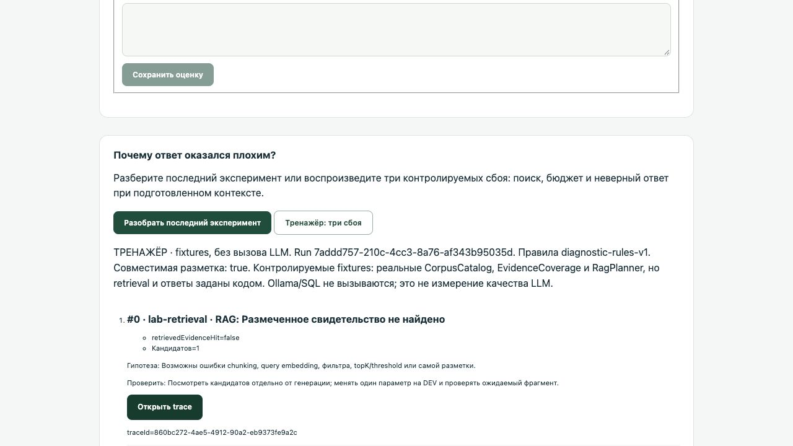
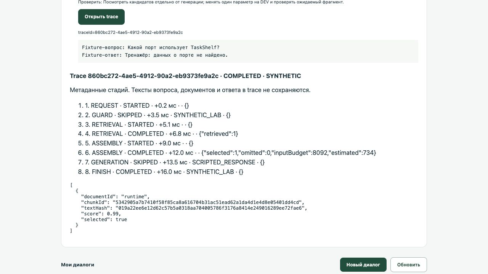

# Проверка урока 3.2

Дата: 2026-10-26. Java 25.0.5+8, Spring Boot 4.1.2, Spring AI 2.0.2, Node 24. Maven выполнен offline из подготовленного кэша. Локальные HTTP-контрактные тесты работают без реальных моделей; pgvector-it использует настоящий контейнер PostgreSQL/pgvector.

## Итоговая матрица

| Проверка | Результат |
| --- | --- |
| lecture: mvnw -o verify -Ppgvector-it | 200 Java + 18 pgvector IT, 0 failures/errors/skips |
| lecture: npm test | 104/104 |
| homework: package с -DskipTests | Собираемый каркас |
| homework: базовые *Test без DocumentScopeAcceptanceTest | 200/200 |
| homework: npm ci --offline и npm test | 104/104 |
| homework: новые DocumentScopeAcceptanceTest до решения | 7 красных: 1 failure, 6 errors; явный TODO |
| Временное решение только DocumentScope, тесты сохранены | 207 Java + 18 pgvector IT, 0 failures/errors/skips |
| Визуальная проверка унаследованной диагностики | Тренажёр и открытие trace работают; снимки ниже |

Команда базовых регрессий: `./mvnw '-Dtest=*Test,!DocumentScopeAcceptanceTest' test`. Шаблон *Test намеренно исключает *IT; обычный профиль verify отдельно запускает PostgreSQL-проверки.

## Что проверяет новый слой

SnapshotRagAdvisorTest и AdvisorChainTest проверяют сохранение ChatOptions, исходного request/context, identity-expanded prompt, guard двойного RAG, changed prompt, call/stream, lazy before, единственный search на подписку, порядок before/after, отсутствие model call при NO_EVIDENCE и передачу RagReport в terminal metadata.

PgVectorRagIT объединяет 16 проверок 3.1 и два новых контракта 3.2: синхронный ServiceRagAdvisor с настоящим SQL retrieval и отказ без chat request. HTTP-стенд корректно различает один JSON для stream=false и NDJSON для stream=true. BAD_ANSWER сохраняется для проверки диагностического разбора неверного ответа.

Диагностические приращения 3.1 перенесены в обе папки: traceId, instrumentation ComparisonEngine/Coordinator, TraceStore/Recorder, API, UI и тесты. ComparisonEngine использует SnapshotAdvisorFactory. pipelineVersion — lesson-3.2-v1.

## Отличие ДЗ от лекции

Все advisors лекции присутствуют в homework в готовом виде. Новое приращение — тематическая DocumentScope policy и scoped endpoint. Реализовать нужно новый метод, которого нет в lecture. Семь acceptance-критериев проверяют policy, последовательность до budget, rank/metadata, labels, immutability и отсутствие fallback/model call.

Решаемость проверена вне курса: временная копия homework отличается в Java source только DocumentScope.java. SHA-256 неизменённого acceptance-файла: `a6cdea5fe5a526880441c2a27b20633002083cd4869639957de9c4b6f4baff01`. Эталонная реализация не включена в homework.

## Визуальная проверка

Приложение запущено на loopback с изолированными временными данными, RAG выключен, настоящие модели не вызываются. В браузере выполнены «Тренажёр: три сбоя» и «Открыть trace». Статус SYNTHETIC видим, списки и trace читаемы. Это унаследованная панель 3.1, новый sync API не добавляет экран.

## Границы проверки

Веса qwen2.5/EmbeddingGemma в техническом прогоне не загружались. RecordingModel и HTTP-стенд доказывают механический контракт; их ответы не являются оценкой качества LLM, latency, semantic retrieval или безопасности prompt injection. Реальные DEV/HOLDOUT-результаты студент получает отдельным экспериментом.

DocumentScope после SQL topK — тематическая policy prompt, не авторизация. Полный diagnostic trace создаёт benchmark; новый stateless call возвращает RagReport и не создаёт run/trace автоматически.

## Локальные свидетельства прогона

Итоговые логи проверки сохранены во временном рабочем окружении: `/tmp/lesson-3-2-final-lecture.log`, `/tmp/lesson-3-2-final-reference.log`, `/tmp/lesson-3-2-final-homework-base.log`, `/tmp/lesson-3-2-merged-homework-red.log`, `/tmp/lesson-3-2-merged-js.log`, `/tmp/lesson-3-2-homework-js.log`. Эти пути служат техническим свидетельством автору и не являются зависимостями учебного проекта.
