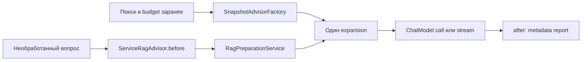

# Урок 3.2. ChatClientRequest и собственный RAG Advisor

[Материалы урока](../README.md) · [Домашнее задание](../homework/README.md) · [Тесты примера](src/test/java/) · [Все уроки](../../../README.md#программа)

В RepoPilot уже есть проверяемый RAG: поиск, отбор по бюджету, источники и диагностические признаки. В этом уроке вы перенесёте повторяющуюся сборку запроса в собственный Advisor. Результат — одинаковая обработка `call` и `stream`, один retrieval на запрос и защита от повторного добавления контекста.

- [Домашнее задание: новый режим тематических источников](../homework/README.md).
- [Отчёт о проверке](../VERIFICATION.md).
- [Предыдущая тема: диагностика](../../lesson-3.1/README.md).
- [Бланк эксперимента с порядком](evaluation/Advisor-Order.md).

Версии проекта: Java 25, Spring Boot 4.1.2, Spring AI **2.0.2**, Maven Wrapper 3.3.4 / Maven 3.9.11. SQLite JDBC 3.53.4.0, PostgreSQL JDBC 42.7.14, pgvector:0.8.1-pg17. Node 24 и jsdom 27.4.0 для прежнего интерфейса. Новых Maven-зависимостей нет.

## 1. Результат занятия

Вы сможете:

1. Показать, что входит в ChatClientRequest: Prompt и общий context advisors.
2. Объяснить прямой и обратный проход цепочки.
3. Вызвать подготовку RAG из before, не запуская поиск на каждую delta.
4. Передать уже рассчитанный snapshot без повторного embedding/SQL.
5. Сохранить ChatOptions, history, budget и finish reason при преобразовании prompt.
6. Отдельно протестировать call и stream, порядок advisors и отсутствие двойного контекста.

Главный продуктовый вопрос: как менять способ подготовки RAG, сохранив HTTP-контракт и честный отчёт о реально переданных источниках? Лекция реализует Advisor-механику. ДЗ добавляет отдельное поведение — тематическое ограничение источников — поверх полностью готовой лекции.

## 2. Запуск готового проекта

Команды выполняются из `lessons/lesson-3.2/lecture`:

```bash
java -version
./mvnw test
npm ci
npm test
./mvnw verify -Ppgvector-it
docker compose up -d
ollama pull embeddinggemma:300m
ollama pull qwen2.5:3b
./mvnw spring-boot:run
```

Ollama должен быть запущен. Модели скачиваются явно, автозагрузка выключена. Для unit-тестов веса и Docker не нужны; профиль pgvector-it требует настоящий Docker. Старые CHAT/FULL_CONTEXT, диалоги, панель сравнения и диагностический тренажёр 3.1 продолжают работать.

В [интерфейсе](http://127.0.0.1:8080/) создайте embeddings и опубликуйте их в pgvector. Существующий режим RAG использует новый snapshot advisor; новая sync-точка доступна через API:

```bash
curl -sS http://127.0.0.1:8080/api/advisors/call \
  -H 'Content-Type: application/json' \
  -d '{"message":"Какой порт нужен TaskShelf?","topK":4,"threshold":0.35}'
```

Ответ содержит answer и rag report. Endpoint stateless: историю разговора он не создаёт. Для streaming с сохранением диалога используйте прежний UI или `/api/conversations/{id}/rag/stream` с реальным UUID.

## 3. Advisor — часть запроса, а не агент

Advisor получает запрос, может изменить Prompt/context, передаёт управление следующему элементу и обрабатывает ответ. Он не становится отдельной моделью, агентским циклом или источником авторизации.

В [Spring AI Advisors API](https://docs.spring.io/spring-ai/reference/api/advisors.html) разные интерфейсы CallAdvisor и StreamAdvisor обслуживают синхронный и потоковый пути. BaseAdvisor объединяет их через before/after. Меньшее order выполняется раньше на запросе и позже на ответе. Для одинаковых order библиотека не обещает порядок регистрации.

```text
A.before → B.before → ChatModel → B.after → A.after
```

Для stream before подготавливает запрос при подписке. after применяется к ответам с признаком завершения, а не к каждому текстовому фрагменту. Точные правила смотрите в [BaseAdvisor тега v2.0.2](https://github.com/spring-projects/spring-ai/blob/v2.0.2/spring-ai-client-chat/src/main/java/org/springframework/ai/chat/client/advisor/api/BaseAdvisor.java).

Мы не используем количество delta как количество запросов. Повторная подписка на холодный Flux — отдельное выполнение, поэтому может снова вызвать retrieval. В этом уроке нет response cache.

## 4. ChatClientRequest: два разных пространства

`request.prompt()` содержит сообщения и model options. `request.context()` — данные, которыми обмениваются advisors. Context не добавляется в текст модели автоматически.

```java
var copy = new HashMap<>(request.context());
copy.put("repopilot.rag.applied", true);
return request.mutate().context(copy).build();
```

Context подходит для RagReport, признака «уже расширено» и request-local metadata. Не записывайте в поле singleton-advisor текущий вопрос, последний найденный список или mutable счётчик пользователя: соседние запросы могут смешать состояние.

Наш snapshot advisor хранит неизменяемый план одного запроса и создаётся заново для него. Service advisor хранит только зависимости и параметры, а результат подготовки помещает в context конкретного запроса.

## 5. Сначала разделяем две ситуации

Есть два корректных входа в Advisor:

| Ситуация | Кто готовит RAG | Что делает Advisor |
| --- | --- | --- |
| Обычный RAG-диалог/UI и benchmark | Сервис уже выполнил поиск и budget | Применяет готовый план, не ищет снова |
| Новый stateless call | План ещё не построен | Вызывает сервис подготовки в before |

Первый путь нужен, чтобы заранее отправить UI отчёт sources/budget. Второй показывает, как retrieval может быть частью цепочки advisors. Оба используют один RagPlanner и один RagPrompt.



Не подключайте готовый QuestionAnswerAdvisor поверх нашего RAG Advisor. Он снова выполнит поиск/расширение и изменит уже проверенный вход. Исходное поведение готового advisor можно сравнить с [его исходником v2.0.2](https://github.com/spring-projects/spring-ai/blob/v2.0.2/advisors/spring-ai-vector-store-advisor/src/main/java/org/springframework/ai/chat/client/advisor/vectorstore/QuestionAnswerAdvisor.java).

## 6. Выделяем подготовку в сервис

Создайте пакет advisor и класс RagPreparationService:

```java
package dev.myfrei.repopilot.advisor;

import java.util.List;
import dev.myfrei.repopilot.rag.*;
import org.springframework.ai.chat.messages.Message;

public class RagPreparationService {
    private final RagSearcher searcher;
    private final RagPlanner planner;
    public RagPreparationService(RagSearcher searcher, RagPlanner planner) { this.searcher = searcher; this.planner = planner; }
    public RagPlan prepare(RagRequest request, List<Message> history) {
        return prepare(request, history, result -> result);
    }
    public RagPlan prepare(RagRequest request, List<Message> history, java.util.function.UnaryOperator<RagSearchResult> selection) {
        RagSearchResult found = this.searcher.search(request);
        return this.planner.plan(request.message(), List.copyOf(history), selection.apply(found));
    }
}
```

Последовательность search → selection → plan намеренная. Отбор источников обязан произойти до budget, иначе вычеркнутый после расчёта чанк мог занять место полезного контекста.

В лекции selection — identity. В ДЗ появится другая policy. SQL workspace/corpus/fingerprint/digest filters из 2.3 остаются ответственностью RagSearcher. Перенос в Advisor не отменяет эти проверки.

История передаётся явным списком полных пар. RagPlanner выбирает её ограниченную часть. Дополнительный MessageChatMemoryAdvisor после planner добавил бы историю второй раз и нарушил бюджет, поэтому в этом пути его нет.

## 7. Реализуем snapshot advisor

План содержит baseMessages, references и RagReport. Он построен доверенным серверным кодом, а не принят как JSON от клиента.

Проверяем два инварианта: контекст ещё не был добавлен и исходные сообщения совпадают с теми, по которым считался бюджет. Затем заменяем Prompt целиком, сохраняя options.

```java
package dev.myfrei.repopilot.advisor;

import java.util.ArrayList;
import java.util.HashMap;
import dev.myfrei.repopilot.evaluation.PromptFingerprint;
import dev.myfrei.repopilot.rag.*;
import org.springframework.ai.chat.client.*;
import org.springframework.ai.chat.client.advisor.api.*;
import org.springframework.ai.chat.messages.UserMessage;
import org.springframework.ai.chat.model.ChatResponse;
import org.springframework.ai.chat.prompt.Prompt;

public class SnapshotRagAdvisor implements BaseAdvisor {
    public static final String APPLIED = "repopilot.rag.applied";
    public static final String REPORT = "repopilot.rag.report";
    private final RagPlan plan;
    public SnapshotRagAdvisor(RagPlan plan) {
        if (plan.references().isEmpty() || plan.report().estimatedInputTokens() > plan.report().inputBudget()) throw new IllegalArgumentException("Prepared nonempty budgeted plan required");
        this.plan = plan;
    }
    @Override public int getOrder() { return 0; }
    @Override public ChatClientRequest before(ChatClientRequest request, AdvisorChain chain) {
        return apply(request, this.plan, true);
    }
    public static ChatClientRequest apply(ChatClientRequest request, RagPlan plan, boolean requireSameInput) {
        if (request.context().containsKey(APPLIED)) throw new RagProblem("DUPLICATE_RAG", "Контекст уже добавлен другим RAG advisor.");
        if (requireSameInput && !PromptFingerprint.of(request.prompt().getInstructions()).equals(PromptFingerprint.of(plan.baseMessages()))) {
            throw new RagProblem("PROMPT_CHANGED", "Сообщения изменились после расчёта бюджета. Подготовьте план заново.");
        }
        var expanded = new ArrayList<>(plan.baseMessages());
        String question = expanded.getLast().getText();
        expanded.set(expanded.size() - 1, new UserMessage(RagPrompt.render(question, plan.references())));
        var context = new HashMap<>(request.context()); context.put(APPLIED, true); context.put(REPORT, plan.report());
        return request.mutate().prompt(new Prompt(expanded, request.prompt().getOptions())).context(context).build();
    }
    @Override public ChatClientResponse after(ChatClientResponse response, AdvisorChain chain) { return attachReport(response); }
    public static ChatClientResponse attachReport(ChatClientResponse response) {
        if (response.chatResponse() == null) return response;
        var chat = ChatResponse.builder().from(response.chatResponse()).metadata(REPORT, response.context().get(REPORT)).build();
        return ChatClientResponse.builder().chatResponse(chat).context(response.context()).build();
    }
}
```

`PromptFingerprint` учитывает роли, порядок и текст сообщений. Он помогает обнаружить изменение входа между planning и invocation. Это проверка согласованности, а не цифровая подпись.

`new Prompt(expanded, request.prompt().getOptions())` сохраняет параметры исходного запроса. Простая замена `.prompt(new Prompt(expanded))` потеряла бы request-specific options.

`RagPrompt.render` используется и planner, и advisor. Фигурные скобки в вопросе и JSON документов подставляются как значения один раз, а не становятся новым шаблоном.

После ответа добавляем report в metadata, не меняя текст и finish reason. Список источников по-прежнему означает «передано в prompt», а не «все утверждения подтверждены».

## 8. Добавляем маленькую фабрику для сквозного продукта

```java
package dev.myfrei.repopilot.advisor;

import dev.myfrei.repopilot.rag.RagPlan;
import org.springframework.ai.chat.client.advisor.api.Advisor;

public final class SnapshotAdvisorFactory {
    private SnapshotAdvisorFactory() { }
    public static Advisor create(RagPlan plan) { return new SnapshotRagAdvisor(plan); }
}
```

В RagChatService подготовка уже существует. Меняется только создание advisor:

```java
var plan = planner.plan(request.message(), history, searcher.search(request));
if (plan.references().isEmpty()) {
    // Прежний программный ответ NO_EVIDENCE; chat-модель не вызывается.
}
var advisor = SnapshotAdvisorFactory.create(plan);
return model.stream(plan.baseMessages(), advisor);
```

В ComparisonEngine аналогично заменяется блок создания QuestionAnswerAdvisor. Подготовка, diagnostic trace и фиксация promptHash остаются на месте. Так benchmark оценивает тот же новый advisor, что и UI, а не старый скрытый путь.

Проверка outbound prompt из 2.3 остаётся полезной: результат расширения должен совпасть с `planner.projected(plan)`. Замена механизма не должна незаметно изменить бюджет.

## 9. Вызываем сервис из before

ServiceRagAdvisor нужен для клиента, который ещё не готовил snapshot:

```java
package dev.myfrei.repopilot.advisor;

import java.util.ArrayList;
import java.util.List;
import dev.myfrei.repopilot.rag.*;
import org.springframework.ai.chat.client.*;
import org.springframework.ai.chat.client.advisor.api.*;
import org.springframework.ai.chat.messages.*;

public class ServiceRagAdvisor implements BaseAdvisor {
    private final RagPreparationService preparation;
    private final int topK;
    private final double threshold;
    private final java.util.function.UnaryOperator<RagSearchResult> selection;
    public ServiceRagAdvisor(RagPreparationService preparation, int topK, double threshold) { this(preparation, topK, threshold, result -> result); }
    public ServiceRagAdvisor(RagPreparationService preparation, int topK, double threshold, java.util.function.UnaryOperator<RagSearchResult> selection) {
        new RagRequest("validate", topK, threshold); this.preparation = preparation; this.topK = topK; this.threshold = threshold; this.selection = selection;
    }
    @Override public int getOrder() { return 0; }
    @Override public ChatClientRequest before(ChatClientRequest request, AdvisorChain chain) {
        if (request.context().containsKey(SnapshotRagAdvisor.APPLIED)) throw new RagProblem("DUPLICATE_RAG", "Не подключайте два RAG advisor к одному запросу.");
        var input = request.prompt().getInstructions();
        if (input.isEmpty() || input.getLast().getMessageType() != MessageType.USER) throw new IllegalArgumentException("Last message must be user");
        var history = new ArrayList<Message>();
        for (int i = 0; i < input.size() - 1; i++) if (input.get(i).getMessageType() != MessageType.SYSTEM) history.add(input.get(i));
        var query = new RagRequest(input.getLast().getText(), this.topK, this.threshold);
        var plan = this.preparation.prepare(query, history, this.selection);
        if (plan.references().isEmpty()) throw new RagProblem("NO_EVIDENCE", "По текущим параметрам подходящих фрагментов нет. Chat-модель не вызывалась.");
        return SnapshotRagAdvisor.apply(request, plan, false);
    }
    @Override public ChatClientResponse after(ChatClientResponse response, AdvisorChain chain) { return SnapshotRagAdvisor.attachReport(response); }
}
```

Вход заканчивается user message. Из предыдущих сообщений извлекаются history-пары; системные правила заново задаёт серверный RagPlanner. JSON API этого урока не принимает произвольную системную инструкцию.

Признак APPLIED проверяется **до** retrieval, чтобы второй RAG advisor не выполнял ненужный поиск. Сервис вызывается один раз в before. Потоковые delta проходят через nextStream; в них нет повторного вызова searcher.

При пустой выдаче ServiceRagAdvisor останавливает цепочку с NO_EVIDENCE. Для нового sync endpoint это HTTP 409 problem+json, модель не вызывается. Для существующего UI сохраняется прежняя программная refusal-ветка до snapshot factory. Это два разных HTTP-контракта, явно проверяемых тестами.

## 10. Делаем порядок наблюдаемым

InputContractAdvisor проверяет исходный, ещё не расширенный вопрос. Его default order=-100, у RAG advisor order=0.

```java
package dev.myfrei.repopilot.advisor;

import dev.myfrei.repopilot.rag.RagProblem;
import org.springframework.ai.chat.client.*;
import org.springframework.ai.chat.client.advisor.api.*;

public class InputContractAdvisor implements BaseAdvisor {
    private final int order;
    public InputContractAdvisor() { this(-100); }
    public InputContractAdvisor(int order) { this.order = order; }
    @Override public int getOrder() { return this.order; }
    @Override public ChatClientRequest before(ChatClientRequest request, AdvisorChain chain) {
        if (request.context().containsKey(SnapshotRagAdvisor.APPLIED)) throw new RagProblem("ADVISOR_ORDER", "InputContractAdvisor должен выполняться до расширения RAG.");
        String text = request.prompt().getUserMessage().getText();
        if (text == null || text.isBlank() || text.length() > 4000) throw new IllegalArgumentException("Invalid original question");
        return request;
    }
    @Override public ChatClientResponse after(ChatClientResponse response, AdvisorChain chain) { return response; }
}
```

Корректная цепочка:

```java
.advisors(new InputContractAdvisor(), new ServiceRagAdvisor(preparation, 4, .35))
```

Даже если передать их в обратном порядке регистрации, разные order определят порядок исполнения. Если задать InputContractAdvisor order=100, он увидит уже расширенный контекст и отклонит запрос с ADVISOR_ORDER. Это проверяемое следствие изменения порядка, а не только красивый список имён.

Для нескольких RAG advisors с одинаковым order мы не полагаемся на порядок: второй обнаружит APPLIED и откажется повторно добавлять контекст.

## 11. Новый sync API

AdvisorCallService создаёт ChatClient с существующими настройками Ollama и подключает два advisor для запроса:

```java
package dev.myfrei.repopilot.advisor;

import dev.myfrei.repopilot.rag.*;
import org.springframework.ai.chat.client.ChatClient;
import org.springframework.ai.chat.client.advisor.api.Advisor;

public class AdvisorCallService {
    private final ChatClient client;
    private final RagPreparationService preparation;
    public AdvisorCallService(ChatClient.Builder builder, RagPreparationService preparation) { this.client = builder.build(); this.preparation = preparation; }
    public Reply call(RagRequest request) { return call(request, result -> result); }
    public Reply call(RagRequest request, java.util.function.UnaryOperator<RagSearchResult> selection) {
        Advisor rag = new ServiceRagAdvisor(this.preparation, request.topK(), request.threshold(), selection);
        var response = this.client.prompt().user(request.message()).advisors(new InputContractAdvisor(), rag).call().chatResponse();
        if (response == null || response.getResult() == null) throw new RagProblem("EMPTY_RESPONSE", "Chat-модель не вернула результат.");
        if (!"stop".equalsIgnoreCase(response.getResult().getMetadata().getFinishReason())) throw new RagProblem("UPSTREAM_INCOMPLETE", "Chat-модель не подтвердила завершение ответа.");
        String answer = response.getResult().getOutput().getText();
        if (answer == null || answer.isBlank()) throw new RagProblem("EMPTY_RESPONSE", "Chat-модель вернула пустой ответ.");
        Object report = response.getMetadata().get(SnapshotRagAdvisor.REPORT);
        if (!(report instanceof RagReport ragReport)) throw new IllegalStateException("Missing RAG report");
        return new Reply(answer, ragReport);
    }
    public record Reply(String answer, RagReport rag) { }
}
```

```java
package dev.myfrei.repopilot.advisor;

import dev.myfrei.repopilot.rag.RagRequest;
import jakarta.validation.Valid;
import org.springframework.boot.autoconfigure.condition.ConditionalOnProperty;
import org.springframework.web.bind.annotation.*;
@RestController
@ConditionalOnProperty(name = "repopilot.rag.enabled", havingValue = "true")
@RequestMapping("/api/advisors")
public class AdvisorController {
    private final AdvisorCallService service;
    public AdvisorController(AdvisorCallService service) { this.service = service; }
    @PostMapping("/call") public AdvisorCallService.Reply call(@Valid @RequestBody RagRequest request) { return this.service.call(request); }
}
```

Новый endpoint использует серверные HTTP timeout и model output limits. Ограничитель max-duration из ChatStreamService относится к streaming-пути, а не автоматически ко всем синхронным вызовам.

Регистрация зависимостей:

```java
package dev.myfrei.repopilot.advisor;

import dev.myfrei.repopilot.rag.*;
import org.springframework.ai.chat.client.ChatClient;
import org.springframework.boot.autoconfigure.condition.ConditionalOnProperty;
import org.springframework.context.annotation.*;
@Configuration
@ConditionalOnProperty(name = "repopilot.rag.enabled", havingValue = "true")
public class AdvisorConfiguration {
    @Bean RagPreparationService ragPreparationService(RagSearcher searcher, RagPlanner planner) { return new RagPreparationService(searcher, planner); }
    @Bean AdvisorCallService advisorCallService(ChatClient.Builder builder, RagPreparationService preparation) { return new AdvisorCallService(builder, preparation); }
}
```

AdvisorConfiguration условно включён при repopilot.rag.enabled=true. RagExceptionHandler теперь обслуживает и AdvisorController. Если corpus/index ещё не подготовлены, модель не должна пытаться угадать содержимое проекта.

## 12. Как тестировать цепочку без весов

SnapshotRagAdvisorTest проверяет expansion, сохранение исходного request, исходных options/metadata, отказ от двойного контекста и changed prompt, metadata ответа и finish reason.

AdvisorChainTest использует настоящий ChatClient с RecordingModel. Это fixture модели, не измерение её качества:

- call: один searcher call и один model call;
- stream: до subscribe нет поиска, после четырёх chunks поиск выполнен один раз;
- terminal metadata содержит RagReport;
- пустая выдача не вызывает модель в обоих режимах;
- before/after идут стеком A→B→model→B→A;
- неверный order прерывает цепочку до модели;
- snapshot path вообще не имеет search service.

```bash
./mvnw -Dtest=SnapshotRagAdvisorTest,AdvisorChainTest test
```

Тесты должны проверять число вызовов и фактический Prompt, а не только класс advisor в списке.

## 13. Проверяем настоящий SQL и HTTP

```bash
./mvnw verify -Ppgvector-it
```

PgVectorRagIT использует отдельный PostgreSQL с pgvector и локальный HTTP-стенд Ollama. Новый call-тест проходит настоящий query embedding, SQL retrieval, planner, ServiceRagAdvisor и non-streaming chat payload. Второй подтверждает NO_EVIDENCE без chat request.

Для call HTTP-стенд возвращает один JSON done/stop, для stream — NDJSON. Одинаковый fixture-ответ не позволяет измерить качество генерации; он проверяет контракт клиента и адаптера.

HTTP-стенд заменяет qwen2.5 и EmbeddingGemma, поэтому его результаты не показывают качество или задержку настоящих моделей. Реальную полезность и задержки проверяйте тем же DEV/HOLDOUT-набором из 2.4, сохраняя model/index versions.

## 14. Диагностика ошибок

Диагностический слой 3.1 включён в этот самостоятельный проект. В ComparisonEngine trace по-прежнему связывает retrieval, selected sources, budget, promptHash и generation; вместо готового QuestionAnswerAdvisor вызывается SnapshotAdvisorFactory. Перенос сборки запроса в Advisor не стирает наблюдаемость предыдущего урока.

Для проверки без весов откройте UI, нажмите «Тренажёр: три сбоя», затем «Открыть trace». Результат явно помечен SYNTHETIC. Для реального run выполните сравнение на DEV и нажмите «Разобрать последний эксперимент». Для просмотра через API:

```bash
curl -sS -X POST http://127.0.0.1:8080/api/diagnostics/lab
curl -sS http://127.0.0.1:8080/api/diagnostics/runs/latest
```

Новый stateless `/api/advisors/call` возвращает RagReport, но не создаёт benchmark run/diagnostic trace. Полную трассу стадий проверяйте через benchmark; исходный RAG stream, как и раньше, отдаёт sources/budget через SSE. Сохраняйте эту разницу контрактов.


| Код/симптом | Что проверить |
| --- | --- |
| DUPLICATE_RAG | Не подключены ли два RAG advisor или повторная expansion |
| PROMPT_CHANGED | Advisor до snapshot изменил уже рассчитанные messages |
| ADVISOR_ORDER | InputContractAdvisor должен идти до расширения |
| NO_EVIDENCE | Параметры retrieval/selection, подготовленный индекс; не включать fallback без источников |
| Контекст повторяется | Сравнить outgoing prompt и registrations, проверить память |
| Search count равен числу chunks | Поиск ошибочно помещён в map/after вместо before |
| Stream не имеет report | Provider не прислал finish reason либо after изменяет metadata некорректно |
| Budget и реальный вход расходятся | Другая template, дополнительный memory advisor или потерянные options |

Не лечите проблему сменой модели, пока не проверили механическую цепочку.

## 15. Самостоятельный эксперимент

Заполните [Advisor-Order.md](evaluation/Advisor-Order.md). Зафиксируйте order, before/after-порядок, число retrieval/model calls и hash/outbound prompt.

Повторите один и тот же вопрос:

1. Правильный InputContractAdvisor(-100) + RAG(0).
2. Обратная регистрация при тех же order.
3. Неправильный InputContractAdvisor(100).
4. Два RAG advisor.
5. Snapshot path после готового planning.

Отметьте, какие варианты не вызывают модель, и почему. Не приравнивайте отказ защитного контракта к плохому качеству LLM.

## 16. Домашнее задание — новая продуктовая функция

В homework **готовы все advisors лекции**. Нужно добавить endpoint тематических источников `/api/advisors/scoped/call` с двумя серверными профилями:

- TROUBLESHOOTING: только runbook.
- ARCHITECTURE: overview и runtime.

Вы реализуете новый DocumentScope.select. Он отбирает candidates до planner, сохраняет rank/identity, перенумеровывает метки и не расширяет scope при пустом результате. В лекции такого endpoint и policy нет. Проверки домашних критериев отделены от регрессий готовой базы.

Это policy формирования контекста **после** retrieval, не полноценная авторизация и не замена SQL workspace filters. Запрещённые для профиля кандидаты уже были прочитаны сервером. TopK до policy может оставить пустой разрешённый набор, хотя подходящий документ есть ниже в рейтинге; это ограничение нужно измерить и описать.

## 17. Самопроверка

1. Какие данные context передаёт модели автоматически?
2. Почему after не должен выполнять retrieval для каждой delta?
3. Чем повторная подписка отличается от следующей delta одного stream?
4. Почему сохранить исходные ChatOptions важно при замене Prompt?
5. Зачем два пути: prepared snapshot и сервис в before?
6. Что произойдёт, если memory advisor добавит историю после budget?
7. Чем отказ DUPLICATE_RAG отличается от NO_EVIDENCE?
8. Почему scope policy после topK не заменяет авторизацию в SQL?

## 18. Читать дальше

- [Spring AI Advisors API](https://docs.spring.io/spring-ai/reference/api/advisors.html).
- [BaseAdvisor v2.0.2](https://github.com/spring-projects/spring-ai/blob/v2.0.2/spring-ai-client-chat/src/main/java/org/springframework/ai/chat/client/advisor/api/BaseAdvisor.java).
- [QuestionAnswerAdvisor v2.0.2](https://github.com/spring-projects/spring-ai/blob/v2.0.2/advisors/spring-ai-vector-store-advisor/src/main/java/org/springframework/ai/chat/client/advisor/vectorstore/QuestionAnswerAdvisor.java).
- [Spring AI RAG](https://docs.spring.io/spring-ai/reference/api/retrieval-augmented-generation.html).

Следующая тема 3.3 — rewrite, query expansion, сохранение смысла вопроса и ограничение дополнительных вызовов.
