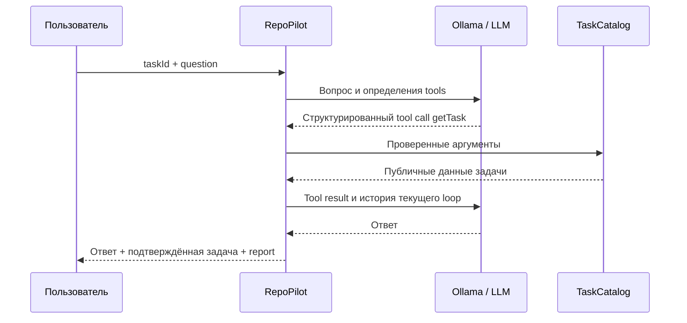

# Урок 4.1. Java tools: от workflow к вызовам модели

[Материалы урока](../README.md) · [Домашнее задание](../homework/README.md) · [Тесты примера](src/test/java/) · [Все уроки](../../../README.md#программа) · [Предыдущая лекция 3.4](../../lesson-3.4/lecture/README.md) · [Проверки примера](../VERIFICATION.md)

Java 25, Spring Boot 4.1.2, Spring AI 2.0.2, Ollama. Новый сценарий — JSON API; отдельной панели UI нет.

## Результат занятия

RAG помогает найти сведения в документах TaskShelf, но найденный Markdown сам по себе не сообщает текущее состояние конкретной задачи. Вы добавите TaskCatalog и два read-only инструмента: getProjectInfo и getTask.

Сначала приложение само прочитает данные по фиксированному workflow. Затем разрешим tool-capable модели запросить те же инструменты через настоящий ToolCallingAdvisor. Сравним состав данных, обязательность getTask, число model/tool calls и ошибки.

TaskCatalog этого урока — локальный учебный каталог в памяти, а не подключённая Jira/БД. Мы изучаем границу доступа к операционным данным; внешнюю интеграцию можно заменить за этой границей позже. Результаты реальных весов не подменяются ответами fixtures.

К концу работают `/api/tools/workflow` и `/api/tools/model`. MODEL считается успешным только после реально исполненного getTask для запрошенной задачи. Красивый текст без такого вызова не выдаётся за проверенный результат.

Ориентир на два часа: задача и архитектура15 минут, каталог/контракты20, callbacks25, bounded loop30, HTTP/тесты20, эксперимент/ДЗ10. Ручная проверка настоящей локальной модели требует дополнительного времени.

## 1. Что меняется после RAG

| Механизм | Откуда сведения | Кто выбирает обращение |
| --- | --- | --- |
| RAG 3.4 | Подготовленный корпус и опубликованный индекс | Retrieval/pipeline приложения |
| WORKFLOW 4.1 | Текущий snapshot локального TaskCatalog | Java-код с фиксированной последовательностью |
| MODEL 4.1 | Тот же каталог через разрешённые callbacks | Модель запрашивает вызов; Java проверяет и исполняет |

Tool calling не даёт модели прямого доступа к Java, SQL или процессам. Она возвращает имя и аргументы; исполнение остаётся в приложении. В нашем allowlist только два чтения каталога. Запись задач, shell и файловая система не экспонируются.



Строка «сейчас вызову getTask» в обычном ответе не является tool call. Источником проверки будет execution audit, а не обещание модели.

## 2. Workflow и model-controlled loop

WORKFLOW полезен, когда обязательные шаги известны заранее: прочитать проект, прочитать выбранную задачу, вернуть типизированные данные. Он не требует, чтобы модель выбрала действие, и в этом уроке вообще не вызывает LLM.

MODEL проверяет другую гипотезу: модель способна выбрать разрешённый инструмент, сформировать допустимые аргументы и использовать результат. Ради этого появляются дополнительные model round trips, ошибки аргументов и необходимость остановить цикл.

Это не обучение весов. Descriptions/schema/instructions описывают доступный интерфейс, а runtime исполняет запросы. Они не превращают любую completion-модель в надёжную tool-calling модель. MCP в следующем уроке также не обучит её автоматически.

В Spring AI 2.0.2 loop принадлежит ToolCallingAdvisor в цепочке ChatClient. Не переносите сюда примеры1.x с расчётом на внутренний цикл произвольного ChatModel. Подробности framework — в [Tool Calling](https://docs.spring.io/spring-ai/reference/api/tools.html); в своём коде ниже мы явно зададим границы текущего запроса.

## 3. Подготовка и запуск

Откройте `lecture/pom.xml` как самостоятельный Maven-проект. Лекционная база3.4 включена готовой; evaluator из прошлого ДЗ для этого сценария не нужен.

```bash
cd lessons/lesson-4.1/lecture
./mvnw -version
node --version
```

Maven должен использовать JDK 25. Node 24 нужен для регрессий старого UI. Настройка JDK и Ollama подробно разобрана в [1.1](../../lesson-1.1/lecture/README.md).

Первый workflow можно изучить без настоящих весов. Чтобы отключить унаследованный RAG/query/rerank путь и не поднимать pgvector:

```bash
./mvnw spring-boot:run -Dspring-boot.run.arguments=--repopilot.rag.enabled=false
```

Этот flag не удаляет лекционную базу. Для старых RAG-экспериментов поднимайте Compose/ingestion/publish как в 3.4; новый TaskCatalog не использует векторную БД.

Для MODEL отдельно запустите Ollama и подготовьте модель:

```bash
ollama serve
```

В другом терминале:

```bash
ollama pull qwen2.5:3b
curl -sS http://127.0.0.1:11434/api/tags
curl -sS http://127.0.0.1:11434/api/show \
  -H 'Content-Type: application/json' \
  -d '{"model":"qwen2.5:3b"}'
```

По умолчанию app использует qwen2.5:3b; если OLLAMA_CHAT_MODEL переопределён, проверьте model ID перед запуском и настройте его явно.

В [карточке qwen2.5:3b](https://ollama.com/library/qwen2.5:3b) заявлены tools. Проверьте capabilities фактически установленного тега и затем реальный smoke через наш `/model`: одинаковое имя тега не доказывает, что ваша версия runtime/весов корректно выполнит конкретную задачу. Зафиксируйте model ID в worksheet и сверяйте digest с report.modelDigest. Протокольные HTTP-fixtures не являются этим smoke.

Описание [Ollama show API](https://docs.ollama.com/api-reference/show-model-details) помогает прочитать metadata. Наличие capability — основание для проверки, а не гарантия семантически верного ответа. Если модель не поддерживает structured tool calls или не вызвала обязательный getTask, используйте явный WORKFLOW либо обработайте ошибку MODEL.
## 4. Строим маленький domain catalog

Новые типы находятся в `dev.myfrei.repopilot.tasks`: [Task](src/main/java/dev/myfrei/repopilot/tasks/Task.java), [TaskView](src/main/java/dev/myfrei/repopilot/tasks/TaskView.java), [ProjectInfo](src/main/java/dev/myfrei/repopilot/tasks/ProjectInfo.java) и [TaskCatalog](src/main/java/dev/myfrei/repopilot/tasks/TaskCatalog.java).

Внутренняя задача содержит acceptanceCriteria, но публичный tool возвращает только view:

```java
public record TaskView(String id, String title, Task.Status status, String summary) { }
```

В каталоге TASK-101..TASK-105, статусы OPEN/IN_PROGRESS/DONE. ProjectInfo содержит project ID/name/description, технологии и допустимые task IDs. Коллекции копируются, поэтому вызывающий код не может переставить каталог через возвращённый List.

TaskCatalog — обычная Java-модель без зависимости от Spring или LLM:

```java
public ProjectInfo projectInfo() {
    return project;
}

public TaskView getTask(String id) {
    return findTask(id)
        .orElseThrow(() -> new IllegalArgumentException("Unknown TaskShelf taskId"))
        .toView();
}

public Optional<Task> findTask(String id) {
    return id == null ? Optional.empty() : Optional.ofNullable(byId.get(id));
}
```

Не возвращайте весь внутренний Task только потому, что Jackson умеет его сериализовать. Состав tool result — самостоятельный публичный контракт. В 4.2 тот же принцип понадобится на границе MCP.

## 5. Ввод и state текущего запуска

[ToolRequest](src/main/java/dev/myfrei/repopilot/tools/ToolRequest.java) принимает taskId и question:

```java
public record ToolRequest(String taskId, String question) {
    public ToolRequest {
        if (taskId == null || !taskId.matches("TASK-[0-9]{3}")
                || question == null || question.isBlank() || question.length() > 1000) {
            throw new IllegalArgumentException("taskId and question 1..1000 required");
        }
    }
}
```

Pattern проверяет форму ID, а наличие задачи проверяется по каталогу. Java char limit ограничивает JSON-ввод; полный prompt каждого model round будет проверяться отдельно.

[ToolRun](src/main/java/dev/myfrei/repopilot/tools/ToolRun.java) создаётся **на один запрос**. Это не singleton bean и не общая история всех пользователей. Он хранит counters, audit и подтверждённый TaskView:

- До четырёх model calls.
- До четырёх допущенных callback attempts, включая отклонённые аргументы.
- Metadata каждого round и каждого начатого tool invocation.
- Успешное чтение getTask именно taskId текущего запроса.
- Digest, prompt hash/version и notes.

`verifiedTask()` не доверяет одной ссылке observedTask: дополнительно ищет успешную audit-запись нужного getTask. Поэтому получить данные другим скрытым способом и затем объявить tool-путь успешным не получится в рамках этого контракта.

Это проверка выполнения операции, не проверка истинности каждого предложения ответа. Модель способна ошибиться и после корректного чтения; сравнивайте answer с возвращённым TaskView отдельно.

## 6. Описываем tool definitions

В [TaskToolSet](src/main/java/dev/myfrei/repopilot/tools/TaskToolSet.java) строим callbacks программно через FunctionToolCallback. Так schema, domain adapter и строгая проверка raw JSON остаются видимыми в одном небольшом срезе.

Для getProjectInfo допустим только пустой object:

```json
{
  "type":"object",
  "properties":{},
  "required":[],
  "additionalProperties":false
}
```

Для getTask указываем taskId строкой, enum единственного taskId текущего запуска, required и additionalProperties=false:

```java
String taskSchema = JSON.writeValueAsString(Map.of(
    "type", "object",
    "properties", Map.of("taskId", Map.of(
        "type", "string", "enum", List.of(run.taskId())
    )),
    "required", List.of("taskId"),
    "additionalProperties", false
));
```

Schema помогает модели сформировать вызов. Она не заменяет серверную проверку фактически полученного raw JSON. Description тоже описывает назначение, а не разрешает любую операцию с похожим названием.

Callback к публичной view:

```java
ToolCallback task = FunctionToolCallback.builder(
        "getTask",
        (Map<String, Object> args) -> {
            var value = catalog.getTask((String) args.get("taskId"));
            run.observedTask(value);
            return value;
        })
    .description("Read the public view of the requested TaskShelf task. Does not expose internal acceptance criteria.")
    .inputType(Map.class)
    .inputSchema(taskSchema)
    .build();
```

getProjectInfo аналогично вызывает catalog.projectInfo. Ни один callback не читает файлы, не запускает команды и не меняет TaskCatalog. У инструментов нет returnDirect: MODEL после tool results должен завершить свой ответ.

Альтернативный способ Spring AI — `@Tool` на методе. Здесь он не нужен: цель занятия — разобрать явную ToolDefinition/ToolCallback-границу и request-local audit, а не зарегистрировать одно и то же действие дважды.

## 7. Проверяем raw arguments до domain callback

TaskToolSet оборачивает FunctionToolCallback собственным ToolCallback. Он сохраняет исходные ToolDefinition/ToolMetadata, а `call(raw, context)` сначала выполняет проверку.

```java
if (raw == null || raw.isBlank() || raw.length() > 2048) throw invalid();
Object parsed = JSON.readValue(raw, Object.class);
if (!(parsed instanceof Map<?, ?> args)) throw invalid();
if (task) {
    if (!args.keySet().equals(Set.of("taskId"))
            || !(args.get("taskId") instanceof String requested)) throw invalid();
    if (catalog.findTask(requested).isEmpty()) {
        throw run.problem("TOOLS_UNKNOWN_TASK", "Tool argument taskId не входит в каталог.");
    }
    if (!run.taskId().equals(requested)) {
        throw run.problem("TOOLS_WRONG_TASK", "getTask разрешён только для taskId текущего запроса.");
    }
    id = requested;
} else if (!args.isEmpty()) {
    throw invalid();
}
String result = delegate.call(raw, context);
```

JSON mapper включает STRICT_DUPLICATE_DETECTION и FAIL_ON_TRAILING_TOKENS. Лишний ключ, неверный тип taskId, JSON array, повторный ключ или текст после object не проходят в domain callback.

Есть два разных ограничения: ID должен существовать в каталоге и совпадать с taskId текущего запроса. Schema уже сужена до выбранной задачи, а runtime независимо проверяет и существование ID, и scope текущего запроса. Неверный вызов не должен прочитать другую задачу, даже если её ID известен.

Начатый callback получает audit outcome SUCCESS или REJECTED и безопасный code. Raw question/arguments/result туда не копируются. Текст исключения JSON parser также не возвращается модели как подробная ошибка со входным payload.

## 8. Разделяем попытку, успех и данные ответа

[ToolRunReport](src/main/java/dev/myfrei/repopilot/tools/ToolRunReport.java) содержит mode/taskId, modelCalls/toolCalls/successfulToolCalls, requiredTaskRead, доступный usage, invocations/rounds, identity и limits.

Invocation хранит sequence/tool/taskId/outcome/code/elapsedMs. Round хранит number/estimatedInputTokens/completed, provider token counters, нормализованный finishReason и число запрошенных tool calls.

Отсюда следует несколько правил интерпретации:

- toolCalls считает начатые допущенные attempts. REJECTED не становится SUCCESS.
- Модель может предложить несколько tool calls в одном round; requestedToolCalls не равен числу model calls и не доказывает исполнение.
- Следующий вызов сверх лимита не запускается; лимит не является инструкцией «пожалуйста, остановись».
- Неполный/упавший model round не получает выдуманные token counters.
- Поле usageComplete показывает, удалось ли собрать usage всех rounds. При отсутствии данных итоговые counters nullable.

Сумма считается по записанным per-round usage, а не повторно по кумулятивному финальному response. Для WORKFLOW отсутствие model rounds означает нулевую model-стоимость, а не отсутствие Java-работы вообще.

Metadata report не содержит raw текста вопроса, аргументов, tool results или answer. Но API отдельно возвращает публичный TaskView, а MODEL — generated answer: весь ответ API не является обезличенным экспортом. Автоматическая диагностика RAG 3.1 не подключается к новому сценарию сама собой.
## 9. Запускаем детерминированный workflow

[TaskToolsService.workflow](src/main/java/dev/myfrei/repopilot/tools/TaskToolsService.java) создаёт новый ToolRun и использует **те же проверяемые callbacks**, что и MODEL:

```java
var run = new ToolRun("WORKFLOW", request.taskId(), 0, "");
var tools = new TaskToolSet(catalog, run);
tools.invoke("getProjectInfo", "{}");
tools.invoke("getTask", json.writeValueAsString(Map.of("taskId", request.taskId())));
run.note("DETERMINISTIC_WORKFLOW");
return new WorkflowReply(catalog.projectInfo(), run.verifiedTask(), "COMPLETED", run.report());
```

WorkflowReply содержит project, task, outcome и report. Здесь нет generated answer: question принимается общим DTO, но workflow возвращает достоверные структурированные данные, а не имитирует свободный анализ моделью.

```bash
curl -sS http://127.0.0.1:8080/api/tools/workflow \
  -H 'Content-Type: application/json' \
  -d '{"taskId":"TASK-101","question":"Что известно о задаче и с чего начать?"}'
```

Проверьте COMPLETED, совпадение task.id, два успешных чтения и modelCalls=0. Наличие результата не требует Ollama. Internal acceptanceCriteria в TaskView отсутствуют.

## 10. Ограничиваем настоящий ToolCallingAdvisor

У [ToolCallingAdvisor 2.0.2](https://docs.spring.io/spring-ai/reference/api/tools/tool-calling-advisor.html) нет builder-метода maxIterations, который можно взять из случайного примера другой версии. Используем штатный loop и расширяем его hooks в [BoundedToolCallingAdvisor](src/main/java/dev/myfrei/repopilot/tools/BoundedToolCallingAdvisor.java).

Конструктор задаёт ToolCallingManager:

```java
super(ToolCallingManager.builder()
        .maxTotalToolCalls(ToolRun.MAX_TOOL_CALLS)
        .maxCallsPerTool(ToolRun.MAX_TOOL_CALLS)
        .onLimitExceeded(ToolCallLimitBehavior.THROW)
        .resolutionFallbackEnabled(false)
        .toolExecutionExceptionProcessor(error -> { throw error; })
        .build(),
    DEFAULT_TOOL_EXECUTION_ELIGIBILITY_CHECKER,
    DEFAULT_ORDER,
    true);
```

Native manager limits дополняют request-local counter, а не заменяют его смысл. resolutionFallbackEnabled(false) не разрешает искать дополнительные tools за пределами переданного набора. Tool exception останавливает этот MODEL-запуск: мы не превращаем его в скрытый repair/retry.

Перед каждым model call выполняется hook:

```java
@Override
protected ChatClientRequest doBeforeCall(ChatClientRequest request, CallAdvisorChain chain) {
    run.beginRound(budget.estimate(request.prompt()));
    return request;
}
```

ToolRun.beginRound проверяет предел четырёх model calls и inputBudget **до** добавления следующего round. В count входят начальный запрос, промежуточные ответы с tool calls и финальная генерация. Четыре model calls не означают четыре обязательных tool calls.

После каждого model response hook записывает per-round usage/finish/requestedToolCalls и проверяет, что модель просит только function getProjectInfo/getTask. Неизвестное имя или иной тип не передаётся в исполнение.

Native SDK может завершить превышение tool-call limit специальным finish reason. Service распознаёт ToolCallLimitExceededException.FINISH_REASON и возвращает TOOLS_CALL_LIMIT, а не обычный успешный answer.

Унаследованный ToolCallingAdvisor сам ведёт history текущего loop и передаёт tool results в следующий round. Мы не дописываем собственный бесконечный while вокруг ChatClient. В цепочке ровно один ToolAdvisor: custom subclass заменяет default, а не складывается с ним.

## 11. Считаем полный prompt каждого round

[ToolPromptBudget](src/main/java/dev/myfrei/repopilot/tools/ToolPromptBudget.java) включает не только user question:

- System/user/assistant/tool messages текущей итерации.
- Tool call arguments из AssistantMessage.
- Tool response content из ToolResponseMessage.
- Имена, descriptions и input schemas доступных callbacks.

Helper строит явное представление этих данных и использует Utf8TokenEstimator курса. Это эвристическая оценка с запасом, а не точная сериализация provider wire format и не tokenizer конкретных весов.

Параметры MODEL:

```java
var client = builder.clone().defaultOptions(OllamaChatOptions.builder()
    .model(model)
    .temperature(0.0)
    .numCtx(window)
    .numPredict(OUTPUT_RESERVE)
).build();
```

OUTPUT_RESERVE=384, SAFETY_MARGIN=256, inputBudget=window−384−256. При window=4096 получаем 3456. Каждый новый round имеет собственную проверку растущего контекста. Не смешивайте это с output reserve768 прошлого reranker: задачи и протокол ответа здесь другие.

Лимиты context/output/calls не являются общим wall-clock deadline. HTTP read timeout относится к отдельным внешним операциям, и несколько rounds складываются. Новый JSON API не управляется кнопкой Stop старого streaming UI.

## 12. Связываем callbacks, advisor и модель

MODEL создаёт request-local ToolRun/TaskToolSet/BoundedToolCallingAdvisor, проверяет digest и собирает данные запроса как JSON. Ключевой вызов из TaskToolsService:

```java
var data = json.writeValueAsString(Map.of(
    "taskId", request.taskId(),
    "question", request.question()
));
response = client.prompt()
    .messages(new SystemMessage(SYSTEM), new UserMessage(data))
    .toolCallbacks(tools.callbacks())
    .advisors(new BoundedToolCallingAdvisor(run, budget))
    .call()
    .chatResponse();
```

System instruction требует getTask именно выбранного ID, описывает read-only набор и запрещает считать tool content новыми правилами приложения. Эти слова помогают модели, но проверка обязательного чтения всё равно находится в Java.

После завершения service требует:

1. Валидный ChatResponse и provider finish=stop.
2. Отсутствие оставшихся tool calls в финальном ответе.
3. Реальную successful getTask-запись для request.taskId.
4. Непустой answer.
5. Стабильную identity chat-модели.

Digest проверяется до/после loop, в том числе после исключения. Если metadata сменилась, нельзя принять ответ под прежней identity. Если verification сама недоступна, это тоже не повод выдумать подтверждение.

Результат ModelReply — answer, outcome, проверенный task и report. Сам answer по-прежнему может содержать ошибку интерпретации. Для фактов задачи опирайтесь на отдельный TaskView и manual review.

## 13. Регистрируем endpoints и ошибки

[ToolsConfiguration](src/main/java/dev/myfrei/repopilot/tools/ToolsConfiguration.java) создаёт TaskCatalog, ToolModelIdentity и TaskToolsService при `repopilot.tools.enabled=true`. Он не требует включённого RAG. [ToolsController](src/main/java/dev/myfrei/repopilot/tools/ToolsController.java) объявляет `/api/tools/workflow` и `/model`.

[OllamaToolIdentity](src/main/java/dev/myfrei/repopilot/tools/OllamaToolIdentity.java) читает точный model tag/digest через `/api/tags`. [ToolsExceptionHandler](src/main/java/dev/myfrei/repopilot/tools/ToolsExceptionHandler.java) возвращает безопасный ProblemDetail с code и доступным report:

| Исход | HTTP | Что делать клиенту |
| --- | --- | --- |
| Неверный request / неизвестная задача / неверные args | 400 | Исправить явный ввод, проверить report |
| Полный prompt не помещается | 413 | Сократить задачу/контекст или проверить window |
| Model/identity недоступны | 503 | Проверить runtime/tag; workflow доступен отдельно |
| Не вызван обязательный getTask | 409 | Не принимать текст за подтверждённый результат |
| Unsupported tools / limits / unfinished / digest drift | 409 | Обработать конкретный code или выбрать workflow |

Запрос к модели:

```bash
curl -sS http://127.0.0.1:8080/api/tools/model \
  -H 'Content-Type: application/json' \
  -d '{"taskId":"TASK-101","question":"Кратко объясни задачу и предложи проверяемые первые шаги."}'
```

Не подставляйте в лекционный отчёт ожидаемый ответ qwen2.5 вместо измеренного. Проверьте report.requiredTaskRead, invocation getTask/SUCCESS и task.id. Если модель просто ответила из памяти, код TOOLS_REQUIRED_NOT_CALLED и HTTP409 являются честным результатом этого smoke.

Для provider, который явно сообщает does not support tools, service возвращает TOOLS_MODEL_UNSUPPORTED. При других несовместимостях может прийти безопасный TOOLS_MODEL_UNAVAILABLE: не каждый runtime использует одинаковую формулировку ошибки. В обоих случаях нет обещания, что один prompt «обучит» модель; альтернативный workflow вызывается явно, автоматически MODEL в него не превращается.

## 14. Разбираем стоимость и границы

| Сценарий | Model calls | Callback attempts | Полезный результат |
| --- | --- | --- | --- |
| WORKFLOW | 0 | Два фиксированных чтения | ProjectInfo/TaskView |
| MODEL успешный | По фактическим rounds, максимум 4 | По фактическому audit, максимум 4 | Answer + подтверждённый TaskView |
| MODEL без обязательного чтения | Были текстовые rounds | Может быть0 | Ошибка, а не «проверенный ответ» |
| Invalid callback arguments | Round уже мог потратить inference | Отклонённый attempt учитывается | Безопасная ошибка до domain read |
| Guard до следующего round | Заблокированный inference не запускается | Уже выполненные calls сохраняются | Report с явной причиной остановки |

Не требуйте всегда ровно три model rounds: модель может запросить два tools одним response или обойтись обязательным getTask без project info. Сравнивайте наблюдаемый execution plan с требованиями продукта.

Provider token counters считаются только при наличии корректных данных всех rounds. Metadata/tags HTTP, сериализация и Java callbacks также расходуют время, хотя не являются model inference. Показанный usage loop не относится к старому RAG/embedding или другому запросу.

Текущий сценарий синхронный, без conversationId и без сохранения tool history в SQLite. Старый ChatMemory из 1.4 не следует подключать к нему вслепую: обычные пары user/assistant не описывают всю последовательность tool calls/results. Этот урок хранит loop history внутри одного запуска.

## 15. Проверяем настоящий framework и прикладной контракт

Из lecture:

```bash
./mvnw test
npm ci
npm test
./mvnw verify -Ppgvector-it
```

Для полного унаследованного pgvector-профиля нужен Docker. Новые tool unit/HTTP contracts работают с контролируемыми model fixtures без скачивания весов. Поддержку tools настоящей моделью проверяйте отдельным smoke-сценарием. [Результаты проверки примера](../VERIFICATION.md).

Проверки должны различать:

- Правильные schemas/callbacks и отсутствие внутренних acceptanceCriteria.
- Фиксированный workflow без model/identity calls.
- Реальный ToolCallingAdvisor: первый response с tool call, результат в следующем prompt, затем answer.
- Неверные/чужие IDs, raw JSON, неизвестные names/type и безопасные ошибки.
- Отсутствие getTask, provider unfinished/unsupported/unavailable.
- Per-round budget, model/tool limits, digest drift после ошибки и независимость запусков.
- Честный per-round usage без двойного сложения финального aggregate.

Точки входа в новые проверки: [TaskCatalogTest](src/test/java/dev/myfrei/repopilot/tasks/TaskCatalogTest.java), [TaskToolSetTest](src/test/java/dev/myfrei/repopilot/tools/TaskToolSetTest.java), [TaskToolsServiceTest](src/test/java/dev/myfrei/repopilot/tools/TaskToolsServiceTest.java), [ToolsConfigurationTest](src/test/java/dev/myfrei/repopilot/tools/ToolsConfigurationTest.java) и [ToolsHttpIntegrationTest](src/test/java/dev/myfrei/repopilot/tools/ToolsHttpIntegrationTest.java). Последний проходит через настоящее Boot-приложение и Ollama-совместимый HTTP-fixture, а не только mock callback.

Отдельно выполните настоящий Ollama smoke и заполните [Tools-Experiment.md](evaluation/Tools-Experiment.md). Зелёные fixtures подтверждают интеграционный механизм, но не качество/послушание реальных весов.

## 16. Самостоятельное ДЗ: стабильная пагинация задач

В [homework](../homework/README.md) вся база tools/loop этого урока уже готова. Новая задача — `TaskPagePolicy.page(snapshot,status,limit,cursor)` для детерминированного listTasks с фильтром и устойчивым cursor. Повторять getTask или ToolCallingAdvisor не требуется.

Готовы новый callback/API и cursor helper. Новый `POST /api/tools/tasks/page` проверяет вашу policy независимо от MODEL. Этот callback не публикуется автоматически в базовый allowlist: создание объекта tool и его регистрация для модели — разные действия.

Основной контракт:

1. Snapshot до 100 уникальных rows id/title/status; status ALL/OPEN/IN_PROGRESS/DONE, limit1..5.
2. Сортировка по ID; filter применяется **до** pagination и total.
3. Version вычисляется по всем отсортированным rows; перестановка исходного списка её не меняет.
4. Cursor helper кодирует version/filter/offset. Смена snapshot/filter и недопустимый offset отвергаются; limit между страницами может меняться.
5. Page immutable; tasks/total/returned/nextCursor/snapshotVersion согласованы, вход не меняется.

Точные границы пустого результата и формат ошибок берите из README задания. Восемь новых acceptance отделены от регрессий готовой лекции. После реализации проверьте всю базу и заполните [SUBMISSION](../homework/SUBMISSION.md): покажите, почему limit/offset по неотфильтрованной коллекции или нестабильному порядку дают неверные страницы.

## 17. Самопроверка

1. Почему tool call не даёт модели прямой доступ к Java API?
2. Чем execution audit отличается от обещания модели вызвать функцию?
3. Зачем после request-scoped enum повторно проверять taskId в runtime?
4. Что считается model round, а что callback attempt?
5. Почему input budget должен включать schemas, arguments и tool results?
6. Что происходит, когда модель отвечает без обязательного getTask?
7. Почему tool-capability smoke нельзя заменить карточкой модели или fixture?
8. Чем безопасное сообщение об ошибке отличается от raw parser exception?
9. Почему cursor зависит от snapshot/filter, но может пережить смену limit?
10. Что останется ответственностью host после перехода на MCP?

## 18. Источники

- [Spring AI 2.0.2 Tool Calling](https://docs.spring.io/spring-ai/reference/api/tools.html) — definitions, callbacks, manager и исполнение приложением.
- [ToolCallingAdvisor](https://docs.spring.io/spring-ai/reference/api/tools/tool-calling-advisor.html) и [Recursive Advisors](https://docs.spring.io/spring-ai/reference/api/advisors-recursive.html) — hooks, loop и single-advisor invariant.
- [Ollama Tool Calling](https://docs.ollama.com/capabilities/tool-calling) — реальный provider protocol вызовов/results.
- [Ollama Show Model Details](https://docs.ollama.com/api-reference/show-model-details) и [qwen2.5:3b](https://ollama.com/library/qwen2.5:3b) — runtime metadata и объявленная capability; smoke выполняется отдельно.
- [MCP protocol 2025-11-25](https://modelcontextprotocol.io/specification/2025-11-25) — следующий шаг стандартизации доступа к tools/resources/prompts.

В 4.2 вынесем каталог в отдельный MCP STDIO-процесс. Это сменит границу интеграции, но не отменит проверки аргументов и не обучит модель новым возможностям автоматически.
