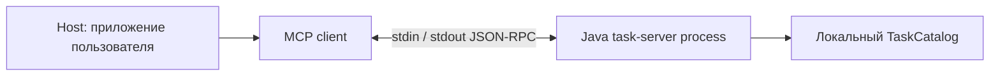

# Урок 4.2. MCP-сервер на Java SDK: STDIO и Inspector

[Материалы урока](../README.md) · [Предыдущая лекция 4.1](../../lesson-4.1/lecture/README.md) · [ДЗ](../homework/README.md) · [Проверка](../VERIFICATION.md)

Дата: 2026-10-31. Новый `task-server` — отдельный Maven-проект на Java 25 и MCP Java SDK 2.1.0. Унаследованное приложение RepoPilot использует Boot 4.1.2/Spring AI 2.0.2, но отдельный MCP-сервер этого урока не запускает Spring Boot и не использует LLM или pgvector.

## Результат занятия

В 4.1 Java callbacks жили внутри RepoPilot. Теперь вынесем доступ к учебному каталогу задач в отдельный процесс и опишем стандартный MCP-интерфейс: два tools, один resource и один prompt. Через Inspector проверим discovery, вызовы, ошибки и завершение процесса.

Мы ещё не подключаем MCP как источник tools к генеративному host RepoPilot. В этом занятии клиент — SDK contract test или Inspector. Сервер не вызывает модель и не «дообучает» её. Работа MCP без единого inference — нормальный результат.

В `lecture` остаётся полная база4.1. Новый продуктовый срез находится в `lecture/task-server`: исполняемый STDIO JAR с tools listTasks/getTask, resource project overview и prompt analyze_task. Дополнительной панели Web UI нет.

Ориентир на два часа: роли/версии20 минут, SDK и transport20, tools25, resource/prompt20, Inspector/контрактные тесты25, разбор ДЗ10.

## 1. Кто здесь host, client и server



Host отвечает за пользовательскую задачу, контекст и решение, что дать модели. MCP client — соединение с конкретным сервером внутри host. Server объявляет capabilities и исполняет согласованные операции. В лаборатории Inspector выполняет роль диагностического клиента; способность вызвать tool не требует модели.

MCP стандартизирует интерфейс доступа. Он не гарантирует, что host выберет нужный tool, корректно использует результат или вообще умеет tool calling с выбранными весами. Ограничения MODEL из 4.1 остаются актуальны и после смены транспорта.

Сами задачи остаются учебными данными в памяти процесса. Это не внешняя task-система и не открытый доступ ко всему компьютеру.

## 2. Фиксируем версии до написания кода

| Компонент | Версия/роль в уроке |
| --- | --- |
| JDK | 25 |
| MCP Java SDK | 2.1.0 в отдельном task-server/pom.xml |
| MCP protocol | 2025-11-25, проверяется handshake контрактом |
| Spring Boot / Spring AI | 4.1.2 / 2.0.2: runtime основного приложения; в server POM только build/dependency management |
| Inspector | Закреплённая проверенная версия в командах ниже |

[SDK release2.1.0](https://github.com/modelcontextprotocol/java-sdk/releases/tag/v2.1.0), дата protocol revision и версия Inspector — три разные вещи. Не выбирайте одну цифру вместо другой. SDK не становится реализацией более новой ревизии из-за изменения строки в README.

На дату подготовки существует [protocol revision 2026-07-28](https://modelcontextprotocol.io/specification/2026-07-28). Его описание self-contained requests и per-request capability negotiation нельзя молча смешивать с lifecycle2025-11-25 этого проекта. Здесь используем pinned протокол; миграцию на новую ревизию нужно делать отдельной проверяемой задачей.

Особенно внимательно читайте ссылки latest: современная [страница Inspector](https://modelcontextprotocol.io/docs/tools/inspector) может описывать более новый CLI/режим переговоров, чем закреплённая версия лаборатории. Сборка и примеры сверяются с реальными sources SDK 2.1.0 и CLI, а не угадываются по статьям другой версии.

## 3. Tools, resources и prompts — разные примитивы

| Примитив | Что отдаёт | Как проверяем |
| --- | --- | --- |
| Tool | Результат вызова с аргументами | tools/list, tools/call |
| Resource | Контекст по URI | resources/list, resources/read |
| Prompt | Шаблон сообщений с аргументами | prompts/list, prompts/get |

listTasks — **имя доменного tool**, который возвращает задачи. tools/list — **метод MCP**, перечисляющий определения инструментов. Эти вызовы нельзя подменять друг другом.

Resource project overview не обязан автоматически попадать в prompt модели: host решает, как использовать полученный контекст. Prompt analyze_task возвращает сообщения, но сам не запускает inference и не исполняет Java tool calls. Соглашения model/application/user-controlled описывают типичные интерфейсы, а не магическое выполнение всех примитивов сервером.

Урок регистрирует только реализованные возможности. Sampling, elicitation, roots и HTTP transport не появляются от общего названия MCP. HTTP/Spring-интеграция рассматривается в следующем4.3 отдельно.

## 4. STDIO — транспорт процесса

Клиент запускает `java -jar ...` как дочерний процесс. Запросы идут в stdin, ответы/уведомления — в stdout. Одна физическая строка содержит одно UTF-8 JSON-RPC сообщение; переносы внутри строк JSON должны быть экранированы как `\n`.

**В stdout сервера допустим только протокол.** Banner, `System.out.println("started")`, Maven build log или отладочный текст сломают поток. Логирование направляется в stderr. Это правило проверяется subprocess-тестом, а не только договорённостью.

STDIO JAR не слушает HTTP-порт. `curl http://localhost:8080/mcp` не проверяет этот transport. Нужен клиент, запускающий процесс и выполняющий lifecycle/JSON-RPC. Inspector и SDK берут framing/negotiation на себя.

Не запускайте сборку Maven вместо готового JAR как transport command: Maven пишет собственные сообщения и живёт по другому lifecycle. Сначала package, затем запускайте ровно Java process.

## 5. Создаём отдельный проект task-server

Откройте `lecture/task-server/pom.xml`. Этот Maven-проект не включён автоматически в сборку основного Boot-приложения; проверяем оба явно.

Из корня курса:

```bash
cd lessons/lesson-4.2/lecture
./mvnw -version
./mvnw -f task-server/pom.xml verify
```

Сборка создаёт `task-server/target/taskshelf-mcp-server.jar`. Альтернатива, если открыли task-server как отдельный проект:

```bash
cd task-server
../mvnw -f pom.xml verify
```

Здесь используется Wrapper родительской папки lecture, а `-f` выбирает отдельный pom. Для STDIO-сервера не нужны Ollama, Docker, embeddings или запущенное приложение на8080. Они потребуются только для других унаследованных сценариев.

Проверка основной базы выполняется отдельно из lecture:

```bash
./mvnw test
npm ci
npm test
```

Полный унаследованный pgvector-профиль по-прежнему требует Docker; результаты обоих Maven-проектов и границы проверки фиксируются в [VERIFICATION](../VERIFICATION.md).
## 6. Закрепляем зависимости и исполняемый JAR

Полный [task-server/pom.xml](task-server/pom.xml) использует общий parent/BOM для build/test dependency management, но не запускает Spring Boot и не содержит Spring AI model runtime. SDK закреплён явно:

```xml
<properties>
    <java.version>25</java.version>
    <spring-ai.version>2.0.2</spring-ai.version>
    <mcp.sdk.version>2.1.0</mcp.sdk.version>
</properties>

<dependency>
    <groupId>io.modelcontextprotocol.sdk</groupId>
    <artifactId>mcp</artifactId>
    <version>${mcp.sdk.version}</version>
</dependency>
```

В сборке проверена effective версия SDK core/json-jackson3 — тоже2.1.0. Не считайте импорт Spring AI BOM самостоятельной гарантией версии произвольного SDK coordinate. Отдельный Maven-проект позволяет проверять именно этот согласованный набор.

Maven Shade plugin упаковывает dependencies, сохраняет service metadata и задаёт Main-Class `dev.myfrei.repopilot.mcp.TaskServerMain`. `finalName=taskshelf-mcp-server` даёт предсказуемый путь JAR. Его нельзя заменить обычным thin JAR без runtime classpath.

Структура нового сервера:

```text
lecture/
  pom.xml                       # Основное приложение RepoPilot
  task-server/
    pom.xml                     # Независимый SDK-проект
    src/main/java/dev/myfrei/repopilot/
      tasks/                    # Чистый domain catalog/public view
      mcp/TaskServerMain.java
      mcp/TaskMcpServer.java
      mcp/TaskMcpHandlers.java
      mcp/TaskServerJson.java
    src/test/java/.../mcp/
    target/taskshelf-mcp-server.jar
```

Здесь нет подключения к внешней системе задач: используются те же пять вымышленных задач TaskShelf. Публичный TaskView содержит id/title/status/summary. Internal acceptanceCriteria не передаются базовыми tools/resource/prompt.

## 7. Создаём STDIO bootstrap

[TaskServerMain](task-server/src/main/java/dev/myfrei/repopilot/mcp/TaskServerMain.java) отделён от factory/handlers. Его main не принимает произвольные CLI arguments и запускает базовый набор без дополнительных tools:

```java
public static void main(String[] args) {
    if (args.length != 0) throw new IllegalArgumentException("This server accepts no command-line arguments");
    start(new TaskCatalog(), List.of());
}
```

Основной фрагмент start:

```java
System.setProperty("org.slf4j.simpleLogger.logFile", "System.err");
System.setProperty("org.slf4j.simpleLogger.defaultLogLevel", "warn");
var transport = new StdioServerTransportProvider(
    TaskServerJson.mapper(), System.in, System.out, 8192
);
var server = TaskMcpServer.create(transport, catalog, extraTools);
Runtime.getRuntime().addShutdownHook(
    new Thread(server::closeGracefully, "taskshelf-mcp-shutdown")
);
System.err.println("taskshelf-mcp-server ready: STDIO, read-only catalog");
return server;
```

Последний transport argument в SDK 2.1.0 — inputMaxSize, максимальная длина одной входящей строки в Java chars. Это **не** buffer size и **не** 8192 байта UTF-8. SDK отвергает превышение и закрывает transport. Возвращённый server живёт благодаря reader/writer threads SDK; ручной бесконечный sleep в main не нужен.

Ready-сообщение идёт в stderr. Само по себе оно не является MCP notification и не подменяет initialize. Если запустить JAR без клиента, он ожидает stdin; HTTP-страницы при этом не появится.

## 8. Объявляем capabilities и регистрируем features

[TaskMcpServer.create](task-server/src/main/java/dev/myfrei/repopilot/mcp/TaskMcpServer.java) собирает один sync server:

```java
return McpServer.sync(transport)
    .jsonMapper(TaskServerJson.mapper())
    .serverInfo("taskshelf-mcp-server", "1.0.0")
    .instructions("Read-only fictional TaskShelf catalog. Tools read public metadata, resources provide context, prompts only return templates.")
    .capabilities(McpSchema.ServerCapabilities.builder()
        .logging()
        .tools(false)
        .resources(false, false)
        .prompts(false)
        .build())
    .requestTimeout(Duration.ofSeconds(5))
    .validateToolInputs(false)
    .tools(tools)
    .resources(handlers.overview())
    .prompts(handlers.analyzeTask())
    .build();
```

`tools(false)` не отключает tools: false — признак отсутствия listChanged notifications. Для resources не включены subscriptions/listChanged, для prompts также listChanged=false. Сам набор зарегистрирован и доступен для discovery/call/read/get.

Initialize фактически объявляет logging:{}: SDK 2.1.0 добавляет эту capability; factory делает её явной. Это [протокольное logging](https://modelcontextprotocol.io/specification/2025-11-25/server/utilities/logging), а не наш stderr. Собственные notifications/message в этом уроке не отправляются. Не считайте ready-строку уведомлением MCP.

serverInfo.version 1.0.0 описывает **наш сервер**, не SDK 2.1.0 и не protocol 2025-11-25. Instructions — metadata для клиента/host, а не автоматический запуск prompt или изменение весов модели.

requestTimeout — параметр SDK, а не обещание принудительно прервать любой произвольный Java handler через пять секунд. Наши handlers выполняют маленькие read-only операции; время ожидания клиента дополнительно ограничено в тестах.

validateToolInputs(false) здесь выбран намеренно: каждый известный tool сам проверяет точные raw types/keys/bounds и возвращает безопасный isError result. Schema при этом остаётся опубликованной. Отключить SDK validation и забыть проверки в handler — совсем другой контракт; готовый пример так не делает.

## 9. Регистрируем tools через SDK 2.1.0

[TaskMcpHandlers.tools](task-server/src/main/java/dev/myfrei/repopilot/mcp/TaskMcpHandlers.java) создаёт schemas и SyncToolSpecification. В этом SDK handler получает request object; его arguments извлекаются явно:

```java
new SyncToolSpecification(
    McpSchema.Tool.builder("getTask", getSchema)
        .description("Прочитать публичную TaskShelf задачу по точному taskId, например TASK-101.")
        .annotations(hints)
        .build(),
    (exchange, request) -> getTask(request.arguments())
)
```

Не подменяйте второй аргумент handler старым примером `Map args` из другого тега SDK. Компиляция закреплённого проекта проверяет настоящую сигнатуру.

Контракты:

| Tool | Arguments | Успешные данные |
| --- | --- | --- |
| listTasks | optional integer limit1..5, default5 | tasks:[TaskView], returned, total |
| getTask | required string taskId, pattern TASK-[0-9]{3} | TaskView существующей задачи |

Обе schemas — object с additionalProperties=false. Handlers отвергают string/fraction/null вместо integer limit, неизвестные поля, отсутствие taskId и неверную форму ID. listTasks возвращает bounded prefix каталога: это не cursor pagination из ДЗ4.1.

MCP getTask — общий read-only инструмент каталога. В отличие от request-scoped Java MODEL 4.1, у Inspector здесь нет заранее выбранного единственного taskId host-запроса. Ограничение модели конкретной пользовательской задачей будет ответственностью будущего host; оно не появляется автоматически в transport server.

Read-only/destructive/idempotent/open-world annotations помогают клиенту понять назначение. Они не заменяют проверку кода и авторизацию. В нашей реализации отсутствие записи обеспечивается самим каталогом/handlers.

## 10. Формируем bounded tool result

[TaskServerJson](task-server/src/main/java/dev/myfrei/repopilot/mcp/TaskServerJson.java) использует согласованный Jackson3 mapper SDK и возвращает два представления одного значения:

```java
return McpSchema.CallToolResult.builder(List.of(
        McpSchema.TextContent.builder(json).build()
    ))
    .structuredContent(value)
    .isError(error)
    .build();
```

TextContent содержит JSON string для клиентов, читающих text content; structuredContent — типизированную структуру. Эти значения проверяются на согласованность в тестах. Не принимайте двойное представление за два вызова tool.

MAX_OUTPUT_BYTES=8192 проверяет UTF-8 длину **encode(value)** перед этой упаковкой. Полный JSON-RPC response может быть больше 8192: значение продублировано, string экранируется и добавляется envelope. Это не глобальный cap wire-строки. Для resource/prompt boundedText ограничивает UTF-8 bytes самого текста, также без всей оболочки.

Лимит output bytes, входной inputMaxSize в Java chars и Unicode code points будущего checklist — разные величины. Их нельзя использовать как взаимозаменяемые оценки model tokens.

## 11. Разделяем tool error и JSON-RPC error

В уже initialized сессии tool call имеет вид:

```json
{"jsonrpc":"2.0","id":2,"method":"tools/call","params":{"name":"getTask","arguments":{"taskId":"TASK-101"}}}
```

Пример приведён одной физической строкой, как требует STDIO framing. Ручной echo такой строки без lifecycle не заменяет MCP client.

Для известного tool business/argument error возвращается result с isError=true и bounded JSON code:

| Ситуация | Envelope этого сервера |
| --- | --- |
| listTasks limit неверного типа/диапазона | result.isError=true / INVALID_ARGUMENTS |
| getTask неизвестного корректно оформленного ID | result.isError=true / TASK_NOT_FOUND |
| Неизвестный tool | JSON-RPC error −32602 |
| Неизвестный method | JSON-RPC error −32601 |
| Неизвестный resource | JSON-RPC error −32002 |
| Неверные analyze_task arguments/ID | JSON-RPC error −32602 |

Это фактический контракт SDK/handlers данного среза, а не HTTP400/404 из 4.1. Не объявляйте tools/call успешным только потому, что пришёл result: проверяйте isError.

Сообщения известных handlers не отражают произвольный входной payload. SDK protocol errors и наши domain codes — разные уровни; не придумывайте общий code вместо наблюдаемой формы.

## 12. Добавляем resource project overview

Resource имеет URI `taskshelf://project/overview`, name taskshelf-project-overview и MIME text/markdown:

```java
var resource = McpSchema.Resource.builder(
        OVERVIEW_URI, "taskshelf-project-overview")
    .title("TaskShelf: публичный обзор")
    .description("Описание вымышленного проекта и известные IDs задач.")
    .mimeType("text/markdown")
    .build();
```

Read handler проверяет URI и строит bounded Markdown из ProjectInfo: название, описание, технологии и task IDs. Он не читает произвольный file:// путь и не возвращает internal criteria.

Клиент делает resources/list, выбирает URI и вызывает resources/read. Resource — стандартизированный контекст, но сервер не может доказать, что host затем действительно включил его в model prompt. Inspector просто показывает данные.

## 13. Добавляем prompt analyze_task

Prompt объявляет required argument taskId и возвращает один USER message. В нём public TaskView и инструкция: сформулировать проблему/шаги/проверки, отделить факты от предположений и не заявлять выполненные изменения.

```java
return McpSchema.GetPromptResult.builder(List.of(
        McpSchema.PromptMessage.builder(
            McpSchema.Role.USER,
            McpSchema.TextContent.builder(text).build()
        ).build()
    ))
    .description("Публичный анализ задачи " + id)
    .build();
```

prompts/get детерминированно подготавливает сообщения. Он сам не вызывает LLM, не запускает tools/call и не меняет репозиторий. Данные TaskView читаются handler из каталога, а не появляются после скрытого agent loop. Если нужны acceptance criteria, baseline prompt предлагает запросить их отдельно.

Публичные поверхности намеренно ограничены: listTasks/getTask/resource/prompt не сериализуют весь Task. Новое ДЗ добавит отдельное явно названное чтение criteria через policy, а не незаметно расширит getTask.

## 14. Проходим lifecycle SDK-клиентом

Порядок session 2025-11-25:

1. Клиент запускает дочерний JAR.
2. Отправляет initialize с protocolVersion/clientInfo/capabilities.
3. Проверяет negotiated version и server capabilities.
4. Отправляет notifications/initialized без id/ответа.
5. Выполняет discovery и операции.
6. Закрывает принадлежащую ему сессию/процесс.

Этот lifecycle реализован в [TaskServerSdkIT](task-server/src/test/java/dev/myfrei/repopilot/mcp/TaskServerSdkIT.java) настоящим SDK client, а не mock server:

```java
var transport = new StdioClientTransport(
    ServerParameters.builder(javaExecutable)
        .args("-jar", absoluteJarPath)
        .build(),
    TaskServerJson.mapper()
);
var client = McpClient.sync(transport)
    .clientInfo(McpSchema.Implementation.builder("course-sdk-test", "1.0").build())
    .requestTimeout(Duration.ofSeconds(5))
    .initializationTimeout(Duration.ofSeconds(5))
    .build();
var initialized = client.initialize();
var tools = client.listTools();
var task = client.callTool(McpSchema.CallToolRequest.builder("getTask")
    .arguments(Map.of("taskId", "TASK-101"))
    .build());
```

Используйте абсолютный путь к JDK 25/java и JAR, особенно если host запускается с другой working directory. Две строки JSON из stdout shell-команды не доказывают успешный lifecycle: SDK тест проверяет negotiated version, schemas/results, ошибки и cleanup.

Отдельный [TaskServerWireIT](task-server/src/test/java/dev/myfrei/repopilot/mcp/TaskServerWireIT.java) читает raw UTF-8 JSON-RPC lines. Он проверяет отсутствие banner/лишнего stdout, error envelopes, поддержанную старую negotiated revision и EOF. Кодек/handlers отдельно покрывает [TaskMcpHandlersTest](task-server/src/test/java/dev/myfrei/repopilot/mcp/TaskMcpHandlersTest.java).

При закрытии stdin сервер завершается с exit 0, в том числе без initialize. SDK client.closeGracefully в проверенной среде может завершать owned process сигналом SIGTERM: child exit 143 при успешной очистке не равен ошибке MCP. Не требуйте exit 0 для всех способов shutdown/всех ОС. Существенны корректный результат операции и отсутствие оставшегося дочернего процесса.
## 15. Проверяем тот же JAR через Inspector 0.21.2

Для лаборатории закреплён [Inspector 0.21.2](https://github.com/modelcontextprotocol/inspector/releases/tag/0.21.2), а не latest. Проверены его CLI arguments и реальные операции с этим JAR. Используйте Node 24 курса; package требует Node не ниже 22.7.5.

Все команды ниже выполняются **из lecture** после server verify. JAVA_HOME должен указывать на JDK 25:

```bash
"$JAVA_HOME/bin/java" -version
node --version
npm exec --yes --package=@modelcontextprotocol/inspector@0.21.2 -- \
  mcp-inspector --cli "$JAVA_HOME/bin/java" \
  -jar "$PWD/task-server/target/taskshelf-mcp-server.jar" \
  --method tools/list
```

MCP Inspector запускает дочерний Java process, выполняет handshake/discovery и завершает соединение. Для остальных операций можно определить небольшой shell helper, сохранив точный package pin и абсолютный JAR path:

```bash
TASKSHELF_MCP_JAR="$PWD/task-server/target/taskshelf-mcp-server.jar"
course_mcp() {
  npm exec --yes --package=@modelcontextprotocol/inspector@0.21.2 -- \
    mcp-inspector --cli "$JAVA_HOME/bin/java" -jar "$TASKSHELF_MCP_JAR" "$@"
}
```

Tools:

```bash
course_mcp --method tools/call --tool-name listTasks --tool-arg limit=2
course_mcp --method tools/call --tool-name getTask --tool-arg taskId=TASK-101
```

Resources:

```bash
course_mcp --method resources/list
course_mcp --method resources/read --uri taskshelf://project/overview
```

Prompts:

```bash
course_mcp --method prompts/list
course_mcp --method prompts/get --prompt-name analyze_task --prompt-args taskId=TASK-101
```

Не заменяйте `--prompt-args` на `--tool-arg` или `--uri` на URL HTTP. Это реальные flags закреплённого CLI. После первой установки package из cache можно использовать npm offline, если он и dependencies действительно доступны локально.

У Inspector 0.21.2 есть приведение tool arguments по schema: строковый CLI argument может превратиться в JSON number для integer-поля. Поэтому попытка передать `limit="2"` через CLI не доказывает отказ сервера от raw string. Для такой проверки используйте SDK/raw-wire tests; в CLI негативный пример можно строить на дробном числе 2.5 или неизвестном поле. Даже isError=true result может сопровождаться exit 0 самого CLI — читайте isError/code и содержание результата.

Каждая такая CLI-команда создаёт собственную короткую сессию. Она не является продолжением единого model conversation. Проверки длительной SDK-сессии и cleanup вынесены в contract tests.

Inspector CLI может pretty-print свой результат с переносами строк. Правило «одна JSON-RPC строка» относится к **server→client pipe**, а не к человекочитаемому stdout самого Inspector. Не подавайте pretty-printed вывод клиента обратно в stdin сервера.

Web Inspector здесь не используется как доказательство: автоматическая подготовка проверила CLI, GUI отдельно не открывался. При желании изучите Web-режим по documentation выбранного tag, не меняя package version и не выдавая непроверенный UI-прогон за результат тестов.

## 16. Что этот урок ещё не подключает

Основной `/api/tools/model` в приложении 4.2 сохраняет локальные callbacks4.1. Запуск task-server рядом не меняет их в MCP callbacks автоматически. В этой лаборатории источником MCP-запросов были Inspector/SDK, а не Ollama.

Чтобы превратить сервер в источник tools для generative host, потребуется отдельно создать MCP client connection, получить определения, связать их с model tool loop, перенести нужные policy/limits и учитывать жизненный цикл процесса. Это следующий шаг, а не свойство любого готового MCP JAR.

STDIO хорошо показывает локальное владение дочерним процессом. Streamable HTTP требует другой transport/runtime и правил соединений; HTTP/Spring-переход будет в 4.3. Не заменяйте новый transport устаревшим термином HTTP+SSE из старых статей без проверки версии.

## 17. Проверяем все уровни раздельно

Матрица команд из lecture:

| Команда | Что проверяет | Требования |
| --- | --- | --- |
| ./mvnw test | Основное приложение и унаследованные unit/HTTP fixtures | JDK 25, без настоящих весов |
| npm test | Унаследованный UI | Node 24, установленные dependencies |
| ./mvnw verify -Ppgvector-it | Полный прежний RAG путь | Docker |
| ./mvnw -f task-server/pom.xml verify | Plain SDK, shaded JAR и реальные STDIO subprocess contracts | JDK 25, без Ollama/Docker |
| Закреплённый Inspector CLI | Interoperability фактического Java JAR с другим MCP client | Node 24, package0.21.2 |

Корневой app Maven не агрегирует task-server. Успех только одной строки таблицы не подтверждает остальные. Для subprocess IT нужен `verify`, потому что JAR создаётся на package phase, а Failsafe запускает его после упаковки.

Проверяются schemas/public views, строгие аргументы, content/structuredContent, lifecycle/negotiation, stderr/stdout, error envelopes, resources/prompts и очистка принадлежащего клиенту процесса. Фактические counters и результаты указаны в [VERIFICATION](../VERIFICATION.md); дополнительные веса модели не запускались и не требуются серверу.

Заполните [Mcp-Stdio-Experiment.md](evaluation/Mcp-Stdio-Experiment.md). Зафиксируйте хотя бы один успешный вызов каждого примитива, known-tool error и protocol error, согласованную version и cleanup. Не подменяйте result.isError=true обещанием «клиент подключился, значит инструмент работает».

## 18. Разбираем неисправности

| Наблюдение | Что проверить |
| --- | --- |
| Inspector ждёт initialize | Правильные JDK 25/JAR path, stderr, отсутствие постороннего stdout |
| Вместо JSON-RPC пришёл Maven log | Соберите JAR заранее; transport command должен запускать java, не Maven |
| Java class version error | javaExecutable host/client указывает на JDK 25, а не системную старую Java |
| tools/list есть, задач нет | tools/list — definitions; listTasks надо вызвать через tools/call |
| isError=true при limit | Нужен настоящий integer 1..5 без лишних полей |
| TASK_NOT_FOUND при TASK-999 | ID корректно оформлен, но не существует; это business result |
| Resource виден, но модель его не использовала | Host решает, как включать контекст; Inspector inference не запускает |
| prompts/get вернул текст, но изменений нет | Prompt — template, не команда исполнения |
| В initialize есть logging:{} | Capability SDK не равна локальным stderr logs или отправленным notifications/message |
| Child завершился 143 после close | В проверенной среде SDK transport использует SIGTERM; оцените outcome/cleanup, не только число |
| Воспроизводимость потерялась после latest | Сверьте SDK, protocol revision и Inspector pin отдельно |
| /api/tools/model не обращается к JAR | В 4.2 он по-прежнему использует локальные callbacks; MCP host ещё не подключён |

## 19. Самостоятельное ДЗ: acceptance checklist

В [homework](../homework/README.md) весь SDK-server, bootstrap и два базовых tools уже реализованы. Новая задача — [AcceptanceChecklistPolicy.build](../homework/task-server/src/main/java/dev/myfrei/repopilot/checklist/AcceptanceChecklistPolicy.java) для ограниченного списка **целых** критериев. Функция получает готовый ChecklistInput; повторная SDK-регистрация не является решением ДЗ.

Два entrypoint разделяют базу и новое приращение:

```bash
# Из homework, основной server остаётся с двумя tools:
java -jar task-server/target/taskshelf-mcp-server.jar

# Отдельный homework main добавляет getAcceptanceChecklist:
java -cp task-server/target/taskshelf-mcp-server.jar \
  dev.myfrei.repopilot.checklist.ChecklistServerMain
```

Здесь нет дополнительного CLI flag: выбирается другой main class того же homework JAR. Inspector должен запускать именно эту command/args-комбинацию. Оба main не принимают произвольных arguments.

Новый tool принимает taskId, optional maxItems1..8/default4 и maxCodePoints40..800/default400. Criteria читает adapter из внутреннего Task, а не получает от клиента. До реализации policy новый tool сообщает HOMEWORK_NOT_IMPLEMENTED; это честный tool error, а не пустой успешный checklist.

Контракт самостоятельного алгоритма:

1. NFKC, свёртка Unicode whitespace в обычный пробел и удаление крайних пробелов.
2. Пропуск blank, точный dedup нормализованных строк с сохранением первого появления; case folding не выполняется.
3. AC IDs основаны на исходной позиции: AC-001 и далее. Пропуски не перенумеровывают последующие IDs; редактирование исходного списка может изменить их смысл.
4. Подсчёт eligibleCount по всему нормализованному уникальному списку.
5. Выбор prefix целых текстов по maxItems и сумме code points. Не обрезать строку и не пропускать большую ради короткой следующей.
6. Честные usedCodePoints/omittedCount/complete/budgetBlocked; если остановил maxItems раньше, budgetBlocked=false.

usedCodePoints считает только выбранный нормализованный текст, без IDs/JSON/separators. Это не байтовый cap TaskServerJson и не модельный token budget. Пустой eligible список — complete=true; частичный перечень — успешный result с complete=false, а не автоматически isError=true.

После реализации выполните оба проекта и проверьте новый entrypoint через Inspector. [SUBMISSION](../homework/SUBMISSION.md) должен показать prefix/Unicode/duplicate-ID сценарии и tools/list базового и расширенного серверов. Точные команды/acceptance и результаты эталона — в homework README/VERIFICATION. Временное решение в каркас не включено.

## 20. Самопроверка

1. Что делает host, что client и что server в этой лаборатории?
2. Почему MCP может работать без единого вызова LLM?
3. Чем tools/list отличается от listTasks?
4. Почему false в tools(false) не отключает tool capability?
5. Чем локальный stderr отличается от MCP logging notification?
6. Что ограничено 8192 Java chars, что 8192 UTF-8 bytes и почему wire response может быть больше?
7. Чем known-tool isError отличается от JSON-RPC error?
8. Почему prompts/get не обучает модель и не выполняет tool calls?
9. Почему запуск JAR не подключает его к старому /api/tools/model?
10. Почему SDK 2.1.0, protocol 2025-11-25 и Inspector 0.21.2 нельзя заменить одной датой latest?
11. Чем partial checklist отличается от испорченного/обрезанного критерия?

## 21. Источники

- [MCP Java SDK 2.1.0 release](https://github.com/modelcontextprotocol/java-sdk/releases/tag/v2.1.0) и [README закреплённого тега](https://github.com/modelcontextprotocol/java-sdk/blob/v2.1.0/README.md) — исходный SDK и links reference.
- [MCP 2025-11-25 lifecycle](https://modelcontextprotocol.io/specification/2025-11-25/basic/lifecycle) и [transports](https://modelcontextprotocol.io/specification/2025-11-25/basic/transports) — session/STDIO framing.
- [Tools](https://modelcontextprotocol.io/specification/2025-11-25/server/tools), [Resources](https://modelcontextprotocol.io/specification/2025-11-25/server/resources), [Prompts](https://modelcontextprotocol.io/specification/2025-11-25/server/prompts) — разные server features и error/data contracts.
- [MCP logging](https://modelcontextprotocol.io/specification/2025-11-25/server/utilities/logging) — protocol notifications, отдельно от stderr.
- [Inspector 0.21.2 source](https://github.com/modelcontextprotocol/inspector/tree/0.21.2) — закреплённый CLI; generic latest documentation может описывать другую версию.
- [MCP 2026-07-28](https://modelcontextprotocol.io/specification/2026-07-28) — отдельная новая ревизия для сравнения, не спецификация реализованного здесь session runtime.
