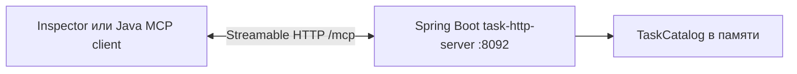

# Урок 4.3. Spring MCP server и Streamable HTTP

[Материалы урока](../README.md) · [Предыдущая лекция 4.2](../../lesson-4.2/lecture/README.md) · [ДЗ](../homework/README.md) · [Проверка](../VERIFICATION.md)

Дата: 2026-10-31. Java 25, Spring Boot 4.1.2, Spring AI 2.0.2, MCP Java SDK 2.1.0. Согласуем protocol revision 2025-11-25; Inspector закреплён на 0.21.2.

## Результат занятия

В 4.2 клиент запускал Java JAR и обменивался JSON-RPC через stdin/stdout. Теперь создадим отдельный Spring Boot MCP server, который заранее запущен и принимает Streamable HTTP на `http://127.0.0.1:8092/mcp`. Опубликуем тот же учебный каталог: listTasks/getTask, project overview resource и analyze_task prompt. Проверим сервер SDK-клиентом и Inspector, а границу доступа — отдельными HTTP-проверками.

Сервер не вызывает LLM. Для нового сценария не нужны Ollama, embeddings или PostgreSQL. В папке `lecture` сохранено основное приложение RepoPilot и STDIO-проект 4.2; новый HTTP-сервер находится в отдельном `task-http-server`. Основной RepoPilot пока не превращается в MCP host от самого факта запуска сервера. Это следующий шаг 4.4.

Дополнительного экрана UI нет. Результат занятия — работающий протокольный сервис, discovery-контракт и воспроизводимые проверки. Каталог в памяти остаётся учебным fixture, а не интеграцией с настоящим issue tracker.

Ориентир на два часа: transport и lifecycle 20 минут, Boot-проект 20, аннотации 25, token/Origin 20, SDK/Inspector 25, эксперимент и ДЗ 10.

## 1. Что изменилось после STDIO



У STDIO клиент создаёт дочерний процесс. У HTTP-сервера свой lifecycle: его запускают до подключения, несколько клиентов могут открыть свои сессии, и завершение одного клиента не должно останавливать общий сервер. JSON-RPC и MCP-примитивы сохраняются, но framing, handshake, доставка сообщений и граница доступа меняются.

| Механизм | Где используется | Что означает |
| --- | --- | --- |
| STDIO | Сервер 4.2 | JSON-RPC сообщения по строкам stdin/stdout дочернего процесса |
| Chat SSE | Чат RepoPilot 1.3 | События приложения с частями сгенерированного ответа |
| Streamable HTTP | Новый `/mcp` | HTTP transport для MCP; ответ может использовать JSON или SSE |
| Legacy MCP SSE | Другой, старый transport | Не включается вместо STREAMABLE в этом уроке |

SSE на HTTP-уровне MCP не обещает поток токенов модели. Наш сервер вообще не обращается к модели. Значение `SYNC` относится к Java API обработчиков, а `STREAMABLE` — к transport; это независимые настройки. Основание — [transport specification 2025-11-25](https://modelcontextprotocol.io/specification/2025-11-25/basic/transports) и [Spring AI MCP server starter 2.0.2](https://docs.spring.io/spring-ai/reference/api/mcp/mcp-server-boot-starter-docs.html).

## 2. Версии — часть контракта

| Компонент | Закрепление |
| --- | --- |
| Java / Boot / Spring AI | 25 / 4.1.2 / 2.0.2 |
| MCP Java SDK | 2.1.0; сверяем effective dependencies, не только название BOM |
| MCP protocol | 2025-11-25 в initialize-контракте |
| Inspector CLI | `@modelcontextprotocol/inspector@0.21.2` |
| Bind / endpoint | `127.0.0.1:8092`, `/mcp` |

Версия Spring AI, SDK, protocol revision и Inspector решают разные задачи. В интернете уже есть [revision 2026-07-28](https://modelcontextprotocol.io/specification/2026-07-28), но изменение URL статьи не меняет реализованный lifecycle. Переход на неё требует отдельной миграции и тестов. Этот урок проверяет именно указанный стек.

Аннотации MCP сверяем с реальным JAR Spring AI 2.0.2. Примеры preview 2.1 нельзя переносить механически. Полный локальный код проекта — основной ориентир для imports и сигнатур; [reference по server annotations](https://docs.spring.io/spring-ai/reference/api/mcp/mcp-annotations-server.html) объясняет их назначение.

## 3. Создаём независимый Boot-проект
Из корня курса:

```bash
cd lessons/lesson-4.3/lecture
./mvnw -version
./mvnw -f task-http-server/pom.xml verify
```

Wrapper находится в `lecture`, а `-f` выбирает отдельный POM. Этот проект собирается независимо от основного RepoPilot и от STDIO `task-server`. Для работы нового HTTP-сервера нужны только Java/Maven; Docker/Ollama понадобятся host в следующем уроке.

Новый код устроен так:

```text
lecture/
  pom.xml                         # Унаследованный RepoPilot
  task-server/                    # Независимый STDIO SDK server4.2
  task-http-server/
    pom.xml
    src/main/resources/application.yaml
    src/main/java/dev/myfrei/repopilot/
      http/
        TaskHttpServerApplication.java
        TaskHttpConfiguration.java
        TaskHttpFeatures.java
        ToolInputSchemas.java
        StrictToolSchemaPostProcessor.java
        McpAccessFilter.java
      tasks/                      # Учебная доменная модель
      mcp/                        # Pure handlers / bounded JSON из4.2
```

В новом проекте повторно используем чистые TaskCatalog, TaskMcpHandlers и TaskServerJson; STDIO-bootstrap не копируем в HTTP lifecycle. Это учебные снимки исходников, а не уже созданная общая библиотека. Смена transport не должна менять смысл публичной задачи.

## 4. Подключаем starter и выбираем transport

В [task-http-server/pom.xml](task-http-server/pom.xml) используются Boot parent4.1.2 и Spring AI BOM2.0.2. Новая runtime dependency:

```xml
<dependency>
    <groupId>org.springframework.ai</groupId>
    <artifactId>spring-ai-starter-mcp-server-webmvc</artifactId>
</dependency>
```

Это настоящий Spring Boot HTTP server. В отличие от plain SDK JAR4.2, он использует WebMVC и autoconfiguration. Не добавляйте Ollama starter только ради MCP: сервер не нуждается в модели.

Откройте [application.yaml](task-http-server/src/main/resources/application.yaml):

```yaml
server:
  address: 127.0.0.1
  port: ${TASKSHELF_MCP_PORT:8092}

spring:
  ai:
    mcp:
      server:
        enabled: true
        name: taskshelf-mcp-http-server
        version: 1.0.0
        type: SYNC
        protocol: STREAMABLE
        stdio: false
        request-timeout: 5s
        tool-change-notification: false
        resource-change-notification: false
        prompt-change-notification: false
        capabilities:
          tool: true
          resource: true
          prompt: true
          completion: false
        streamable-http:
          mcp-endpoint: /mcp
          disallow-delete: false

taskshelf:
  access-token: ${TASKSHELF_MCP_TOKEN:course-local-token}
```

В полном файле также есть application name, virtual threads и серверные instructions. `disallow-delete: false` позволяет HTTP session cleanup; это не CRUD-delete учебной задачи. Здесь нет tool, изменяющего TaskCatalog. Notification flags относятся к изменению catalog metadata, а не к chat token streaming.

В реальном initialize присутствует и `logging:{}`: SDK 2.1.0 добавляет эту capability. Собственные MCP log notifications в уроке не отправляем. Локальные Boot-логи и MCP logging — разные каналы; наличие capability не означает, что сервер публикует в ней весь console log.

Запустите в отдельном терминале из `lecture`:

```bash
export TASKSHELF_MCP_TOKEN=course-local-token
./mvnw -f task-http-server/pom.xml spring-boot:run
```

Значение token должно совпадать у сервера и клиента. Храните его в transport configuration, не в prompt/аргументах tool. Если поменяли TASKSHELF_MCP_PORT, обновите и URL всех клиентов; остальные команды ниже используют 8092.

## 5. Регистрируем tools, resource и prompt аннотациями

[TaskHttpFeatures.java](task-http-server/src/main/java/dev/myfrei/repopilot/http/TaskHttpFeatures.java) — Spring component. Его imports берутся из **`org.springframework.ai.mcp.annotation`** в 2.0.2; не подменяйте их обычным `org.springframework.ai.tool.annotation.Tool` или API другой версии.

Начните с tools:

```java
@Component
public class TaskHttpFeatures implements ToolInputSchemas {
    private final TaskMcpHandlers handlers;

    public TaskHttpFeatures(TaskMcpHandlers handlers) {
        this.handlers = handlers;
    }

    @McpTool(name = "getTask",
        description = "Прочитать публичную TaskShelf задачу по точному taskId, например TASK-101.",
        annotations = @McpTool.McpAnnotations(
            readOnlyHint = true, destructiveHint = false,
            idempotentHint = true, openWorldHint = false))
    public CallToolResult getTask(CallToolRequest request) {
        return this.handlers.getTask(request.arguments());
    }
}
```

Это фрагмент класса: полный файл содержит listTasks и реализацию ToolInputSchemas. Метод принимает raw CallToolRequest, чтобы guard видел реальные JSON-значения до удобного Java coercion. Handler требует точные поля/типы: taskId — string формата TASK-xxx; limit — integer1..5, default5; неизвестные keys отвергаются.

Оба tools возвращают bounded CallToolResult: публичная TaskView с id/title/status/summary либо доменная ошибка. Внутренние acceptanceCriteria не сериализуются. readOnly/destructive/idempotent/openWorld hints описывают намерение для клиента, но не заменяют проверку Java-кода и доступ.

Унаследованный TaskServerJson ограничивает UTF-8 JSON самого значения tool до 8192 bytes, затем помещает его в text content и structuredContent. Полный JSON-RPC response может быть больше из-за дублирования/escaping/envelope. Это не общий лимит HTTP body или session stream; resource/prompt отдельно ограничивают свой текст.

Добавьте resource и prompt:

```java
@McpResource(uri = TaskMcpHandlers.OVERVIEW_URI,
    name = "taskshelf-project-overview", title = "TaskShelf: публичный обзор",
    mimeType = "text/markdown", description = "Описание вымышленного проекта и известные IDs задач.")
public ReadResourceResult overview() {
    return this.handlers.overview().readHandler().apply(null,
        new ReadResourceRequest(TaskMcpHandlers.OVERVIEW_URI, null));
}

@McpPrompt(name = "analyze_task",
    description = "Шаблон анализа публичной задачи без вызова модели.")
public GetPromptResult analyzeTask(GetPromptRequest request,
        @McpArg(name = "taskId", required = true,
            description = "Точный TaskShelf ID, например TASK-101.") String taskId) {
    return this.handlers.analyzeTask().promptHandler().apply(null, request);
}
```

`@McpArg` объявляет required argument в discovery. Guard использует исходный GetPromptRequest, поэтому лишние fields или неверный taskId не становятся допустимыми от автоматического binding. Resource возвращает text/markdown по `taskshelf://project/overview`; prompt — одно USER-сообщение с публичной задачей и инструкциями анализа, без inference.

## 6. Уточняем schema отдельно от handlers

В закреплённой 2.0.2 у `@McpTool` нет атрибута `inputSchema`. Для raw CallToolRequest аннотационный scanner не выводит желаемые limit/taskId properties из Java-параметров. Поэтому «написали аннотацию — получили строгую schema» было бы неверным объяснением этого проекта.

[ToolInputSchemas](task-http-server/src/main/java/dev/myfrei/repopilot/http/ToolInputSchemas.java) отдаёт явные schema maps. [StrictToolSchemaPostProcessor](task-http-server/src/main/java/dev/myfrei/repopilot/http/StrictToolSchemaPostProcessor.java) уточняет annotation-generated SyncToolSpecification через публичные SDK constructors: сохраняет handler/metadata, заменяет inputSchema по имени. Это небольшой осознанный adapter, без доступа к private framework fields и без второй регистрации того же tool.

Schema getTask в discovery:

```json
{
  "type": "object",
  "properties": {
    "taskId": {"type": "string", "pattern": "^TASK-[0-9]{3}$", "maxLength": 8}
  },
  "required": ["taskId"],
  "additionalProperties": false
}
```

Схема здесь общая для сервера: он обслуживает TASK-101..105 и возвращает TASK_NOT_FOUND для отсутствующего корректного ID. Scope одного пользовательского запроса host будет сужаться отдельно в 4.4; не копируйте ограниченный enum из 4.1 в общий сервер без решения о server contract.

В [TaskHttpConfiguration](task-http-server/src/main/java/dev/myfrei/repopilot/http/TaskHttpConfiguration.java) SDK validation выключена намеренно:

```java
@Bean @Primary
McpSyncServerCustomizer strictInputValidation() {
    return builder -> builder.jsonMapper(TaskServerJson.mapper())
        .immediateExecution(true).validateToolInputs(false);
}
```

В Spring AI 2.0.2 есть и servlet customizer. Наш `@Primary` bean объединяет его policy immediateExecution=true с явным управлением input validation; это часть конфигурации закреплённого проекта.

Runtime raw guards остаются в TaskMcpHandlers и возвращают контролируемые INVALID_ARGUMENTS. Явные schemas информируют клиентов, но не являются единственной защитой сервера. SDK/HTTP contract tests проверяют обе стороны: metadata и реальные raw arguments.

Сохраните и отдельную MCP transport mapper-настройку из TaskHttpConfiguration:

```java
@Bean(name = "mcpServerJsonMapper", defaultCandidate = false)
JsonMapper mcpServerJsonMapper() {
    return JsonMapper.builder().changeDefaultPropertyInclusion(inclusion ->
        JsonInclude.Value.construct(
            JsonInclude.Include.NON_NULL, JsonInclude.Include.ALWAYS)).build();
}
```

Это публичная точка настройки Spring AI 2.0.2. NON_NULL применяется к properties, ALWAYS — к содержимому maps. Иначе transport conversion может потерять явный `limit:null` или `unknown:null` ещё до raw handler: запрос станет похож на отсутствие поля, а строгая проверка получит уже изменённые аргументы. Tests отправляют literal HTTP JSON и требуют отказа для обоих случаев. Обычный Java-вызов handler эту границу не проверяет. `TaskServerJson.mapper()` отдельно задаёт SDK mapper в customizer; transport mapper не заменяет доменную валидацию.

## 7. Ставим bearer и Origin до MCP handler

[McpAccessFilter.java](task-http-server/src/main/java/dev/myfrei/repopilot/http/McpAccessFilter.java) применяется ко **всем routes отдельного HTTP-сервера**. Его правила:

| Условие | Результат |
| --- | --- |
| Origin отсутствует | Разрешено продолжить bearer-проверку для SDK/CLI |
| Один Origin `http://localhost:8080` или `http://127.0.0.1:8080` | Разрешено продолжить bearer-проверку |
| Другой Origin или несколько Origin headers | 403 INVALID_ORIGIN |
| Отсутствует/неверный/неоднозначный Authorization | 401 UNAUTHORIZED и WWW-Authenticate |
| Верный Origin policy и один верный Bearer | Передать запрос MCP transport |

Origin проверяется первым. Поэтому при одновременно запрещённом Origin и неверном token ответ будет 403. Это не CORS-настройка для произвольного браузерного UI: allowlist — отдельная проверка запроса, а новых frontend-клиентов в уроке нет.

Не отключайте filter по сравнению raw requestURI с `/mcp`. Spring routing может считать `/mcp;demo=x` тем же endpoint после обработки matrix parameters, а строковое сравнение увидит другой путь. В независимой проверке такой разрыв позволял initialize без bearer. Отдельное приложение публикует MCP, поэтому защищаем все его routes: запрос к `/mcp;demo=x` без bearer должен получить 401, с верным bearer и запрещённым Origin — 403, до transport handler.

Основной guard сравнивает bytes token через MessageDigest.isEqual:

```java
var headers = Collections.list(request.getHeaders("Authorization"));
String header = headers.size() == 1 ? headers.getFirst() : null;
if (header == null || header.length() < 7
        || !header.regionMatches(true, 0, "Bearer ", 0, 7)
        || !MessageDigest.isEqual(this.expectedToken,
            header.substring(7).getBytes(StandardCharsets.UTF_8))) {
    response.setHeader("WWW-Authenticate", "Bearer realm=\"taskshelf-local\"");
    deny(response, 401, "UNAUTHORIZED");
    return;
}
chain.doFilter(request, response);
```

Полный filter проверяет ещё Origin, ограничения настройки token и возвращает только короткие error codes с Cache-Control:no-store. Registration имеет высокий precedence и asyncSupported=true. Не выводите Authorization в logs/worksheet.

Loopback уменьшает доступность учебного endpoint извне, но не удостоверяет пользователя. Shared demo bearer не предоставляет identity/roles/rotation и не является реализацией MCP OAuth. Для этого курса достаточно честно ограниченной локальной границы; production-систему проектируют отдельно.
## 8. Проверяем HTTP-границу до MCP-операций

Используем только учебное значение token. В терминале клиента:

```bash
export TASKSHELF_MCP_TOKEN=course-local-token
```

Сначала запрос без Authorization. Фильтр должен остановить его до MCP handler:

```bash
curl -i -X POST http://127.0.0.1:8092/mcp \
  -H 'Content-Type: application/json' \
  -H 'Accept: application/json, text/event-stream' \
  -d '{"jsonrpc":"2.0","id":1,"method":"initialize","params":{"protocolVersion":"2025-11-25","capabilities":{},"clientInfo":{"name":"course-curl","version":"1.0.0"}}}'
```

Теперь верный bearer с запрещённым Origin:

```bash
curl -i -X POST http://127.0.0.1:8092/mcp \
  -H "Authorization: Bearer $TASKSHELF_MCP_TOKEN" \
  -H 'Origin: https://untrusted.example' \
  -H 'Content-Type: application/json' \
  -H 'Accept: application/json, text/event-stream' \
  -d '{"jsonrpc":"2.0","id":2,"method":"initialize","params":{"protocolVersion":"2025-11-25","capabilities":{},"clientInfo":{"name":"course-curl","version":"1.0.0"}}}'
```

Отдельная regression-проверка варианта пути. Первый запрос ожидает 401, второй — 403; кавычки вокруг URL сохраняют `;` частью пути:

```bash
curl -i -X POST 'http://127.0.0.1:8092/mcp;demo=x'
curl -i -X POST 'http://127.0.0.1:8092/mcp;demo=x' \
  -H "Authorization: Bearer $TASKSHELF_MCP_TOKEN" \
  -H 'Origin: https://untrusted.example'
```

Для положительного initialize:

```bash
curl -sS -N --max-time 10 -D - http://127.0.0.1:8092/mcp \
  -H "Authorization: Bearer $TASKSHELF_MCP_TOKEN" \
  -H 'Content-Type: application/json' \
  -H 'Accept: application/json, text/event-stream' \
  -d '{"jsonrpc":"2.0","id":3,"method":"initialize","params":{"protocolVersion":"2025-11-25","capabilities":{},"clientInfo":{"name":"course-curl","version":"1.0.0"}}}'
```

Этот curl показывает HTTP headers и handshake, но не является полным клиентом. Для обычных операций нужно завершить lifecycle через notifications/initialized, сохранить session headers и protocol version. Используйте SDK/Inspector ниже: они реализуют lifecycle, а не отправляют tools/call в незавершённую сессию. Не переносите bearer в query string или JSON-RPC params.

Origin может отсутствовать у SDK/CLI-клиента. Разрешение такого запроса не отключает bearer. При переданном Origin он должен быть в явном allowlist. Порт, Origin и bearer решают разные задачи; конфигурация курса остаётся локальной демонстрацией, без production OAuth/identity management.

## 9. Подключаем Inspector0.21.2

Для CLI используйте Node24 из курса; закреплённый пакет требует Node не ниже 22.7.5. Перед первым запуском npm скачает package и зависимости. После заполнения cache допустим npm offline-режим.

В терминале клиента:

```bash
npm exec --yes --package=@modelcontextprotocol/inspector@0.21.2 -- \
  mcp-inspector --cli http://127.0.0.1:8092/mcp \
  --transport http \
  --header "Authorization: Bearer $TASKSHELF_MCP_TOKEN" \
  --method tools/list
```

В этой версии CLI `--transport http` означает Streamable HTTP. Это не legacy `sse`. Список должен содержать базовые listTasks/getTask с ожидаемыми schemas. MCP tools/list возвращает определения, а доменный listTasks — задачи.

Вызовите оба tools:

```bash
npm exec --yes --package=@modelcontextprotocol/inspector@0.21.2 -- \
  mcp-inspector --cli http://127.0.0.1:8092/mcp \
  --transport http \
  --header "Authorization: Bearer $TASKSHELF_MCP_TOKEN" \
  --method tools/call --tool-name listTasks --tool-arg limit=2

npm exec --yes --package=@modelcontextprotocol/inspector@0.21.2 -- \
  mcp-inspector --cli http://127.0.0.1:8092/mcp \
  --transport http \
  --header "Authorization: Bearer $TASKSHELF_MCP_TOKEN" \
  --method tools/call --tool-name getTask --tool-arg taskId=TASK-101
```

Для resources/prompts повторите тот же prefix до `--method`, заменив только хвост:

| Операция | Хвост команды |
| --- | --- |
| Список resources | `--method resources/list` |
| Чтение overview | `--method resources/read --uri taskshelf://project/overview` |
| Список prompts | `--method prompts/list` |
| Получение prompt | `--method prompts/get --prompt-name analyze_task --prompt-args taskId=TASK-101` |

resource даёт публичный контекст по URI. prompt возвращает сообщение с задачей и инструкциями анализа, но сам не запускает модель. Даже наличие обоих примитивов не включает их автоматически в будущий prompt host.

Проверьте ошибку дробного limit или неизвестного аргумента. CLI умеет преобразовывать строки аргументов по schema: такой клиент не является доказательством строгого raw JSON type на сервере. Raw string/fraction/unknown-key guards отдельно проверяются SDK/HTTP-тестами.

У Inspector exit code0 может сопровождать tool result с `isError=true`. Читайте результат, code и содержание, а не только код завершения процесса. HTTP401/403, JSON-RPC error и `isError` — разные слои.

## 10. Разбираем ошибки и lifecycle

| Слой | Пример | Что проверять |
| --- | --- | --- |
| HTTP boundary | Нет bearer / запрещённый Origin | HTTP status до handler |
| MCP protocol | Неизвестный метод или tool | JSON-RPC error |
| Доменный tool | Неверные аргументы / нет задачи | CallToolResult.isError и bounded error code |
| Клиент/сеть | Сервер остановлен | Ошибка connection/timeout, без выдуманного результата |

Tool handlers не возвращают Java stack trace и не смешивают criteria с публичной TaskView. Ошибки ресурса/prompt следуют отдельным MCP-контрактам; не считайте их tools/call.

У HTTP-сервера обычные Boot-логи могут идти в консоль: протокол передаётся по HTTP, не через stdout. Ограничение «stdout только JSON-RPC» остаётся обязательным для STDIO-проекта 4.2. Не запускайте HTTP Boot-JAR как STDIO command и не подключайте Inspector `--transport sse` к `/mcp` в этом уроке.

## 11. Проверяем проект
Из `lessons/lesson-4.3/lecture`:

```bash
./mvnw -f task-http-server/pom.xml verify
./mvnw -f task-http-server/pom.xml dependency:tree \
  '-Dincludes=io.modelcontextprotocol.sdk:*'
```

Первый проход проверяет не только вызов Java handler: контрактные проверки используют настоящий HTTP endpoint и SDK. Зависимости SDK core/JSON должны соответствовать закреплённому 2.1.0. Точные результаты, Inspector evidence и границы окружения приведены в [VERIFICATION](../VERIFICATION.md).

При чтении тестов найдите доказательства каждого свойства:

- annotation discovery публикует ровно базовые tools с явными schemas, resource и prompt;
- initialize согласует protocol и capabilities на реальном transport;
- token/Origin guard срабатывает до операции, а raw argument guards работают после него;
- tool result содержит публичные поля, `isError` и protocol errors различаются;
- закрытие клиента не завершает общий HTTP server.

Основная база RepoPilot и STDIO-сервер проверяются отдельно:

```bash
./mvnw verify -Ppgvector-it
npm ci
npm test
./mvnw -f task-server/pom.xml verify
```

pgvector-профиль требует Docker, а fixture chat/embedding endpoints не являются настоящими LLM weights. Если dependencies уже в cache, Maven можно запускать с `-o`; это свойство окружения, не обязательная часть первого setup.

Тесты и CLI проверяют API/transport. В новом HTTP-сервере нет генерации, поэтому они не измеряют качество ответов модели. Числа тестов не дублируем в тексте: актуальный снимок — [VERIFICATION](../VERIFICATION.md).
## 12. Проводим эксперимент

Откройте [пустой бланк](evaluation/Mcp-Http-Experiment.md). Сначала запишите версии и фактические capabilities, затем выполните discovery и все три вида примитивов. После положительного прохода проверьте доступ с отсутствующим/неверным bearer и с запрещённым Origin.

Меняйте один фактор за раз: token, Origin, аргументы либо lifecycle. Ошибка transport до initialize не проверяет валидацию getTask; `isError=true` из getTask не означает, что bearer-фильтр отказал. Различайте HTTP status, JSON-RPC error и доменную ошибку tool.

Закройте клиент и подключитесь снова. HTTP-сервер продолжает жить: это отличие от запускаемого клиентом STDIO-процесса. Остановите сервер и убедитесь, что новый клиент получает реальную ошибку подключения. Не объясняйте этот результат «модель не умеет MCP»: модель в эксперименте не участвует.

## 13. Самостоятельное ДЗ: готовность задачи к релизу

В [homework](../homework/README.md) HTTP transport, security filter, MCP-аннотации, fixture-источник и регистрация нового getReleaseReadiness уже готовы. Ваша работа — отдельная `ReleaseReadinessPolicy.assess(ReadinessInput)`. Это новое поведение продукта: агрегировать результаты проверок, а не повторять сервер лекции или вырезанные методы его handlers.

Вход ReadinessInput приходит от server-owned COURSE_FIXTURE: taskId/taskStatus/currentRevision и до 100 событий ReadinessInput.Event. Событие содержит check BUILD/UNIT/INTEGRATION, revision, attempt и status PASS/FAIL/UNKNOWN. Для каждого обязательного check рассматривайте только currentRevision и максимальный attempt. Повтор одного и того же status на максимальном attempt не усиливает доказательство; разные statuses на нём дают CONFLICT. Все события с revision != currentRevision, в том числе с более новой revision, входят в ignoredStaleResults и не подтверждают актуальную проверку.

| Check state | Основание |
| --- | --- |
| PASS / FAIL / UNKNOWN | Один согласованный status на latest attempt текущей revision |
| MISSING | Нет событий для check текущей revision |
| CONFLICT | На latest attempt текущей revision разные statuses |

Verdict строится с явным приоритетом:

1. BLOCKED, если status задачи не DONE или хотя бы один итоговый check имеет state FAIL.
2. Иначе UNKNOWN, если есть MISSING/UNKNOWN/CONFLICT.
3. Иначе READY: задача DONE, все три required checks — PASS.

Result должен объяснять revision, состояния/attempts checks, ignoredStaleResults, reasons и origin COURSE_FIXTURE. Данные fixture не доказывают, что Maven, CI или реальные тесты запускались. TASK-105 в fixture DONE и имеет три актуальных PASS; остальные задачи OPEN/IN_PROGRESS не становятся READY даже от удачного набора проверок.

Новый tool принимает только taskId: текущая revision2 и fixture observations создаются сервером. Профиль `release-homework` включает эту готовую регистрацию в проекте homework; по умолчанию базовый сервер публикует прежние два tools.

Восемь новых acceptance-сценариев проверяют policy независимо от transport. Базовый набор продолжает проверять сервер лекции. Перед сдачей выполните команды из [homework README](../homework/README.md) и приложите [SUBMISSION](../homework/SUBMISSION.md), а не реализацию сервера заново. Стартовые красные проверки нового TODO и проверка временного эталона отдельно описаны в [VERIFICATION](../VERIFICATION.md).

## 14. Что должно остаться понятным

Вы должны уметь объяснить, почему переход на HTTP требует отдельного lifecycle и границы доступа, почему SYNC не отменяет Streamable HTTP, чем annotations metadata отличаются от реальной валидации и где различаются HTTP/JSON-RPC/tool ошибки. Сервер полезен и без модели: он даёт стандартный проверяемый интерфейс к ограниченным данным.

Следующий шаг — [4.4, MCP host](../../lesson-4.4/lecture/README.md): создадим клиент в RepoPilot, явно допустим getTask и соединим его результат с RAG. Sampling и новые HTTP auth-протоколы не добавляются автоматически от наличия MCP server.

## Источники

- [Spring AI2.0.2: MCP Server Boot Starter](https://docs.spring.io/spring-ai/reference/api/mcp/mcp-server-boot-starter-docs.html) — WebMVC, protocol и server configuration.
- [Spring AI2.0.2: Server Annotations](https://docs.spring.io/spring-ai/reference/api/mcp/mcp-annotations-server.html) — tools/resources/prompts; точные API сверяем с закреплённым JAR.
- [MCP2025-11-25: transports](https://modelcontextprotocol.io/specification/2025-11-25/basic/transports) — Streamable HTTP, headers, Origin и отличие от STDIO.
- [MCP2025-11-25: lifecycle](https://modelcontextprotocol.io/specification/2025-11-25/basic/lifecycle) — initialize, capabilities и initialized notification.
- [MCP tools](https://modelcontextprotocol.io/specification/2025-11-25/server/tools), [resources](https://modelcontextprotocol.io/specification/2025-11-25/server/resources), [prompts](https://modelcontextprotocol.io/specification/2025-11-25/server/prompts) — три разных примитива.
- [MCP Java SDK 2.1.0 release](https://github.com/modelcontextprotocol/java-sdk/releases/tag/v2.1.0) и [Inspector0.21.2 source](https://github.com/modelcontextprotocol/inspector/tree/0.21.2) — закреплённые реализации.
- [JDK25](https://openjdk.org/projects/jdk/25/) — базовая Java курса.
