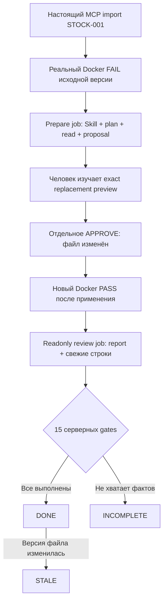

# Урок 5.10. Финал: от реальной MCP-задачи до проверенного изменения

[Материалы урока](../README.md) · [Домашнее задание](../homework/README.md) · [Тесты примера](src/test/java/dev/myfrei/repopilot/capstone/) · [Все уроки](../../../README.md#программа)

Соберём возможности курса в один воспроизводимый сценарий. RepoPilot получит задачу Stock Room через настоящий MCP, подтвердит исходный провал проверки, подготовит изменение с помощью Skill и плана, дождётся решения человека, затем предъявит свежий PASS и серверный отчёт.

Финал состоит из нескольких стадий. Модель не выдаёт себе разрешение и не проходит весь путь одним бесконечным loop. Две короткие AI-задачи разделены реальным человеческим review и запуском проверки.

Старт — [урок 5.9](../../lesson-5.9/README.md). Здесь сохранены Web, REPL, события, research, compaction, Skills, план, patch и verifier. Новое ДЗ — [переносимый аудит](../homework/README.md); оно расширяет продукт, а не предлагает повторить финальный gate.

## 1. Что именно исправляем

Учебный проект — **Stock Room**, Java 25-приложение с `StockLedger`. Резервирование количества, равного всему остатку, должно успешно обнулить остаток. В финальной копии условие ошибочно отклоняет и этот случай.

`capstone-workspace` — полная копия прежнего проекта с одной изменённой границей. Здесь есть Maven, консольное приложение, Skills и четыре старых JUnit-теста. Изолированный verifier проверяет пять фиксированных условий StockLedger, включая точное равенство остатку.

Старые четыре JUnit-теста этот граничный случай не покрывают. Их успешность не доказывает исправление. В финале используется отдельный доверенный `STOCKROOM_CONTRACT_V1`, а не произвольный запуск этого POM, нового JUnit-кода или всего workspace.

TaskShelf из модуля 4 — другая вымышленная предметная область. Его `TASK-101` не относится к StockLedger. Для финала создаётся отдельный MCP-сервер Stock Room и задача `STOCK-001`.

## 2. Критерий завершения

Результат считается `DONE`, только когда Java-код подтвердил всю цепочку:



`run.status = COMPLETED` означает, что закончился ответ конкретной модели. `verification.state = CHECKED_PASS` относится к одному фиксированному контракту. `capstone.state = DONE` — результат проверки всей последовательности, включая происхождение задачи, версии, approvals и review.

Эти состояния нельзя подменять убедительным текстом «я всё исправил».

## 3. Что добавляется в проект

```text
lecture/
├── capstone-task-server/          # Отдельное Spring MCP HTTP-приложение
├── capstone-workspace/            # Полный Stock Room с исходным дефектом
├── src/main/resources/
│   ├── application-capstone.yaml
│   └── capstone/stockroom-task.json
└── src/main/java/dev/myfrei/repopilot/capstone/
    ├── StockRoomMcpGateway.java
    ├── CapstoneTaskContract.java
    ├── CapstoneService.java
    ├── CapstoneCompletion.java
    ├── CapstoneReport.java
    └── CapstoneRunEvidence.java
```

Новый `CapstoneService` координирует стадии и собирает свидетельства. AI-задачи он отправляет в тот же `SessionCoordinator` из 5.9. Дополнительного agent loop здесь нет.

На один процесс приложения приходится одна физическая capstone-сессия. Проект не обещает параллельное редактирование нескольких копий Stock Room в одном workspace. До двух ручных попыток prepare и review допускаются с новыми request IDs; скрытых повторов модельных стадий нет.

## 4. Шаг 1. Поднимаем настоящий Stock Room MCP

В отдельном Maven-проекте подключён starter:

```xml
<dependency>
    <groupId>org.springframework.ai</groupId>
    <artifactId>spring-ai-starter-mcp-server-webmvc</artifactId>
</dependency>
```

Настройка `spring.ai.mcp.server.protocol=STREAMABLE` создаёт Streamable HTTP endpoint `/mcp`. Используем Spring AI 2.0.2 и проверенную в курсе ревизию MCP `2025-11-25`. [MCP Server Boot Starter](https://docs.spring.io/spring-ai/reference/api/mcp/mcp-server-boot-starter-docs.html).

Сервер публикует один read-only tool:

```java
@McpTool(
    name = "getStockRoomTask",
    description = "Read the single public Stock Room capstone task.",
    annotations = @McpTool.McpAnnotations(
        readOnlyHint = true, destructiveHint = false,
        idempotentHint = true, openWorldHint = false))
public CallToolResult getStockRoomTask(CallToolRequest request) {
    var args = request.arguments();
    if (args == null || !args.keySet().equals(Set.of("taskId"))
            || !"STOCK-001".equals(args.get("taskId"))) {
        return TaskServerJson.error("INVALID_TASK", "Use the exact fixed Stock Room task ID.");
    }
    return TaskServerJson.result(task);
}
```

Tool schema закрыта: только строковый `taskId` со значением `STOCK-001`. Полная реализация находится в [StockRoomTaskTools.java](capstone-task-server/src/main/java/dev/myfrei/course/capstonetasks/StockRoomTaskTools.java).

Manifest содержит ID, версию, относительный путь StockLedger, строки 17–25, SHA-256 исходной дефектной версии, команду verifier и пять условий. Здесь нет произвольной shell-строки или разрешения на запись.

## 5. Шаг 2. Проверяем транспорт и происхождение задачи

Host использует MCP SDK, а не обычный REST-запрос с похожим JSON:

```text
initialize → tools/list → tools/call getStockRoomTask
```

[StockRoomMcpGateway](src/main/java/dev/myfrei/repopilot/capstone/StockRoomMcpGateway.java) проверяет имя сервера, согласованную ревизию, tools capability, точную схему и read-only hints. Затем сверяет structured content и текстовый JSON результата.

`CapstoneTaskContract` принимает только закреплённый контракт Stock Room. Подмена пути, команды, baseline hash, TaskShelf ID или дополнительное поле отклоняются. Текст MCP-ответа считается данными, а не инструкциями host-приложению.

Сервер привязан к `127.0.0.1:8093`. Локальный bearer token одинаков у host и сервера; чужой браузерный Origin отклоняется. Это учебная локальная настройка, не production OAuth. Требования транспорта к Origin, localhost и HTTP-обмену описаны в [MCP transports](https://modelcontextprotocol.io/specification/2025-11-25/basic/transports).

`McpImportReceipt` сохраняет server/tool names, protocol version, digest задачи и счётчики логических SDK-операций. Это не цифровая подпись и не счётчик всех HTTP-пакетов. Пользователь не может прислать такой receipt в HTTP body вместо импорта.

Если MCP недоступен, create завершается ошибкой. Подмена локальным TaskShelf-каталогом или модельным «похожим ответом» не выполняется.

## 6. Шаг 3. Фиксируем момент применения patch

Проверка PASS нужной версии могла существовать ещё до применения текущего предложения. Одних совпавших hashes недостаточно, чтобы назвать её свежей относительно этого действия.

В `ControlledService` добавляем ограниченную audit map:

```java
private final Map<UUID, Instant> appliedTimes = new LinkedHashMap<>();
```

Только после успешного изменения файла:

```java
workspace.applyReplacement(stored.edit());
appliedTimes.put(id, clock.instant());
return replace(stored, "APPLIED");
```

`appliedAt(id)` возвращает `null`, пока реального применения не было. Существующий DTO `PatchProposal` не меняется. Время берётся из внедрённого Clock, а не из запроса клиента или ответа модели.

Финальный gate требует `passingReport.startedAt >= appliedAt`. PASS прежней проверки после повторной записи той же версии не считается новой проверкой этого patch. [Java 25 Instant](https://docs.oracle.com/en/java/javase/25/docs/api/java.base/java/time/Instant.html).

## 7. Шаг 4. Подготавливаем самостоятельную копию и образ

Проверьте Java 25, Docker и локальную модель:

```bash
java -version
./mvnw -version
docker version
ollama list
```

Соберите доверенный verifier:

```bash
docker build --iidfile /tmp/repopilot-verifier-510.id -t repopilot-verifier:lesson-5.10 verification-runner
export VERIFIER_IMAGE_ID="$(cat /tmp/repopilot-verifier-510.id)"
```

Используется точный `sha256:` image ID. Verifier переносит только разрешённый StockLedger в ограниченный контейнер и проверяет фиксированный контракт. Host не запускает POM и команды из изучаемого репозитория.

Сохраните исходную копию задачи и работайте в новом каталоге:

```bash
export CAPSTONE_WORKSPACE="$(mktemp -d)"
cp -R capstone-workspace/. "$CAPSTONE_WORKSPACE/"
```

MCP import проверяет baseline hash. Если выбрать уже исправленный `workspace-fixture` или случайный репозиторий, получится `CAPSTONE_BASELINE_MISMATCH`; приложение не перезапишет его исходным дефектом.

Для нового эксперимента используйте новую копию первоначальной задачи. История capstone хранится в RAM и не восстанавливается после перезапуска приложения.

## 8. Шаг 5. Запускаем два приложения

В первом терминале из `lecture`:

```bash
./mvnw -f capstone-task-server/pom.xml verify
java -jar capstone-task-server/target/stockroom-capstone-task-server-0.0.1-SNAPSHOT.jar
```

Во втором, с теми же переменными образа и workspace:

```bash
export OLLAMA_CHAT_MODEL='qwen2.5:3b'
export LLM_CONTEXT_WINDOW=16384
./mvnw spring-boot:run -Dspring-boot.run.profiles=capstone
```

Готовый [application-capstone.yaml](src/main/resources/application-capstone.yaml) включает agent/workspace/controlled/Skills/plan/compaction/verification/research/sessions/capstone. Для самостоятельной демонстрации старые RAG-срезы отключены: PostgreSQL и embedding-модель этой цепочке не нужны.

Host слушает `127.0.0.1:8080`. По умолчанию обе стороны используют опубликованный учебный token `stockroom-local-course-token`; для другого значения задайте один `STOCKROOM_MCP_TOKEN` в обоих терминалах. Host URL можно задать через `STOCKROOM_MCP_URL`, только с буквальным `127.0.0.1`.

Заранее подтвердите structured tool calling выбранной модели. Наличие обычного текста чата не гарантирует выполнение всех фаз. При нехватке контекста или лимита loop получится `INCOMPLETE`; число вызовов автоматически не увеличивается.

## 9. Шаг 6. Импортируем задачу

```bash
curl -sS -X POST http://127.0.0.1:8080/api/capstone/sessions \
  -H 'Content-Type: application/json' \
  -d '{"taskId":"STOCK-001"}'
```

Ответ содержит capstone `id`, отдельный `conversationId`, задачу и настоящий import receipt. Скопируйте их в переменные:

```bash
CAPSTONE_ID='вставьте-id-упражнения'
CONVERSATION_ID='вставьте-conversationId'
```

Проверьте отчёт:

```bash
curl -sS "http://127.0.0.1:8080/api/capstone/sessions/$CAPSTONE_ID/report"
```

Ожидается `INCOMPLETE`, gate `MCP_IMPORTED=true` и отсутствие подставных baseline/pass/patch IDs. Повторный create в том же процессе возвращает ту же импортированную сессию; это идемпотентное чтение уже созданного упражнения.

Не путайте идентификаторы:

| ID | Что обозначает |
| --- | --- |
| CAPSTONE_ID | Упражнение и связанная цепочка доказательств |
| CONVERSATION_ID | Разговор общего AgentStore |
| prepare/review job ID | Асинхронное задание Web/REPL |
| run ID | Фактический model/tool loop внутри job |
| patch ID | Одно сохранённое предложение изменения |
| verification request ID | Одноразовый запрос ручного запуска |
| verification report ID | Реальный результат исполнения |

## 10. Шаг 7. Получаем исходный FAIL

Создадим запрос проверки:

```bash
curl -sS -X POST "http://127.0.0.1:8080/api/verification/conversations/$CONVERSATION_ID/requests" \
  -H 'Content-Type: application/json' \
  -d '{"command":"STOCKROOM_CONTRACT_V1"}'
```

Скопируйте его `id` и изучите command, input revision и image ID. Только затем примите решение:

```bash
CHECK_REQUEST_ID='вставьте-id-запроса-проверки'
curl -sS -X POST "http://127.0.0.1:8080/api/verification/requests/$CHECK_REQUEST_ID/decision" \
  -H 'Content-Type: application/json' \
  -d '{"decision":"APPROVE"}'
curl -sS "http://127.0.0.1:8080/api/verification/conversations/$CONVERSATION_ID/reports"
```

Ожидается реальный report `FAIL`, exit code 10 и `exact-stock-reservation=FAIL`. Остальные наблюдения позволяют увидеть, что дефект ограничен границей.

Из списка reports возьмите **report.id**, а не request.id:

```bash
FAIL_REPORT_ID='вставьте-id-реального-FAIL-report'
```

Report из другой conversation, другая версия файла или неподходящая команда не подходят prepare. «Мы знаем, что тест должен падать» без фактического исполнения тоже не считается baseline.

## 11. Шаг 8. Отправляем prepare job

```bash
PREPARE_REQUEST_ID='11111111-1111-4111-8111-111111111111'
curl -sS -X POST "http://127.0.0.1:8080/api/capstone/sessions/$CAPSTONE_ID/prepare" \
  -H 'Content-Type: application/json' \
  -d "{\"requestId\":\"$PREPARE_REQUEST_ID\",\"baselineReportId\":\"$FAIL_REPORT_ID\"}"
```

Host сам создаёт ResearchRequest: `EDIT`, явный `java-code-review`, один обязательный `READ_CODE` для строк 17–25 и ссылки на реальный FAIL report. Клиент не передаёт completed plan, successful evidence или текст разрешения.

Почему один обязательный шаг? `start/read/complete` занимают три tool calls, чтение verifier report и proposePatch — ещё два. Skills/reference/research могут потребовать дополнительные вызовы. Лимит родителя остаётся 8 tools и 6 model calls; финал не повышает его ради красивого демо.

Ответ — `SessionSnapshot` из 5.9. Сначала job может быть `QUEUED`, а фактический run ID ещё отсутствует. Дождитесь результата:

```bash
PREPARE_JOB_ID='вставьте-id-prepare-job'
curl -sS "http://127.0.0.1:8080/api/sessions/jobs/$PREPARE_JOB_ID"
```

Повторный prepare с теми же request ID и report ID возвращает то же задание и не начинает inference заново. Для ручной второй попытки нужен новый request ID; количество попыток ограничено.

Две попытки prepare доступны только до review и пока источник совпадает с первоначальным baseline hash. Если человек применил неверную правку и проверка снова упала, этот узкий capstone не начинает универсальный repair loop от новой версии. Разберите результат и для нового эксперимента подготовьте свежую исходную копию и перезапустите приложение. Review имеет собственный предел двух ручных попыток.

## 12. Шаг 9. Изучаем результат через Web или REPL

Откройте страницу:

```text
http://127.0.0.1:8080/agent.html?sessionId=<PREPARE_JOB_ID>
```

Здесь `sessionId` — ID UI job, а не CAPSTONE_ID. Attach читает состояние; обновление страницы не создаёт новую AI-задачу.

Либо подключите консоль:

```bash
./mvnw -q exec:java -Dexec.mainClass=dev.myfrei.repopilot.ui.SessionRepl
```

Команды REPL:

```text
/attach <PREPARE_JOB_ID>
/status
/plan
/events
/show PATCH <PATCH_ID>
```

Prepare должен прочитать actual FAIL report, выполнить свой план, получить parent read receipts и создать предложение. Состояние verifier пока `CHECKED_FAIL`. Наличие предложенного diff не означает, что файл уже изменён.

Если модель остановилась раньше, изучите stop reason и журнал. Сообщение «готово» с незакрытым шагом остаётся неполным результатом.

## 13. Шаг 10. Человек применяет точную замену

Получите предложения фактического prepare run:

```bash
PREPARE_RUN_ID='вставьте-result.run.id'
curl -sS "http://127.0.0.1:8080/api/controlled/runs/$PREPARE_RUN_ID/proposals"
```

Изучите path, base/result hashes, operation hash и preview. Это **exact replacement preview**, сохранённый сервером, а не полный Git unified diff и не файл для `git apply`.

Далее используйте кнопку Web, `/approve-patch ID` в REPL или отдельный HTTP-запрос:

```bash
PATCH_ID='вставьте-id-просмотренного-patch'
curl -sS -X POST "http://127.0.0.1:8080/api/controlled/proposals/$PATCH_ID/decision" \
  -H 'Content-Type: application/json' \
  -d '{"decision":"APPROVE"}'
```

До этого действия код остаётся дефектным. После успешного применения proposal имеет `APPLIED`, а `appliedAt` фиксируется Java-сервисом. Повторное применение и stale base отклоняются.

Можно выбрать REJECT. Тогда `PATCH_APPLIED` не выполнится и финальный отчёт не получит DONE. Модель не может заменить это решение строкой «пользователь согласен».

## 14. Шаг 11. Запускаем свежую проверку

Создайте новый verification request для той же conversation и снова изучите его перед APPROVE. Можно использовать `/verify` и `/approve-check ID` в attached REPL или повторить HTTP-процедуру шага 7.

```bash
curl -sS -X POST "http://127.0.0.1:8080/api/verification/conversations/$CONVERSATION_ID/requests" \
  -H 'Content-Type: application/json' \
  -d '{"command":"STOCKROOM_CONTRACT_V1"}'
```

После отдельного решения ожидается новый report `PASS`, exit code 0, другая input revision и пять PASS-наблюдений. Сохраните его ID:

```bash
PASS_REPORT_ID='вставьте-id-нового-PASS-report'
```

Старый PASS даже той же итоговой версии не подходит, если проверка началась до применения текущего patch. Успех другой conversation, другого image ID или устаревшего source hash также не подходит.

`MAX_ATTEMPTS` verifier остаётся ограниченным. Повторять один и тот же провал без изменения версии бесконечно нельзя; ошибки анализа не маскируются автоматическим новым запуском.

## 15. Шаг 12. Отправляем отдельный readonly review

```bash
REVIEW_REQUEST_ID='22222222-2222-4222-8222-222222222222'
curl -sS -X POST "http://127.0.0.1:8080/api/capstone/sessions/$CAPSTONE_ID/review" \
  -H 'Content-Type: application/json' \
  -d "{\"requestId\":\"$REVIEW_REQUEST_ID\",\"patchId\":\"$PATCH_ID\",\"passingReportId\":\"$PASS_REPORT_ID\"}"
```

Перед постановкой review сервис проверяет applied patch, связь с собственным prepare job, версии, image, реальный свежий PASS и его порядок относительно appliedAt. Неподходящие IDs не начинают новый inference.

Review использует `ASK`, тот же Skill и обязательное актуальное чтение. Задача — посмотреть реальный PASS через readVerification и перечитать текущий код. Новые записи для этой стадии запрещены режимом.

Дождитесь `result` в новом UI job. Можно attached Web/REPL перевести на REVIEW_JOB_ID без второго agent loop.

## 16. Шаг 13. Читаем серверный отчёт

```bash
curl -sS "http://127.0.0.1:8080/api/capstone/sessions/$CAPSTONE_ID/report"
```

Отчёт содержит:

- задачу и MCP import receipt с task digest;
- реальные IDs исходного FAIL, applied patch и свежего PASS;
- baseline/result/current revisions и точный verifier image ID;
- сохранённый preview замены;
- prepare/review job IDs и run IDs;
- typed plan, Skills, read receipts, run metrics и admission budgets;
- 15 отдельных gates и итоговое состояние.

В `CapstoneCompletion` задан полный набор обязательных gates. Отсутствующий, повторённый или неизвестный gate не превращает частичный результат в DONE.

| Группа | Что подтверждается |
| --- | --- |
| MCP_IMPORTED | Реальный import нужного закреплённого контракта |
| BASELINE_FAIL / OBSERVED | Нужный FAIL и его чтение моделью |
| PREPARE_* / SKILL_ACTIVATED | Завершённый prepare, план, Skill и собственное чтение |
| PATCH_* | Реальное применение и цепочка исходной/итоговой версий |
| FRESH_PASS / CURRENT_VERSION | Проверка после применения и текущая версия |
| REVIEW_* / PASS_OBSERVED | Завершённый review с планом, чтением и настоящим report |

`prepareEvidence` — историческое свидетельство исходной версии: после применения её hash естественно отличается от текущего. Актуальность итогового кода проверяется отдельно через review и CURRENT_VERSION.

Provider usage и локальные reservations остаются разными величинами. Два jobs имеют собственные bounded scopes. Не выдавайте их суммы за точное измерение модели, если usage неизвестен.

## 17. Шаг 14. Проверяем отрицательные сценарии

После DONE измените рабочую копию StockLedger вне runtime и запросите отчёт снова. Ожидается `STALE`; предыдущее успешное состояние не доказывает новую версию.

Дополнительно проверьте:

1. MCP-сервер выключен до первого create — импорт не подменяется локальными данными.
2. Task ID или command из другой предметной области — контракт отклонён.
3. FAIL report другой conversation — prepare не запускается.
4. Patch не одобрен — до свежего review цепочка не проходит.
5. PASS выполнен до appliedAt — review отклонён.
6. Модель не прочитала report или не закрыла план — INCOMPLETE.
7. Изменился Skill или источник — соответствующий gate больше не выполнен.

Для повторения используйте новую копию исходного задания и новый процесс приложения. Не откатывайте чужие изменения в рабочем каталоге ради демонстрации.

## 18. Автоматическая проверка и пределы результата

```bash
./mvnw test
./mvnw -f capstone-task-server/pom.xml verify
./mvnw -Pcapstone-it -Dverification.image="$VERIFIER_IMAGE_ID" verify
npm ci
npm test
```

Новый workflow IT запускает отдельный исполняемый MCP-сервер, настоящий SDK gateway, Boot host, Docker verifier и HTTP-фикстуру Ollama. Он проверяет чужой FAIL, старый PASS до применения, явный human patch action, свежий PASS, обе модельные стадии, все gates и последующий STALE.

LLM-ответы в автоматических проверках заданы фикстурой. Это доказывает механику и границы, но не способность любой локальной модели правильно решить задачу. Реальный прогон запишите в [Capstone-Experiment.md](evaluation/Capstone-Experiment.md).

Сопоставьте свой запуск с [результатами проверки примера](../VERIFICATION.md). Успех относится к фиксированному StockLedger contract: этот результат не подтверждает проверку всего репозитория, REST, производительности или произвольных новых JUnit-тестов. Для них нужны отдельные сценарии.

## 19. Домашнее задание: переносимый аудит

В [homework](../homework/README.md) уже готов весь capstone. Новое приращение — `PortableAuditPolicy`: построить ограниченный переносимый JSON-аудит по server-owned report.

Нужно оставить разрешённые facts, явно представить недостающие стадии и соблюдать размер полного envelope. Source content, replacement preview, вопросы, логи, абсолютные пути и секреты в экспорт не входят. Optional details можно исключать по правилам с явной отметкой.

Checksum подтверждает целостность конкретного canonical payload, а не является цифровой подписью или независимым доказательством истинности. Экспорт INCOMPLETE или STALE сохраняет это состояние, а не заменяет его успешным.

Студент реализует одну новую policy. Заново писать MCP, AI loop, verifier или финальные gates не требуется.

## 20. Источники

- [Spring AI MCP Server Boot Starter](https://docs.spring.io/spring-ai/reference/api/mcp/mcp-server-boot-starter-docs.html) — конфигурация и transport.
- [MCP Streamable HTTP, ревизия 2025-11-25](https://modelcontextprotocol.io/specification/2025-11-25/basic/transports) — реальный протокольный обмен.
- [Spring AI Tool Calling](https://docs.spring.io/spring-ai/reference/api/tools.html) — инструменты исполняет приложение.
- [Agent Skills specification](https://agentskills.io/specification) — формат процедур, отдельно от разрешений.
- [Java 25 Instant](https://docs.oracle.com/en/java/javase/25/docs/api/java.base/java/time/Instant.html) — временная последовательность свидетельств.

Курс заканчивается конкретным проверяемым изменением. Дальнейшее развитие — другие предметные задачи, долговечное хранилище и более широкие проверки — потребует новых контрактов и отдельных критериев готовности.
