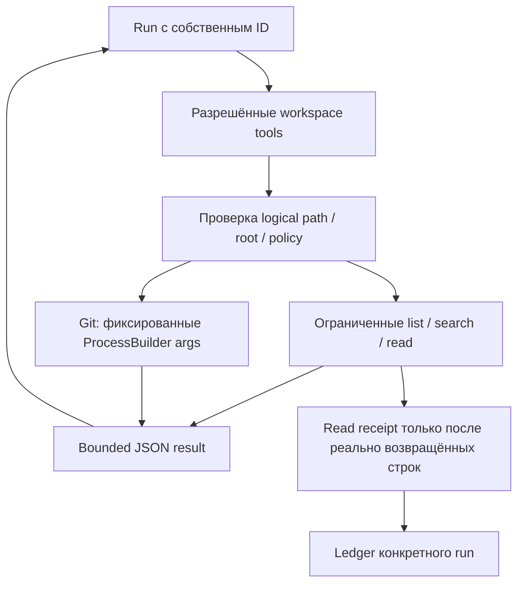

# Урок 5.2. Read-only workspace: навигация, Git и read receipts

[Материалы урока](../README.md) · [Предыдущая лекция 5.1](../../lesson-5.1/lecture/README.md) · [ДЗ](../homework/README.md) · [Проверка](../VERIFICATION.md)

Дата: 2026-10-31. Java 25, Boot 4.1.2, Spring AI2.0.2. Новый workspace подключается к manual agent runtime5.1. Старые chat/RAG/MCP API сохранены; нового UI нет.

## Результат занятия

В 5.1 агент умел читать учебный каталог задач. Теперь научим его ориентироваться в небольшом Java-репозитории: перечислять файлы, искать текст, читать диапазоны строк и получать ограниченные Git status/diff. Каждый инструмент работает с заранее настроенным workspace; модель не выбирает произвольный root и не получает shell.

Продуктовый сценарий: «Найди, как устроена проверка задачи в учебном проекте, прочитай нужный код и объясни, где потребуется изменение». На этом занятии агент **исследует**; он не пишет файлы и не запускает Maven за пользователя. Вместо заявления «я посмотрел проект» появятся конкретные read receipts: run, путь, hash файла и реально возвращённые линии.

Учебный Java 25 fixture позволяет пройти сценарий без секретов и чужих изменений. Его тесты проверяются человеком отдельно. Инструменты чтения не доказывают успешный build, правильность объяснения модели или право редактировать прочитанный файл. Редактирование и Skills — следующие темы, не скрытые возможности этого API.

Ориентир на два с половиной часа: разрешённый root и fixture20 минут, навигация/поиск 25, безопасное чтение 30, Git25, интеграция/receipts25, эксперимент/ДЗ 25.

## 1. Доступ по имени операции вместо произвольной команды



Модель просит `readFile` с logical path; Java-код решает, допустим ли он, и читает ограниченный диапазон. Нет инструмента «выполни эту строку shell» и нет аргумента, меняющего allowed root на лету. Так контракт можно проверить без надежды на дисциплину самой модели.

| Инструмент | Что узнаём | Чего он не доказывает |
| --- | --- | --- |
| listFiles | Какие разрешённые пути существуют | Содержимое и смысл кода |
| searchText | Где встречается literal text | Что прочитан весь файл/метод |
| readFile | Реально возвращённые строки и hash | Правильность интерпретации и запуск tests |
| gitStatus | Изменения index/worktree/untracked в scope | Причину изменения и качество кода |
| gitDiff | Ограниченную разницу tracked файла | Всё содержимое, untracked files или успешный build |

У вас по-прежнему один manual loop: tool request → Java validation/execution → correlated tool result → следующий model step. WorkspaceService не скрывает внутри себя ещё одну LLM, MCP-сессию или отдельный агентский loop.

## 2. Почему normalize недостаточно

`root.resolve(userPath).normalize()` полезен, но одной проверки `startsWith(root)` недостаточно: symbolic link внутри root может вести наружу. Кроме того, абсолютные пути, `..`, скрытые служебные файлы и неограниченный результат поиска остаются отдельными проблемами.

Текущий проект использует строгую учебную policy: literal configured root, разрешённые logical paths и текстовые extensions, запрет symlink самого configured root и его file descendants с канонизацией системных ancestors. Размеры, UTF-8 и строки проверяются до выдачи результата. Основные Java-механизмы описаны в [Files API Java 25](https://docs.oracle.com/en/java/javase/25/docs/api/java.base/java/nio/file/Files.html); точную policy задаёт наш WorkspaceService, а не само наличие Files.readString.

Это граница read-only приложения, не OS sandbox для произвольного исполняемого кода. Репозиторий должен быть доверенной учебной копией без конкурентной подмены дерева во время вызова. Код не становится секрет-сканером от запрета `.env`: выбирайте fixture или заранее подготовленный безопасный workspace.

## 3. Готовим Java 25 fixture

В `lecture/workspace-fixture` лежит самостоятельный проект [Stock Room](workspace-fixture/README.md): склад технических книг, метод reserve и четыре tests. У него нет Spring, LLM или базы. Из корня курса:

```bash
cd lessons/lesson-5.2/lecture
./mvnw -version
./mvnw -f workspace-fixture/pom.xml test
"$JAVA_HOME/bin/java" -cp workspace-fixture/target/classes dev.myfrei.fixture.StockRoomApp
```

Fixture использует compiler release25. Wrapper основной папки запускает его отдельный POM; корневой Maven не собирает этот проект автоматически.

В [StockLedger.java](workspace-fixture/src/main/java/dev/myfrei/fixture/StockLedger.java) есть наблюдаемое поведение:

```java
public synchronized boolean reserve(String sku, int quantity) {
    if (quantity < 1) throw new IllegalArgumentException("Quantity must be positive");
    int available = requireSku(sku);
    if (quantity > available) return false;
    this.stock.put(sku, available - quantity);
    return true;
}
```

В [StockLedgerTest.java](workspace-fixture/src/test/java/dev/myfrei/fixture/StockLedgerTest.java) сценарий insufficientStockDoesNotChangeInventory проверяет отказ и неизменность остатка. Задача агента — найти и прочитать эту связь, а не объявить tests пройденными по одному имени метода. Реальное выполнение Maven выше делает человек.

### Явно создаём Git только для учебного fixture

Git не инициализируется ни приложением, ни tool. Для этой лаборатории используйте собственный fixture без чужих изменений. Если его `.git` ещё нет, из `lecture`:

```bash
git -C workspace-fixture init
git -C workspace-fixture add README.md pom.xml .gitignore src
git -C workspace-fixture \
  -c user.name='Course Learner' -c user.email='learner@example.invalid' \
  commit -m 'Initial Stock Room fixture'
git -C workspace-fixture rev-parse --show-toplevel
```

Последняя команда должна показать именно workspace-fixture. Временные `-c user.*` относятся только к этому commit и не меняют вашу глобальную identity. Не выполняйте init/add/commit в произвольном рабочем репозитории ради примера.

Чтобы увидеть WORKTREE diff, добавьте только учебную заметку в README:

```bash
printf '\nЛабораторная заметка: проверить отказ при недостаточном остатке.\n' >> workspace-fixture/README.md
```

Эти действия выполняет человек. Агентские gitStatus/gitDiff ничего не инициализируют, не коммитят и не редактируют. Без собственной `.git` directory инструменты вернут NO_GIT_REPOSITORY; они не ищут родительский репозиторий курса вместо fixture.

## 4. Включаем agent и workspace

Подготовьте Ollama как в 5.1:

```bash
ollama pull qwen2.5:3b
curl -sS http://127.0.0.1:11434/api/tags
```

Если сервис не запущен, используйте отдельный терминал с `ollama serve`. Затем из `lesson-5.2/lecture`:

```bash
./mvnw spring-boot:run \
  -Dspring-boot.run.arguments="--repopilot.agent.enabled=true --repopilot.workspace.enabled=true --repopilot.rag.enabled=false"
```

[WorkspaceConfiguration](src/main/java/dev/myfrei/repopilot/workspace/WorkspaceConfiguration.java) активна только при обоих flags agent/workspace=true. Root задаётся server configuration `repopilot.workspace.root`, по умолчанию `./workspace-fixture`, относительно рабочей папки приложения. Модель и HTTP request его не меняют.

```java
@Bean
public WorkspaceService workspaceService(
        @Value("${repopilot.workspace.root:./workspace-fixture}") String root) {
    return new WorkspaceService(Path.of(root));
}
```

Новый срез состоит из отдельных частей:

```text
lecture/
  src/main/java/dev/myfrei/repopilot/
    agent/                       # Manual runtime5.1
    workspace/
      WorkspaceConfiguration.java
      WorkspaceAgentTools.java
      WorkspaceService.java
      WorkspaceProcessRunner.java
      WorkspaceJson.java
      ReadReceipt.java
      WorkspaceReadLedger.java
  workspace-fixture/
    pom.xml
    README.md
    src/main/java/dev/myfrei/fixture/StockLedger.java
    src/test/java/dev/myfrei/fixture/StockLedgerTest.java
```

Пять workspace tools становятся явными AgentTool beans. Вместе с тремя TaskShelf tools получается 8 registrations — допустимый максимум registry5.1. Отдельного `/api/workspace/call` нет: используем тот же agent API и тот же manual dispatcher.

Docker/embeddings/MCP server нужны только для унаследованных сценариев. Если вы сохраняете RAG=true, подготовьте соответствующие зависимости по предыдущим урокам. Эта лаборатория читает исходники напрямую, не индексирует их автоматически в pgvector.

Stock Room — отдельный target repository. Сохранённые getProjectInfo/getTask подтверждают только TaskShelf; они не являются metadata Stock Room. Для фактов о новом проекте нужны workspace files и receipts.

## 5. Фиксируем контракты tools

[WorkspaceAgentTools.java](src/main/java/dev/myfrei/repopilot/workspace/WorkspaceAgentTools.java) адаптирует strict arguments к WorkspaceService. Все schemas закрыты через additionalProperties=false.

| Tool | Аргументы | Defaults / границы |
| --- | --- | --- |
| listFiles | directory?, maxEntries? | `.`,20; limit1..40 |
| searchText | query, directory?, maxResults? | `.`,10; limit1..40 |
| readFile | path, startLine, endLine | Inclusive lines, максимум 80 запрошенных |
| gitStatus | `{}` | Только fixed scope |
| gitDiff | path, scope? | WORKTREE либо STAGED; default WORKTREE |

Например, **аргументы модельного вызова**, не отдельный REST endpoint:

```json
{"path":"src/main/java/dev/myfrei/fixture/StockLedger.java","startLine":1,"endLine":40}
```

Context с runId/conversationId подставляет engine. Tool не принимает эти поля от модели. Для readFile adapter использует `context.runId()` при записи receipt.

```java
service.readFile(c.runId().toString(), string(a, "path", null),
    integer(a, "startLine", 0), integer(a, "endLine", 0))
```

Expected WorkspaceException превращается в ограниченный error result с code. Текст файла, абсолютный root и stack trace не подставляются в сообщение ошибки. Это ok=false в normal tool envelope, а не успешное чтение и не новая скрытая LLM-попытка.

## 6. Ограничиваем logical paths

Текущая policy разрешает только README.md, pom.xml и текстовые файлы под src/. Extensions: java/xml/md/txt/properties/yaml/yml/json/sql. Директории доступны только в этом scope; tool directory `.` означает разрешённый обзор root.

| Что отвергается | Причина |
| --- | --- |
| Absolute path, backslash, `:`, control chars | Не допускаем альтернативные формы пути |
| Пустой segment, `.`/`..`, hidden segment | Нет traversal и служебных скрытых каталогов |
| `*?[]` | Пользователь не задаёт glob/pathspec |
| Segment с secret/credential/password/token/privatekey | Ограниченная denylist учебного scope |
| Неизвестный root file / extension | Доступ не открывается ко всему дереву |
| Symlink в разрешаемом descendant path | Не читаем через перенаправление |

Path ограничен 240 UTF-8 bytes. Это техническая policy имён, а не анализ содержимого на секреты. Она может закрыть и обычный технический файл вроде TokenBudget.java; менять scope нужно явно в Java-policy, не инструкцией модели. Например, любой JSON под src не становится безопасным по смыслу только от допустимого extension.

В [WorkspaceService](src/main/java/dev/myfrei/repopilot/workspace/WorkspaceService.java) сначала проверяются root и segments, затем normalize/startsWith, каждый descendant и real path:

```java
Path resolved = this.root.resolve(path).normalize();
if (!resolved.startsWith(this.root)) throw new WorkspaceException("PATH_NOT_ALLOWED");
Path cursor = this.root;
for (Path part : this.root.relativize(resolved)) {
    cursor = cursor.resolve(part);
    if (Files.isSymbolicLink(cursor)) {
        throw new WorkspaceException("SYMLINK_NOT_ALLOWED");
    }
    if (!Files.exists(cursor, NOFOLLOW_LINKS)) {
        if (missingAllowed) return resolved;
        throw new WorkspaceException("NOT_FOUND");
    }
}
```

Полный метод также проверяет real path, тип объекта и доступность root. Configured root-leaf сам не может быть symlink; системные ancestors канонизируются через toRealPath — это позволяет macOS `/tmp`→`/private/tmp`. Внутри canonical root symlink components запрещены. Код не обещает атомарную защиту от конкурентной замены дерева внешним процессом.

## 7. Делаем ограниченный list и literal search

| Граница обхода | Значение |
| --- | --- |
| Проверяемые entries |512 |
| Глубина одного walk от выбранной directory |12 |
| Размер одного читаемого файла |65536 bytes |
| Консервативный бюджет чтений search |2097152 bytes |
| maxEntries/maxResults |1..40 |
| query | Непустая literal строка,≤160 UTF-8 bytes, без control chars |
| Строка search excerpt | До 160 UTF-8 bytes |

Search case-sensitive, без regex. До каждой попытки чтения резервируется 65537 bytes: MAX_FILE_BYTES+1 для проверки роста. Reservation сохраняется и при binary/UTF-8 error. Поэтому один search допускает не более 31 попытки чтения файлов, даже если они маленькие; scanComplete/truncated честно отражают раннюю остановку.

```java
if (charged + MAX_FILE_BYTES + 1L > MAX_SEARCH_BYTES) {
    complete = false;
    break;
}
charged += MAX_FILE_BYTES + 1L;
```

searchedBytes считает успешно прочитанный текст, readBudgetBytes — upper-bound reservation с учётом неуспешных попыток. Нельзя использовать searchedBytes=0 как доказательство, что binary files вообще не читались. Это ограничение объёма работы, а не замер дисковой производительности.

Search case-sensitive, без regex. Файлы читаются strict UTF-8; binary/oversized файлы search пропускает. Слишком большой запрос, неподходящий path или IO failure возвращают typed error, а не произвольную часть чужого файла.

Результат listFiles содержит files/totalFiles/scanComplete/truncated, searchText — matches/totalMatches/searchedBytes/readBudgetBytes/scanComplete/truncated. Это counts **пройденного ограниченного обхода**. scanComplete=false не позволяет назвать totalFiles полным количеством файлов репозитория. Возвращаемые пути сортируются; при достижении scan cap это порядок найденного подмножества.

Каждый search hit хранит path/line/text/lineTruncated/fullFileHash. Hash полезен для сверки snapshot, но search **не создаёт read receipt**. Нахождение одной строки не подтверждает чтение всего метода и теста.

## 8. Читаем только полные строки и считаем полный hash

readFile открывает разрешённый regular file без follow symlink, проверяет size до чтения и читает максимум MAX_FILE_BYTES+1. Это защищает и от файла, который вырос после первой size-проверки.

```java
try (var channel = Files.newByteChannel(file,
        Set.of(StandardOpenOption.READ, NOFOLLOW_LINKS));
     var input = java.nio.channels.Channels.newInputStream(channel)) {
    bytes = input.readNBytes(MAX_FILE_BYTES + 1);
}
if (bytes.length > MAX_FILE_BYTES) {
    throw new WorkspaceException("FILE_TOO_LARGE");
}
```

Decoder использует CodingErrorAction.REPORT. Control chars, кроме newline/carriage return/tab, отвергаются как BINARY_FILE. SHA-256 считается по **всем исходным bytes файла**, а не по выбранному excerpt. Перевод CRLF в LF меняет fullFileHash, даже если текст выглядит похоже.

Результат в [WorkspaceService](src/main/java/dev/myfrei/repopilot/workspace/WorkspaceService.java) имеет явную форму:

```java
public record FileRead(String path, String fullFileHash,
    long totalBytes, int totalLines, int startLine, int endLine,
    String content, boolean truncated, boolean rangeComplete) { }
```

FileRead содержит реальные startLine/endLine, не копию requested range. Запрошенный конец может выйти за EOF: возвращается существующая часть. Начало за EOF или диапазон длиннее 80 линий — INVALID_LINE_RANGE.

Новый JSON наращивается по одной **полной** строке. Если очередная строка не помещается в output budget, она не обрезается посередине. Если не помещается даже первая, получаем OUTPUT_LIMIT и receipt не создаётся.

truncated означает, что возвращён не весь файл; rangeComplete — достигнут ли допустимый конец выбранного диапазона. Эти flags нельзя подменять друг другом. Начав с 10-й строки и прочитав requested range целиком, можно получить rangeComplete=true при truncated=true.

## 9. Записываем receipt после окончательного budget check

[WorkspaceJson](src/main/java/dev/myfrei/repopilot/workspace/WorkspaceJson.java) считает не только data JSON, но и полный будущий runtime envelope:

```java
public static boolean fits(Object value) {
    return encode(Map.of("ok", true, "code", "OK", "data", value))
        .getBytes(StandardCharsets.UTF_8).length <= MAX_RESULT_BYTES;
}
```

Лимит 4096 bytes совпадает с AgentEngine. Иначе можно было бы записать receipt для строк, затем отвергнуть oversized envelope в runtime — валидного tool result у runtime не оказалось бы.

После подбора complete lines:

```java
WorkspaceJson.bounded(result);
this.ledger.record(new ReadReceipt(runId, path,
    snapshot.hash(), startLine, last));
return result;
```

[ReadReceipt](src/main/java/dev/myfrei/repopilot/workspace/ReadReceipt.java) — server-owned значение:

```java
public record ReadReceipt(String runId, String path, String fullFileHash,
    int startLine, int endLine) { }
```

Сервис связывает receipt с UUID текущего выполнения. [WorkspaceReadLedger](src/main/java/dev/myfrei/repopilot/workspace/WorkspaceReadLedger.java) хранит 128 недавних run IDs и до 256 уникальных receipts на run; одинаковые receipts не дублируются. Эвикция или отсутствие записи — RECEIPTS_UNAVAILABLE, не чужое evidence и не молчаливый пустой список. Evicted IDs сохраняются как bounded retired set (до 256): поздний record не воскрешает частичную историю. Когда память retired IDs заполнена, новое evidence отвергается fail-closed; доступные active ledgers остаются доступны.

Receipt подтверждает чтение и пригодный результат, переданный runtime. Он не доказывает следующий inference или понимание кода моделью. Например, после tool run может остановиться по CONTEXT_LIMIT: result/receipt останутся для диагностики, но следующего model call не будет.

Старый read result может остаться в conversation history5.1. Это не переносит его receipt в новый run и не обновляет hash. Так различаются «модель видела старый текст» и «этот run прочитал свежие строки».

## 10. Получаем Git без shell и внешних helpers

[Git status porcelain](https://git-scm.com/docs/git-status) даёт стабильный формат для программ; `-z` отделяет records NUL, поэтому имена с пробелами не приходится разбирать как строки shell. Наш parser сохраняет index/worktree отдельно и учитывает вторую запись rename. Команда ограничена README.md/pom.xml/src/.

ProcessBuilder принимает список аргументов, рабочий каталог и environment: [Java 25 ProcessBuilder API](https://docs.oracle.com/en/java/javase/25/docs/api/java.base/java/lang/ProcessBuilder.html). Это не исполнение одной model-generated command string.

```java
var command = new ArrayList<String>(List.of(
    "git", "--no-pager", "--no-optional-locks", "--literal-pathspecs",
    "--git-dir=" + this.root.resolve(".git"), "--work-tree=" + this.root,
    "-c", "core.fsmonitor=false", "-c", "core.untrackedCache=false",
    "-c", "core.hooksPath=/dev/null", "-c", "core.attributesFile=/dev/null",
    "-c", "core.quotepath=false", "-c", "color.ui=false",
    "-c", "protocol.allow=never"));
command.addAll(args);
return new WorkspaceProcessRunner().run(command, this.root);
```

[WorkspaceProcessRunner](src/main/java/dev/myfrei/repopilot/workspace/WorkspaceProcessRunner.java) создаёт ProcessBuilder с этим списком и root working directory, ограничивает вывод/ожидание и выполняет cleanup.

.git должна быть собственной real directory: worktree `.git` file, symlinks, commondir/objects alternates и опасная local include/filter configuration отвергаются. Наличие `.git/config.worktree` также запрещено независимо от extensions flag: дополнительные worktree overlays этим учебным сервисом не поддерживаются. Inherited GIT_* удаляются; global/system config выключены. Fixed flags отдельно выключают fsmonitor, hooks, external diff/textconv и pager. Самого отсутствия shell для этих гарантий было бы мало. Git способен читать дополнительный config.worktree и запускать configured clean filter; поэтому отказ проверяется harmless-helper regression до реального Git-вызова. Порядок источников описан в [Git configuration](https://git-scm.com/docs/git-config).

| Git operation | Смысл |
| --- | --- |
| status --porcelain=v1 -z --untracked-files=all --renames | Изменения tracked/untracked, с отфильтрованными paths |
| diff WORKTREE | Рабочее дерево относительно index |
| diff STAGED / --cached | Index относительно HEAD |
| --no-ext-diff --no-textconv --no-renames | Отключены внешние представления и rename expansion |

Разбор различий — в [Git diff documentation](https://git-scm.com/docs/git-diff). gitDiff принимает ровно один разрешённый path после `--`, не пользовательские flags. Перед patch сервис вызывает fixed ls-files/ls-tree для проверки tracked text path. Untracked или отсутствующий нетрекаемый path дают NOT_TRACKED; удаление известного tracked text file поддерживается. Для содержимого допустимого untracked файла используйте readFile.

Ожидание завершения каждого Git subprocess ограничено 3s; это не общий deadline нескольких helper calls внутри gitDiff. Stdout/stderr читаются параллельно и ограниченно, лишний output не копится в памяти. Process output cap65536 bytes не равен final JSON cap4096: patch дополнительно сокращается с truncated=true. При timeout процесс и descendants завершаются; stderr не выдаётся агенту как произвольный payload.

## 11. Проходим исследование через API

Создайте отдельную conversation:

```bash
CONVERSATION_JSON="$(curl -sS -X POST http://127.0.0.1:8080/api/agent/conversations)"
CONVERSATION_ID="$(printf '%s' "$CONVERSATION_JSON" | node -pe 'JSON.parse(require("fs").readFileSync(0,"utf8")).id')"
RUN_JSON="$(curl -sS http://127.0.0.1:8080/api/agent/conversations/$CONVERSATION_ID/runs \
  -H 'Content-Type: application/json' \
  -d '{"question":"Исследуй Stock Room: через listFiles/searchText найди StockLedger.reserve и тест отказа при недостаточном остатке. Прочитай нужные строки обоих файлов через readFile. Объясни связь и приведи точные paths и lines. Ничего не изменяй и не утверждай, что запускал tests."}')"
printf '%s\n' "$RUN_JSON"
RUN_ID="$(printf '%s' "$RUN_JSON" | node -pe 'JSON.parse(require("fs").readFileSync(0,"utf8")).id')"
curl -sS "http://127.0.0.1:8080/api/agent/runs/$RUN_ID/events"
curl -sS "http://127.0.0.1:8080/api/agent/runs/$RUN_ID/messages"
```

В raw transcript найдите настоящие readFile results: возвращённый hash, диапазон и текст. По events можно проверить действия и hashes, но они не являются полным файловым журналом. Статус COMPLETED означает завершённый ответ модели, не доказанную правильность paths/lines; сравните его с фактическими results.

Отдельным run попросите gitStatus и gitDiff README.md. Не заставляйте одну небольшую локальную модель выполнить все возможные исследования подряд: базовые 6model/8tool calls и context budget5.1 сохраняются. При STOPPED разберите причину вместо выдачи частичного исследования за успех.

### Два разных отказа до чтения

Аргументы tool с выходом за workspace:

```json
{"path":"../README.md","startLine":1,"endLine":3}
```

Это корректные scalar types, поэтому runtime может вызвать Java handler. Workspace policy вернёт ok=false/PATH_NOT_ALLOWED до чтения и без receipt. Следующий model step может объяснить отказ; это не успешный доступ к родительской лекции.

А startLine=0 не проходит уже объявленную scalar schema runtime: handler не вызывается, run останавливается TOOL_ARGUMENTS. Отделяйте registry validation от доменной workspace validation; в обоих случаях модель не получила запрошенные строки. Для точных доказательств используйте controlled tests, а не просьбу реальной модели обязательно совершить ошибку.

## 12. Проверяем границу доступа и интеграцию

Из `lecture`:

```bash
./mvnw test
./mvnw -f workspace-fixture/pom.xml test
npm ci
npm test
```

Новым workspace tests нужны filesystem/Git и контролируемый model HTTP endpoint, не реальные веса или Docker. Проверьте в source tests не только success:

- запрещённые/абсолютные/traversal/symlink paths не читаются;
- strict UTF-8, file/scan/search/result caps работают на границе;
- receipt содержит именно возвращённые полные строки и полный hash;
- фактический AgentEngine envelope остаётся≤4096 bytes до ledger commit;
- search/git/currentHash не создают receipts;
- expired ledger не воскресает частично от позднего record того же run;
- Git config/redirects/helpers не расширяют scope и не запускают посторонние команды;
- настоящий HTTP agent loop передаёт runId, tools/results и завершение без подмены fixture.

Полный унаследованный pgvector-профиль требует Docker:

```bash
./mvnw verify -Ppgvector-it
```

Дополнительные MCP IT запускаются отдельно по 4.4. Точные counts и limits proof — в [VERIFICATION](../VERIFICATION.md). Fixture build подтверждает бизнес-tests Stock Room; runtime tests подтверждают tools/orchestration. Они не измеряют качество установленной модели и не означают, что агент сам запускал build.

Заполните [пустой бланк](evaluation/Workspace-Read-Experiment.md). Сравните пути/строки в ответе с реальными readFile results. Проверяйте scope каждого утверждения: TaskShelf getProjectInfo/getTask описывают TaskShelf, а не произвольный Stock Room. Для его кода нужны workspace files/receipts.

## 13. Самостоятельное ДЗ: проверяем evidence claims

В [homework](../homework/README.md) WorkspaceService, все tools, ledger и endpoint adapter готовы. Новый [EvidencePolicy](../homework/src/main/java/dev/myfrei/repopilot/evidence/EvidencePolicy.java) с единственным TODO check получает чистые данные и решает, подтверждён ли claim чтением этого run. Студент не копирует path validation, Git ProcessBuilder или runtime.

Input содержит runId,1..12 Claims, до 256 ReadSpan и server-built map текущих hashes. Claim задаёт path/fullFileHash/startLine/endLine; ReadSpan добавляет собственный runId. Проверка идёт в таком приоритете:

| Status | Условие |
| --- | --- |
| NOT_READ | Нет receipt с точным SAME run/path/hash |
| UNAVAILABLE | Такой receipt есть, но текущий hash получить не удалось |
| STALE | Текущий hash отличается от claim hash |
| OUTSIDE_READ_RANGES | Hash актуален, но union ranges не покрывает весь inclusive claim |
| SUPPORTED | Совпали происхождение, актуальность и полное покрытие |

Приоритет важен. Например, без matching same-run receipt нельзя объявить claim STALE только потому, что другой hash найден в map. При несовпадении текущего hash результат STALE даже при дыре coverage. Проверка исходного текста/смысла ответа в эти статусы не входит.

Объединяйте перекрывающиеся и **соседние** ranges одного run/path/hash.1..5 и 6..10 покрывают 1..10;1..5 и 7..10 оставляют дырку 6. Нельзя заполнить её чужим run или receipt с иным hash. Результаты сохраняют порядок claims и дубликаты; allSupported true только если все claims SUPPORTED.

Provided маршрут вызывается **после run**:

```http
POST /api/agent/runs/{runId}/evidence/check
Content-Type: application/json

{"claims":[{"path":"src/main/java/dev/myfrei/fixture/StockLedger.java","fullFileHash":"0000000000000000000000000000000000000000000000000000000000000000","startLine":17,"endLine":23}]}
```

В примере hash — placeholder: замените его фактическим fullFileHash из readFile result этого run. Клиент передаёт только claims. Receipts и currentHashes получает server; отправить себе готовый matching ReadSpan через этот endpoint нельзя.

Различайте два уровня unavailable. Если ledger никогда не записывался или уже expired, endpoint возвращает typed RECEIPTS_UNAVAILABLE для всего запроса. Это не авторитетный пустой список и не вывод «файл точно не читали». Если ledger доступен, а конкретный claim не имеет matching receipt, policy возвращает NOT_READ. Если matching receipt есть, но файл сейчас нельзя прочитать/хешировать, это policy UNAVAILABLE.

Для NOT_READ-сценария можно в одном run сначала прочитать README, затем проверить claim другого файла: ledger доступен, но нужного receipt нет. Search-only run receipts не создаёт; его endpoint может получить RECEIPTS_UNAVAILABLE, а не набор отдельных NOT_READ.

Приёмочные тесты чистой policy проверяют same-run/path/hash, свежесть, приоритеты statuses, inclusive coverage, overlap/adjacency/holes и сохранение порядка. Adapter tests отдельно проверяют server-owned данные, ошибки ledger и совместимые path limits. Команды — в [homework README](../homework/README.md), эталон и стартовые красные TODO — в [VERIFICATION](../VERIFICATION.md).

Заполните [SUBMISSION](../homework/SUBMISSION.md): покажите один SUPPORTED, один STALE и один OUTSIDE_READ_RANGES. Объясните, почему SUPPORTED не доказывает верность объяснения модели или успешный запуск tests.

## 14. Что теперь умеет RepoPilot

Сквозной продукт RepoPilot стал исследовать выбранный репозиторий через ограниченные инструменты. Stock Room — отдельная учебная цель, не переименованный TaskShelf. TaskShelf tools подтверждают только свой каталог; workspace tools подтверждают конкретные файлы Stock Room.

Агент умеет находить и читать существующий код, видеть ограниченный Git-контекст и оставлять проверяемые receipts. Это основа для следующего шага — точечного редактирования с правилом «сначала прочитать». В этом уроке нет write tool, произвольного command runner, отмены run или загрузки Skills.

## Источники

- [Java 25 Files API](https://docs.oracle.com/en/java/javase/25/docs/api/java.base/java/nio/file/Files.html) — файловые операции и NOFOLLOW_LINKS.
- [Java 25 ProcessBuilder](https://docs.oracle.com/en/java/javase/25/docs/api/java.base/java/lang/ProcessBuilder.html) — список аргументов, environment и IO subprocess.
- [Git status](https://git-scm.com/docs/git-status) — porcelain/-z, index/worktree/untracked.
- [Git diff](https://git-scm.com/docs/git-diff) — WORKTREE/STAGED, external diff и textconv options.
- [Git config](https://git-scm.com/docs/git-config) — порядок чтения config и worktree overlays.
- [Spring AI2.0.2 ChatModel](https://docs.spring.io/spring-ai/reference/api/chatmodel.html) и [upgrade notes](https://docs.spring.io/spring-ai/reference/upgrade-notes.html) — manual loop из 5.1, без удалённого internalToolExecutionEnabled.
