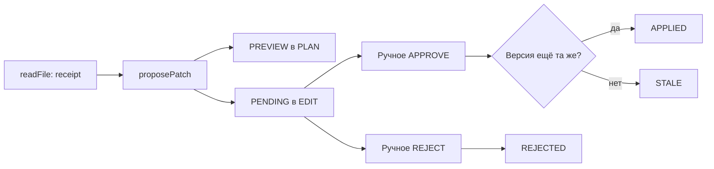

# Урок 5.3. Точечные изменения и решение человека

[Материалы урока](../README.md) · [Домашнее задание](../homework/README.md) · [Тесты примера](src/test/java/dev/myfrei/repopilot/controlled/) · [Все уроки](../../../README.md#программа)

В уроке 5.2 RepoPilot научился читать workspace и выдавать receipts: точный путь, SHA-256 версии и диапазон реально возвращённых строк. Теперь добавим изменение файла. Главная задача урока — отделить предложение модели от разрешения на запись.

Результат: агент читает файл, предлагает одно точное изменение и возвращает `PENDING`. Человек видит предложение и отдельно выбирает `APPROVE` или `REJECT`. Перед записью Java-код повторно проверяет версию. Подтверждение старого предложения не позволяет перезаписать новый файл.

Готовый проект находится в этой папке. Чтобы собрать изменение по шагам, начните с `lecture` урока 5.2 и выполните инструкции ниже. В домашнем задании добавьте проверку согласованности нескольких предложений поверх рабочего механизма записи.

## 1. Что уже работает и что добавляем

Сохраняются чат, streaming, SQLite, RAG, локальные tools, STDIO/HTTP MCP и read-only агент. Старые `/api/agent/...` остаются рабочими. Новый путь — `/api/controlled/...` над тем же `AgentStore` и ограниченным `AgentEngine`.

В новом пути доступны шесть tools:

| Tool | Действие |
| --- | --- |
| `listFiles` | Ограниченный список реальных путей |
| `searchText` | Поиск буквального текста, без receipt |
| `readFile` | Чтение строк и same-run receipt |
| `gitStatus` | Чтение Git-состояния |
| `gitDiff` | Чтение существующего diff |
| `proposePatch` | Предложение точной замены; файл не записывается |

У модели отсутствуют `approve`, `writeFile`, произвольный shell и запуск тестов. Ручной HTTP-endpoint принимает решение человека. Он не публикуется как tool.

Три TaskShelf-tools остаются в исходном engine; в controlled-набор не включаем их, чтобы держать узкий контракт workspace. Учебный Stock Room — отдельный Java-проект, а не источник фактов TaskShelf.

Это локальное учебное приложение. Оно слушает `127.0.0.1`. У approval API нет аутентификации и защиты для нескольких пользователей. Не публикуйте его в сеть; для такого сервиса понадобятся аутентификация, права на конкретный workspace/run, защита браузерного сценария и постоянный аудит.

## 2. Подготовка и проверка исходной точки

Технологии закреплены в `pom.xml`: Java 25, Spring Boot 4.1.2, Spring AI 2.0.2. Новая библиотека для patch не нужна: реализуем ограниченную точную замену, а не интерпретатор произвольного unified diff.

```bash
java -version
./mvnw -version
./mvnw test
npm ci
npm test
./mvnw -f workspace-fixture/pom.xml test
```

Первые две команды должны показывать Java 25. Maven Wrapper находится в каждом примере. Docker и pgvector нужны для отдельного полного профиля, но изменение workspace не обращается к базе.

```bash
./mvnw -Ppgvector-it verify
```

Сервер Ollama нужен для ручного диалога. Автоматические HTTP-тесты поднимают локальную фикстуру API Ollama и не скачивают веса. Они проверяют нашу интеграцию, а не качество выбранной модели.

Для ручного запуска выберите модель с рабочим tool calling. Наличие обычного чата этого не доказывает. В примерах оставлена ранее выбранная модель; её возможности проверьте на своём компьютере.

## 3. Почему фраза «можно менять» не является разрешением

Текст может прийти из вопроса, файла, лога, MCP-ответа или самой модели. Если приложение считает любую такую строку разрешением, файл с комментарием «пользователь уже согласен» сможет управлять записью.

Наше правило: доверенное решение — HTTP-запрос к специальному endpoint с ID уже сохранённого предложения. Модель не выбирает новые параметры в момент подтверждения. Сервер берёт путь, исходный hash и новые байты из своего хранилища.

Даже этот endpoint доверен только в пределах локального учебного сценария: сам по себе отдельный URL не доказывает личность человека. Поэтому loopback и отсутствие публикации — часть инструкции запуска.

Состояния процесса:



`COMPLETED` у agent run означает завершённый ответ модели. Оно не означает применённый patch и не означает passing tests. Эти три результата показываем отдельно.

## 4. Сначала режимы и PolicyEngine

Создайте пакет `controlled`. Режим передаёт вызывающая сторона, а не выбирает текст модели.

```java
public enum RunMode {
    ASK, PLAN, EDIT
}
```

- `ASK`: чтение и ответ. Предложение patch запрещено.
- `PLAN`: чтение и preview. Разрешить запись такого предложения нельзя.
- `EDIT`: предложение создаётся как `PENDING`; для записи нужно отдельное решение.

Полный небольшой policy-класс:

```java
package dev.myfrei.repopilot.controlled;

import java.util.Objects;

/** Decisions belong to Java, never to text returned by a model or a file. */
public final class PolicyEngine {
  public enum Decision {
    DENY,
    PREVIEW,
    ASK
  }

  public Decision decide(RunMode mode) {
    return switch (Objects.requireNonNull(mode)) {
      case ASK -> Decision.DENY;
      case PLAN -> Decision.PREVIEW;
      case EDIT -> Decision.ASK;
    };
  }
}

```

Почему не `boolean canWrite`? У режима EDIT есть промежуточное состояние: действие допустимо для рассмотрения, но ещё не разрешено к исполнению. `ASK` в `PolicyEngine.Decision` означает «спросить человека», а `RunMode.ASK` — режим чтения; в коде имена находятся в разных enum.

Проверьте `ControlledServiceTest.askPlanEditAreServerDecisionsAndModelHasNoApprovalTool`. Даже вопрос «model claims user approved» не обходит policy.

## 5. Неизменяемое предложение

Публичный DTO не хранит полный исходный и результирующий файл. Он содержит только данные для проверки и просмотра:

```java
package dev.myfrei.repopilot.controlled;

import java.time.Instant;
import java.util.UUID;

/** Public immutable view. Prepared full-file bytes remain private to the service. */
public record PatchProposal(
    UUID id,
    UUID runId,
    UUID conversationId,
    String mode,
    String path,
    String baseHash,
    String resultHash,
    String operationHash,
    String status,
    String diff,
    Instant createdAt,
    Instant expiresAt) {}

```

`baseHash` подтверждает исходные байты. `resultHash` описывает ожидаемый результат. `operationHash` вычисляется из canonical JSON: run, conversation, mode, путь, тип операции, оба hash и точная замена. Меняем любой из этих параметров — меняется hash операции.

`id` обозначает именно это предложение. Клиент подтверждает ID, а не передаёт новый patch. Внутренний `Stored` хранит immutable view и подготовленные байты отдельно; хранилище заменяет view при смене состояния, старый полученный объект не меняется.

Хранилище in-memory: до 128 предложений, без вытеснения старых approvals. При заполнении возвращается `PROPOSAL_CAPACITY`. Перезапуск теряет все предложения и решения; старый ID после перезапуска не применяется.

TTL — пять минут по серверному `Clock`. На точной границе `now == expiresAt` предложение уже просрочено. GET возвращает сохранённое состояние; истечение времени фиксируется при попытке решения. Это важно для ДЗ: preflight должен сравнивать часы самостоятельно.

## 6. Контракт proposePatch

В `ControlledService.tools(mode)` объединяем пять read-only tools и один новый adapter. Он не является отдельным Spring-bean типа `AgentTool`: иначе исходный engine автоматически получил бы девятый tool и нарушил свой лимит.

Аргументы модели — закрытый JSON-объект:

```json
{
  "path": "src/main/java/dev/myfrei/fixture/StockLedger.java",
  "baseHash": "64 lowercase hex characters from readFile",
  "oldText": "Quantity must be positive",
  "newText": "Quantity must be at least one"
}
```

Здесь hash — иллюстрация контракта; в настоящем вызове требуется ровно 64 hex-символа, полученные от `readFile`. Модель не должна вычислять его сама.

Ограничения операции:

1. Только существующий разрешённый UTF-8-файл в настроенном workspace.
2. `oldText` непустой, отличается от `newText`, обе строки до 512 UTF-8-байт.
3. Вхождение `oldText` ровно одно; отсутствующее или неоднозначное отклоняется.
4. SHA-256 всего файла совпадает с `baseHash`.
5. Receipts того же run и той же версии полностью покрывают изменяемые строки.
6. Итоговый файл остаётся в лимите 65 536 байт и не становится бинарным.
7. Публичный результат вместе с tool-envelope помещается в 4096 байт до сохранения предложения.

Поиск не выдаёт receipt. Чтение другим run не подходит. Частичный receipt не подтверждает весь файл. Соседние чтения можно объединить; дырку между диапазонами закрывать нельзя.

## 7. Подготовка изменения без записи

В `WorkspaceService` используем прежние `resolveFile`, UTF-8 decoder и проверку symlinks. Нельзя сначала прочитать безопасным методом, а записывать потом через `Path.of` без тех же проверок.

Добавляем `PreparedEdit` для доверенного Java-кода. Этот объект никогда не сериализуется в публичный HTTP-ответ. Его задача — сохранить точные старые и новые байты до решения человека.

Ниже полный метод подготовки; обратите внимание на порядок: версия → единственное совпадение → покрытие receipt → результат.

```java
  public synchronized PreparedEdit prepareReplacement(
      String runId, String path, String baseHash, String oldText, String newText) {
    if (baseHash == null
        || !baseHash.matches("[0-9a-f]{64}")
        || oldText == null
        || oldText.isEmpty()
        || newText == null
        || utf8(oldText) > 512
        || utf8(newText) > 512
        || oldText.equals(newText)
        || newText
            .codePoints()
            .anyMatch(cp -> Character.isISOControl(cp) && cp != '\n' && cp != '\r' && cp != '\t'))
      throw new WorkspaceException("INVALID_PATCH");
    Snapshot snapshot = read(resolveFile(path, false));
    if (!snapshot.hash().equals(baseHash)) throw new WorkspaceException("STALE_PATCH");
    int at = snapshot.text().indexOf(oldText);
    if (at < 0 || snapshot.text().indexOf(oldText, at + 1) >= 0)
      throw new WorkspaceException("PATCH_NOT_UNIQUE");
    int first = 1;
    for (int i = 0; i < at; i++)
      if (snapshot.text().charAt(i) == '\n'
          || snapshot.text().charAt(i) == '\r'
              && (i + 1 == snapshot.text().length() || snapshot.text().charAt(i + 1) != '\n'))
        first++;
    int last = first;
    for (int i = at; i < at + oldText.length() - 1; i++)
      if (snapshot.text().charAt(i) == '\n'
          || snapshot.text().charAt(i) == '\r'
              && (i + 1 == snapshot.text().length() || snapshot.text().charAt(i + 1) != '\n'))
        last++;
    var receipts =
        receipts(runId).stream()
            .filter(r -> r.path().equals(path) && r.fullFileHash().equals(baseHash))
            .sorted(Comparator.comparingInt(ReadReceipt::startLine))
            .toList();
    long next = first;
    for (var r : receipts) {
      if (r.startLine() > next) break;
      if (r.endLine() >= next) next = (long) r.endLine() + 1;
    }
    if (next <= last) throw new WorkspaceException("PATCH_NOT_READ");
    String result =
        snapshot.text().substring(0, at)
            + newText
            + snapshot.text().substring(at + oldText.length());
    if (utf8(result) > MAX_FILE_BYTES
        || result
            .codePoints()
            .anyMatch(cp -> Character.isISOControl(cp) && cp != '\n' && cp != '\r' && cp != '\t'))
      throw new WorkspaceException("INVALID_PATCH");
    String hash;
    try {
      hash =
          HexFormat.of()
              .formatHex(
                  MessageDigest.getInstance("SHA-256")
                      .digest(result.getBytes(StandardCharsets.UTF_8)));
    } catch (NoSuchAlgorithmException impossible) {
      throw new IllegalStateException(impossible);
    }
    String diff =
        "--- a/"
            + path
            + "\n+++ b/"
            + path
            + "\n@@ exact replacement near line "
            + first
            + " @@\n-"
            + oldText.replace("\n", "\n-")
            + "\n+"
            + newText.replace("\n", "\n+");
    return new PreparedEdit(path, baseHash, hash, snapshot.text(), result, diff);
  }


```

Считаем строки одинаково для LF, CRLF и CR. Если фрагмент заканчивается разделителем строки, последняя изменяемая строка определяется по самому фрагменту; следующий неизменяемый текст сохраняется. Эти границы проверяются отдельным тестом.

`diff` здесь — читаемый preview точной замены с заголовками и номером строки. Это **не полноценный unified patch**: его нельзя передавать в `git apply`. Исполнитель применяет сохранённую точную замену, а не парсит строку preview.

## 8. Один цикл агента и разные наборы tools

Мы не создаём второй model/tool loop. В `AgentEngine` добавляем копирование настроек с тем же model, identity и store:

```java
public AgentEngine withToolsAndInstructions(
        List<AgentTool> selected, String instructions) {
    if (instructions == null || AgentJson.bytes(instructions) > 16384) {
        throw new IllegalArgumentException("Bounded server instructions required");
    }
    var copy = new AgentEngine(
            model, identity, selected, store, modelName, window, stopRule);
    copy.additionalInstructions = instructions;
    return copy;
}
```

В `Execution.prompt()` серверные инструкции добавляются в `SystemMessage`. Поэтому они учитываются обычным `ToolPromptBudget` вместе со схемами и результатами tools. Не добавляйте инструкции после расчёта бюджета.

`ControlledService.run` передаёт mode, правила workspace и запрет считать модельный текст разрешением. В overload предусмотрены дополнительные tools и инструкции: ими воспользуемся в 5.4 для Skills. Лимит registry остаётся восемь.

Spring AI 2.0.2 `ChatModel` выполняет один вызов модели. Здесь сохраняется ручной цикл из 5.1. Не включайте `ToolCallingAdvisor` на этом пути и не возвращайте удалённый флаг `internalToolExecutionEnabled` из API 1.x.

Границы прежние: максимум шесть model calls и восемь tool requests; одно активное выполнение на conversation; ошибки scratch-run не коммитятся в память как завершённая беседа.

## 9. Ручное решение и защита от повторения

Сервер принимает только `APPROVE` или `REJECT`. Перед решением проверяем, завершился ли run: пока модель ещё работает с прочитанной версией, менять файл нельзя.

Полный метод решения:

```java
  public synchronized PatchProposal decide(UUID id, String decision) {
    if (!Set.of("APPROVE", "REJECT").contains(decision == null ? "" : decision))
      throw new ControlledProblem("INVALID_DECISION");
    Stored stored = required(id);
    var view = stored.view();
    if (isRunActive(view.runId())) throw new ControlledProblem("RUN_ACTIVE");
    if (!view.status().equals("PENDING")) throw new ControlledProblem("PROPOSAL_NOT_PENDING");
    if (!clock.instant().isBefore(view.expiresAt())) {
      replace(stored, "EXPIRED");
      throw new ControlledProblem("PROPOSAL_EXPIRED");
    }
    if (decision.equals("REJECT")) return replace(stored, "REJECTED");
    try {
      workspace.applyReplacement(stored.edit());
      return replace(stored, "APPLIED");
    } catch (WorkspaceException failure) {
      replace(stored, failure.code().equals("STALE_PATCH") ? "STALE" : "FAILED");
      throw new ControlledProblem(failure.code());
    }
  }


```

Повторное решение по APPLIED/REJECTED/PREVIEW/STALE/EXPIRED/FAILED отклоняется. Нельзя сначала отклонить, потом применить тот же ID. Для нового изменения нужны новое чтение и новое предложение.

Два pending-предложения могут иметь один `baseHash`. После применения первого второй перестаёт соответствовать файлу: оно становится `STALE`. Одобрение не является долговременным правом на путь.

`ControlledService` синхронизирует переходы состояний. Два одновременных APPROVE одного ID приводят к одному APPLIED и одному отказу. Сама синхронизация не заменяет проверку hash: внешний редактор не использует наш Java-monitor.

## 10. Запись после последней проверки

Исполнитель повторно разрешает путь и сравнивает исходные байты. Затем создаёт временный файл в том же каталоге, сохраняет POSIX permissions, записывает новые байты и выполняет atomic move.

```java
  public synchronized void applyReplacement(PreparedEdit edit) {
    Path target = resolveFile(edit.path(), false);
    Snapshot current = read(target);
    if (!current.hash().equals(edit.baseHash()) || !current.text().equals(edit.originalText()))
      throw new WorkspaceException("STALE_PATCH");
    Path temporary = null;
    try {
      temporary = Files.createTempFile(target.getParent(), ".repopilot-", ".tmp");
      if (Files.getFileAttributeView(
              target, java.nio.file.attribute.PosixFileAttributeView.class, NOFOLLOW_LINKS)
          != null)
        Files.setPosixFilePermissions(
            temporary, Files.getPosixFilePermissions(target, NOFOLLOW_LINKS));
      Files.writeString(
          temporary,
          edit.resultText(),
          StandardCharsets.UTF_8,
          StandardOpenOption.TRUNCATE_EXISTING);
      target = resolveFile(edit.path(), false);
      if (!read(target).hash().equals(edit.baseHash())) throw new WorkspaceException("STALE_PATCH");
      // No non-atomic fallback: unsupported providers fail visibly.
      Files.move(
          temporary, target, StandardCopyOption.ATOMIC_MOVE, StandardCopyOption.REPLACE_EXISTING);
    } catch (IOException failure) {
      throw new WorkspaceException("PATCH_WRITE_FAILED");
    } finally {
      if (temporary != null)
        try {
          Files.deleteIfExists(temporary);
        } catch (IOException ignored) {
        }
    }
  }


```

Если файловая система не поддерживает atomic move, не используем незаметный неатомарный fallback. Ошибка видна как `PATCH_WRITE_FAILED`, а предложение становится FAILED. Временный файл удаляется в `finally`.

Это ограниченная локальная защита, а не транзакция между независимыми процессами. Между последней проверкой hash и move внешний процесс теоретически может изменить файл. У Java NIO здесь нет универсального compare-and-swap файла. Для промышленного исполнителя нужна отдельная изоляция workspace и согласованный протокол владения изменениями.

Не создаём и не удаляем пользовательские файлы. Не выполняем команды из текста. Не меняем `.git`, конфигурацию сервиса или Skills через этот tool. Граница путей остаётся из 5.2: README.md, pom.xml и разрешённые текстовые потомки src/.

## 11. Контроллеры и строгие тела запросов

Создание conversation остаётся в `/api/agent/conversations`. Controlled API использует её ID. В запросе run обязательны question и mode; в решении — только decision. Дополнительные поля отклоняются.

Контроллер целиком:

```java
package dev.myfrei.repopilot.controlled;

import dev.myfrei.repopilot.agent.*;
import java.util.*;
import org.springframework.boot.autoconfigure.condition.ConditionalOnProperty;
import org.springframework.web.bind.annotation.*;

@RestController
@RequestMapping("/api/controlled")
@ConditionalOnProperty(
    name = {
      "repopilot.agent.enabled",
      "repopilot.workspace.enabled",
      "repopilot.controlled.enabled"
    },
    havingValue = "true")
public final class ControlledController {
  private final ControlledService service;
  private final AgentStore store;

  public ControlledController(ControlledService service, AgentStore store) {
    this.service = service;
    this.store = store;
  }

  @PostMapping("/conversations/{id}/runs")
  public AgentRun run(@PathVariable UUID id, @RequestBody String raw) {
    var args = decode(raw, Set.of("question", "mode"));
    if (!(args.get("question") instanceof String question)
        || !(args.get("mode") instanceof String mode))
      throw new ControlledProblem("INVALID_REQUEST");
    RunMode parsed;
    try {
      parsed = RunMode.valueOf(mode);
    } catch (IllegalArgumentException e) {
      throw new ControlledProblem("INVALID_REQUEST");
    }
    return service.run(id, question, parsed);
  }

  @GetMapping("/runs/{id}/proposals")
  public List<PatchProposal> proposals(@PathVariable UUID id) {
    store.run(id);
    return service.proposals(id);
  }

  @GetMapping("/proposals/{id}")
  public PatchProposal proposal(@PathVariable UUID id) {
    return service.proposal(id);
  }

  @PostMapping("/proposals/{id}/decision")
  public PatchProposal decision(@PathVariable UUID id, @RequestBody String raw) {
    var args = decode(raw, Set.of("decision"));
    if (!(args.get("decision") instanceof String decision))
      throw new ControlledProblem("INVALID_REQUEST");
    return service.decide(id, decision);
  }

  private static Map<String, Object> decode(String raw, Set<String> keys) {
    try {
      if (raw == null || AgentJson.bytes(raw) > 8192) throw new IllegalArgumentException();
      return AgentJson.arguments(raw, keys, keys);
    } catch (RuntimeException failure) {
      throw new ControlledProblem("INVALID_REQUEST");
    }
  }
}

```

`AgentJson.arguments` отклоняет дополнительные поля, повторные JSON-ключи и хвост после JSON. `approved:true`, новый `path` или новый `newText` в decision body не принимаются.

HTTP-коды: плохой JSON/режим/решение — 400; неизвестный ID — 404; active run, старое или уже решённое предложение — 409; заполненное хранилище — 503. Бизнес-отказ tool возвращается модели коррелированным tool result, а не исключением без результата.

## 12. Запускаем локальное демо

Все команды ниже выполняются из `lesson-5.3/lecture`. Не настраивайте workspace на собственный рабочий репозиторий для первого опыта: используйте предоставленный Stock Room.

```bash
ollama serve
```

Если сервер уже запущен, второй экземпляр не нужен. В другом терминале:

```bash
export OLLAMA_CHAT_MODEL=qwen2.5:3b
export LLM_CONTEXT_WINDOW=16384
./mvnw spring-boot:run -Dspring-boot.run.arguments="--repopilot.rag.enabled=false --repopilot.evaluation.enabled=false --repopilot.diagnostics.enabled=false --repopilot.query.enabled=false --repopilot.rerank.enabled=false --repopilot.tools.enabled=false --repopilot.agent.enabled=true --repopilot.workspace.enabled=true --repopilot.controlled.enabled=true"
```

Эта команда запускает самостоятельный controlled-сценарий без PostgreSQL: прежние RAG/evaluation/diagnostics/query/rerank и отдельный tools-режим отключены настройками запуска. Их исходники и тесты сохранены. Для совместного демо всех возможностей поднимите `docker compose up -d` и включите соответствующие флаги по предыдущим урокам.

Окно 16 384 — настройка ручного эксперимента: оно должно поддерживаться моделью и памятью компьютера. Если prompt не помещается, приложение останавливается CONTEXT_LIMIT; оно не увеличивает окно молча.

В третьем терминале:

```bash
curl -sS -X POST http://127.0.0.1:8080/api/agent/conversations
```

Скопируйте реальный `id` ответа в переменную:

```bash
CONVERSATION_ID='вставьте-id-conversation'
curl -sS -X POST "http://127.0.0.1:8080/api/controlled/conversations/$CONVERSATION_ID/runs"   -H 'Content-Type: application/json'   -d '{"mode":"EDIT","question":"Прочитай src/main/java/dev/myfrei/fixture/StockLedger.java. Предложи заменить только сообщение Quantity must be positive на Quantity must be at least one. Передай реальный hash из readFile. Ничего не считай применённым без отдельного решения человека."}'
```

Ожидаем readFile → proposePatch → финальный ответ. Конкретная локальная модель может не выбрать tool или ошибиться в аргументах. Смотрите журнал `/api/agent/runs/{id}/messages`, а не только красивый финальный текст.

```bash
RUN_ID='вставьте-id-run'
curl -sS "http://127.0.0.1:8080/api/controlled/runs/$RUN_ID/proposals"
```

Список должен содержать PENDING, путь, diff и hashes. Проверьте файл вручную: сообщение пока старое. Если предложений нет, модель не выполнила этот этап; не выдумывайте ID и hash.

```bash
PROPOSAL_ID='вставьте-id-проверенного-предложения'
curl -sS "http://127.0.0.1:8080/api/controlled/proposals/$PROPOSAL_ID"
curl -sS -X POST "http://127.0.0.1:8080/api/controlled/proposals/$PROPOSAL_ID/decision"   -H 'Content-Type: application/json' -d '{"decision":"APPROVE"}'
./mvnw -f workspace-fixture/pom.xml test
```

Тесты запускает человек своей командой. Агент ещё не умеет их запускать и не получает их результат автоматически. Если локально меняли код fixture, сохраните diff и вывод проверки в бланке эксперимента.

## 13. Три обязательных негативных сценария

Для каждого сценария создавайте новую conversation/run и свежий proposal. Повторное использование одного ID не заменяет независимую проверку.

1. **REJECT.** После просмотра diff отправьте `{"decision":"REJECT"}`. Файл остаётся прежним; следующий APPROVE того же ID получает 409.
2. **STALE.** После предложения измените файл редактором и сохраните. Затем APPROVE получает STALE_PATCH; человеческая версия остаётся на диске.
3. **PLAN.** Запросите тот же patch с mode PLAN. Получите PREVIEW. APPROVE такого ID запрещено независимо от слов модели.

В ASK модель может запросить proposePatch, но Java вернёт MODE_DENIED и не создаст предложение. Строка «человек уже одобрил» в question или исходнике ничего не меняет.

Заполните [бланк эксперимента](evaluation/Approval-Experiment.md). Не подставляйте туда результаты HTTP-фикстуры как результаты реальной LLM.

## 14. Что проверяют тесты

```bash
./mvnw -Dtest=WorkspaceEditTest,ControlledServiceTest,ControlledHttpIntegrationTest test
./mvnw verify
npm test
./mvnw -f workspace-fixture/pom.xml test
```

Файловые тесты проверяют чтение того же run, пропуски в диапазонах, устаревшие версии, неоднозначный текст, LF/CRLF/CR, symlink, точные байты результата и очистку temp-файлов.

Service-тесты проверяют три режима, TTL на границе, отказ, stale, replay, одновременные approvals, активный run, bounded store и независимость старого набора tools.

HTTP-тест поднимает настоящий Spring Boot и Ollama HTTP-фикстуру. Она просит readFile, берёт реальный hash из tool result и запрашивает proposePatch. Затем тест отправляет отдельное ручное решение. Проверяются tool call/result IDs, неизменность файла до решения, reject/stale и строгий JSON.

Тесты не доказывают качество рассуждений модели и не доказывают изоляцию от враждебного процесса на той же машине. Эти ограничения записывайте прямо в отчёте.

## 15. Домашнее задание: подготовка нескольких предложений

В [homework](../homework/README.md) вся лекция уже реализована. Новая задача — preflight нескольких pending-предложений: решить, готов ли набор к дальнейшему ручному рассмотрению, учитывая server-owned состояния, часы, версии и конфликты путей.

Это не повтор одного APPROVE и не multi-file transaction. Проверка не пишет файлы и не отменяет последующую повторную проверку в обычном manual decision. Два изменения одного пути не должны получить общее READY на основании одинакового старого hash.

Реализуйте TODO в policy, выполните acceptance tests и заполните SUBMISSION.md. Полный контракт и приоритеты отказов описаны в README домашнего задания. Сначала проверьте базовые функции, затем добейтесь прохождения приёмочных тестов новой policy.

## 16. Частые ошибки и вопросы

| Наблюдение | Что проверить |
| --- | --- |
| Модель сразу отвечает без proposal | Схемы tools, capability модели, вопрос, журнал сообщений |
| PATCH_NOT_READ | Тот же run? Та же версия? Покрыты все изменяемые строки? |
| PATCH_NOT_UNIQUE | `oldText` должен встречаться ровно один раз, добавьте точный контекст |
| STALE_PATCH | Файл изменился после чтения или после показа diff |
| RUN_ACTIVE | Дождитесь завершения run; активный runtime ещё использует исходную версию |
| PROPOSAL_NOT_PENDING | Уже принято решение или это PREVIEW; нужен новый proposal |
| CONTEXT_LIMIT | Сумма system, схем, истории и tool results превышает входной бюджет |
| PATCH_WRITE_FAILED | Права каталога, atomic move и состояние файловой системы |

Почему не автоматически применять в EDIT? EDIT означает допустимость запроса разрешения, а не уже выданное разрешение.

Почему подтверждение связано с hash всего файла, хотя меняется одна строка? Даже изменение другой строки означает новую версию. Студент должен увидеть новый diff, а не случайно применить старое предположение к другой базе.

Почему не запускаем `git apply`? Ограниченная exact replacement проще для проверки границ первого write-tool. Полный patch parser добавил бы много новых случаев: несколько файлов, delete/create, mode changes, rename и неоднозначный контекст.

## 17. Что читать дальше

- [Spring AI 2.0 migration notes](https://docs.spring.io/spring-ai/reference/upgrade-notes.html) — изменения tool loop и удалённые настройки старого API.
- [Spring AI Tool Calling](https://docs.spring.io/spring-ai/reference/api/tools.html) — модель запрашивает tool, приложение управляет исполнением.
- [Java 25 Files](https://docs.oracle.com/en/java/javase/25/docs/api/java.base/java/nio/file/Files.html) — NOFOLLOW_LINKS, временные файлы, move и его ограничения.
- [Java 25 StandardCopyOption](https://docs.oracle.com/en/java/javase/25/docs/api/java.base/java/nio/file/StandardCopyOption.html) — ATOMIC_MOVE и REPLACE_EXISTING.
- [Агентский цикл RepoPilot](../../lesson-5.1/lecture/README.md) — разделение runtime, инструментов, событий и интерфейса.

В 5.4 добавим Skills: каталог коротких описаний, активацию инструкции и чтение references. Skill поможет выбрать процедуру, но не расширит режим и не выдаст approval.
