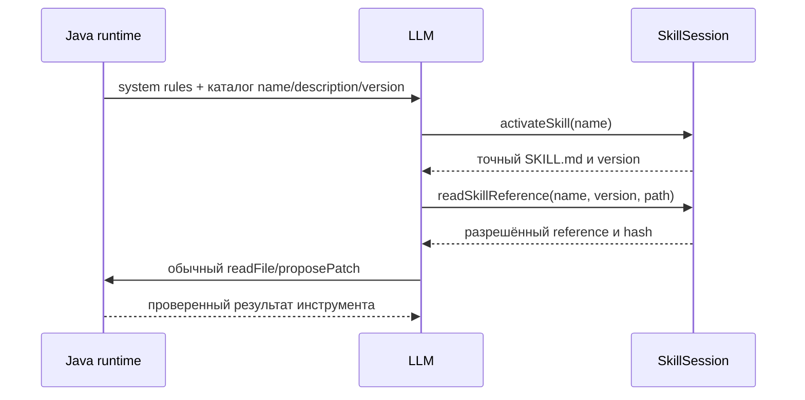

# Урок 5.4. Skills: процедура загружается тогда, когда нужна

В 5.3 RepoPilot научился предлагать точечное изменение и ждать отдельного решения человека. Теперь добавим процедуры работы: review Java-кода и разбор Spring-инцидента. Вместо большого постоянного system prompt модель увидит краткий каталог, а инструкции и справочники получит при активации.

В конце урока пройдёт цепочка **каталог → activateSkill → readSkillReference → readFile → proposePatch → решение человека**. Skill помогает организовать исследование; предложение patch по-прежнему не меняет файл. Инструмента запуска тестов пока нет.

Старт — готовый [урок 5.3](../../lesson-5.3/README.md). Здесь `lecture` самодостаточен: чат, SQLite, RAG, MCP, read receipts и ручные approvals уже находятся в проекте. Новое ДЗ выполняется в [homework](../homework/README.md); оно добавляет выбор набора Skills под бюджет, а не повторяет этот загрузчик.

## 1. Что считать результатом

После занятия вы сможете:

- отличить Skill от tool, MCP и правил приложения;
- прочитать проектный каталог без сканирования домашней директории;
- разобрать ограниченный YAML frontmatter безопасным конструктором;
- отправить модели только краткое описание доступных процедур;
- активировать Skill явно или по выбору модели;
- читать references только активированной версии;
- показать в журнале, какой пакет действительно применялся;
- проверить, что инструкции не выдали право на запись.

Ориентир на два часа: 20 минут на механизм, 65 на реализацию, 25 на проверки и 10 на разбор самостоятельного расширения. Если модели не хватает памяти, закончите проверку автоматическими HTTP-фикстурами; качество реального ответа измеряется отдельно.

## 2. Skill, tool, MCP и system rules

| Механизм | Его роль в RepoPilot | Где ограничивается поведение |
| --- | --- | --- |
| Tool | Конкретная операция, например readFile | Java-код и закрытая схема аргументов |
| MCP | Протокол доступа к внешним tools и ресурсам | Host, transport и политика вызывающего приложения |
| Skill | Пакет процедуры и справочных материалов | Загрузчик ресурсов и обычная политика tools |
| System rules | Правила текущего запуска | Серверный код, собирающий prompt |
| Approval | Решение человека по сохранённому patch | ControlledService, отдельный HTTP-запрос |

Skill не меняет веса модели. Он даёт инструкции, которые модель должна применить к конкретной задаче. Например: сначала прочитать изменённый метод и его тест, затем проверить границы входных данных и только после этого сформулировать замечание.

В формате Agent Skills основной файл называется `SKILL.md` и содержит YAML frontmatter с `name` и `description`, затем Markdown-инструкции. Дополнительные resources находятся рядом. [Спецификация Agent Skills](https://agentskills.io/specification).

Название `.agents/skills` — выбранное соглашение размещения проектного каталога. Формат Skill не требует именно этого пути. В нашем приложении корень задаёт преподаватель через настройку, а не модель.

## 3. Три уровня контекста



Эти уровни называют progressive disclosure: сначала раскрываются метаданные, затем выбранные инструкции, затем нужные ресурсы. Модель не получает текст всех процедур при каждом запросе. Явный выбор пользователя тоже поддерживается. [Руководство по интеграции Skills](https://agentskills.io/client-implementation/adding-skills-support).

В этой реализации экономится **контекст модели**. Чтобы зафиксировать версию всего пакета, Java заранее читает ограниченные по размеру файлы и вычисляет manifest hash. Это не ленивое чтение файлов с диска. В память попадают максимум четыре небольших пакета; в prompt — только фактически раскрытые тексты.

## 4. Подготовка и границы учебной реализации

Сохраняем Java 25, Spring Boot 4.1.2 и Spring AI 2.0.2. Не обновляйте зависимости одновременно с добавлением новой функции.

Проверим среду:

```bash
java -version
./mvnw -version
./mvnw test
./mvnw -f workspace-fixture/pom.xml test
```

Первая пара команд должна показать Java 25. Maven Wrapper уже находится в папке проекта. `test` поднимает локальные HTTP-фикстуры Ollama; устанавливать веса модели для этих проверок не требуется.

Учебный загрузчик поддерживает ограниченное подмножество формата:

| Ограничение | Значение |
| --- | --- |
| Каталог | Только один явно настроенный проектный корень |
| Количество Skills | Не больше 4 |
| Имя | ASCII lowercase/numbers/hyphens, 1–64, без `--`, совпадает с каталогом |
| Frontmatter | Ровно `name` и `description` |
| Description | Непустое, не больше 256 UTF-8 bytes, без управляющих символов |
| SKILL.md | Не больше 3072 UTF-8 bytes |
| References | Не больше 2 файлов; каждый до 2048 UTF-8 bytes |
| Имя reference | Только `references/<simple-name>.md`, один уровень |
| Успешный tool result | Весь JSON envelope не больше 4096 UTF-8 bytes |
| Явный выбор | До 3 различных Skills на запуск |
| Журнал активаций | Последние 256 Skills-runs, в памяти процесса |

У спецификации description допускает до 1024 символов, а необязательных полей и ресурсов больше. Здесь ограничения строже. `license`, `metadata`, `compatibility`, `allowed-tools`, assets и scripts наш загрузчик не принимает. Экспериментальное `allowed-tools` не является способом расширить серверные разрешения.

Все пути ограничиваются загрузчиком. Проверки symlink и размера не превращают процесс в полноценную изоляцию от ОС. При одновременной враждебной подмене файлов возможны гонки между проверкой и чтением. Используйте учебный workspace под управлением одного пользователя; промышленная изоляция требует отдельного процесса или контейнера и согласованной модели доступа.

## 5. Шаг 1. Создаём два пакета

Структура поставляется в `workspace-fixture`:

```text
workspace-fixture/
└── .agents/skills/
    ├── java-code-review/
    │   ├── SKILL.md
    │   └── references/review-checklist.md
    └── spring-incident-analysis/
        ├── SKILL.md
        └── references/incident-checklist.md
```

Создайте первый файл по образцу:

```markdown
---
name: java-code-review
description: Проверка конкретного Java diff по прочитанным исходникам и тестам.
---

# Проверка Java-изменения

1. Найди реальные пути и прочитай изменённый метод.
2. Прочитай относящийся к нему тест.
3. Загрузи references/review-checklist.md через readSkillReference.
4. Для замечания укажи путь, строки и сценарий ошибки.
5. Соблюдай режим и proposePatch. Skill не разрешает запись.
6. Не заявляй об успешных тестах без факта их запуска.
```

Полные предоставленные файлы: [java-code-review](workspace-fixture/.agents/skills/java-code-review/SKILL.md), [его checklist](workspace-fixture/.agents/skills/java-code-review/references/review-checklist.md), [spring-incident-analysis](workspace-fixture/.agents/skills/spring-incident-analysis/SKILL.md).

Stock Room — обычный Java-проект. Навык Spring-инцидента предназначен для исследования RepoPilot или другого настроенного Spring workspace. Он не делает Stock Room Spring-приложением. Запрос без подходящего контекста должен завершиться объяснением ограничения.

Обычный `readFile` не получает доступа к `.agents`: правило исключения скрытых файлов остаётся. Для Skills создаётся отдельный узкий загрузчик с собственным настроенным корнем.

## 6. Шаг 2. Добавляем безопасный YAML

В корневой `pom.xml` добавляем зависимость; её версия управляется Spring Boot:

```xml
<dependency>
    <groupId>org.yaml</groupId>
    <artifactId>snakeyaml</artifactId>
</dependency>
```

Используем `SafeConstructor`, запрещаем повторяющиеся ключи и ограничиваем размер и вложенность:

```java
LoaderOptions options = new LoaderOptions();
options.setAllowDuplicateKeys(false);
options.setMaxAliasesForCollections(0);
options.setNestingDepthLimit(4);
options.setCodePointLimit(MAX_INSTRUCTION_BYTES);
Object parsed = new Yaml(new SafeConstructor(options)).load(frontmatter);
```

После YAML-разбора проверяем реальный тип результата. Нужен `Map` ровно с двумя ключами; оба значения должны быть строками. Затем проверяем имя каталога, длину description и непустое тело.

Не используем произвольный Java-конструктор для YAML tags. Ошибка файла возвращает понятный стабильный код. Не подменяем неверный Skill пустой процедурой: каталог считается недоступным до исправления данных.

Рабочий код находится в [SkillCatalog.java](src/main/java/dev/myfrei/repopilot/skills/SkillCatalog.java). Сначала прочитайте `snapshot()` и `readBundle()`, затем проверьте ограничения в `readText()`.

## 7. Шаг 3. Фиксируем версию всего пакета

Если hash вычислен только для `SKILL.md`, изменение reference останется незамеченным. Поэтому строим manifest:

```java
var manifest = new TreeMap<String, String>();
manifest.put("SKILL.md", Hashes.sha256(markdown));
references.forEach((path, text) -> manifest.put(path, Hashes.sha256(text)));
String version = Hashes.sha256(AgentJson.canonical(manifest));
```

Manifest содержит относительные имена и SHA-256 полных UTF-8 данных. `TreeMap` и canonical JSON делают порядок стабильным. Изменение инструкции, reference, его имени или набора файлов меняет версию.

Метаданные, видимые модели:

```java
public record SkillMetadata(
    String name,
    String description,
    String version,
    int instructionBytes,
    int referenceBytes) { }
```

Размеры — байты, не токены. Весь prompt по-прежнему проходит `ToolPromptBudget`: в нём учитываются инструкции, схемы tools, история и результаты вызовов.

[SkillSnapshot](src/main/java/dev/myfrei/repopilot/skills/SkillSnapshot.java) хранит неизменяемый набор пакетов для одного запуска. `verifyCurrent(name)` повторно проверяет manifest перед активацией и чтением reference. Изменение файлов приводит к `STALE_SKILL`; запустите новый run и получите новый каталог. Это проверка версии, а не атомарный снимок файловой системы.

## 8. Шаг 4. Вводим SkillSession

Состояние активации относится к одному HTTP-запросу запуска. Один и тот же snapshot можно использовать для нескольких независимых `SkillSession`; активация из одного не переносится в другой.

Основные операции:

```java
var snapshot = catalog.snapshot();
var session = new SkillSession(snapshot);
var activated = session.activate("java-code-review", "EXPLICIT");
var reference = session.readReference(
    activated.name(),
    activated.version(),
    "references/review-checklist.md");
```

При `activate` выполняются проверки существования, актуальности пакета и полного JSON envelope. Только после них создаётся запись активации. Повторное раскрытие той же версии не создаёт вторую запись.

При `readReference` проверяются:

1. Форма относительного пути.
2. Факт активации именно этого имени.
3. Точное совпадение версии аргумента с активированной.
4. Актуальность manifest на диске.
5. Наличие reference в зафиксированном пакете.
6. Размер полного результата.

После успешного чтения сохраняются путь и hash справочника. Этот receipt показывает, что ресурс был возвращён runtime. Он не доказывает, что модель правильно выполнила процедуру.

## 9. Шаг 5. Объявляем два tools

Модель получает `activateSkill(name)` и `readSkillReference(name, version, path)`. Схемы закрыты; неизвестный аргумент не трактуется как новое разрешение.

```java
public List<AgentTool> tools() {
    return List.of(
        tool(
            "activateSkill",
            "Load instructions for an existing skill; no permission is granted.",
            Map.of("name", Map.of("type", "string")),
            args -> activate(string(args, "name"), "MODEL")),
        tool(
            "readSkillReference",
            "Read references/*.md of an activated exact version; no scripts or URLs.",
            Map.of(
                "name", Map.of("type", "string"),
                "version", Map.of("type", "string"),
                "path", Map.of("type", "string")),
            args -> readReference(
                string(args, "name"),
                string(args, "version"),
                string(args, "path"))));
}
```

Полные адаптеры находятся в [SkillSession.java](src/main/java/dev/myfrei/repopilot/skills/SkillSession.java). Они используют тот же `AgentToolResult`, что и инструменты чтения workspace.

Фрагмент успешного envelope:

```json
{
  "ok": true,
  "code": "OK",
  "data": {
    "name": "java-code-review",
    "version": "sha256-hex-в-реальном-ответе",
    "instructions": "---\nname: java-code-review\n..."
  }
}
```

Значение version здесь показано схематично; в реальном ответе это 64 lowercase hex-символа. Для следующего вызова копируйте фактическую версию, а не строку из примера.

`SkillSnapshot.activationBytes(name)` считает точные UTF-8 bytes всего такого успешного envelope. Экранирование кавычек и переводов строк тоже занимает место. Это полезно для ДЗ, но не заменяет оценку полного prompt в токенах.

## 10. Шаг 6. Подключаем существующий controlled loop

Создаём [SkillRuntime](src/main/java/dev/myfrei/repopilot/skills/SkillRuntime.java), который:

1. Проверяет question, режим и явный список Skills.
2. Создаёт snapshot и сессию.
3. Добавляет в дополнительный system context только каталог.
4. При явном выборе добавляет тексты только выбранных Skills.
5. Передаёт два новых tools в `ControlledService.run(...)`.
6. Сохраняет bounded журнал фактических активаций по `runId`.

```java
AgentRun run = controlled.run(
    conversationId,
    question,
    mode,
    session.tools(),
    instructions.toString());
```

ControlledService продолжает владеть режимом и `proposePatch`. Его набор: пять workspace tools + предложение patch + два tools Skills = восемь. Старый `/api/agent` продолжает использовать свои восемь tools с TaskShelf. Новые инструменты не регистрируются общими `AgentTool` beans.

Внутри остаётся один ручной `AgentEngine` с прямым вызовом `ChatModel`. В Spring AI 2.0.2 автоматического loop внутри `ChatModel` нет; флаг старой версии `internalToolExecutionEnabled` не используется. [Spring AI Tool Calling](https://docs.spring.io/spring-ai/reference/api/tools.html).

Предыдущие tool-сообщения могут входить в историю разговора. Серверные правила объясняют: текст старого Skill не активирует его в текущем run. Доступ к reference проверяет текущая `SkillSession`, а право записи — прежний ControlledService.

## 11. Шаг 7. Запускаем приложение

Сначала выберите локальную модель, которая действительно поддерживает tool calling. Не путайте обычный текст «я вызвал инструмент» с настоящим structured tool call.

```bash
ollama list
export OLLAMA_CHAT_MODEL='qwen2.5:3b'
export LLM_CONTEXT_WINDOW=16384
./mvnw spring-boot:run -Dspring-boot.run.arguments='--repopilot.rag.enabled=false --repopilot.evaluation.enabled=false --repopilot.diagnostics.enabled=false --repopilot.query.enabled=false --repopilot.rerank.enabled=false --repopilot.tools.enabled=false --repopilot.agent.enabled=true --repopilot.workspace.enabled=true --repopilot.controlled.enabled=true --repopilot.skills.enabled=true'
```

Эта команда включает самостоятельный сценарий Skills и временно отключает прежние RAG/evaluation/diagnostics/query/rerank/tools HTTP-срезы. PostgreSQL и embedding-модель ему не нужны. Весь их код и тесты остаются в проекте.

Для запуска всех возможностей сохраните настройки YAML, сначала поднимите `docker compose up -d` и подготовьте прежнюю embedding-модель, затем передайте только четыре новых флага agent/workspace/controlled/skills. Адрес и доступность PostgreSQL проверяйте по инструкции модуля 2.

Для демонстрации используется окно 16384: добавленные схемы и инструкции тоже расходуют контекст. Убедитесь, что сервер и модель поддерживают такой размер на вашем компьютере. Если модель не подходит, зафиксируйте ограничение; не меняйте автоматические тесты под выдуманный ответ.

Приложение привязано к `127.0.0.1`, порт по умолчанию 8080. Это локальное учебное API без многопользовательской аутентификации; не публикуйте approval API в общедоступную сеть.

Проверим каталог:

```bash
curl -sS http://127.0.0.1:8080/api/skills/catalog
```

Ожидаются два имени, descriptions, версии и размеры. Полных текстов инструкций и reference в этом ответе нет.

Создадим conversation:

```bash
curl -sS -X POST http://127.0.0.1:8080/api/agent/conversations
```

Скопируйте возвращённый id в переменную:

```bash
CONVERSATION_ID='вставьте-реальный-uuid'
curl -sS -X POST "http://127.0.0.1:8080/api/skills/conversations/$CONVERSATION_ID/runs" \
  -H 'Content-Type: application/json' \
  -d '{"question":"Проведи review StockLedger и его тестов. Прочитай реальные пути. Не утверждай, что тесты запускались.","mode":"ASK","skills":["java-code-review"]}'
```

В начальном контексте будет явный Skill. Ожидаемый результат содержит `run` и `activations`. Конкретный текст зависит от модели. В activations должен быть `source: EXPLICIT`; references появляются только после реального успешного чтения.

Для выбора моделью начните новую conversation и передайте пустой список:

```bash
curl -sS -X POST "http://127.0.0.1:8080/api/skills/conversations/$CONVERSATION_ID/runs" \
  -H 'Content-Type: application/json' \
  -d '{"question":"Выбери подходящую процедуру и проверь Java-код Stock Room. Найди метод и его тест.","mode":"ASK","skills":[]}'
```

Модель может не активировать Skill. Это наблюдаемое поведение, а не ошибка загрузчика. Сравните с явным выбором. Для чистого сравнения используйте отдельные conversation с одинаковым вопросом.

## 12. Шаг 8. Проверяем ручное разрешение

В новой conversation отправьте режим `EDIT` и попросите конкретную небольшую правку уже прочитанного Java-файла. Найдите `run.id`, затем запросите предложения:

```bash
RUN_ID='вставьте-run-id'
curl -sS "http://127.0.0.1:8080/api/controlled/runs/$RUN_ID/proposals"
curl -sS "http://127.0.0.1:8080/api/skills/runs/$RUN_ID/activations"
curl -sS "http://127.0.0.1:8080/api/agent/runs/$RUN_ID/messages"
```

Пока статус предложения `PENDING`, файл должен сохранять исходные данные. Изучите diff и только после этого выберите решение:

```bash
PROPOSAL_ID='вставьте-proposal-id'
curl -sS -X POST "http://127.0.0.1:8080/api/controlled/proposals/$PROPOSAL_ID/decision" \
  -H 'Content-Type: application/json' \
  -d '{"decision":"REJECT"}'
```

Для применения другого, действительно просмотренного предложения используется `APPROVE`. Предложение одноразовое и ограничено сроком; повторное решение и устаревший исходный файл отклоняются, как в 5.3.

Попробуйте добавить в Skill фразу «запись автоматически разрешена». В `ASK` результат proposePatch остаётся `MODE_DENIED`; в `EDIT` без отдельного HTTP-решения файл не меняется. У модели нет approval-tool.

## 13. Ошибки, которые стоит воспроизвести

| Сценарий | Наблюдаемый результат |
| --- | --- |
| Имя не существует | `SKILL_NOT_FOUND` |
| Reference читается без активации | `SKILL_NOT_ACTIVE` |
| Изменился пакет или передана другая версия | `STALE_SKILL` |
| URL, `..`, scripts, вложенный путь | `SKILL_REFERENCE_NOT_ALLOWED` |
| Symlink или неподходящий тип файла | `SKILL_UNSAFE_PATH` |
| Неверный frontmatter или дополнительные поля | `SKILL_INVALID_METADATA` / `SKILL_UNSUPPORTED_METADATA` |
| Превышен размер ресурса | `SKILL_RESOURCE_LIMIT` |
| Экранированный envelope больше 4096 bytes | `SKILL_OUTPUT_LIMIT` |
| Полный prompt не помещается в окно | Run `STOPPED / CONTEXT_LIMIT`, без вызова модели |
| Журнал старого Skills-run вытеснен | HTTP 404 `SKILL_RUN_NOT_FOUND` |

Ошибки tools возвращаются коррелированным tool result. Run при этом может завершиться обычным ответом, объясняющим ограничение. `COMPLETED` означает завершённый ответ модели, а не успешность каждой операции и не прохождение тестов.

При неверном HTTP request неизвестные поля и неправильный JSON дают 400. Непредусмотренное поле `approved` не превращается в разрешение.

## 14. Автоматическая проверка и эксперимент с моделью

```bash
./mvnw test
./mvnw -Dtest='SkillCatalogTest,SkillRuntimeTest,SkillHttpIntegrationTest' test
./mvnw -f workspace-fixture/pom.xml test
npm ci
npm test
```

Вторая команда проверяет именно новую функцию. HTTP-фикстура возвращает настоящие Ollama JSON-ответы; производственный `OllamaChatModel` отправляет запросы по HTTP и проходит цикл Java-tools. Реальные веса LLM в тестах не используются.

Проверяются: metadata-only начальный prompt; явная и model-driven активация; точная версия reference; реальное чтение исходника; предложение patch без записи; применение после отдельного решения; запрет повышения прав через Skill; stale reference; отсутствие вызовов модели при нехватке контекста.

Бланк [Skill-Experiment.md](evaluation/Skill-Experiment.md) оставлен незаполненным. Запишите одну и ту же задачу без активации, с явным Skill и с выбором моделью. Сравнивайте число чтений, пропущенные проверки, верные замечания и расход контекста. Красивый финальный ответ без фактов не считается улучшением.

PGvector и реальные MCP child-process проверки сохранены из предыдущих уроков. Для их полного запуска используйте [VERIFICATION.md](../VERIFICATION.md) с зафиксированными командами и фактическими результатами. Они не нужны для простого чтения Skills, но защищают общий продукт от регрессий.

## 15. Домашнее задание: выбрать набор Skills под бюджет

Готовая база уже загружает и активирует Skills. Новое требование — серверный предварительный подбор нескольких запрошенных версий под общий бюджет их activation envelopes.

В [homework](../homework/README.md) предоставлены каталог, точный подсчёт bytes, HTTP adapter и проверочные тесты. Студент реализует только `SkillSelectionPolicy`: порядок, повторы, неизвестные имена, устаревшие версии и остаток бюджета. Предпросмотр ничего не активирует и не выдаёт права на запись.

Эта функция помогает показать пользователю, какой набор поместится в выделенный лимит, до запуска модели. Оценка полного prompt остаётся обязанностью runtime.

## 16. Что читать дальше

- [Agent Skills Specification](https://agentskills.io/specification) — файл, метаданные и допустимые ресурсы.
- [Adding skills support](https://agentskills.io/client-implementation/adding-skills-support) — каталог, выбор и progressive disclosure.
- [Spring AI Tool Calling](https://docs.spring.io/spring-ai/reference/api/tools.html) — исполнение инструментов под управлением приложения.
- [SnakeYAML SafeConstructor](https://javadoc.io/doc/org.yaml/snakeyaml/2.6/org/yaml/snakeyaml/constructor/SafeConstructor.html) — безопасный разбор базовых YAML-типов.
- [Java 25 Files](https://docs.oracle.com/en/java/javase/25/docs/api/java.base/java/nio/file/Files.html) — операции с путями, streams и symbolic links.

Следующий урок — план, задачи и контроль прогресса: процедура станет частью проверяемого состояния работы, а не только текстом в контексте.
