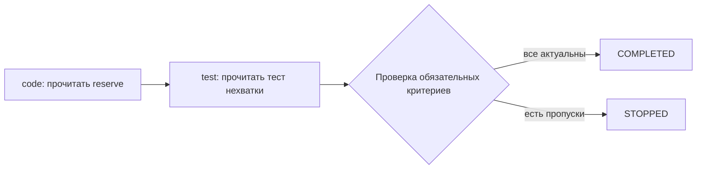

# Урок 5.5. План, зависимости и подтверждённый прогресс

RepoPilot уже читает workspace, использует Skills и предлагает правку для отдельного решения человека. Теперь сделаем ход работы видимым и проверяемым. Агент получит небольшой план: прочитать нужный код, затем прочитать относящийся к нему тест. Java-runtime будет проверять каждый переход и не примет красивый финальный ответ вместо выполненных обязательств.

Результат урока: запрос содержит явные критерии, каждый шаг имеет состояние и зависимости, перед каждым вызовом модели появляется актуальная сводка. Завершение run разрешается только после серверной проверки обязательных шагов. Домашнее задание добавляет самостоятельную функцию — выбор следующего доступного набора шагов под ограниченный бюджет чтения.

## 1. Стартовая точка и честный объём результата

Начинаем с [рабочего примера 5.4](../../lesson-5.4/README.md). В этой папке уже находится самодостаточный результат: чат, streaming, SQLite, RAG, MCP, read receipts, proposals и Skills сохранены.

Наш учебный target repository — Stock Room в `workspace-fixture`. В 5.5 поддерживаются только два критерия:

| Критерий | Что подтверждает сервер | Чего он не подтверждает |
| --- | --- | --- |
| `READ_CODE` | Запрошенный диапазон `src/main/...java` реально возвращён инструментом этому run, версия актуальна | Правильность понимания и исправления |
| `READ_TEST` | Запрошенный диапазон `src/test/...java` реально возвращён этому run, версия актуальна | Исполнение теста и passing result |

Не добавляем фиктивный `TEST_PASSED`: runner появится в 5.7. Применение patch остаётся отдельным ручным действием из 5.3. Завершённый план чтения не выдаёт разрешение на запись.

План — часть состояния приложения. Он не является обычным абзацем в сообщении модели и не заменяет первоначальную задачу пользователя.

## 2. Среда и исходные проверки

Остаёмся на Java 25, Spring Boot 4.1.2 и Spring AI 2.0.2. Новые зависимости не нужны.

```bash
java -version
./mvnw -version
./mvnw test
npm ci
npm test
./mvnw -f workspace-fixture/pom.xml test
```

Полный профиль с Docker и PostgreSQL:

```bash
./mvnw -Ppgvector-it verify
```

Автоматические интеграционные проверки вызывают настоящий Spring Boot, а вместо весов LLM используют локальную HTTP-фикстуру Ollama. Это позволяет проверить порядок действий, actual receipts и gate детерминированно. Качество реальной модели проверяется отдельным экспериментом.

Ориентир занятия: 20 минут на модель состояния, 65 на реализацию, 25 на проверки и 10 на самостоятельное расширение.

## 3. Почему одного инструмента writePlan недостаточно

Представим ответ: «План: прочитать код, проверить тест, закончить». Модель может следующим сообщением сказать «готово», ни разу не вызвав readFile. Даже список с галочками не становится доказательством.

Нам нужны три независимых механизма:

1. **Контракт:** какие обязательства заданы человеком и что считается их выполнением.
2. **Переходы:** какие действия разрешены при текущих состояниях и зависимостях.
3. **Проверка финала:** можно ли признать run завершённым перед записью его результата в память.

Модель просит выполнить переход. Java-код проверяет его по реальному состоянию workspace. Разделение запроса модели и исполнения соответствует общему механизму tools в [Spring AI](https://docs.spring.io/spring-ai/reference/api/tools.html).

## 4. Неизменяемый контракт PlanSpec

Добавьте пакет `plan`. `PlanSpec` содержит от одного до четырёх шагов. У каждого есть:

```java
public record StepSpec(
        String id,
        String title,
        String criterion,
        String path,
        int startLine,
        int endLine,
        List<String> dependsOn,
        boolean required) {
    // В рабочем классе здесь выполняется полная проверка границ.
}
```

Это фрагмент формы record; готовая валидация находится в [PlanSpec.java](src/main/java/dev/myfrei/repopilot/plan/PlanSpec.java).

Границы:

- ID: `[a-z][a-z0-9-]{0,15}`, уникальный в плане.
- Title: непустой, до 120 UTF-8-байт, без управляющих символов.
- Path: нормализованный ASCII-путь в `src/main/` или `src/test/`, до 240 байт, только Java-файл; скрытые и исключённые имена запрещены.
- Диапазон: включительно, не больше 80 строк, номера от 1 до 100 000.
- Зависимости: только ID более ранних шагов, без повторов.
- Хотя бы один шаг обязателен.

Такой порядок задаёт небольшой ориентированный граф без циклов — DAG. Каждая стрелка ведёт от более раннего шага к более позднему. Модель не может добавить цикл, изменить required или подменить критерий через tool.



`List.copyOf` фиксирует список dependencies. Сам `StepSpec` состоит из неизменяемых значений. У [Java List.copyOf](https://docs.oracle.com/en/java/javase/25/docs/api/java.base/java/util/List.html#copyOf(java.util.Collection)) неизменяемость списка не означает автоматическую неизменяемость элементов; поэтому здесь элементы тоже records со скалярными полями и копией списка.

## 5. Состояние шага и публичный snapshot

Разделим неизменяемую спецификацию и изменяемый прогресс. Внутренний `Step` хранит final spec, status и hash подтверждённой версии. Публичный snapshot — независимый immutable view:

```java
package dev.myfrei.repopilot.plan;

import java.util.*;

public record PlanSnapshot(UUID runId, int revision, List<StepView> steps) {
  public PlanSnapshot {
    steps = List.copyOf(steps);
  }

  public record StepView(
      String id,
      String title,
      String criterion,
      String path,
      int startLine,
      int endLine,
      List<String> dependsOn,
      boolean required,
      String status,
      String evidenceHash,
      boolean evidenceCurrent) {
    public StepView {
      dependsOn = List.copyOf(dependsOn);
    }
  }
}

```

Состояния шага:

| Состояние | Значение |
| --- | --- |
| `PENDING` | Шаг ещё не начат или явно сброшен |
| `ACTIVE` | Шаг начат; доказательства ещё не приняты |
| `COMPLETED` | Java приняла receipt требуемого чтения |

Поле `evidenceCurrent` вычисляется заново по текущему файлу. Если файл изменился после завершения шага, status остаётся историческим COMPLETED, а current становится false. Это не новая успешная версия. Перед продолжением и финалом проверяем оба поля.

`revision` увеличивается при переходах и явном сбросе прогресса. Изменение внешнего файла само по себе не увеличивает revision; свежесть evidence видна отдельным полем.

## 6. Ограничиваем результат до изменения состояния

Все plan tools возвращают snapshot. Нельзя сначала завершить шаг, а потом обнаружить, что его результат не помещается в 4096 байт: модель получила бы ошибку при уже изменённом состоянии.

Поэтому `PlanSpec` до создания run проверяет максимальный возможный snapshot: все состояния COMPLETED, SHA-256 длиной 64 символа, самый длинный номер revision и полный JSON-envelope. Если результат слишком большой, запрос отвергается до model call.

```java
var largest = steps.stream()
        .map(s -> new PlanSnapshot.StepView(
                s.id(), s.title(), s.criterion(), s.path(),
                s.startLine(), s.endLine(), s.dependsOn(), s.required(),
                "COMPLETED", "a".repeat(64), false))
        .toList();
var snapshot = new PlanSnapshot(new UUID(0, 0), Integer.MAX_VALUE, largest);
int bytes = AgentJson.bytes(AgentJson.encode(
        Map.of("ok", true, "code", "OK", "data", snapshot)));
if (bytes > 4096) {
    throw new IllegalArgumentException("Plan snapshot exceeds tool envelope limit");
}
```

Проверяется сериализованный результат с экранированием, а не сумма длин Java-строк. Отдельный тест использует четыре шага с длинными путями и кавычками в titles.

## 7. Начало шага: проверяем всю цепочку зависимостей

`startPlanStep(stepId)` не принимает status. Оно запускает ровно один шаг, если ни один другой не ACTIVE. Для каждой зависимости нужны COMPLETED и актуальное evidence.

Полный метод:

```java
  public synchronized PlanSnapshot start(UUID id, String stepId) {
    bind(id);
    var step = required(stepId);
    if (step.status.equals("COMPLETED") && current(step))
      throw new PlanException("PLAN_ALREADY_COMPLETED");
    if (steps.values().stream().anyMatch(s -> s != step && s.status.equals("ACTIVE")))
      throw new PlanException("PLAN_STEP_ACTIVE");
    if (step.status.equals("ACTIVE")) throw new PlanException("PLAN_STEP_ACTIVE");
    dependencies(step);
    step.status = "ACTIVE";
    step.hash = "";
    revision++;
    return view(id);
  }
```

Проверяем не только прямого родителя. В цепочке A → B → C файл A мог измениться после завершения B; текущий status B не доказывает актуальность A.

```java
  private void dependencies(Step step) {
    var ancestors = new LinkedHashSet<String>();
    step.spec.dependsOn().forEach(id -> closure(id, ancestors));
    for (String id : ancestors) {
      var dependency = steps.get(id);
      if (!dependency.status.equals("COMPLETED"))
        throw new PlanException("PLAN_DEPENDENCY_PENDING");
      if (!current(dependency)) throw new PlanException("PLAN_DEPENDENCY_STALE");
    }
  }
```

Вспомогательный closure проходит dependencies с множеством посещённых ID. Граф уже проверен как acyclic при создании, а множество также исключает повторную работу с общими предками.

## 8. Завершение шага по реальным receipts

`completePlanStep(stepId)` не принимает hash, путь, текст доказательства или boolean success. Всё это сервер получает сам.

```java
  public synchronized PlanSnapshot complete(UUID id, String stepId) {
    bind(id);
    var step = required(stepId);
    if (!step.status.equals("ACTIVE")) throw new PlanException("PLAN_STEP_NOT_ACTIVE");
    dependencies(step);
    String hash;
    List<ReadReceipt> receipts;
    try {
      hash = workspace.currentHash(step.spec.path());
      receipts = workspace.receipts(id.toString());
    } catch (WorkspaceException error) {
      throw new PlanException("PLAN_NOT_READ");
    }
    var ranges =
        receipts.stream()
            .filter(r -> r.path().equals(step.spec.path()) && r.fullFileHash().equals(hash))
            .sorted(Comparator.comparingInt(ReadReceipt::startLine))
            .toList();
    long next = step.spec.startLine();
    for (var range : ranges) {
      if (range.startLine() > next) break;
      if (range.endLine() >= next) next = (long) range.endLine() + 1;
    }
    if (next <= step.spec.endLine()) throw new PlanException("PLAN_NOT_READ");
    step.status = "COMPLETED";
    step.hash = hash;
    revision++;
    return view(id);
  }
```

Обратите внимание на четыре условия:

1. Шаг ACTIVE.
2. Все его предки завершены с актуальными версиями.
3. Receipts принадлежат тому же run, пути и текущему hash файла.
4. Диапазоны receipts покрывают требуемые строки без дыр.

Чтения `1–3` и `4–6` покрывают `1–6`. Чтения `1–3` и `5–6` не подтверждают строку 4. Search snippets и чтение другим run не считаются доказательствами.

Receipt может быть получен раньше start этого шага, но только в том же run и для актуальной версии. Критерий подтверждает наличие фактического чтения, а не строгую временную последовательность человеческого исследования.

## 9. Четыре plan tools и явный предел registry

Добавляем:

```text
planStatus()
startPlanStep(stepId)
completePlanStep(stepId)
revisePlanStep(stepId, reason)
```

Для plan run работают 12 tools: пять workspace, proposePatch, два Skills и четыре plan. Старые общие beans остаются прежними восемью. Новые plan tools принадлежат одному `PlanSession`; не публикуйте их глобальными beans.

В `AgentToolRegistry` увеличиваем только проверяемый предел определений до `AgentEngine.MAX_TOOLS = 12`. Лимиты исполнения сохраняются: максимум восемь tool requests и шесть model calls на run. Схемы всех 12 tools учитываются в бюджете prompt.

Схемы по-прежнему закрытые и плоские. Попытка передать в revise `required:false`, новый path или criterion останавливается TOOL_ARGUMENTS. Модель не может упростить себе приёмку.

## 10. Смена плана после ошибки сохраняет обязательства

В узкой реализации «пересмотреть план» означает сбросить прогресс выбранного шага и его потомков. Пути, критерии, зависимости, required и вопрос пользователя остаются прежними.

```java
  public synchronized PlanSnapshot revise(UUID id, String stepId, String reason) {
    bind(id);
    required(stepId);
    if (reason == null
        || reason.isBlank()
        || AgentJson.bytes(reason) > 240
        || reason.codePoints().anyMatch(Character::isISOControl))
      throw new PlanException("PLAN_INVALID_REVISION");
    // Requirements remain immutable: only progress and evidence are reset.
    for (var step : steps.values()) {
      if (step.spec.id().equals(stepId) || dependsOn(step.spec.id(), stepId, new HashSet<>())) {
        step.status = "PENDING";
        step.hash = "";
      }
    }
    revision++;
    return view(id);
  }
```

Причина нужна для объяснения в tool call journal. Она не является новым разрешением. Если требуется действительно другой target или критерий, человек создаёт новый run с новым PlanSpec.

Сброс не удаляет raw tool messages и receipts из журнала. Он отменяет вывод «этот шаг уже завершён». После нового чтения и проверки можно снова пройти переходы.

## 11. Напоминание перед каждым model call

Одна запись плана в начале разговора быстро теряется среди tools. Поэтому текущий snapshot добавляется при каждом построении prompt, внутри единственного `AgentEngine`.

В engine вводим два доверенных Java-hook:

```java
public AgentEngine withRuntimeHooks(
        Function<UUID, String> context,
        Function<UUID, String> terminal) {
    var copy = withToolsAndInstructions(tools, additionalInstructions);
    copy.runtimeContext = Objects.requireNonNull(context);
    copy.completionReason = Objects.requireNonNull(terminal);
    return copy;
}
```

`PlanSession.prompt(runId)` возвращает `CURRENT_PLAN_V1=<JSON>` и правила переходов. `Execution.prompt()` вызывает этот hook перед вызовом модели. Полученный текст входит в system message **до** подсчёта `ToolPromptBudget`.

```java
String dynamic = runtimeContext.apply(state.id);
if (dynamic == null || AgentJson.bytes(dynamic) > 8192) {
    throw new IllegalStateException("Bounded runtime context required");
}
var system = List.<Message>of(new SystemMessage(
        SYSTEM + "\n" + additionalInstructions + "\n" + dynamic));
```

Это упрощённый фрагмент сборки; в рабочем методе пустые блоки не добавляются. Полный код находится в [AgentEngine.java](src/main/java/dev/myfrei/repopilot/agent/AgentEngine.java).

Hooks устанавливает серверный код. JSON-запрос, Skill и ответ модели не могут передать Java-function и заменить проверку. Исключение hook приводит к ENGINE_ERROR и освобождению conversation, а не к молчаливому успеху.

## 12. Проверка финала до commit

Самое важное место — ветка ответа без tool calls. Сначала проверяем, что ответ полный и непустой. Затем вызываем completion gate, и только после его успеха добавляем final assistant message и коммитим завершённую пару в AgentStore.

```java
String refusal = completionReason.apply(state.id);
if (refusal != null) {
    reason = refusal;
    break;
}
answer = text;
run.append(new AssistantMessage(text));
reason = "FINAL_ANSWER";
```

Проверка плана:

```java
  public synchronized String completionReason(UUID id) {
    bind(id);
    var relevant = new LinkedHashSet<String>();
    for (var step : steps.values()) if (step.spec.required()) closure(step.spec.id(), relevant);
    for (var key : relevant)
      if (!steps.get(key).status.equals("COMPLETED")) return "PLAN_INCOMPLETE";
    for (var key : relevant) if (!current(steps.get(key))) return "PLAN_EVIDENCE_STALE";
    return null;
  }

  private void closure(String id, Set<String> relevant) {
    if (relevant.add(id)) steps.get(id).spec.dependsOn().forEach(dep -> closure(dep, relevant));
  }
```

Необязательный независимый шаг может остаться PENDING. Но если обязательный шаг зависит от необязательного, этот предок тоже входит в проверяемую closure.

При отказе возвращаем STOPPED с `PLAN_INCOMPLETE` или `PLAN_EVIDENCE_STALE`, answer отсутствует, завершённая пара не попадает в память. Raw journal выполненных tools остаётся доступен. Проверка после обычного engine.run была бы слишком поздней: успешный ответ уже оказался бы в истории.

COMPLETED здесь подтверждает объявленные критерии чтения. Свободный финальный текст всё ещё требует ревью; наличие receipts не доказывает корректность рассуждения модели.

## 13. Один runtime: plan → skills → controlled → engine

`PlanRuntime` создаёт отдельный PlanSession и передаёт его tools, context и terminal в overload `SkillRuntime.run`. Тот добавляет Skills, передаёт управление ControlledService, затем тому же AgentEngine.

```text
PlanRuntime
  → SkillRuntime
    → ControlledService
      → AgentEngine: единственный model/tool loop
```

Hooks и выбранный набор tools сохраняются при клонировании engine. Это проверяется тестом цепочки `withRuntimeHooks → withPromptProjection → withStopRule → withToolsAndInstructions`.

Подготовлен также доверенный интерфейс `PromptProjection` для следующего урока. В 5.5 default-путь сохраняет прежнее удаление целых старых turns при недостатке бюджета. Projector здесь ещё не сжимает историю. Любой его результат engine независимо проверяет реальным tool-aware estimator; null запрещает model admission.

Планы хранятся in-memory до 256 принятых run. Невалидный запрос или неизвестный Skill до начала исполнения не расходует слот. Активный snapshot доступен через GET; после перезапуска планы теряются. Автоматического повторного исполнения действий нет.

## 14. HTTP-контракт

Контроллер целиком:

```java
package dev.myfrei.repopilot.plan;

import java.util.UUID;
import org.springframework.boot.autoconfigure.condition.ConditionalOnProperty;
import org.springframework.web.bind.annotation.*;

@RestController
@RequestMapping("/api/plans")
@ConditionalOnProperty(
    name = {
      "repopilot.agent.enabled",
      "repopilot.workspace.enabled",
      "repopilot.controlled.enabled",
      "repopilot.skills.enabled",
      "repopilot.plans.enabled"
    },
    havingValue = "true")
public class PlanController {
  private final PlanRuntime runtime;

  public PlanController(PlanRuntime runtime) {
    this.runtime = runtime;
  }

  @PostMapping("/conversations/{id}/runs")
  public PlanRuntime.PlanRunResult run(@PathVariable UUID id, @RequestBody String raw) {
    var request = PlanRequest.decode(raw);
    return runtime.run(id, request.question(), request.mode(), request.skills(), request.plan());
  }

  @GetMapping("/runs/{id}")
  public PlanSnapshot snapshot(@PathVariable UUID id) {
    return runtime.snapshot(id);
  }
}

```

`PlanRequest.decode` принимает только `question`, `mode`, необязательный `skills` и обязательный `steps`. Каждый step содержит ровно поля StepSpec; caller не передаёт status, evidenceHash или evidenceCurrent.

Ошибки JSON и спецификации — 400, неизвестный plan run — 404, заполненное хранилище — 503. Бизнес-отказ plan tool возвращается коррелированным tool result. Run при этом может продолжить ограниченное исправление, а gate всё равно проверит результат.

## 15. Запускаем самостоятельное демо

Из `lesson-5.5/lecture` запустите уже настроенный Ollama. Для модели нужны tool calling и способность возвращать несколько запросов tools в одном ответе.

```bash
export OLLAMA_CHAT_MODEL=qwen2.5:3b
export LLM_CONTEXT_WINDOW=16384
./mvnw spring-boot:run -Dspring-boot.run.arguments='--repopilot.rag.enabled=false --repopilot.evaluation.enabled=false --repopilot.diagnostics.enabled=false --repopilot.query.enabled=false --repopilot.rerank.enabled=false --repopilot.tools.enabled=false --repopilot.agent.enabled=true --repopilot.workspace.enabled=true --repopilot.controlled.enabled=true --repopilot.skills.enabled=true --repopilot.plans.enabled=true'
```

Прежние DB-зависимые режимы отключены только флагами этого запуска, поэтому PostgreSQL для демо не нужен. Полный прежний сценарий можно включить по материалам предыдущих уроков.

Сервис слушает loopback. Как и в 5.3, у учебных ручных endpoints нет multi-user авторизации; не публикуйте их в сеть. План не добавляет новых прав к workspace.

Создайте conversation:

```bash
curl -sS -X POST http://127.0.0.1:8080/api/agent/conversations
CONVERSATION_ID='вставьте-реальный-id'
```

Сохраните тело запроса в `plan-request.json`:

```json
{
  "question": "Исследуй отказ reserve при нехватке остатка и связанный тест. Выполни оба шага плана. Для каждого шага возвращай упорядоченный пакет startPlanStep, readFile и completePlanStep; сервер исполнит его последовательно. Не утверждай, что тест запущен.",
  "mode": "ASK",
  "skills": [],
  "steps": [
    {
      "id": "code",
      "title": "Прочитать reserve",
      "criterion": "READ_CODE",
      "path": "src/main/java/dev/myfrei/fixture/StockLedger.java",
      "startLine": 17,
      "endLine": 22,
      "dependsOn": [],
      "required": true
    },
    {
      "id": "test",
      "title": "Прочитать тест нехватки",
      "criterion": "READ_TEST",
      "path": "src/test/java/dev/myfrei/fixture/StockLedgerTest.java",
      "startLine": 12,
      "endLine": 15,
      "dependsOn": ["code"],
      "required": true
    }
  ]
}
```

Это именно упорядоченный пакет, не параллельное исполнение. Наш engine выполняет calls последовательно и связывает каждый с результатом. Три tools на code, три на test и затем ответ укладываются в восемь tool requests и шесть model calls.

```bash
curl -sS -X POST "http://127.0.0.1:8080/api/plans/conversations/$CONVERSATION_ID/runs"   -H 'Content-Type: application/json' --data-binary @plan-request.json
```

Сохраните реальный `run.id`:

```bash
RUN_ID='вставьте-реальный-id-run'
curl -sS "http://127.0.0.1:8080/api/plans/runs/$RUN_ID"
curl -sS "http://127.0.0.1:8080/api/agent/runs/$RUN_ID/messages"
```

Ожидаем два COMPLETED с актуальными hashes и ответ по коду. Если модель вызывает каждый tool отдельным round trip, может исчерпаться MODEL_LIMIT до финала. Запишите это как ограничение модели/сценария, не убирайте gate для красивого демо. Короткий план из одного обязательного шага помогает отдельно проверить базовую механику.

## 16. Проверяем отрицательные сценарии

1. Попросите немедленно сказать «всё сделано», не вызывая tools. При раннем финале gate возвращает PLAN_INCOMPLETE, а conversation не получает успешную пару.
2. Запросите completion без readFile. Получите PLAN_NOT_READ; статус не станет COMPLETED.
3. Попытайтесь начать test раньше code. PLAN_DEPENDENCY_PENDING.
4. После завершения code измените его файл. Последующие зависимые start/complete отклоняются, а финал не принимается по старому hash.
5. Попытайтесь передать `required:false` в revise tool. Закрытая схема не принимает такое поле.

Пункты с точным моментом изменения файла воспроизводятся автоматической HTTP-фикстурой. Ручной эксперимент с настоящей моделью может потребовать остановки на нужном шаге; не выдавайте результаты фикстуры за результаты модели.

Заполните [бланк Plan-Experiment](evaluation/Plan-Experiment.md). Сохраните фактический run, snapshot, число model/tool calls, точные receipts и ограничения.

## 17. Как устроены проверки

```bash
./mvnw -Dtest=PlanSessionTest,AgentRuntimeHooksTest,PlanHttpIntegrationTest test
./mvnw verify
npm test
./mvnw -f workspace-fixture/pom.xml test
```

`PlanSessionTest` работает с реальной временной файловой системой: range gaps, другой run, stale dependencies, обязательная closure, reset и immutable requirements.

`AgentRuntimeHooksTest` проверяет hook перед каждым prompt, gate перед commit, сохранение hooks при клонировании, bounded context и projection admission.

`PlanHttpIntegrationTest` поднимает настоящий Boot и Ollama HTTP-фикстуру: шесть фактически исполненных tools завершают два шага; ранний ответ, fake completion, изменённый файл и подмена требований не проходят приёмку. Старый набор общих tools остаётся из восьми beans.

## 18. Домашнее задание: выбрать следующий фронт работ

В [homework](../homework/README.md) весь этот runtime уже готов. Новая `PlanFrontierPolicy` выбирает следующий допустимый набор шагов под `maxSteps` и `readLineBudget`.

Самостоятельная часть: определить доступные шаги по свежему snapshot, учесть всех предков, отдать приоритет ACTIVE и шагам, открывающим обязательную работу, затем выполнить детерминированный отбор под бюджет. Слишком большой кандидат не должен скрывать более поздний подходящий.

Это preview очереди: endpoint не начинает шаги, не запускает несколько работ параллельно, не пишет файлы и не завершает run. Студент не переписывает PlanSession, receipts или terminal gate. Полный контракт, приоритеты и новые acceptance tests находятся в README ДЗ.

## 19. Типичные затруднения

| Код или наблюдение | Что означает |
| --- | --- |
| PLAN_NOT_READ | Нет полного покрытия того же run/пути/текущей версии |
| PLAN_DEPENDENCY_PENDING | В цепочке предков есть незавершённый шаг |
| PLAN_DEPENDENCY_STALE | Предок завершён, но его версия уже не актуальна |
| PLAN_INCOMPLETE | Модель дала финальный ответ раньше обязательных переходов |
| PLAN_EVIDENCE_STALE | Все нужные статусы COMPLETED, но хотя бы один hash устарел |
| PLAN_STEP_ACTIVE | Нужно завершить или явно сбросить текущий шаг |
| MODEL_LIMIT | Не хватило разрешённых обращений к модели; проверьте длину workflow |
| CONTEXT_LIMIT | Схемы, system, план, история и tools не помещаются в входной бюджет |

Snapshot не следует трактовать как разрешение на write. Skill, план, read receipt и ручное approval имеют разные роли и проверяются разными компонентами.

## 20. Материалы для чтения

- [Spring AI Tool Calling](https://docs.spring.io/spring-ai/reference/api/tools.html) — граница между запросом модели и исполнением приложения.
- [Spring AI Chat Memory](https://docs.spring.io/spring-ai/reference/api/chat-memory.html) — рабочая память и полный журнал решают разные задачи.
- [Java 25 List](https://docs.oracle.com/en/java/javase/25/docs/api/java.base/java/util/List.html) — immutable collections и границы этой неизменяемости.
- [Предыдущий урок: Skills](../../lesson-5.4/README.md).
- [Следующий урок: бюджет контекста и compaction](../../lesson-5.6/README.md).

В 5.6 сохраним план и ограничения в prompt, когда история станет большой: введём отдельный projection и проверим, что сжатое резюме не заменяет реальные receipts и approvals.
