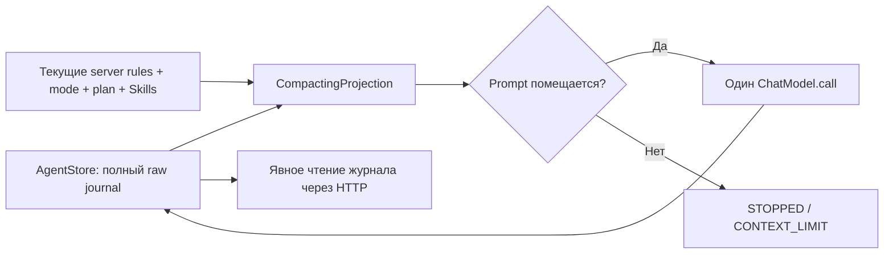

# Урок 5.6. Контекст агента: бюджет, полная история и управляемое сжатие

В 5.5 план стал серверным состоянием: модель может попросить завершить шаг, но Java проверяет реальные чтения. Теперь решим следующую проблему: результаты tools занимают всё больше контекста, хотя часть подробностей уже не нужна для следующего действия.

В конце урока RepoPilot сможет заменить старые завершённые tool exchanges небольшим детерминированным резюме. Исходный журнал останется полным. Вопросы человека, текстовые ответы и текущие правила не будут незаметно выброшены ради лимита.

Старт — [готовый урок 5.5](../../lesson-5.5/README.md). Здесь `lecture` самодостаточен. Все прежние HTTP API, RAG, MCP, approvals, Skills и план сохранены. Новый режим включается отдельным флагом и используется через `/api/context`.

## 1. Результат занятия

Научимся:

- считать в бюджете не только вопрос, но и system rules, схемы tools, Skills, план и предыдущие результаты;
- отделять локальную оценку от token usage, сообщённого inference-сервером;
- строить временную проекцию prompt поверх полного журнала;
- сжимать только завершённые целые обмены, сохраняя корреляцию вызовов;
- оставлять оригинальные цели, ограничения и гипотезы в тексте;
- отказывать до обращения к модели, если обязательная часть не помещается;
- проверять, что сжатие не превратилось в выдачу разрешения или завершение плана.

На объяснение отведите 20 минут, на реализацию 65, на проверку 25 и на разбор ДЗ 10. Никакого дополнительного вызова LLM для summarization в этом уроке нет.

## 2. Две разные истории



**Raw journal** нужен для разбора фактического выполнения: что запросила модель и что вернул инструмент. **Prompt projection** — сообщения, которые отправятся модели в следующем вызове. Их состав может отличаться, но проекция не редактирует исходный журнал.

Это разные задачи. Нельзя «освободить контекст», удалив сведения о действиях из единственного хранилища. Также нельзя автоматически исполнить старый tool call, чтобы восстановить забытый текст.

В учебном `AgentStore` не больше 256 runs и 64 conversations; в committed window остаются последние четыре завершённых turn. Тексты старше этого окна данный проектор не получает. Хранилище находится в RAM и исчезает после перезапуска; долговечный аудит потребует отдельного решения. SQLite-история прежнего чат-среза не является хранилищем нового agent runtime.

## 3. Что расходует контекст

Бюджет входа задаём так:

```text
actualInputBudget = contextWindow - outputReserve - safetyMargin
```

Текущие константы: `outputReserve = 384`, `safetyMargin = 256`. Для окна 16384 реальный входной бюджет равен 15744. Через новый API пользователь дополнительно указывает `maxInputTokens`; эффективный лимит — минимум этого значения и реального входного бюджета.

Вход включает:

| Часть | Откуда берётся | Можно ли выбросить проектору |
| --- | --- | --- |
| System rules и режим | Java-runtime | Нет |
| Текущий план | PlanSession перед каждым вызовом | Нет |
| Каталог и явные Skills | SkillRuntime | Нет |
| Текущий вопрос | Исходный UserMessage | Нет |
| Вопросы и текстовые ответы четырёх старых turns | Committed window | Нет |
| Skill/reference exchanges текущего run и четырёх сохранённых turns | Реальные результаты tools | Нет |
| Последний tool exchange | Текущий журнал | Нет |
| Старые завершённые tool exchanges без текстового рассуждения | Текущий журнал и старые turns | Да, целиком |
| Схемы доступных tools | AgentToolRegistry | Учитываются всегда |

Если assistant приложил текст к tool calls, весь такой exchange тоже защищён: там может оказаться гипотеза или уточнение. Мы не пытаемся определить его смысл эвристикой.

## 4. Оценка и измерение — разные числа

`ToolPromptBudget` сериализует роли, текст, tool calls, аргументы и tool responses, затем добавляет определения tools. После этого применяется учебная оценка `utf8-div3-overhead12-v1`.

Эта оценка не является tokenizer выбранной модели. Размеры JSON в UTF-8 bytes и количество токенов тоже не совпадают. Реальный chat template, tokenizer и реализация inference-сервера могут отличаться.

`AgentRun.report.providerInputTokens` и `providerOutputTokens` — накопленные сведения из ответов сервера. При неизвестном usage не подставляем локальную оценку вместо измерения. `usageComplete` показывает полноту данных.

Новый `context.frames` сообщает оценку каждого admission attempt: полный вход, получившуюся проекцию, оба лимита и факт допуска. Эти значения объясняют принятое решение, но не доказывают точный расход модели.

Связь истории и рабочей памяти подробно разобрана в [Spring AI Chat Memory](https://docs.spring.io/spring-ai/reference/api/chat-memory.html). В нашем ручном loop проекция строится явно, без дополнительного memory advisor.

## 5. Подготовка

Сохраняем Java 25, Spring Boot 4.1.2 и Spring AI 2.0.2. Дополнительных Maven-зависимостей проектору не требуется.

```bash
java -version
./mvnw -version
./mvnw test
./mvnw -f workspace-fixture/pom.xml test
```

Maven должен использовать Java 25. Обычные проверки запускают локальные HTTP-фикстуры Ollama, а не веса модели.

Рабочие файлы нового среза:

```text
src/main/java/dev/myfrei/repopilot/compaction/
├── CompactionPolicy.java
├── CompactingProjection.java
├── ProjectionFrame.java
├── CompactionReport.java
├── ContextRequest.java
├── ContextRuntime.java
├── CompactionConfiguration.java
├── CompactionController.java
└── CompactionExceptionHandler.java
```

Название Spring bean — `compactionController`: прежний `context.ContextController` модуля 2 продолжает существовать. Не создавайте второй bean с тем же простым именем.

## 6. Шаг 1. Добавляем точку проекции в существующий loop

Используем server-owned интерфейс:

```java
@FunctionalInterface
public interface PromptProjection {
    List<Message> project(
        UUID runId,
        List<Message> system,
        List<List<Message>> completedHistory,
        List<Message> current,
        int inputBudget,
        ToIntFunction<List<Message>> estimate);
}
```

`estimate` вызывает настоящий `ToolPromptBudget` конкретного engine, с его схемами и Ollama options. Возвращается новый неизменяемый список сообщений. `null` означает отказ в допуске и приводит к `CONTEXT_LIMIT`.

В [AgentEngine](src/main/java/dev/myfrei/repopilot/agent/AgentEngine.java) порядок следующий:

1. Восстановить текущий system context и план из Java-состояния.
2. Вызвать проектор с копиями списков.
3. Если результат отсутствует, остановить run до identity lookup и model call.
4. Повторно посчитать получившийся prompt самим engine.
5. Вызвать модель только при соблюдении реального input budget.

У старых маршрутов `promptProjection == null`, поэтому их прежнее сокращение истории целыми turns остаётся. На новом маршруте скрытого fallback к удалению UserMessages нет.

При подключённом проекторе нет второго agent loop, дополнительных retries или отдельного запроса LLM. `withPromptProjection` сохраняется при клонировании engine через controlled, Skills и plan runtime.

## 7. Шаг 2. Определяем неделимый tool exchange

Один exchange — assistant message с tool calls и все следующие tool responses, закрывающие эти вызовы.

```text
assistant: calls [A, B]
tool: result A
tool: result B
```

Нельзя удалить только `result A` или оставить его без вызова. Для batch из двух calls проектор либо сохраняет весь блок, либо заменяет весь блок одной записью summary.

`CompactingProjection.split(...)` проходит список и проверяет:

- уникальность call IDs внутри batch;
- наличие всех ответов;
- совпадение имён tools;
- отсутствие неожиданного ToolResponse без assistant calls.

Незавершённый или противоречивый протокол отклоняется. Мы не «исправляем» его синтетическими успешными результатами. Сам AgentEngine уже поддерживает корреляцию; эта проверка защищает границу нового адаптера.

Все обычные UserMessages и AssistantMessages без calls переносятся как исходные объекты. Полный текст не пересказывается и не заменяется hash.

Загрузки Skill/reference защищены консервативно и в старых сохранённых turns. Это увеличивает обязательный минимум. Старый текст по-прежнему не активирует Skill для нового run: доступ проверяет текущая SkillSession, а не наличие инструкции в истории.

## 8. Шаг 3. Отделяем чистую политику выбора

[CompactionPolicy](src/main/java/dev/myfrei/repopilot/compaction/CompactionPolicy.java) не знает Spring, файлов и модели. На входе — хронологические units, их оценки и признак защиты:

```java
var decision = new CompactionPolicy().choose(
    List.of(
        new CompactionPolicy.Unit("old", 900, false),
        new CompactionPolicy.Unit("skill", 700, true),
        new CompactionPolicy.Unit("latest", 1100, true)),
    500);
```

Выбирается целый `old`; защищённые units не выбираются. Политика может убрать больше условных токенов, чем запрошено, потому что не разрезает блок.

Нельзя считать эту разницу точным итоговым выигрышем. Summary тоже занимает место. Поэтому адаптер после каждого выбора заново строит весь prompt и вызывает `estimate`.

Алгоритм:

1. Сформировать полный кандидат.
2. Если он помещается, сохранить его полностью.
3. Иначе выбрать старые допустимые exchanges, начиная с самого раннего.
4. Заменить выбранные блоки summary.
5. Повторно оценить весь кандидат вместе с summary и схемами.
6. Если ещё тесно, продолжить выбор.
7. Если удалить больше нечего, вернуть `null`.

Компрессия маленького результата может оказаться бесполезной: метаданные summary бывают больше исходного текста. Это допустимая причина отказа, а не повод выбросить цель человека.

## 9. Шаг 4. Строим детерминированное резюме

Summary содержит наблюдаемые метаданные, например:

```json
{
  "kind": "DETERMINISTIC_TOOL_SUMMARY_V1",
  "authorization": false,
  "semanticSummary": false,
  "fullPayloadAvailableInRawJournal": true,
  "observations": []
}
```

В реальном массиве observations для каждого исключённого результата сохраняются tool name, call ID, SHA-256 аргументов и результата, доступные `ok`/`code`, а для чтения — путь, версия, диапазон и исходные признаки усечения. Сам content не копируется.

`currentFileState = UNKNOWN_REQUIRES_FRESH_READ` напоминает: старый hash не доказывает текущее содержимое файла. Для точной новой правки требуется обычное актуальное чтение и серверная проверка.

Это **не семантическое резюме разговора**. Мы не делаем вывод «дефект найден» и не переносим гипотезу в разряд фактов. Исходные вопросы и текстовые ответы сохранены дословно; tool I/O сжат до ограниченного описания наблюдения.

Summary передаётся как `UserMessage` с префиксом `COMPACTED_TOOL_DATA`, а не вставляется в system rules. Отдельное фиксированное server rule объясняет, что этот блок — данные. Строка из старого результата «approval=true» не получает дополнительного приоритета.

Полный код: [CompactingProjection.java](src/main/java/dev/myfrei/repopilot/compaction/CompactingProjection.java). Обратите внимание на отдельные `split`, `render` и `summary`.

## 10. Шаг 5. Сохраняем границы полномочий

Проектор не обращается к `decide(APPROVE)`, не меняет PlanSession и не запускает tools. Он получает только сообщения и функцию оценки.

После сжатия:

- режим берётся из текущего ControlledService;
- неизменяемое предложение patch и решение хранятся в ControlledService;
- статус плана повторно добавляется PlanSession перед каждым model call;
- completion gate проверяет обязательные шаги перед финальным commit;
- Skills и их версии остаются server-owned; activation/reference exchanges текущего run и четырёх сохранённых turns защищены;
- read receipts проверяются WorkspaceService по run, пути и версии.

Слова «уже разрешено» в summary не являются решением человека. Фраза модели «план выполнен» не завершает шаг. Если обязательный шаг не закрыт, итог остаётся `PLAN_INCOMPLETE`, даже когда модель прислала корректный final response.

Технический механизм tools описан в [Spring AI Tool Calling](https://docs.spring.io/spring-ai/reference/api/tools.html), а сохранение активированных процедур — в [руководстве Agent Skills](https://agentskills.io/client-implementation/adding-skills-support).

## 11. Шаг 6. Подключаем новый маршрут

`ContextRequest` использует прежний закрытый контракт плана и добавляет одно поле:

```java
public record ContextRequest(PlanRequest task, int maxInputTokens) { }
```

HTTP JSON остаётся плоским: `question`, `mode`, необязательные `skills`, `steps`, `maxInputTokens`. Не добавляйте status, evidence, usage или approved: их источник — сервер.

`ContextRuntime` создаёт один проектор на run:

```java
var projection = new CompactingProjection(request.maxInputTokens());
var result = plans.run(
    conversationId,
    task.question(),
    task.mode(),
    task.skills(),
    task.plan(),
    projection);
var report = projection.report(result.run().id());
```

Результат HTTP содержит привычные `run`, `activations`, `plan` и новый `context`. Отчёты доступны в RAM по run ID, до перезапуска процесса; их bounded хранилище не заменяет raw journal.

Маршруты:

| Операция | Маршрут |
| --- | --- |
| Запуск с проекцией | `POST /api/context/conversations/{id}/runs` |
| Отчёт проекции | `GET /api/context/runs/{id}/report` |
| Полный raw journal | `GET /api/agent/runs/{id}/messages` |
| Текущий план | `GET /api/plans/runs/{id}` |

## 12. Шаг 7. Запускаем локальный пример

Для самостоятельного среза не нужны PostgreSQL и embedding-модель. Прежние RAG/evaluation/diagnostics/query/rerank/tools HTTP-срезы временно выключим флагами; их код остаётся в проекте.

```bash
ollama list
export OLLAMA_CHAT_MODEL='qwen2.5:3b'
export LLM_CONTEXT_WINDOW=16384
./mvnw spring-boot:run -Dspring-boot.run.arguments='--repopilot.rag.enabled=false --repopilot.evaluation.enabled=false --repopilot.diagnostics.enabled=false --repopilot.query.enabled=false --repopilot.rerank.enabled=false --repopilot.tools.enabled=false --repopilot.agent.enabled=true --repopilot.workspace.enabled=true --repopilot.controlled.enabled=true --repopilot.skills.enabled=true --repopilot.plans.enabled=true --repopilot.compaction.enabled=true'
```

Нужна модель с реальным structured tool calling и поддержкой выбранного окна. Само название модели не гарантирует успешный длинный сценарий. Если на вашем компьютере окно не помещается, уменьшите его и измерьте, на какой стадии возникает отказ.

Приложение слушает `127.0.0.1:8080`. Это локальный учебный API без многопользовательской аутентификации. Для полного старого RAG-среза сначала запустите `docker compose up -d`, подготовьте embedding-модель и сохраните прежние настройки вместо отключающих флагов.

Создайте conversation:

```bash
curl -sS -X POST http://127.0.0.1:8080/api/agent/conversations
```

Подставьте id в запрос:

```bash
CONVERSATION_ID='вставьте-реальный-uuid'
curl -sS -X POST "http://127.0.0.1:8080/api/context/conversations/$CONVERSATION_ID/runs" \
  -H 'Content-Type: application/json' \
  -d '{
    "question":"Исследуй StockLedger и тест. Не меняй публичное API и не записывай файлы. Читай реальные диапазоны, закрывай шаги только по доказательствам. Не утверждай, что тесты запущены.",
    "mode":"ASK",
    "skills":[],
    "maxInputTokens":6500,
    "steps":[
      {"id":"code","title":"Прочитать проверку остатка","criterion":"READ_CODE","path":"src/main/java/dev/myfrei/fixture/StockLedger.java","startLine":17,"endLine":25,"dependsOn":[],"required":true},
      {"id":"test","title":"Прочитать тест отказа","criterion":"READ_TEST","path":"src/test/java/dev/myfrei/fixture/StockLedgerTest.java","startLine":12,"endLine":15,"dependsOn":["code"],"required":true}
    ]
  }'
```

Диапазоны относятся к поставляемому fixture. При изменении исходников сначала перепроверьте строки. Модель должна использовать `startPlanStep`, `readFile`, `completePlanStep`; обычный финальный текст без этого будет остановлен completion gate.

На маленьком Stock Room число `compactedExchanges` может быть нулевым. Это корректно: не нужно сжимать помещающийся prompt. Для воспроизводимого примера с большими результатами далее есть HTTP integration test.

## 13. Шаг 8. Сравниваем projection и raw journal

```bash
RUN_ID='вставьте-run-id'
curl -sS "http://127.0.0.1:8080/api/context/runs/$RUN_ID/report"
curl -sS "http://127.0.0.1:8080/api/agent/runs/$RUN_ID/messages"
curl -sS "http://127.0.0.1:8080/api/plans/runs/$RUN_ID"
```

В frames проверьте:

- `fullEstimatedTokens` — оценка до сжатия для этого admission attempt;
- `projectedEstimatedTokens` — оценка последнего построенного кандидата;
- `actualInputBudget` — окно минус output reserve и safety margin;
- `effectiveInputBudget` — ещё и с учётом maxInputTokens;
- `compactedExchanges`, `omittedToolBytes`, `summaryBytes` — что изменилось;
- `admitted` — был ли кандидат допущен;
- `omittedCurrentCallIds` — только исключённые calls текущего run.

Frames не обязательно соответствуют только успешным model calls: отказ тоже создаёт запись; перед проверкой общего лимита loop может построить ещё один кандидат. Сопоставляйте их по порядку, а не считайте каждый frame обращением к модели.

При `null`-проекции Engine не получает новый список. Поэтому `run.report.estimatedInputTokens` может хранить последнюю принятую оценку, а актуальная отклонённая оценка находится в последнем `context.frames`. В usage не переносим ни одно из этих чисел.

Полный raw journal должен содержать оригинальный tool result, даже когда в последнем prompt он заменён summary. В этом уроке подробности можно просмотреть явно через HTTP или заново прочитать разрешённым tool. Автоматического повторного исполнения старых вызовов нет.

## 14. Шаг 9. Проверяем отказ и незавершённый план

Повторите запрос в новой conversation с `maxInputTokens: 1`. Ожидается `STOPPED / CONTEXT_LIMIT`, `modelCalls: 0`, `toolCalls: 0` и `admitted: false` в отчёте. Приложение должно освободить active run, чтобы conversation можно было использовать снова.

Затем попробуйте получить финальный ответ модели без завершения обоих обязательных шагов. Ожидаемый stop reason — `PLAN_INCOMPLETE`; незавершённый turn не попадает в committed conversation history.

Сжатие не удаляет обязательные требования плана и не меняет их пути. `revisePlanStep` из 5.5 сбрасывает прогресс по прежним требованиям, а не заменяет их более удобным заданием.

Если все старые exchanges защищены или summary всё ещё слишком велико, runtime останавливается. Это лучше считать явным результатом проверки входного бюджета. Измените задачу, лимит или допустимый размер результатов; не скрывайте потерю ограничений.

## 15. Автоматические проверки

```bash
./mvnw test
./mvnw -Dtest='CompactionPolicyTest,CompactingProjectionTest,CompactionHttpIntegrationTest' test
./mvnw -f workspace-fixture/pom.xml test
npm ci
npm test
```

Новые проверки покрывают:

1. Выбор старых целых units и защиту обязательных частей.
2. Два tool calls в одном assistant batch и два коррелированных ответа.
3. Дословное сохранение старого вопроса, гипотезы и текущего задания.
4. Защиту Skill/reference exchanges и последнего результата.
5. Отсутствие model/identity calls при недостаточном минимуме.
6. Реальные `readFile` и plan tools через производственный OllamaChatModel HTTP.
7. Отличие полного журнала от отправленного prompt.
8. Сохранение `PLAN_INCOMPLETE` после сжатия.
9. Новый run в той же conversation без изменения старого raw journal.

HTTP-фикстура использует большие, но разрешённые результаты чтения. Это проверяет механизм на конкретном шумном входе, а не качество реальной локальной LLM. Проверьте реальные ответы отдельно и заполните [Context-Experiment.md](evaluation/Context-Experiment.md).

Профили PostgreSQL/pgvector и MCP child-process проверок сохранены. Какие проверки выполнены заново и какие не повторялись, указано в [VERIFICATION.md](../VERIFICATION.md). Наличие зелёной фикстуры не доказывает, что модель правильно использует summary или обязательно решит задачу в пределах шести model calls.

## 16. Домашнее задание: ограниченное восстановление результата

Загрузчик, projector, plan loop и HTTP-приложение уже готовы. В [homework](../homework/README.md) добавляется отдельный journal recall: проверить запрос на несколько результатов чтения из **того же run**, вернуть целые JSON envelopes в установленном лимите и не выдать старую версию за актуальную.

Студент реализует `ToolRecallPolicy`. Предоставленные adapters сопоставляют calls и replies, проверяют allowlist и структуру результатов. Реконструкция не исполняет инструменты заново, не отдаёт произвольные вопросы человека и не создаёт новые read receipts.

Это самостоятельное развитие проекта: после сжатия пользователь получает контролируемый способ посмотреть сохранённые подробности. Переписывать compaction или делать ещё один agent loop не требуется.

## 17. Полезные источники

- [Spring AI Chat Memory](https://docs.spring.io/spring-ai/reference/api/chat-memory.html) — рабочая память и история сообщений.
- [Spring AI Tool Calling](https://docs.spring.io/spring-ai/reference/api/tools.html) — исполнение tools под управлением приложения.
- [Spring AI Observability](https://docs.spring.io/spring-ai/reference/observability/index.html) — измерения и модельная телеметрия.
- [Agent Skills: управление контекстом](https://agentskills.io/client-implementation/adding-skills-support) — сохранение активированных процедур.
- [Java 25 MessageDigest](https://docs.oracle.com/en/java/javase/25/docs/api/java.base/java/security/MessageDigest.html) — hash как идентификатор данных.

Следующий урок добавит ограниченный запуск проверок. Тогда слова «я прочитал тест» и «я запустил актуальную проверку» получат разные серверные свидетельства.
