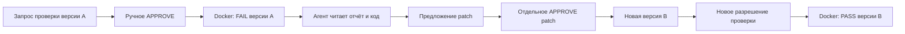

# Урок 5.7. Изолированная проверка: FAIL → правка → PASS

RepoPilot уже умеет исследовать файлы, сохранять план и предлагать точный patch. Но строка «исправлено» пока не подтверждает поведение программы. В этом уроке добавим фиксированную проверку StockLedger в отдельном Docker-контейнере и свяжем её с конкретной версией исходника.

Результат: человек разрешает проверку точных входов, приложение получает реальный FAIL, агент читает этот отчёт и предлагает patch. После отдельного разрешения на запись новая версия проверяется по новому разрешению и получает PASS. Каждый результат имеет input hash, image ID, exit code и время исполнения.

## 1. Границы проверяемого продукта

Старт — [готовый урок 5.6](../../lesson-5.6/README.md). В этой папке сохранены прежние чат, SQLite, RAG, MCP, Skills, план и compaction. Новые endpoints включаются отдельно.

Команда называется `STOCKROOM_CONTRACT_V1`. Она компилирует **один** файл `src/main/java/dev/myfrei/fixture/StockLedger.java` и проверяет пять заранее заданных бизнес-условий:

1. Частичное резервирование уменьшает только нужный остаток.
2. Отказ из-за нехватки не меняет остаток.
3. Резервирование всего доступного остатка разрешено.
4. Недопустимое количество и неизвестный SKU отклоняются.
5. Snapshot независим и неизменяем.

Это не полный Maven build, не весь набор JUnit-тестов проекта и не универсальный shell. Название команды и scope видны в отчёте.

Корректный `workspace-fixture` предыдущих уроков сохранён. Для эксперимента подготовлен отдельный [verification-lab](verification-lab/README.md): в нём намеренно испорчена граница резервирования. Сначала ожидается FAIL, а не зелёный результат.

## 2. Почему не запускаем mvn test на host

В исследуемом репозитории POM, плагины, wrapper и тесты могут содержать исполняемый код. Запустить его обычным ProcessBuilder на компьютере пользователя — значит дать ему права нашего приложения.

Наш host выполняет только фиксированные команды Docker CLI. В контейнер передаётся отдельный снимок одного Java-файла. Ни POM, ни `.m2`, ни `.git`, ни host workspace целиком, ни Docker socket не монтируются.

Сам Java-код target всё равно исполняется. Для этого контейнер имеет отдельную файловую систему, отключённую внешнюю сеть, непривилегированного пользователя и ограничения ресурсов. Это реальные ограничения процесса, а не просьба в system prompt. Возможности `docker create/run` описаны в [официальной документации Docker](https://docs.docker.com/reference/cli/docker/container/run/).

Docker-контейнер не является математическим доказательством безопасности или корректности программы. В Linux он использует ядро Docker-host; в Docker Desktop добавляется VM. Для произвольных враждебных репозиториев может понадобиться более строгая среда. Учебный результат — воспроизводимая изоляция выбранного контракта с проверяемыми ограничениями.

## 3. Подготовка проекта

Остаёмся на Java 25, Spring Boot 4.1.2 и Spring AI 2.0.2. Новая библиотека для исполнения команд не нужна.

```bash
java -version
./mvnw -version
./mvnw test
npm ci
npm test
./mvnw -f workspace-fixture/pom.xml test
```

Обычные Java-тесты проверяют service, policy, API и HTTP-интеграцию с моделью через фикстуру; Docker для них не требуется. Реальные проверки контейнера выделены в профиль `runner-it`.

Для ручного примера нужны работающий Docker и Ollama с моделью, поддерживающей tools. Факт обычного ответа модели не доказывает способность выполнить весь workflow.

Ориентир занятия: 20 минут на границы исполнения, 60 на реализацию, 30 на негативные проверки и 10 на ДЗ.

## 4. Два разных разрешения



Разрешение проверки не разрешает запись. Разрешение patch не разрешает новый запуск. В тексте модели нет способа объявить approval выданным.

В 5.7 ручные approvals по-прежнему относятся к локальному учебному API на `127.0.0.1`. Здесь нет многопользовательской авторизации; не публикуйте эти endpoints в сеть.

## 5. Фиксируем image, command и input revision

`VerificationRequest` сохраняет server-owned данные:

```java
public record VerificationRequest(
        UUID id,
        UUID conversationId,
        String command,
        String inputRevision,
        String imageId,
        String status,
        Instant createdAt,
        Instant expiresAt) { }
```

`command` может иметь только значение `STOCKROOM_CONTRACT_V1`. `imageId` — конкретный локальный `sha256:...`, а не изменяемый tag. Время жизни разрешения — пять минут; на точной границе expiresAt оно уже недействительно.

В этом уроке `inputRevision` — SHA-256 manifest **проверяемого входа**, а не всего Git-репозитория:

```java
String sourceHash = Hashes.sha256(sourceText);
String inputRevision = Hashes.sha256(AgentJson.canonical(
        Map.of(VerificationService.SOURCE, sourceHash)));
```

Изменение исходника означает другую проверяемую версию. Изменение POM не исполняется этой командой вообще. Scope нельзя незаметно расширить названием «проверка проекта».

Снимок для runner не создаёт read receipt модели. Для предложения patch агент отдельно вызывает readFile и получает обычный same-run receipt.

## 6. Собираем неизменяемый образ

В `verification-runner` находятся доверенные `VerificationMain.java`, `Probe.java` и Dockerfile. Эти файлы являются частью нашего приложения; они не берутся из target workspace.

```dockerfile
FROM eclipse-temurin:25-jdk@sha256:83f4a7fc27df94dcc7b8de04d14cbbba8da14406f921e966969c3b09000aa507
WORKDIR /opt/verifier
COPY VerificationMain.java /opt/source/VerificationMain.java
COPY Probe.java /opt/probe/Probe.java
RUN javac --release 25 -d /opt/verifier /opt/source/VerificationMain.java
USER 65532:65532
ENTRYPOINT ["java","-XX:+DisableAttachMechanism","-Xmx192m","-Djava.io.tmpdir=/build","-cp","/opt/verifier","dev.course.verifier.VerificationMain"]

```

Base image закреплён digest. После сборки используем конкретный ID получившегося образа:

```bash
docker build --pull=false --iidfile /tmp/repopilot57-image.id   -t repopilot-stockroom-contract:lesson57 verification-runner
cat /tmp/repopilot57-image.id
export REPOPILOT_VERIFIER_IMAGE_ID="$(cat /tmp/repopilot57-image.id)"
```

Сохраните фактический ID. Другой локальный build может получить другой ID; разрешение должно ссылаться на тот образ, который вы действительно запускаете. В verification path стоит `--pull=never`: проверка не скачивает неожиданную замену образа.

## 7. Доверенный parent и исполняемый target child

Нельзя считать любой `System.exit(0)` внутри исследуемого класса успешным тестом. Поэтому parent не загружает StockLedger в свой JVM.

Он компилирует исходник с фиксированным `Probe.java`, запускает отдельный child JVM и проверяет полученные наблюдения. Отсутствие полного протокола, лишний вывод в stdout, ненулевой child exit и timeout не превращаются в PASS.

Полный доверенный entrypoint:

```java
package dev.course.verifier;

import java.io.*;
import java.nio.charset.StandardCharsets;
import java.nio.file.*;
import java.util.*;
import java.util.concurrent.*;
import javax.tools.ToolProvider;

/** Trusted image entrypoint. Target classes are compiled here but executed only in a child JVM. */
public final class VerificationMain {
  public static void main(String[] ignored) throws Exception {
    Path input = Path.of("/input/src/main/java/dev/myfrei/fixture/StockLedger.java");
    Path classes = Files.createDirectories(Path.of("/build/classes"));
    int compilation =
        ToolProvider.getSystemJavaCompiler()
            .run(
                null,
                System.out,
                System.err,
                "-proc:none",
                "--release",
                "25",
                "-encoding",
                "UTF-8",
                "-Xmaxerrs",
                "20",
                "-d",
                classes.toString(),
                input.toString(),
                "/opt/probe/Probe.java");
    if (compilation != 0) {
      System.out.println("COMPILE_FAILED");
      System.exit(10);
    }
    var child =
        new ProcessBuilder(
                "java",
                "-Xmx64m",
                "-XX:+DisableAttachMechanism",
                "-Djava.io.tmpdir=/build",
                "-cp",
                classes.toString(),
                "dev.course.verifier.Probe")
            .start();
    child.getOutputStream().close();
    var stdout = new ByteArrayOutputStream();
    var stderr = new ByteArrayOutputStream();
    var limited = new java.util.concurrent.atomic.AtomicBoolean();
    Thread out = Thread.ofVirtual().start(() -> drain(child.getInputStream(), stdout, limited));
    Thread err = Thread.ofVirtual().start(() -> drain(child.getErrorStream(), stderr, limited));
    if (!child.waitFor(12, TimeUnit.SECONDS)) {
      child.destroyForcibly();
      child.waitFor(1, TimeUnit.SECONDS);
      System.out.println("PROBE_TIMEOUT");
      System.exit(124);
    }
    out.join(1000);
    err.join(1000);
    if (limited.get()) System.err.println("PROBE_OUTPUT_TRUNCATED");
    System.err.write(stderr.toByteArray());
    String observed = stdout.toString(StandardCharsets.UTF_8).strip();
    if (child.exitValue() != 0
        || out.isAlive()
        || err.isAlive()
        || !observed.matches(
            "OBS_V1\\|(?:true|false)\\|-?[0-9]+\\|-?[0-9]+\\|(?:true|false)\\|-?[0-9]+\\|(?:true|false)\\|-?[0-9]+\\|(?:true|false)\\|(?:true|false)\\|(?:true|false)\\|(?:true|false)")) {
      System.out.println("PROBE_PROTOCOL_ERROR childExit=" + child.exitValue());
      System.err.write(stderr.toByteArray());
      System.exit(20);
    }
    String[] parts = observed.split("\\|", -1);
    boolean[] checks = {
      parts[1].equals("true") && parts[2].equals("1") && parts[3].equals("2"),
      parts[4].equals("false") && parts[5].equals("3"),
      parts[6].equals("true") && parts[7].equals("0"),
      parts[8].equals("true") && parts[9].equals("true"),
      parts[10].equals("true") && parts[11].equals("true")
    };
    String[] names = {
      "partial-reservation",
      "insufficient-stock-unchanged",
      "exact-stock-reservation",
      "invalid-input-rejected",
      "snapshot-independent-immutable"
    };
    boolean passed = true;
    for (int i = 0; i < checks.length; i++) {
      System.out.println(names[i] + "=" + (checks[i] ? "PASS" : "FAIL"));
      passed &= checks[i];
    }
    System.out.println("STOCKROOM_CONTRACT_V1 checks=5");
    System.exit(passed ? 0 : 10);
  }

  private static void drain(
      InputStream input,
      ByteArrayOutputStream output,
      java.util.concurrent.atomic.AtomicBoolean limited) {
    try (input) {
      byte[] buffer = new byte[1024];
      int n;
      while ((n = input.read(buffer)) != -1) {
        int remaining = 8192 - output.size();
        if (remaining > 0) output.write(buffer, 0, Math.min(remaining, n));
        if (n > remaining) limited.set(true);
      }
    } catch (IOException ignored) {
    }
  }
}

```

`Probe.java` создаёт StockLedger с известными данными и возвращает конкретные наблюдения: boolean результата, остатки и признаки исключений. Решения по пяти условиям вычисляет неизменяемый parent. Строка target «PASS» сама по себе не принимается.

Опция `-proc:none` исключает запуск annotation processors при компиляции; список source paths фиксирован. Параметры компилятора см. в [Java25 javac](https://docs.oracle.com/en/java/javase/25/docs/specs/man/javac.html).

Это всё ещё тестирование поведения, а не защита от любой возможной подделки исследуемой программой. Доверенный parent и строгий протокол исключают простой обход через ранний exit, но passing контракт не доказывает отсутствие иного поведения программы.

## 8. Создаём контейнер с ограничениями

`DockerVerificationRunner.createCommand` строит argv из фиксированных параметров. Путь снимка и случайное имя контейнера задаёт сервер; shell не используется.

```java
  public static List<String> createCommand(String imageId, Path snapshot, String name) {
    if (imageId == null
        || !imageId.matches("sha256:[0-9a-f]{64}")
        || name == null
        || !name.matches("repopilot-check-[0-9a-f-]{36}")
        || snapshot == null)
      throw new IllegalArgumentException("Exact image and owned container required");
    String source = snapshot.toAbsolutePath().normalize().toString();
    if (source.contains(",") || source.contains("\n"))
      throw new IllegalArgumentException("Unsupported snapshot path");
    return List.of(
        "docker",
        "create",
        "--pull=never",
        "--name",
        name,
        "--label",
        "repopilot.verification=owned",
        "--network",
        "none",
        "--user",
        "65532:65532",
        "--read-only",
        "--cap-drop",
        "ALL",
        "--security-opt",
        "no-new-privileges=true",
        "--memory",
        "512m",
        "--memory-swap",
        "512m",
        "--cpus",
        "1",
        "--pids-limit",
        "64",
        "--ulimit",
        "nofile=128:128",
        "--tmpfs",
        "/build:rw,noexec,nosuid,size=67108864,mode=1777",
        "--mount",
        "type=bind,src=" + source + ",dst=/input,readonly",
        imageId);
  }
```

Ключевые границы: readonly input, readonly root, UID65532, no-new-privileges, удалённые capabilities, внешняя сеть none, память512MiB, один CPU, максимум64PIDs. `/build` — отдельный ограниченный writable tmpfs; host build directory не монтируется.

Temp snapshot создаётся host-приложением. Каталоги получают755, файл444, чтобы непривилегированный пользователь контейнера мог прочитать только переданные данные. По умолчанию временный каталог часто имеет700; без явной настройки контейнерный UID его не прочитает.

`WorkspaceService.snapshotBytes` использует прежние проверки разрешённого пути, symlinks, UTF-8 и размера. После копирования файл остаётся readonly для контейнера.

## 9. Запуск и обязательная очистка

Runner выполняет последовательность:

```text
create fixed container
→ start --attach
→ inspect actual container state
→ rm --force exact owned container in finally
```

Локальный Docker CLI — клиент. Убить его по timeout недостаточно: контейнер мог продолжить работу. Поэтому имя создаётся один раз, а finally удаляет именно этот контейнер независимо от исхода.

Stdout и stderr читаются одновременно отдельными потоками с лимитами. Лишние байты отбрасываются, выставляется outputTruncated, каналы продолжают дренироваться, чтобы процесс не завис на заполненной трубе.

Общий default timeout —30секунд; child probe имеет собственный предел12секунд. Нет fallback к host execution и нет произвольной строки shell при ошибке Docker.

Фактический exit берётся из `docker inspect .State`, а не только из exit code клиента `docker start`. OOM, неизвестное состояние и ошибка очистки не считаются успешным тестом.

## 10. Approval: сначала повторная проверка версии

В `VerificationService.decide` под короткой синхронизацией выполняются проверки:

```java
if (!request.status().equals("PENDING")) {
    throw new VerificationProblem("VERIFICATION_NOT_PENDING");
}
if (!clock.instant().isBefore(request.expiresAt())) {
    // Сохраняем EXPIRED; команда не исполняется.
}
if (!request.inputRevision().equals(currentRevision())) {
    // Сохраняем STALE; старый snapshot не выдаётся за текущую версию.
}
```

После проверки разрешение становится RUNNING, резервируется попытка, monitor освобождается. Docker работает вне monitor: GET состояния не блокируется на весь процесс. Второй одновременный запуск отклоняется как VERIFICATION_BUSY.

После процесса снова сравниваем revision. Если workspace успели изменить, отчёт становится STALE, даже когда старый snapshot завершился с exit0. Никакого применения изменений из контейнера обратно в workspace нет.

Переходы и cleanup реализованы полностью в [VerificationService.java](src/main/java/dev/myfrei/repopilot/verification/VerificationService.java).

## 11. Отчёт и смысл статусов

```java
package dev.myfrei.repopilot.verification;

import java.time.Instant;
import java.util.UUID;

public record VerificationReport(
    UUID id,
    UUID requestId,
    UUID conversationId,
    String command,
    String inputRevision,
    String imageId,
    String status,
    Integer exitCode,
    String stdout,
    String stderr,
    boolean outputTruncated,
    boolean inputsStillCurrent,
    Instant startedAt,
    Instant finishedAt,
    double elapsedMs,
    String reason) {}

```

| Status | Значение |
| --- | --- |
| PASS | Неизменяемый контракт завершился exit0 для проверяемой версии |
| FAIL | Контракт завершился своим test-failure exit10 |
| TIMEOUT | Не получено нормальное завершение в лимите |
| ERROR | Infrastructure, OOM, protocol или unknown-state ошибка |
| STALE | Проверенный snapshot уже не соответствует текущему исходнику |

`inputsStillCurrent` в сохранённом отчёте относится к **finishedAt**. GET отчёта возвращает исторический immutable результат и не обещает свежесть через час. Tool readVerification и typed summary отдельно повторно проверяют live revision.

OutputTruncated сообщает об усечении текста. Если actual exit достоверно получен, усечение stderr само по себе не превращает завершённую проверку в UNKNOWN. Для timeout или неизвестного состояния нельзя выводить PASS из обрывка лога.

## 12. Ограниченные попытки и отсутствие прогресса

На одну комбинацию фиксированного command, image и input revision допускается не больше двух запусков в этом in-memory service. Второй PASS разрешён для сравнения. Два FAIL без изменения входа приводят к VERIFICATION_NO_PROGRESS при следующем запросе; остальные исчерпанные серии — VERIFICATION_ATTEMPT_LIMIT.

Это не автоматический retry. Для каждой попытки человек создаёт новый request и выдаёт новое approval. После неясного запуска runner не пытается молча повторить действие.

Новая версия исходника имеет другой revision и может быть проверена снова. Само изменение hash ещё не доказывает полезный прогресс: человек должен ревьюить patch и результат.

## 13. Передаём реальные результаты модели

Новый read-only tool:

```text
readVerification(reportId)
```

Он читает сохранённый отчёт только той conversation, которой принадлежит текущий AgentToolContext. Возвращаются status, command, input revision, image ID, exit code, признак текущей версии и ограниченные excerpts. Команда при этом не запускается и разрешение не создаётся.

Новый `/api/verified/.../runs` проходит через прежний ContextRuntime → PlanRuntime → SkillRuntime → ControlledService → AgentEngine. Добавляется только один tool; второй agent loop не появляется.

В planned verification run доступны13tools. Предел registry явно увеличен до16, а лимиты исполнения остались6model calls и8tool requests. Старые общие beans остаются восемью.

## 14. Разделяем завершение чтения и проверенный результат

`run.status=COMPLETED` по-прежнему относится к критериям READ_CODE/READ_TEST плана. Диагностический run должен уметь закончить исследование и предложить patch при failing проверке.

Поэтому новый ответ дополнительно содержит `verification`:

```json
{
  "state": "CHECKED_FAIL",
  "reportId": "actual-server-report-id",
  "inputRevision": "actual-current-input-revision"
}
```

Варианты: CHECKED_PASS, CHECKED_FAIL, STALE и UNVERIFIED. Summary берётся с сервера по последнему отчёту той же conversation и текущей версии, а не из текста модели. После patch старый PASS становится STALE для live summary.

## 15. Запускаем failing lab

Из `lesson-5.7/lecture`, после сборки image:

```bash
export OLLAMA_CHAT_MODEL=qwen2.5:3b
export LLM_CONTEXT_WINDOW=24000
./mvnw spring-boot:run -Dspring-boot.run.arguments="--repopilot.rag.enabled=false --repopilot.evaluation.enabled=false --repopilot.diagnostics.enabled=false --repopilot.query.enabled=false --repopilot.rerank.enabled=false --repopilot.tools.enabled=false --repopilot.agent.enabled=true --repopilot.workspace.enabled=true --repopilot.controlled.enabled=true --repopilot.skills.enabled=true --repopilot.plans.enabled=true --repopilot.compaction.enabled=true --repopilot.verification.enabled=true --repopilot.workspace.root=./verification-lab --repopilot.verification.image-id=$REPOPILOT_VERIFIER_IMAGE_ID"
```

Для этого сценария PostgreSQL не нужен: прежние DB-зависимые режимы отключены только флагами запуска. Skills берутся из поставляемого `workspace-fixture/.agents/skills`; исследуемый исходник — из отдельного lab.

```bash
curl -sS -X POST http://127.0.0.1:8080/api/agent/conversations
CONVERSATION_ID='вставьте-реальный-id'
curl -sS -X POST "http://127.0.0.1:8080/api/verification/conversations/$CONVERSATION_ID/requests"   -H 'Content-Type: application/json' -d '{"command":"STOCKROOM_CONTRACT_V1"}'
```

Сверьте command, imageId, inputRevision и expiresAt. Пока статус PENDING, ничего не запущено.

```bash
REQUEST_ID='вставьте-id-проверенного-request'
curl -sS -X POST "http://127.0.0.1:8080/api/verification/requests/$REQUEST_ID/decision"   -H 'Content-Type: application/json' -d '{"decision":"APPROVE"}'
curl -sS "http://127.0.0.1:8080/api/verification/conversations/$CONVERSATION_ID/reports"
```

Ожидаем FAIL, exit10 и `exact-stock-reservation=FAIL`. Сохраните фактический reportId. Если Docker недоступен или image неверен, это ERROR, а не доказательство дефекта.

## 16. Агент исследует отчёт и предлагает patch

Сохраните `verified-request.json`, заменив REPORT_ID реальным ID:

```json
{
  "question": "Вызови readVerification для reportId REPORT_ID. Прочитай StockLedger и предложи точечное исправление причины failing exact-stock-reservation. Выполни шаг code; сначала startPlanStep и readFile, затем completePlanStep и proposePatch. Не считай patch применённым и не утверждай, что новая проверка уже прошла.",
  "mode": "EDIT",
  "maxInputTokens": 16000,
  "steps": [{
    "id": "code",
    "title": "Исследовать границу резервирования",
    "criterion": "READ_CODE",
    "path": "src/main/java/dev/myfrei/fixture/StockLedger.java",
    "startLine": 17,
    "endLine": 22,
    "dependsOn": [],
    "required": true
  }]
}
```

```bash
curl -sS -X POST "http://127.0.0.1:8080/api/verified/conversations/$CONVERSATION_ID/runs"   -H 'Content-Type: application/json' --data-binary @verified-request.json
```

Модель может ошибиться в tool calling или исчерпать бюджет. Смотрите фактические messages, plan и typed verification summary. Убедительный текст не заменяет серверный proposal.

```bash
RUN_ID='вставьте-run.id'
curl -sS "http://127.0.0.1:8080/api/controlled/runs/$RUN_ID/proposals"
curl -sS "http://127.0.0.1:8080/api/agent/runs/$RUN_ID/messages"
```

Ожидаем точную замену ошибочного сравнения после актуального чтения. Просмотрите diff и только затем подтвердите:

```bash
PROPOSAL_ID='вставьте-id-просмотренного-patch'
curl -sS -X POST "http://127.0.0.1:8080/api/controlled/proposals/$PROPOSAL_ID/decision"   -H 'Content-Type: application/json' -d '{"decision":"APPROVE"}'
```

## 17. Новая версия требует новой проверки

Повторите создание verification request для той же conversation. Сверьте, что inputRevision изменился. Старое approval повторно использовать нельзя.

После нового APPROVE ожидаем PASS, exit0 и пять успешных условий. История содержит разные revisions для исходного FAIL и исправленного PASS.

Если хотите получить новое объяснение модели, передайте ей новый reportId через `/api/verified/.../runs`. Typed summary покажет CHECKED_PASS только для совпадающей текущей версии. Сохраните diff и реальные отчёты в [бланке эксперимента](evaluation/Verification-Experiment.md).

## 18. Проверки и негативные сценарии

```bash
./mvnw test
./mvnw -Prunner-it -Dverification.image="$REPOPILOT_VERIFIER_IMAGE_ID" verify
./mvnw -Ppgvector-it verify
npm test
```

Default suite не запускает Docker runner: HTTP-тест использует настоящий Boot/Ollama HTTP и injected verification backend. Профиль runner-it запускает настоящий собранный image.

Docker IT проверяют: FAIL → отдельное чтение и manual patch approval → новая проверка PASS; ранний System.exit0 в target не даёт PASS; запреты записи input, сети и socket; writable build tmpfs; timeout с удалением owned container; усечение output; stale approval и replay.

Service-тесты проверяют TTL, состояния, ограничение попыток, отсутствие автоматического retry, concurrent approval и scoped read-only report tool. В HTTP-тестах отдельно проверено, что run.COMPLETED может сопровождаться CHECKED_FAIL, а внешний edit даёт STALE.

Для ручных негативных проверок создавайте новые requests: REJECT не запускает command; изменение файла между request и APPROVE даёт VERIFICATION_STALE; повтор APPROVE даёт VERIFICATION_NOT_PENDING.

## 19. Домашнее задание: стабильность исторической серии

В [homework](../homework/README.md) уже готов весь runner, approvals и агентский путь. Новая VerificationStabilityPolicy анализирует выбранную серверную серию отчётов без повторного запуска.

Задача: сгруппировать результаты по command, input revision и image, различить consistent pass/fail, противоречивые и неполные наблюдения, правильно учесть дубликаты и scope. TIMEOUT/ERROR не выдаются за доказанный test failure.

Это историческая диагностика, а не обещание текущего PASS и не статистическая гарантия отсутствия flaky поведения. Полный контракт и восемь новых acceptance tests находятся в README ДЗ. Студент не переписывает Docker execution или fail→fix→pass workflow.

## 20. Материалы и ограничения

- [Docker container run](https://docs.docker.com/reference/cli/docker/container/run/) — ограничения ресурсов, mounts и execution settings.
- [Java25 javac](https://docs.oracle.com/en/java/javase/25/docs/specs/man/javac.html) — фиксированная компиляция и annotation processing.
- [Spring AI Tool Calling](https://docs.spring.io/spring-ai/reference/api/tools.html) — модель запрашивает операцию, приложение управляет её исполнением.
- [Предыдущий урок: compaction](../../lesson-5.6/README.md).
- [Следующий урок: исследовательский субагент](../../lesson-5.8/README.md).

Проверяется пять конкретных свойств StockLedger на зафиксированной версии. Полезность patch, полнота проверок и интерпретация отчёта остаются предметом ревью. Следующий урок добавит ограниченное делегирование исследования, сохраняя эти границы исполнения и разрешений.
