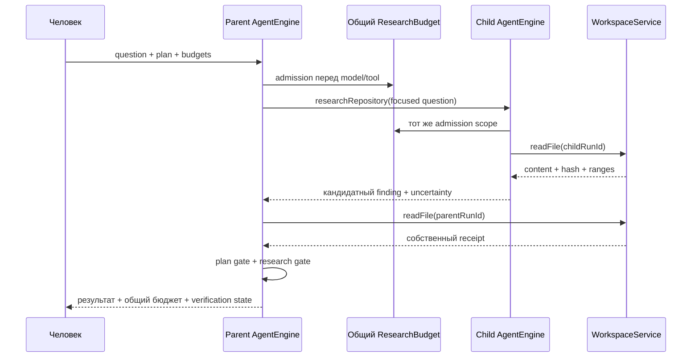

# Урок 5.8. Исследовательский субагент с отдельным контекстом

[Материалы урока](../README.md) · [Домашнее задание](../homework/README.md) · [Тесты примера](src/test/java/dev/myfrei/repopilot/research/) · [Все уроки](../../../README.md#программа)

В 5.7 RepoPilot получил ограниченную проверку StockLedger в Docker и различимые состояния `CHECKED_PASS`, `CHECKED_FAIL`, `STALE`, `UNVERIFIED`. Теперь добавим исследователя: отдельный короткий запуск, который читает проект и возвращает родителю небольшой отчёт.

К концу урока пройдём цепочку **задача родителю → focused question → отдельное чтение → кандидатный вывод с цитатой → повторное чтение родителем → финал**. У обоих запусков будет общий бюджет. Отмена родителя станет видна дочернему запуску на ближайшей проверяемой границе.

Старт — [урок 5.7](../../lesson-5.7/README.md). Этот `lecture` самодостаточен. Старые маршруты сохранены; исследование включается отдельно через `/api/research`. ДЗ находится в [homework](../homework/README.md) и добавляет план повторного чтения цитат, а не второй исследовательский loop.

## 1. Зачем отдельный контекст

Если модель уже получила большой объём кода, исследование соседнего участка увеличивает тот же prompt. Субагент позволяет начать ограниченный вопрос с чистого контекста и вернуть короткий результат.

Это имеет цену: дополнительные обращения к модели, задержку и необходимость перепроверить вывод. Для маленького проекта обычное чтение главным агентом часто проще. Качество делегирования нужно измерять на одной задаче, а не считать его улучшением по определению.

В этом уроке «отдельный» означает **другие сообщения и состояние**. Дочерний loop выполняется синхронно внутри инструмента родителя. Параллельного пула исследователей и распределённого agent framework здесь нет.

Рекомендации по контексту и необязательному делегированию есть в [руководстве Agent Skills](https://agentskills.io/client-implementation/adding-skills-support). Наши бюджеты, отчёты и границы исполнения — собственный учебный контракт RepoPilot.

## 2. Архитектура одного подзапуска



У ребёнка новый `AgentStore`, новая conversation и новый run ID. Он использует ту же модель и workspace, но не получает список сообщений родителя.

Родитель получает только структурированный отчёт. Полный журнал ребёнка можно явно посмотреть отдельным HTTP-запросом; он не копируется автоматически в prompt родителя.

## 3. Какие инструменты доступны

| Контекст | Доступные операции |
| --- | --- |
| Parent research route | 5 workspace tools + proposePatch + 2 Skills + 4 plan tools + readVerification + researchRepository |
| Child | Только listFiles, searchText, readFile |
| Человек | Прежние ручные решения по patch и проверке; новый запрос отмены |

У родителя 14 определений tools; максимальный размер registry — 16. У ребёнка ровно 3. Лимит поднят явно, схемы входят в `ToolPromptBudget`. Старый `/api/agent` сохраняет свои восемь tools; новые инструменты не добавляются общими Spring beans.

Ребёнок не получает `proposePatch`, `readVerification`, MCP, Skills, план, запуск команд или `researchRepository`. Попытка запросить неизвестный tool заканчивается `TOOL_NOT_ALLOWED`. Глубина делегирования ограничена одним уровнем, количество детей — одним на родителя.

Тот факт, что модель может написать имя инструмента в тексте, не создаёт операцию. Исполнением владеет приложение. [Spring AI Tool Calling](https://docs.spring.io/spring-ai/reference/api/tools.html).

## 4. Что именно ограничиваем

Каждый AgentEngine сохраняет прежние пределы: 6 model calls и 8 tool calls. Поверх них вводится один общий admission scope:

| Предел | По умолчанию | Максимум запроса |
| --- | --- | --- |
| Model calls parent + child | 8 | 8 |
| Принятые tool requests parent + child | 12 | 12 |
| Сумма локальных token reservations | 48000 | 131072 |
| Дети на parent | 1 | Не меняется запросом |
| Глубина | 1 | Не меняется запросом |
| Model calls ребёнка | 3 | Не меняется запросом |
| Findings в отчёте | 0–3 | Не меняется запросом |
| JSON финального child report | 2048 UTF-8 bytes | Не меняется запросом |

На model call резервируем:

```text
estimatedInputTokens + outputReserve
```

`outputReserve` по-прежнему 384. Принятый резерв не возвращается, даже если сервер сообщил меньший расход или ответил ошибкой. Это делает локальную политику простой и проверяемой.

**Это лимит суммы локальных оценок, а не гарантия точного количества токенов провайдера.** Tokenizer и chat template могут отличаться. Фактический usage учитываем отдельно; неизвестный расход остаётся неизвестным.

Model admission выполняется после проверки digest перед вызовом модели. Поэтому отказ по общему резерву гарантирует отсутствие нового model call, но не отсутствие предыдущего HTTP-запроса `/api/tags`. Отказ по `CONTEXT_LIMIT` возникает раньше, на этапе построения prompt.

## 5. Подготовка

Новые Maven-зависимости не нужны. Остаются Java 25, Spring Boot 4.1.2 и Spring AI 2.0.2.

```bash
java -version
./mvnw -version
./mvnw test
./mvnw -f workspace-fixture/pom.xml test
```

Модель должна поддерживать structured tool calling. Автоматические тесты используют HTTP-фикстуры и не требуют установленных весов LLM. Для ручной демонстрации проверьте выбранную модель отдельно.

Рабочие файлы нового среза:

```text
agent/AgentRunControl.java
agent/AgentRunExtension.java
research/ResearchBudget.java
research/ResearchLimits.java
research/ResearchReports.java
research/ResearchRuntime.java
research/ResearchSnapshot.java
research/ResearchController.java
```

Полные DTO и adapters находятся в [пакете research](src/main/java/dev/myfrei/repopilot/research/ResearchRuntime.java). При создании проекта переносите файлы последовательно по шагам ниже; готовая папка уже содержит весь результат.

## 6. Шаг 1. Добавляем admission hooks в существующий Engine

До этого runtime умел проверять план и проецировать prompt. Теперь добавим небольшой доверенный интерфейс:

```java
public interface AgentRunControl {
    AgentRunControl NONE = new AgentRunControl() {};
    default String check(UUID runId) { return null; }
    default String beforeModel(UUID runId, int estimatedInputTokens, int outputReserve) {
        return check(runId);
    }
    default void afterModel(UUID runId, Integer inputTokens,
                            Integer outputTokens, boolean usageKnown) { }
    default String beforeTool(UUID runId, String name) { return check(runId); }
}
```

`null` разрешает продолжение. Стабильный код причины останавливает прежний loop. У старых маршрутов используется `NONE`.

В [AgentEngine.java](src/main/java/dev/myfrei/repopilot/agent/AgentEngine.java) control вызывается:

1. До построения очередного prompt.
2. Перед новым model call — для общего резерва.
3. После model call и проверки digest — для учёта usage и отмены.
4. Перед каждым tool request.
5. После коррелированного tool result.
6. Перед завершением run.

Если отмена приходит внутри batch, уже принятый assistant message остаётся связан со всеми ответами. Неисполненные остатки получают `NOT_EXECUTED`. Ошибка самого tool guard приводит к `RUN_CONTROL_FAILED`, а не к журналу с оборванной корреляцией.

`withRunControl` сохраняется при клонировании engine через hooks, tools и projection. Вызов provider по-прежнему один — `ChatModel.call(Prompt)`; скрытых повторов не появляется.

## 7. Шаг 2. Реализуем атомарный общий бюджет

[ResearchBudget](src/main/java/dev/myfrei/repopilot/research/ResearchBudget.java) хранит общий счётчик и `AtomicBoolean` отмены. Parent и child получают разные control adapters, ссылающиеся на один объект бюджета.

```java
var budget = new ResearchBudget(new ResearchLimits(8, 12, 48000));
AgentRunControl parent = budget.control(false, parentRunId -> { });
AgentRunControl child = budget.control(true, childRunId -> { });
```

В runtime callbacks регистрируют настоящий run ID. Пустые callbacks здесь показывают только независимое создание adapters; производственный код использует `scope::bindParent` и `scope.bindChild`.

В `beforeModel` под одним monitor проверяются отмена, три вызова ребёнка, общий предел вызовов и следующий резерв. Только после успешной проверки увеличиваются счётчики. Два одновременно запрошенных допуска не могут оба занять последний слот.

`afterModel` вызывается и после ошибки provider. Если usage неизвестен, `usageComplete` становится false, а aggregate provider tokens возвращаются `null`. Резерв остаётся занятым. Ноль не используется как замена неизвестному расходу.

`beforeTool` считает принятые запросы, а не только успешные инструменты. Отказ в допуске и остатки `NOT_EXECUTED` не создают новые принятые операции.

## 8. Шаг 3. Создаём чистый дочерний Engine

Обычное клонирование engine сохраняет hooks. Для дочернего исследования нужен другой путь:

```java
public AgentEngine fork(List<AgentTool> selected,
                        AgentStore isolatedStore,
                        String instructions) {
    return new AgentEngine(model, identity, selected, isolatedStore, modelName, window)
        .withToolsAndInstructions(selected, instructions);
}
```

Так передаются только provider, identity и настройки модели. Parent memory, plan hooks, approvals, projection и control не переносятся. Новый общий control назначается явно.

В `ResearchRuntime.runChild` выбираются имена трёх read-only tools и создаётся новый store:

```java
var isolated = new AgentStore();
var readOnly = WorkspaceAgentTools.create(workspace).stream()
    .filter(tool -> Set.of("listFiles", "searchText", "readFile").contains(tool.name()))
    .toList();
var child = base.fork(readOnly, isolated, CHILD_RULES)
    .withRunControl(scope.budget.control(true, id -> scope.bindChild(id, isolated)));
var run = child.run(isolated.createConversation().id(), question);
```

В `CHILD_RULES` перечислены ограничения и точная JSON-форма ответа. Сосредоточенный вопрос ограничен 500 code points и 1500 UTF-8 bytes. Родитель не передаёт всю собственную историю «для удобства».

## 9. Шаг 4. Делаем отчёт проверяемым

Дочерняя модель должна вернуть JSON ровно с двумя полями:

```json
{
  "findings": [],
  "uncertainties": ["Поведение не проверено запуском тестов"]
}
```

Каждый finding имеет форму:

```java
public record ResearchFinding(
    String statement,
    String path,
    String fullFileHash,
    int startLine,
    int endLine) { }
```

`statement` ограничен 240 UTF-8 bytes, path — 240, hash — 64 lowercase hex-символами. Диапазон включительный, до 80 строк. Строка uncertainty — до 160 bytes, всего до трёх.

[ResearchReports.parse](src/main/java/dev/myfrei/repopilot/research/ResearchReports.java) проверяет закрытый JSON, типы, размеры, нормализацию пути и затем реальные server-owned свидетельства:

1. У этого **childRunId** есть успешные read receipts.
2. Они относятся к тому же пути и версии.
3. Объединённые диапазоны покрывают цитату без дыр.
4. Текущий hash файла совпадает с версией отчёта.

Принятый статус называется `CANDIDATE`. Проверена provenance: данные реально были возвращены ребёнку. Правильность свободного `statement` это не доказывает. Нулевой список findings тоже не доказывает отсутствие дефектов.

Произвольный текст вместо JSON, выдуманная версия или непрочитанные строки дают `RESEARCH_REPORT_INVALID`. Родителю возвращается типизированная ошибка без непрошедших проверку утверждений. Полный ответ остаётся в явном child journal для разбора.

## 10. Шаг 5. Требуем повторного чтения родителем

Проверенный child receipt не становится parent receipt. Для финала [parentGate](src/main/java/dev/myfrei/repopilot/research/ResearchReports.java) проверяет каждую принятую цитату ещё раз:

```text
parentRunId + path + fullFileHash + полное покрытие диапазона
```

Нет собственного чтения — `RESEARCH_NOT_RECHECKED`. Файл изменился — `RESEARCH_EVIDENCE_STALE`. Файл недоступен — `RESEARCH_EVIDENCE_UNAVAILABLE`.

Сначала работает прежний plan gate, затем research gate. Дочерний отчёт не завершает шаги плана и не меняет обязательные пути. Для patch по-прежнему нужен актуальный read receipt родителя и отдельное решение человека.

Tool exchange `researchRepository` защищён от compaction вместе с загрузками Skills. Кандидатный отчёт остаётся в tool data, а не переносится свободным текстом в SystemMessage. Текущие серверные правила объясняют, что его утверждения требуют проверки.

Это предотвращает потерю необходимых цитат в проекции. Если защищённые схемы, план, Skills и отчёт не помещаются, допуска нет; ограничения не выбрасываются ради продолжения.

## 11. Шаг 6. Сохраняем прежнюю композицию

[AgentRunExtension](src/main/java/dev/myfrei/repopilot/agent/AgentRunExtension.java) содержит дополнительные tools, context hook, terminal gate и control. Старые overloads делегируют с `AgentRunExtension.NONE`.

ResearchRuntime идёт через прежние слои:

```text
ResearchRuntime
→ VerificationRuntime
→ ContextRuntime
→ PlanRuntime
→ SkillRuntime
→ ControlledService
→ AgentEngine
```

VerificationRuntime добавляет readVerification, PlanRuntime — четыре plan tools, SkillRuntime — два tools Skills. ResearchRuntime добавляет ровно researchRepository. Ни один слой не исчезает ради освобождения места в registry.

HTTP-ответ сохраняет `run`, `activations`, `plan`, `context`, `verification` и добавляет `research`. `run.status = COMPLETED` означает завершённый ответ; фактическое состояние проверки остаётся в `verification.state`.

Без действующего результата проверки это `UNVERIFIED`, даже если parent и child успешно исследовали файлы. `CHECKED_PASS` относится только к фиксированному контракту StockLedger из 5.7, а не к качеству исследования или всем тестам проекта.

## 12. Шаг 7. Запускаем локальный пример

Сначала подготовьте точный verifier image, унаследованный из 5.7:

```bash
docker build --iidfile /tmp/repopilot-verifier-58.id -t repopilot-verifier:lesson-5.8 verification-runner
VERIFIER_IMAGE_ID="$(cat /tmp/repopilot-verifier-58.id)"
```

Образ собирается из закреплённой Java 25 base image. Само исследование контейнер не запускает. ID нужен общей конфигурации verification-среза; Docker-проверка выполняется только прежним ручным API с отдельным решением.

Выберите локальную модель с structured tool calling:

```bash
ollama list
export OLLAMA_CHAT_MODEL='qwen2.5:3b'
export LLM_CONTEXT_WINDOW=16384
./mvnw spring-boot:run -Dspring-boot.run.arguments="--spring.http.clients.read-timeout=30s --repopilot.rag.enabled=false --repopilot.evaluation.enabled=false --repopilot.diagnostics.enabled=false --repopilot.query.enabled=false --repopilot.rerank.enabled=false --repopilot.tools.enabled=false --repopilot.agent.enabled=true --repopilot.workspace.enabled=true --repopilot.controlled.enabled=true --repopilot.skills.enabled=true --repopilot.plans.enabled=true --repopilot.compaction.enabled=true --repopilot.verification.enabled=true --repopilot.verification.image-id=$VERIFIER_IMAGE_ID --repopilot.research.enabled=true"
```

Прежние RAG/evaluation/diagnostics/query/rerank/tools HTTP-срезы отключены только для самостоятельной демонстрации. Для полного RAG сначала поднимите `docker compose up -d` и подготовьте embedding-модель, затем сохраните прежние включающие настройки.

Сервер привязан к `127.0.0.1:8080`. Это локальный учебный API без многопользовательской аутентификации. Настроенный workspace — `workspace-fixture`; ограничения пути, symlink, размера и UTF-8 одинаковы для parent и child.

Создайте conversation:

```bash
curl -sS -X POST http://127.0.0.1:8080/api/agent/conversations
```

Отправьте задачу, подставив настоящий id:

```bash
CONVERSATION_ID='вставьте-реальный-uuid'
curl -sS -X POST "http://127.0.0.1:8080/api/research/conversations/$CONVERSATION_ID/runs" \
  -H 'Content-Type: application/json' \
  -d '{
    "question":"Один раз делегируй исследователю вопрос о проверке остатка StockLedger. Получи короткую цитату. Затем сам перечитай каждый указанный диапазон той же версии, выполни обязательный шаг плана и объясни ограничения. Ничего не записывай; тесты не объявляй запущенными.",
    "mode":"ASK",
    "skills":[],
    "maxInputTokens":12000,
    "researchBudget":{"modelCalls":8,"toolRequests":12,"estimatedTokenReservations":48000},
    "steps":[
      {"id":"code","title":"Проверить условие остатка","criterion":"READ_CODE","path":"src/main/java/dev/myfrei/fixture/StockLedger.java","startLine":17,"endLine":25,"dependsOn":[],"required":true}
    ]
  }'
```

Модель может не вызвать делегирование или нарушить формат child report. Это наблюдаемое поведение. Наличие успешного обычного чата не гарантирует этот сценарий; сравнивайте ответ с отчётом и raw journals.

## 13. Шаг 8. Смотрим оба контекста и общий расход

```bash
PARENT_RUN_ID='вставьте-run-id'
curl -sS "http://127.0.0.1:8080/api/research/runs/$PARENT_RUN_ID"
curl -sS "http://127.0.0.1:8080/api/agent/runs/$PARENT_RUN_ID/messages"
```

Из `children[0].childRunId` возьмите дочерний id:

```bash
CHILD_RUN_ID='вставьте-child-run-id'
curl -sS "http://127.0.0.1:8080/api/research/runs/$PARENT_RUN_ID/children/$CHILD_RUN_ID/messages"
```

Чужой child ID для этого parent возвращает 404. Отчёт, бюджеты и journals существуют в RAM процесса, с прежними ограничениями AgentStore; это не долговечный аудит.

Поля бюджета:

| Поле | Значение |
| --- | --- |
| admittedModelCalls | Общие допуски parent + child |
| observedModelCalls | Завершившиеся попытки provider call, включая ошибки |
| admittedToolRequests | Общие принятые запросы tools |
| reservedEstimatedTokens | Накопленная сумма локальных резервов |
| providerInputTokens / providerOutputTokens | Общий известный usage либо null |
| usageComplete | Достаточно ли данных для aggregate usage |
| childrenStarted / childModelCalls | Число детей и принятых model calls ребёнка |

`run.report` содержит показатели самого родителя. `research.budget` уже включает родителя и ребёнка; не складывайте их повторно. На время выполняющегося call usage может быть неполным.

В child journal должен находиться сосредоточенный вопрос и три разрешённых tools. Полной задачи, старой переписки и plan context родителя там быть не должно, если родитель сам не включил эти данные в focused question.

## 14. Шаг 9. Проверяем общий отказ

Создайте новую conversation и повторите запрос с `researchBudget.modelCalls: 2`. Обычно один вызов займёт parent, следующий — child. Новый model call будет отклонён `RESEARCH_SHARED_MODEL_LIMIT`; число фактических вызовов не превысит два.

Другие причины:

| Причина | Что ограничено |
| --- | --- |
| RESEARCH_SHARED_TOOL_LIMIT | Общий допуск tools |
| RESEARCH_RESERVATION_LIMIT | Сумма локальных резервов |
| RESEARCH_CHILD_MODEL_LIMIT | Три model calls ребёнка |
| RESEARCH_CHILD_LIMIT | Второй подзапуск в том же parent |
| RESEARCH_REPORT_INVALID | Формат, версия или child evidence |
| RESEARCH_NOT_RECHECKED | Собственная цитата родителя отсутствует |
| RESEARCH_EVIDENCE_STALE | Версия изменилась после исследования |

При ошибке ребёнка без принятых findings родитель может завершить ответ, объясняющий ограничение. Это не доказательство выполнения исследования. При принятых findings собственное повторное чтение обязательно.

## 15. Шаг 10. Отменяем родителя во время подзапуска

Основной POST синхронный. Пока он выполняется в первом терминале, во втором получите conversation:

```bash
curl -sS "http://127.0.0.1:8080/api/agent/conversations/$CONVERSATION_ID"
```

Возьмите `activeRunId` и запросите отмену:

```bash
PARENT_RUN_ID='вставьте-activeRunId'
curl -sS "http://127.0.0.1:8080/api/research/runs/$PARENT_RUN_ID"
curl -sS -X POST "http://127.0.0.1:8080/api/research/runs/$PARENT_RUN_ID/cancel"
```

Research scope регистрируется на первом control check, до обращения к модели. В snapshot видно `children: []` до делегирования и `RUNNING` у начавшегося ребёнка. Отмена возвращает `CANCEL_REQUESTED`; окончательный результат смотрите в `run.stopReason`.

Отмена кооперативная: новый call/tool не допускается после того, как control увидит флаг. Уже выполняющийся блокирующий `ChatModel.call` этот интерфейс принудительно не обрывает. После него выполняется и `identityAfter`, поэтому ожидание может включать несколько последовательных HTTP-обращений.

В базовой конфигурации read-timeout одного обращения — 120s; в демонстрационной команде он уменьшен до 30s. Это не обещание общей задержки отмены в 30 секунд. При гонке завершения и отмены итог определяет финальное состояние run; завершившийся run обычно даёт 409 на новый запрос отмены.

В контролируемом HTTP-тесте ответ ребёнка задерживается, затем приходит отмена. После освобождения HTTP-фикстуры child прекращает работу до возвращённого readFile, а parent завершает batch коррелированными результатами и получает `CANCELLED`. Файлы не меняются.

## 16. Автоматические проверки и эксперимент

```bash
./mvnw test
./mvnw -Dtest='AgentRunControlTest,ResearchBudgetTest,ResearchReportsTest,ResearchHttpIntegrationTest' test
./mvnw -f workspace-fixture/pom.xml test
npm ci
npm test
```

Новые проверки подтверждают отдельный контекст, ровно три tools ребёнка, отсутствие записи и рекурсивного делегирования, общие атомарные бюджеты, неизвестный usage, строгий JSON, child provenance, parent recheck и кооперативную отмену.

HTTP-фикстуры вызывают настоящие OllamaChatModel, AgentEngine, WorkspaceService и controller с заданными ответами provider. Они проверяют механизм, а не качество установленных весов LLM. PostgreSQL и Docker проверяйте отдельными профилями по инструкциям соответствующих уроков; [результаты проверки примера](../VERIFICATION.md) помогают различить эти сценарии.

Заполните [Research-Experiment.md](evaluation/Research-Experiment.md). Для одинаковой задачи сравните обычное исследование и отдельного ребёнка: число вызовов, расход, задержку, правильность цитат, пропуски и необходимость дополнительного чтения. Не сравнивайте runs с разным исходным кодом как одинаковый эксперимент.

## 17. Домашнее задание: план повторного чтения

В [homework](../homework/README.md) предоставлены тот же runtime и отдельный API предпросмотра. Студент реализует `ResearchCheckPlanPolicy`, который превращает принятые child findings в ограниченные задачи повторного чтения родителем.

Нужно объединить пересечения, вычесть уже полученные строки той же версии, разделить чтения по 80 строк и соблюдать общий лимит строк. Конфликт версий, недоступные файлы и остаток работы должны быть видимыми.

Adapter берёт findings и parent evidence с сервера. Предпросмотр не запускает tools, не создаёт receipts и не завершает gate. Если бюджет позволил только часть чтений, после их реального выполнения потребуется следующий предпросмотр или явный отчёт об остатке.

Это развитие проекта: исследователь уже работает, а ДЗ помогает родителю экономно перепроверять его результат. Переписывать дочерний loop, HTTP или JSON parser не требуется.

## 18. Полезные источники

- [Spring AI Tool Calling](https://docs.spring.io/spring-ai/reference/api/tools.html) — приложение владеет исполнением инструментов.
- [Agent Skills: интеграция и необязательное делегирование](https://agentskills.io/client-implementation/adding-skills-support) — контекст процедур и отдельные подзадачи.
- [Java 25 Thread](https://docs.oracle.com/en/java/javase/25/docs/api/java.base/java/lang/Thread.html) — модель выполнения и cooperative interruption.
- [Java 25 AtomicBoolean](https://docs.oracle.com/en/java/javase/25/docs/api/java.base/java/util/concurrent/atomic/AtomicBoolean.html) — общий флаг между обработчиками.
- [Java 25 MessageDigest](https://docs.oracle.com/en/java/javase/25/docs/api/java.base/java/security/MessageDigest.html) — hash версии, не доказательство смысла текста.

Следующий урок подключит Web и консольный REPL к одному runtime и его событиям. Отдельная логика агента в интерфейсах не понадобится.
