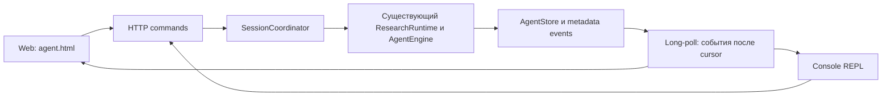

# Урок 5.9. Web и консольный REPL над одним агентским runtime

[Материалы урока](../README.md) · [Домашнее задание](../homework/README.md) · [Тесты примера](src/test/java/dev/myfrei/repopilot/ui/) · [Все уроки](../../../README.md#программа)

До этого мы управляли RepoPilot через отдельные HTTP-вызовы. Теперь добавим страницу `agent.html` и настоящий консольный REPL. Они будут отправлять одинаковые команды, читать одинаковое состояние и получать события одного выполнения.

Результат: задача запускается асинхронно, интерфейс остаётся доступен во время вызова модели. Можно увидеть план и tools, отключить обновления, подключиться снова и отдельно запросить отмену. Для patch и проверки пользователь просматривает точные параметры и принимает решение по сохранённому ID.

## 1. Старт и результат занятия

Начинаем с [урока 5.8](../../lesson-5.8/README.md). Все прежние RAG, MCP, Skills, research child, plan, compaction и Docker verification сохранены. Обычный чат остаётся на `/`, новая страница находится на `/agent.html`.

В этом уроке не создаётся второй agent loop. Консоль не выполняет сгенерированный Java-код или shell. REPL означает цикл чтения пользовательских команд и отправки HTTP-запросов.

После занятия пользователь сможет:

- отправить задачу и сразу получить ID сессии;
- видеть фактические переходы выполнения;
- посмотреть актуальный план и каталог Skills;
- переподключиться без повторного исполнения tools;
- запросить кооперативную отмену;
- просмотреть diff или точный verification request перед решением.

## 2. Поток событий и поток токенов — разные механизмы

Старый чат из 1.3 сохраняет SSE streaming текста модели. Новый AgentEngine выполняет блокирующий `ChatModel.call` и ручной tool loop. Мы не превращаем этот вызов в token streaming.

Здесь «живые обновления» — события состояния: QUEUED, MODEL_STARTED, TOOL_STARTED, TOOL_FINISHED, SESSION_FINISHED. Ответ модели отображается после завершения run. Это честная граница текущей реализации.

Выбираем JSON long-poll: клиент запрашивает события после определённого номера, сервер немного ждёт новые и возвращает страницу JSON. Для повторного подключения нужен cursor. Позже тот же журнал можно передавать через SSE или WebSocket без второго runtime.

## 3. Проверяем исходную точку

Используем Java25, Spring Boot4.1.2 и Spring AI2.0.2.

```bash
java -version
./mvnw -version
./mvnw test
npm ci
npm test
./mvnw -f workspace-fixture/pom.xml test
```

Полный профиль прежнего RAG:

```bash
./mvnw -Ppgvector-it verify
```

Docker verification остаётся отдельной опцией из 5.7. Для новой страницы и REPL сами по себе Docker-запуски не нужны; image ID требуется конфигурации verification service, а исполнение происходит только после ручного approval.

Ориентир занятия: 20 минут на контракт, 60 на coordinator и клиентов, 30 на проверки и 10 на ДЗ.

## 4. Команда запуска и наблюдение разделены



POST создаёт работу или выражает явное решение человека. GET показывает состояние. Подключение к событиям не должно создавать новую работу.

Закрытие вкладки и `AbortController.abort()` отменяют ожидание HTTP-ответа клиента. Они не являются командой отмены задачи. Для этого есть отдельный POST CANCEL. [Поведение AbortController](https://developer.mozilla.org/en-US/docs/Web/API/AbortController/abort).

## 5. Сессия интерфейса и agent run

У сессии есть собственный `id`, а `runId` появляется при фактическом начале AgentStore.run. Пока задача стоит в очереди, runId может быть null.

```java
package dev.myfrei.repopilot.ui;

import dev.myfrei.repopilot.plan.PlanSnapshot;
import dev.myfrei.repopilot.research.*;
import dev.myfrei.repopilot.verification.VerificationService;
import java.util.*;

public record SessionSnapshot(
    UUID id,
    UUID conversationId,
    UUID requestId,
    String status,
    UUID runId,
    String stopReason,
    long lastSequence,
    long firstAvailableSequence,
    ResearchRuntime.ResearchRunResult result,
    List<ApprovalRef> approvals,
    PlanSnapshot plan,
    ResearchSnapshot research,
    VerificationService.VerificationState verification) {
  public SessionSnapshot {
    approvals = List.copyOf(approvals);
  }
}

```

Состояния сессии: QUEUED, RUNNING, COMPLETED, STOPPED, FAILED. COMPLETED означает завершение исследовательского run с выполненными критериями его плана. Проверенный результат кода показывается отдельно в verification.

`result` — результат момента завершения runtime. Верхние `plan`, `research`, `verification` и `approvals` читаются заново при получении snapshot. Старый PASS внутри исторического result не выдаётся за актуальную версию после правки.

У coordinator максимум64сессии и два выполняющихся dispatch. На одну conversation одновременно допускается одна незавершённая сессия. Ограничения AgentStore из прошлых уроков также остаются действующими.

## 6. Идемпотентная отправка задачи

Если сервер принял POST, а ответ потерялся, клиент не знает, началась ли работа. Новый случайный запуск при автоматическом retry может повторить действия.

Поэтому caller создаёт `requestId` один раз. Сочетание conversationId, requestId и нормализованного тела задачи обозначает одну отправку. Повтор того же ID и тела возвращает прежнюю сессию; другое тело с тем же ID получает409.

```java
  public SessionSnapshot submit(UUID conversation, UUID requestId, ResearchRequest task) {
    store.conversation(conversation);
    Objects.requireNonNull(requestId);
    Objects.requireNonNull(task);
    String hash = Hashes.sha256(AgentJson.encode(task));
    Job job;
    synchronized (jobs) {
      var key = new Key(conversation, requestId);
      UUID existing = requests.get(key);
      if (existing != null) {
        job = jobs.get(existing);
        if (!job.hash.equals(hash)) throw new SessionProblem("SESSION_REQUEST_CONFLICT");
      } else {
        if (jobs.size() >= MAX_JOBS) throw new SessionProblem("SESSION_CAPACITY");
        if (active.containsKey(conversation)) throw new SessionProblem("SESSION_BUSY");
        job = new Job(conversation, requestId, hash, task);
        jobs.put(job.id, job);
        requests.put(key, job.id);
        active.put(conversation, job.id);
        Job submitted = job;
        Thread.startVirtualThread(() -> dispatch(submitted));
      }
    }
    return snapshot(job.id);
  }
```

Хеш считается после строгого разбора ResearchRequest, поэтому разный порядок JSON-полей не создаёт другую задачу. Запросы не сохраняются в неограниченном кеше: idempotency index ограничен теми же64сессиями.

Браузер при ручном повторе потерянной отправки сохраняет requestId. Автоматические retries разрешены только для чтения событий. Для решения по patch или verification автоматического повторения POST нет.

## 7. Асинхронный dispatch без второго loop

Worker — виртуальный поток, который ожидает ограниченный semaphore и вызывает существующий ResearchRuntime ровно один раз:

```java
while (!job.cancel.get()) {
    if (slots.tryAcquire(50, TimeUnit.MILLISECONDS)) {
        admitted = true;
        break;
    }
}
if (!admitted || job.cancel.get()) {
    finish(job, "STOPPED", "CANCELLED_BEFORE_START", null);
    return;
}
var result = dispatcher.run(
        job.conversation, job.task, job.cancel::get);
```

Виртуальный поток позволяет не занимать отдельный platform thread на ожидании. Он не ускоряет inference модели. Два worker slots ограничивают одновременно принятые runtime, включая их синхронные research children.

Перед публикацией terminal status coordinator освобождает conversation reservation. Затем status, result и SESSION_FINISHED публикуются атомарно под одним monitor:

```java
  private void finish(
      Job job, String status, String reason, ResearchRuntime.ResearchRunResult result) {
    synchronized (jobs) {
      active.remove(job.conversation, job.id);
    }
    synchronized (job) {
      job.status = status;
      job.reason = reason;
      job.result = result;
      job.append("SESSION_FINISHED", Map.of("status", status, "reason", reason));
    }
  }
```

Так клиент не увидит `terminal=true` без последнего события и не получит ложный SESSION_BUSY сразу после завершения.

## 8. Привязываемся к своему run, а не к чужому activeRunId

Polling conversation.activeRunId выглядит простым, но опасен гонкой: старый direct endpoint мог начать другой run раньше worker. Сессия не должна присвоить его ID и затем отменить чужое выполнение.

Добавляем маленький thread-local observer в конкретный AgentStore:

```java
try (var observation = store.observeRun(
        id -> bindThisJobToRun(id),
        event -> appendJobEvent(event))) {
    return existingRuntime.run(conversationId, task, cancelled);
}
```

В рабочем coordinator callback только записывает metadata. Никаких вызовов stores, model или approvals из callback нет. Исследовательский child использует отдельный AgentStore и не наследует observer родителя.

Observer exceptions перехватываются внутри AgentStore: ошибка доставки UI не должна оставить activeRun занятым после begin. Subscription удаляется в try-with-resources.

Если direct legacy run выиграл гонку, новый worker получает AGENT_BUSY и сессия заканчивается FAILED без чужого runId. Это проверяется тестом.

## 9. Порядок блокировок

AgentStore вызывает observer внутри своего synchronized-метода. Observer берёт monitor job. Значит обратный путь job → AgentStore нельзя держать одновременно.

В `snapshot` coordinator сначала копирует поля job под коротким monitor, отпускает его и только затем читает plan, research и approval services. В command тоже сначала определяется exact job/ID, затем вызывается domain service вне job monitor.

Event ring может выбрасывать старые строки, но не бросает исключение в AgentStore. Это ограниченная доставка состояния, а не условие разрешения действия.

## 10. Event cursor, replay и предел хранения

В каждой сессии события имеют последовательный номер. Хранятся последние128строк. Один ответ содержит только события с sequence больше cursor клиента.

```java
  public EventPage events(UUID id, long after, int waitMs) {
    if (after < 0 || waitMs < 0 || waitMs > 10000)
      throw new IllegalArgumentException("Event cursor/wait bounds");
    var job = required(id);
    synchronized (job) {
      if (job.waiters >= 8) throw new SessionProblem("SESSION_READER_CAPACITY");
      job.waiters++;
      try {
        long until = System.nanoTime() + waitMs * 1_000_000L;
        while (after == job.sequence && !job.terminal()) {
          long left = until - System.nanoTime();
          if (left <= 0) break;
          TimeUnit.NANOSECONDS.timedWait(job, left);
        }
        long first = job.events.getFirst().sequence();
        if (after < first - 1) throw new SessionProblem("SESSION_EVENTS_EXPIRED");
        if (after > job.sequence) throw new IllegalArgumentException("Future cursor");
        var rows = job.events.stream().filter(e -> e.sequence() > after).toList();
        long next = rows.isEmpty() ? after : rows.getLast().sequence();
        return new EventPage(job.id, rows, next, first, job.sequence, job.terminal());
      } catch (InterruptedException interrupted) {
        Thread.currentThread().interrupt();
        throw new SessionProblem("SESSION_READER_INTERRUPTED");
      } finally {
        job.waiters--;
      }
    }
  }
```

`waitMs` ограничен10000, одновременно допускается максимум8ожидающих readers на одну сессию. Пустая страница не означает успех задачи: проверяйте terminal и snapshot.status.

Если нужные события уже выпали из ring, сервер возвращает SESSION_EVENTS_EXPIRED. Клиент делает GET snapshot, показывает актуальное состояние и продолжает с lastSequence. Повторный POST задачи для восстановления ленты запрещён логикой клиента.

Это in-memory replay. Перезапуск приложения теряет сессии, журнал и idempotency index. Это не долговечная очередь и не exactly-once гарантия между перезапусками.

## 11. Отмена очереди и выполняющегося run

Команда CANCEL устанавливает AtomicBoolean сессии. Этот флаг передаётся через BooleanSupplier в тот же ResearchBudget, который уже контролирует parent и child.

```java
public boolean cancelled() {
    return cancelled.get() || externalCancelled.getAsBoolean();
}
```

Старый ResearchRuntime.run продолжает работать с default false. Новый overload используется coordinator. Это закрывает промежуток между получением worker slot и регистрацией ResearchScope: даже в этом промежутке existing Engine check увидит отмену до первого model call.

До допуска задача получает CANCELLED_BEFORE_START без model calls. После начала отмена остаётся кооперативной: уже выполняющийся HTTP-запрос к модели принудительно не прерывается. После его завершения control проверяется раньше исполнения возвращённых tools.

CANCEL агента не является отменой отдельной Docker-проверки, которую человек уже запустил manual approval. У runner есть собственные resource limits, timeout и cleanup из 5.7.

## 12. HTTP-контракт

| Операция | Endpoint |
| --- | --- |
| Запустить | POST `/api/sessions/conversations/{id}/jobs` |
| Список сессий | GET `/api/sessions/conversations/{id}/jobs` |
| Состояние | GET `/api/sessions/jobs/{id}` |
| События | GET `/api/sessions/jobs/{id}/events?after=0&waitMs=10000` |
| Явная команда | POST `/api/sessions/jobs/{id}/commands` |
| Просмотр точного действия | GET `/api/sessions/jobs/{id}/approvals/{kind}/{approvalId}` |
| Каталог Skills | GET `/api/sessions/skills` |

Тело запуска:

```json
{
  "requestId": "реальный-UUID-отправки",
  "task": {
    "question": "Прочитай StockLedger и выполни шаг code. Не утверждай, что тесты запускались.",
    "mode": "ASK",
    "maxInputTokens": 16000,
    "steps": [{
      "id": "code",
      "title": "Исследовать код",
      "criterion": "READ_CODE",
      "path": "src/main/java/dev/myfrei/fixture/StockLedger.java",
      "startLine": 17,
      "endLine": 22,
      "dependsOn": [],
      "required": true
    }]
  }
}
```

UUID в примере заменяется настоящим UUID. Тело task повторяет проверенный ResearchRequest, включая возможность явного researchBudget и Skills. Client не передаёт status, result или разрешение на исполнение.

## 13. Manual approvals в общем command API

Типы команд: CANCEL, REQUEST_VERIFICATION, APPROVE_PATCH, REJECT_PATCH, APPROVE_VERIFICATION, REJECT_VERIFICATION.

```json
{"type":"CANCEL"}
```

```json
{"type":"APPROVE_PATCH","approvalId":"реальный-UUID-показанного-предложения"}
```

Coordinator проверяет ownership: patch должен принадлежать run этой сессии, verification request — её conversation. Затем управление передаётся прежним ControlledService или VerificationService, где повторно проверяются hash, TTL, mode и одноразовость решения.

ApprovalRef содержит только kind, ID, status и короткое summary. Для решения Web и REPL отдельно загружают detail: точный diff/baseHash/resultHash либо command/inputRevision/imageId/expiresAt.

PREVIEW показывается для чтения, но кнопки решения отключены. PENDING patch не применяется до завершения активного run — это ограничение сохранено из 5.3. Просмотр detail не запускает никаких действий.

## 14. Web-страница

Новая страница использует прежнюю визуальную основу, отдельные `agent-ui.js`, `session-api.js` и CSS. Старый chat UI сохранён, в header добавлена ссылка «Агент».

Достаточно одного выбранного диапазона кода: форма собирает минимальный plan. Для более сложного ResearchRequest используйте HTTP или `/ask FILE` в REPL. Наличие интерфейса не меняет лимиты runtime.

Результаты модели, titles, descriptions Skills и diff выводятся через textContent:

```javascript
answer.textContent = snapshot.result?.run?.answer || '';
review.textContent = proposal.diff;
```

Не вставляйте их через innerHTML. [Свойство textContent](https://developer.mozilla.org/en-US/docs/Web/API/Node/textContent).

## 15. Переподключение Web без повторного запуска

Основной цикл клиента:

```javascript
const page = await api.events(sessionId, cursor, 10000, signal);
if (generation !== currentGeneration) return;
for (const event of page.events) {
  if (event.sequence <= cursor) continue;
  appendEventAsText(event);
  cursor = event.sequence;
}
const snapshot = await api.snapshot(sessionId, signal);
if (generation !== currentGeneration) return;
render(snapshot);
```

Generation проверяется после каждого ожидания. Поздний ответ старой сессии не должен заменить новый выбранный sessionId или cursor. То же правило используется при attach.

Кнопка «Отключить обновления» вызывает abort только клиентского запроса. «Подключиться» продолжает чтение. Кнопка «Отменить задачу» отправляет явный command. После трёх неудачных попыток GET клиент предлагает переподключиться вручную; POST mutations автоматически не повторяются.

Адрес `/agent.html?sessionId=<UUID>` загружает существующий snapshot и events только через GET. Его можно открыть в другой вкладке или восстановить после перезагрузки страницы.

## 16. Реальный консольный REPL

`SessionRepl` — отдельный mainClass. Он использует Java HttpClient и не создаёт Spring context, model, AgentEngine или tools.

```java
var request = HttpRequest.newBuilder(base.resolve(path))
        .timeout(Duration.ofSeconds(45))
        .header("Content-Type", "application/json")
        .POST(HttpRequest.BodyPublishers.ofString(AgentJson.encode(command)))
        .build();
var response = client.send(request, HttpResponse.BodyHandlers.ofString());
```

HttpClient переиспользуется и закрывается при выходе. Поведение синхронного send и жизненный цикл описаны в [Java25 HttpClient](https://docs.oracle.com/en/java/javase/25/docs/api/java.net.http/java/net/http/HttpClient.html).

Команды:

| Команда | Назначение |
| --- | --- |
| Обычная строка | Отправить задачу с минимальным plan StockLedger |
| `/ask FILE` | Прочитать ResearchRequest JSON до8KiB и отправить |
| `/status` | Прочитать snapshot |
| `/plan` | Показать актуальный plan |
| `/skills` | Показать каталог |
| `/events` | Получить следующую страницу событий |
| `/watch` | Читать long-poll в отдельном клиентском потоке |
| `/disconnect` | Отключить client watch, не отменяя задачу |
| `/attach UUID` | Подключиться к существующей сессии |
| `/conversation UUID` | Выбрать известную conversation |
| `/cancel` | Явно запросить отмену |
| `/show PATCH UUID` | Просмотреть exact patch |
| `/approve-patch UUID` | Явное решение по показанному patch |
| `/verify` | Создать pending verification request |
| `/show VERIFICATION UUID` | Просмотреть параметры проверки |
| `/approve-check UUID` | Запустить одобренную fixed-проверку |
| `/quit` | Закрыть CLI, не отменяя server task |

Для отказа есть `/reject-patch` и `/reject-check`. Все эти действия используют тот же command API, что Web.

## 17. Защита REPL от позднего ответа

Watcher захватывает target session, generation и cursor под коротким monitor. HTTP выполняется вне monitor. После ответа данные применяются только если target и generation всё ещё актуальны.

`/attach` и `/conversation` отключают старый watcher. Иначе его поздняя страница могла бы переписать cursor уже другой сессии.

При SESSION_EVENTS_EXPIRED REPL делает GET snapshot, явно сообщает об утрате старой ленты и продолжает с lastSequence. Новая задача при этом не отправляется. `/ask FILE` ограничивает объём чтения до разбора JSON; это не механизм исполнения файла.

## 18. Запуск Web и REPL

Сначала соберите или используйте неизменяемый verification image из 5.7 и сохраните его реальный ID:

```bash
export REPOPILOT_VERIFIER_IMAGE_ID='sha256:вставьте-64-hex-символа-фактического-image-id'
export OLLAMA_CHAT_MODEL=qwen2.5:3b
export LLM_CONTEXT_WINDOW=24000
./mvnw spring-boot:run -Dspring-boot.run.arguments="--repopilot.rag.enabled=false --repopilot.evaluation.enabled=false --repopilot.diagnostics.enabled=false --repopilot.query.enabled=false --repopilot.rerank.enabled=false --repopilot.tools.enabled=false --repopilot.agent.enabled=true --repopilot.workspace.enabled=true --repopilot.controlled.enabled=true --repopilot.skills.enabled=true --repopilot.plans.enabled=true --repopilot.compaction.enabled=true --repopilot.verification.enabled=true --repopilot.research.enabled=true --repopilot.sessions.enabled=true --repopilot.verification.image-id=$REPOPILOT_VERIFIER_IMAGE_ID"
```

Пример значения image ID — placeholder, его нужно заменить фактическим ID. Никаких mutable tags в execution path. Для этого демо прежние DB-зависимые функции отключены флагами, PostgreSQL не нужен.

Откройте `http://127.0.0.1:8080/agent.html`. Из другого терминала в той же папке:

```bash
./mvnw -q exec:java   -Dexec.mainClass=dev.myfrei.repopilot.ui.SessionRepl   -Dexec.args=http://127.0.0.1:8080
```

Exec Maven Plugin закреплён в pom; его задача — запустить наш CLI с classpath проекта. Он не запускает исследуемый POM. [Документация exec:java](https://www.mojohaus.org/exec-maven-plugin/java-mojo.html).

Отправьте задачу в Web, скопируйте session ID и выполните в консоли:

```text
/attach <реальный-session-id>
/status
/plan
/skills
/watch
/disconnect
/status
```

Проверьте, что task продолжилась после disconnect. Затем отдельно попробуйте `/cancel` на ещё выполняющейся задаче. Не считайте закрытие клиента подтверждением отмены.

## 19. Проверяем общий источник решений

Для изменения выберите в Web режим «Предложить правку». После завершения run просмотрите proposal, сравните exact diff и version hashes. Можно открыть ту же сессию в REPL и выполнить `/show PATCH <id>`.

Выберите только один интерфейс для решения. Второе решение того же ID должно получить отказ. Аналогично работает REQUEST_VERIFICATION → просмотр command/image/revision → отдельное APPROVE_VERIFICATION.

Typed verification state показывается отдельно от текста ответа. Сохранённый PASS после внешнего edit не становится текущим PASS: live snapshot показывает STALE.

Заполните [бланк эксперимента](evaluation/Interfaces-Experiment.md): два клиента, один session ID, восстановление cursor, подтверждённые действия и ограничения модели.

## 20. Что доказывают проверки

```bash
./mvnw -Dtest=SessionCoordinatorTest,SessionHttpIntegrationTest,SessionReplTest test
npm test
./mvnw -Ppgvector-it verify
```

Coordinator-тесты проверяют idempotency, terminal event, bounded ring и expired cursor, queued cancel без dispatch, гонку со старым direct run и отсутствие утечки AgentStore observer.

HTTP-тесты поднимают настоящий Boot и Ollama HTTP-фикстуру. POST возвращается, пока model call заблокирован; client disconnect не отменяет задачу; явный CANCEL отбрасывает поздние tools; replay не вызывает модель; patch и verification требуют отдельных exact-ID решений.

REPL-тест использует реальный HttpClient и console Reader и проверяет `/status`, `/plan`, `/skills`, `/cancel`, восстановление gap и поздний ответ старой сессии. JS-тесты охватывают XSS, POST retry ID, preview-only решения и восстановление состояния без resubmit. Выполните оба набора при проверке общего координатора и клиентов.

Тесты с фикстурой подтверждают механизм приложения, а не качество реального ответа локальной модели. Проверку с моделью и реальным браузером фиксируйте отдельно.

## 21. Домашнее задание: очередь внимания

В [homework](../homework/README.md) оба клиента, coordinator, события и approvals уже готовы. Новая AttentionQueuePolicy строит очередь того, что требует внимания человека.

Соберите pending approvals и terminal failures/stops из server-owned snapshots, правильно примените acknowledgement через per-session high-watermark, приоритеты, дедупликацию и лимит. Pending approval нельзя спрятать простым ack: acknowledgement не является разрешением и не завершает действие.

Используйте готовые endpoint `/api/sessions/conversations/{id}/attention/check` и страницу homework. Реализуйте policy очереди и проверьте её приёмочными тестами: приоритеты, устранение повторов и подтверждение просмотра должны работать поверх общего координатора и клиентов.

## 22. Дальнейшее чтение

- [Java25 HttpClient](https://docs.oracle.com/en/java/javase/25/docs/api/java.net.http/java/net/http/HttpClient.html).
- [MDN AbortController.abort](https://developer.mozilla.org/en-US/docs/Web/API/AbortController/abort).
- [MDN textContent](https://developer.mozilla.org/en-US/docs/Web/API/Node/textContent).
- [Exec Maven Plugin](https://www.mojohaus.org/exec-maven-plugin/java-mojo.html).
- [Следующий урок: итоговая задача и проверенный diff](../../lesson-5.10/README.md).

Следующий урок объединит эти интерфейсы с реальной учебной задачей: импорт, исходный FAIL, исследование, одобренная правка, свежий PASS и итоговый проверяемый отчёт.
